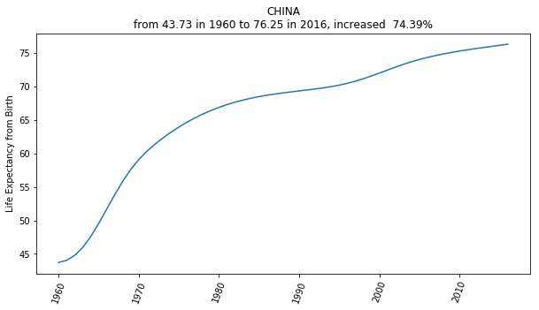
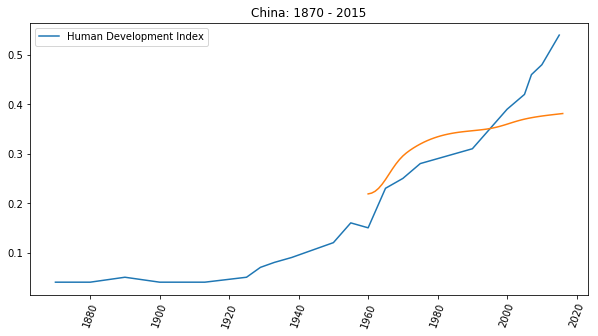
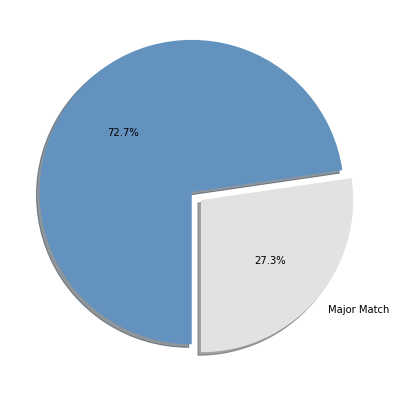

<!-- reading-navigation:start -->

<div dir="rtl" lang="fa">

[بخش قبلی: چطور ثابت کنید که واقعاً این کتاب را خوانده‌اید؟](02.proof-of-work.md) · [فهرست مطالب](TOC.md) · [بخش بعدی: چرا برنامه‌نویسی را نقطهٔ ورود به خودآموزی قرار می‌دهیم؟](Part.1.B.why.start.from.learning.coding.md)

</div>

<!-- reading-navigation:end -->

<a id="为什么一定要掌握自学能力"></a>
# چرا حتماً باید توانایی خودآموزی داشته باشیم؟

پاسخ را می‌توان در یک جمله روشن کرد:

> کسی که توانایی خودآموزی ندارد، **آینده‌ای** ندارد.

دو عامل را باید با دقت بیشتری در نظر بگیریم:

> * هنوز سال‌های زیادی از زندگی پیش روی ماست.
> * این جهان با سرعتی بسیار زیاد پیشرفت می‌کند.

چیزی که متوجه شده‌ام این است:

> بسیاری از آدم‌ها ناخودآگاه جدول زمانی زندگی پدر و مادرشان را تکرار می‌کنند.

مثلاً شاید شما هم دیده باشید که فرزندان کسانی که دیر ازدواج کرده‌اند، بیشتر احتمال دارد خودشان هم دیر ازدواج کنند؛ فرزندان کسانی که دیر بچه‌دار شده‌اند نیز بیشتر احتمال دارد دیر بچه‌دار شوند…

مثال دیگر: بیشتر آدم‌ها در عمق ذهنشان، بی‌آنکه متوجه باشند، چون پدر و مادرشان در پنجاه‌وپنج‌سالگی بازنشسته شده‌اند، فرض می‌کنند خودشان هم حدود همان سن بازنشسته خواهند شد… در نتیجه، از حدود چهل‌سالگی جدی به بازنشستگی فکر می‌کنند، نادانسته انگیزهٔ تلاش را به‌کلی از دست می‌دهند و خیلی زود طوری زندگی می‌کنند که انگار سال‌ها پیرتر شده‌اند.

اما این خطرناک است؛ چون بسیاری اصلاً متوجه نیستند زندگی پیش رویشان ممکن است با زندگی پدر و مادرشان کاملاً متفاوت باشد؛ آن هم از همه نظر. فقط یک جنبه را مثال بزنیم؛ جنبه‌ای که به‌راحتی می‌تواند شگفت‌زده‌مان کند:

> در سراسر جهان، امید به زندگی انسان‌ها طی پنجاه سال گذشته به‌شکلی شگفت‌انگیز افزایش یافته است…

چین را در نظر بگیرید. طبق آمار بانک جهانی، امید به زندگی در بدو تولد در چین، از _۴۳٫۷۳_ سال در ۱۹۶۰ به _۷۶٫۲۵_ سال در ۲۰۱۶ رسیده است؛ یعنی در ۵۶ سال، افزایشی معادل **۷۴٫۳۹٪**!

```python
import matplotlib.pyplot as plt
import numpy as np

data = np.genfromtxt('life-expectancy-china-1960-2016.txt',
                     delimiter=',',
                     names=['x', 'y'])
da1960  = data[0][1]
da2016  = data[-1][1]
increase = (da2016 - da1960) / da1960
note = 'from {:.2f} in 1960 to {:.2f} in 2016, increased  {:.2%}'\
    .format(da1960, da2016, increase)

plt.figure(figsize=(10, 5))
plt.plot(data['x'], data['y'])
plt.ylabel('Life Expectancy from Birth')
plt.tick_params(axis='x', rotation=70)
plt.title('CHINA\n' + note)

# plt.savefig('life-expectancy-china-1960-2016.png', transparent=True)
plt.show()

# data from:
# https://databank.worldbank.org/data/reports.aspx?source=2&series=SP.DYN.LE00.IN
```



اگر این روند ادامه یابد، هرچند بعید است انسان‌ها نامیرا شوند، ادامهٔ افزایش میانگین طول عمر واقعیتی انکارناپذیر است. برخلاف نسل پیشین، نسل هزارهٔ امروز باید خود را برای زندگی صدساله آماده کند؛ بی‌هیچ تردیدی، بدون جای چون‌وچرا.

> **یادداشت مترجم — توضیح تکمیلی:** تأکید بر «زندگی صدساله» پیش‌بینی نویسنده در زمان نگارش است، نه تضمینی دربارهٔ طول عمر هر فرد. داده‌های این بخش به سال‌های ذکرشده مربوط‌اند و آمار روز نیستند.

زندگی‌ای چنین طولانی، که شاید نزدیک به دو برابر تصور پیش‌فرض ما ادامه داشته باشد، اگر با عامل دوم ترکیب شود ــ جهانی که هر روز سریع‌تر تغییر می‌کند ــ چه شکلی خواهد داشت؟

من متولد ۱۹۷۲ هستم. از نظر رفت‌وآمد، روزگاری را دیده‌ام که برای بیرون رفتن فقط می‌شد پیاده رفت؛ خیابان‌ها پر از گاری‌های گاو و اسب بود و تنها وسیلهٔ موتوری که می‌دیدیم، نهایتاً تراکتور بود. بعد دوچرخه آمد، بعد موتورسیکلت دیدم، بعد سوار خودرو شدم، بعد خودم رانندگی کردم و سرانجام به رانندگی با خودروی برقی مجهز به قابلیت کمک‌رانندگی خودکار رسیدم… از نظر مطالعه، زمانی فقط کتاب‌فروشی شین‌هوا (Xinhua) بود؛ بعد نوشته‌های اینترنتی آمد، بعد توانستم از دانگ‌دانگ (Dangdang) کتاب کاغذی سفارش بدهم. با گرفتن کارت اعتباری بین‌المللی، توانستم نسخهٔ الکترونیکی تازه‌ترین کتاب‌ها را بلافاصله در Amazon بخوانم و نسخهٔ صوتی‌شان را گوش کنم. امروز هم به‌راحتی به شکل‌های تعاملیِ تازه‌ترین دانش دسترسی دارم و می‌توانم مستقیم در بحث‌ها شرکت کنم… از نظر مهارت هم دورانی را دیده‌ام که بی‌سواد کسی بود که خواندن و نوشتن نمی‌دانست؛ بعد کسی که انگلیسی نمی‌دانست؛ بعد کسی که کار با کامپیوتر بلد نبود؛ و حالا کسی که تحلیل داده نمی‌داند، عملاً تفاوت چندانی با بی‌سواد ندارد…

همچنین مهارت‌های بسیاری را دیده‌ام که زمانی بسیار کاربردی، پول‌ساز و رشک‌برانگیز بودند و «ناگهان» تقریباً بی‌ارزش شدند. روشن‌ترین مثال، رانندگی است. همین بیست‌وچند سال پیش، رانندهٔ تاکسی بودن شغلی بود که خیلی‌ها به آن غبطه می‌خوردند! من در دورهٔ کارشناسی حسابداری خواندم؛ آن زمان حتی تمرین ویژهٔ کار با چرتکه داشتیم! حالا، سی سال بعد، اگر کسی با هر سرعتی هم چرتکه بیندازد، دقیقاً چه استفاده‌ای دارد؟ وقتی دبیرستان می‌رفتم، کسی با انتشار سرمشق خوش‌نویسی پول زیادی درآورد؛ آن روزها می‌گفتند کافی است خط خوشی داشته باشید تا شغل خوبی پیدا کنید. اما امروز، آیا هنوز خوش‌خط بودن عامل تعیین‌کنندهٔ کیفیت شغل است؟ چاپگر که ارزان است!

وقتی این دو عامل کنار هم قرار می‌گیرند، نتیجه این است که جهان برای بسیاری از آدم‌ها در واقع هر روز بی‌رحم‌تر می‌شود.

هم‌سن‌وسال‌های زیادی دیده‌ام که خیلی زود از پیشرفت دست کشیدند، خیلی زود از زمانه عقب ماندند و خیلی زود به همین دلیل سردرگم و درمانده شدند. دیر یا زود، شما هم با شمار بیشتری از این آدم‌ها روبه‌رو خواهید شد. همهٔ آن‌ها فقط در یک ویژگی مشترک‌اند:

> توانایی خودآموزی ندارند.

یک شاخص آماری به نام شاخص توسعهٔ انسانی (Human Development Index) وجود دارد. وقتی نمودارش را رسم می‌کنیم، از هر طرف که نگاه کنیم، به نظر می‌رسد در آستانهٔ رشد نمایی است.

```python
import matplotlib.pyplot as plt
import numpy as np
plt.figure(figsize=(10, 5))

lebdata = np.genfromtxt('life-expectancy-china-1960-2016.txt',
                        delimiter=',',
                        names=['x', 'y'])

hdidata = np.genfromtxt('hdi-china-1870-2015.txt',
                        delimiter=',',
                        names=['x', 'y'])

plt.plot(hdidata['x'], hdidata['y'], label='Human Development Index')
plt.tick_params(axis='x', rotation=70)
plt.title('China: 1870 - 2015')

plt.plot(lebdata['x'], lebdata['y'] * 0.005, label='Life Expectancy from Birth')
plt.plot(secondary_y=True)

plt.legend()

# plt.savefig('human-development-index-china-1870-2015.png', transparent=True)
plt.show()

# link:
# https://ourworldindata.org/human-development-index

# data from:
# blob:https://ourworldindata.org/44b6da71-f79e-42ab-ab37-871e4bd256e9
```



> **یادداشت مترجم — توضیح تکمیلی:** در این تصویر، منحنی امید به زندگی برای مقایسهٔ بصری در ۰٫۰۰۵ ضرب شده است؛ مقدار آن را نباید مستقیم به‌عنوان تعداد سال خواند. توصیف «رشد نمایی» نیز برداشت نویسنده از نمودار است، نه نتیجهٔ یک آزمون آماری در این مثال.

جامعه هر روز سریع‌تر پیش می‌رود و زندگی‌ای که پیش روی شماست هر روز طولانی‌تر می‌شود. در این مسیر طولانی، که با حدس شهودی‌تان هم یکسان نیست، اگر توانایی خودآموزی را پرورش نداده باشید، فقط می‌توانید درمانده تماشا کنید که چطور عقب می‌مانید. آیا قرار است تمام آن سال‌های طولانیِ بعد را صرف «دل‌خوش کردن در میان رنج» کنید؟

روزهایی را که آینده‌ای ندارند، چطور می‌شود گذراند؟

من کارشناسی حسابداری خواندم؛ برای تحصیلات تکمیلی به خارج رفتم تا اقتصاد کلان بخوانم، اما تمامش نکردم. به چین برگشتم و وارد عمده‌فروشی سخت‌افزار کامپیوتر شدم. بعدتر برای تدریس TOEFL به نیو اورینتال (New Oriental) درخواست کار دادم. پس از ترک آنجا کسب‌وکار خودم را راه انداختم، بعد وارد سرمایه‌گذاری شدم و در تمام این مدت هم پیوسته کتاب نوشتم… اما واقعیت این است که در این روزگار، چنین مسیری اصلاً عجیب نیست. چند نفر در ادامهٔ مسیر شغلی‌شان کاری انجام می‌دهند که با رشتهٔ دانشگاهی‌شان همخوان باشد؟

بانک فدرال رزرو نیویورک (Federal Reserve Bank of New York) در سال ۲۰۱۲ بررسی‌ای انجام داد و دریافت حتی _۳۰٪_ افراد هم در شغلی متناسب با رشتهٔ دانشگاهی خود کار نمی‌کنند. حدس من این است که این نسبت باز هم کاهش خواهد یافت؛ چون جهان سریع تغییر می‌کند و فاصلهٔ بیشتر نهادهای آموزشی با تحولات جهان فقط بیشتر می‌شود…

```python
import matplotlib.pyplot as plt

labels = ['Major Match', '']
sizes = [273, 727]
colors = ['#E2E2E2', '#6392BF']
explode = (0, 0.08)
plt.figure(figsize=(7, 7))
plt.pie(sizes,
        labels=labels,
        explode=explode,
        autopct='%1.1f%%',
        colors=colors,
        startangle=270,
        shadow=True)
# plt.savefig('major-match-job.png', transparent=True)
plt.show()

# data from:
# https://libertystreeteconomics.newyorkfed.org/2013/05/do-big-cities-help-college-graduates-find-better-jobs.html
```



> **یادداشت مترجم — نیازمند بررسی:** نویسنده سال بررسی را ۲۰۱۲ ذکر می‌کند، اما نشانی منبع در کد به مطلبی منتشرشده در مهٔ ۲۰۱۳ می‌رسد. سال داده‌ها، دامنهٔ جمعیت بررسی‌شده و تعمیم این نسبت به «افراد» باید با منبع تطبیق داده شود؛ عبارت متن اصلی در ترجمه حفظ شده است.

بیشتر آدم‌ها تمام عمر زیر بار **توهم زمان** رنج می‌کشند.

در کودکی احساس می‌کنیم زمان خیلی طولانی است؛ این توهم است. وقتی بزرگ می‌شویم احساس می‌کنیم زمان هر روز سریع‌تر می‌گذرد؛ این هم توهم است. زمان همیشه با سرعتی یکنواخت می‌گذرد. بزرگ‌ترین توهم آن است که مدام فکر کنیم «دیگر وقت کافی نداریم»؛ این یکی بیش از همه به ما آسیب می‌زند. سال‌ها پیش، یک بار داشتم همسرم را دلداری می‌دادم. گفت: «چی؟ باید پنج سال یاد بگیرم تا بشود؟! خیلی طولانی است!» گفتم:

> «برگردید و نگاه کنید؛ فکر کنید پنج سال پیش چه می‌کردید؟ وقتی به عقب نگاه می‌کنید، مگر پنج سال پیش مثل دیروز نیست؟ همین منطق اینجا هم برقرار است. پنج سال دیگر هم یک روز به امروز فکر می‌کنید و می‌گویید: پنج سال در یک چشم‌به‌هم‌زدن گذشت… فقط امروز حس می‌کنید زمان زیادی لازم دارد و به همین دلیل حاضر نیستید یاد بگیرید. اما چه یاد بگیرید و چه نگیرید، آن پنج سال در یک چشم‌به‌هم‌زدن می‌گذرد… آن وقت که برگردید و این ماجرا یادتان بیاید، اگر یاد نگرفته باشید، حتماً پشیمان می‌شوید. راستش، مگر همین حالا هم بارها حسرت نخورده‌اید که کاش قبلاً یاد گرفته بودم؟»

حالا که به عقب نگاه می‌کنم، آن گفت‌وگو خیلی موفق بود. امروز، بیش از ده سال بعد، واقعاً می‌توان او را «متخصص خودآموزی» نامید؛ هیچ ورزشی برایش مسئلهٔ حل‌نشدنی نیست. در تناسب اندام، نایب‌قهرمان پکن شد و تصویرش روی جلد مجلهٔ جیان یو می (Jian yu Mei؛ «سلامت و زیبایی») رفت؛ در بدمینتون، می‌تواند در مسابقات حرفه‌ای شرکت کند؛ در غواصی، همهٔ مقصدهای مشهور دنیا را گشته و در پایان، تعداد و سطح گواهی‌های مربیگری‌اش از مربیانی که در جاهای مختلف دیده بیشتر و بالاتر شده است؛ در قایق‌رانی بادبانی، می‌تواند با یک گروه از اقیانوس اطلس عبور کند؛ در کوهنوردی، به هیمالیا صعود کرده است…

همه می‌گویند آدم باید در یک مهارت سرآمد باشد. اما آن مهارت دقیقاً باید چه باشد؟

> توانایی خودآموزی تنها مهارتی است که ارزش دارد پیوسته آن را پرورش دهید.

فایدهٔ پرورش این توانایی آن است که هر وقت جهان یاد گرفتن چیزی را از ما بخواهد، می‌توانیم خودمان دست‌به‌کار شویم؛ آن هم بلافاصله، بدون اینکه منتظر بمانیم کسی به ما درس بدهد یا راهنمایی‌مان کند.

البته توانایی بالای خودآموزی به این معنا نیست که هر چیزی را فوراً یاد می‌گیرید، در هر کاری سریع ماهر می‌شوید و سرانجام در همه‌چیز استاد خواهید شد… مسئلهٔ زمان در میان است. یاد گرفتن هر چیزی زمان و انرژی می‌خواهد؛ از آن دشوارتر، باید مدام ذخیرهٔ صبرتان را تازه کنید تا زود تمام نشود. در بعضی وضعیت‌های خاص، استعداد هم تا حدی نقش دارد: مثلاً قد ممکن است بر عملکرد در بسکتبال اثر بگذارد؛ ظاهر ممکن است بر نتیجهٔ بازیگری اثر بگذارد؛ ظاهراً اصلاح خارج خواندن در آواز کار دشواری است؛ و بی‌دقتی بعضی آدم‌ها در واقع ریشهٔ ژنتیکی دارد، و مانند این‌ها. بااین‌حال، طبق مشاهدات من، موضوع هرچه باشد، حتی کمی بلد بودن از اصلاً بلد نبودن بهتر است. حتی سطحی متوسط هم برای پاسخ دادن به نیازهای زندگی، کار و تأمین معاش خانواده کافی است.

> **یادداشت مترجم — توضیح تکمیلی:** مثال‌های مربوط به استعداد، ژنتیک و آواز، دیدگاه نویسنده‌اند. در این بخش شواهد علمی‌ای برای آن‌ها ارائه نشده است؛ آن‌ها را نباید حکمی قطعی دربارهٔ توانایی یا امکان پیشرفت افراد دانست.

در دانشگاه حسابداری خواندم، اما بعد از فارغ‌التحصیلی کار مرتبط پیدا نکردم و ناچار وارد فروش شدم. کسی هم نبود یادم بدهد! چه می‌کردم؟ خودآموزی. البته همیشه هم خوب از پسش برنیامدم؛ مثلاً همان دورهٔ تحصیلات تکمیلی را نتوانستم تمام کنم. بعد خواستم در New Oriental درس بدهم، چون شنیده بودم درآمدش خوب است؛ اما انگلیسی‌ام چندان خوب نبود! چه می‌کردم؟ خودآموزی. آنجا را ترک کردم تا کسب‌وکار خودم را راه بیندازم، ولی زمانه مدت‌ها بود تغییر کرده بود. چه می‌کردم؟ خودآموزی. اگر خوب یاد نمی‌گرفتم، چه؟ دوام می‌آوردم. گرچه آن کسب‌وکار در نهایت موفقیت بزرگی نشد، عجیب آنکه نتیجه‌اش در سرمایه‌گذاری به بار نشست. اما آیا پول درآوردن یعنی از آن به بعد همه‌چیز امن و روبه‌راه است؟ نه؛ باید با خطرها و گرفتاری‌هایی روبه‌رو می‌شدم که پیش‌تر حتی امکان برخورد با آن‌ها را نداشتم. چه می‌کردم؟ خودآموزی. جدا از این گرفتاری‌ها، کشف دردناک‌تر این بود که هیچ آموزش واقعاً به‌دردبخوری برای سرمایه‌گذاری ندیده‌ام. چه می‌کردم؟ خودآموزی. فکر می‌کردم دیگر تقریباً فهمیده‌ام، اما دست به کار که می‌شدم شکست می‌خوردم. چه می‌کردم؟ باز هم یاد می‌گرفتم.

خانوادهٔ معمولی‌ای داشتم؛ پدر و مادرم معلمانی کم‌درآمد بودند. در شهرکی مرزی به دنیا آمدم، آموزش دوران کودکی‌ام هم معمولی بود و خودم هم بیش از حد شیطنت می‌کردم؛ بعدتر هم دانشگاه خیلی خوبی قبول نشدم. راستش، استعداد خودم را هم معمولی می‌دانم؛ از همان آدم‌هایی هستم که به‌گمانم ژن‌هایشان آن‌ها را مستعد حواس‌پرتی و بی‌دقتی کرده است. با اینکه این‌همه از سنم گذشته، هوش هیجانی‌ام هنوز هم به‌طرز غیرعادی پایین است؛ مثل جوانی، خیلی وقت‌ها بی‌آنکه بدانم چطور، کسی را حسابی از خودم می‌رنجانم…

بااین‌همه، زندگی‌ام هیچ‌وقت چندان بد نبوده است.

به چه چیزی تکیه کرده‌ام؟ به آدم‌ها؟ حتی به یک نفر هم نمی‌توانستم تکیه کنم. سرانجام احساس کردم فقط یک چیز واقعاً قابل اتکاست: **توانایی خودآموزی**. به همین دلیل، در گذر سال‌ها مهارتی مخصوص خودم پروراندم: هر وقت چیزی را لازم بدانم، حاضرم یادش بگیرم و هرچه را یاد می‌گیرم، می‌توانم تا حدی که به کارم بیاید بیاموزم… برنامه‌نویسی را با شرکت در کلاس یاد نگرفتم؛ انگلیسی‌ام حاصل آموزش یک معلم نبود؛ نوشتن را هم کسی نمی‌توانست به من یاد بدهد؛ برای تدریس دورهٔ تربیت معلم نگذراندم؛ سرمایه‌گذاری را هم که کسی نمی‌توانست یادم بدهد؛ گمان می‌کنم کسی هم مایل نبود… چیزهایی را که خودم به کار می‌برم، خودم با فکر و جست‌وجو یاد می‌گیرم. روش خوبی است.

نکتهٔ اصلی این است که خودآموزی نه دشوار است و نه پیچیده؛ بسیار ساده است، چون همهٔ چیزهایی که لازم دارد ساده و بی‌تکلف‌اند.

پس از یک نظر، من هر روز را با خوشحالی می‌گذرانم. چرا؟ چون آینده دارم. از کجا این‌قدر مطمئنم؟ چون می‌دانم توانایی خودآموزی دارم.

**ــ امیدوارم شما هم داشته باشید.**

دقیق‌تر بگویم، امیدوارم آیندهٔ بهتری داشته باشید.

و حالا حدس می‌زنم شما هم همین لحظه، در دلتان همین آرزو را دارید.


<!-- reading-navigation:start -->

<div dir="rtl" lang="fa">

[بخش قبلی: چطور ثابت کنید که واقعاً این کتاب را خوانده‌اید؟](02.proof-of-work.md) · [فهرست مطالب](TOC.md) · [بخش بعدی: چرا برنامه‌نویسی را نقطهٔ ورود به خودآموزی قرار می‌دهیم؟](Part.1.B.why.start.from.learning.coding.md)

</div>

<!-- reading-navigation:end -->
