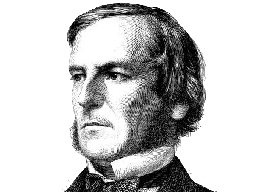
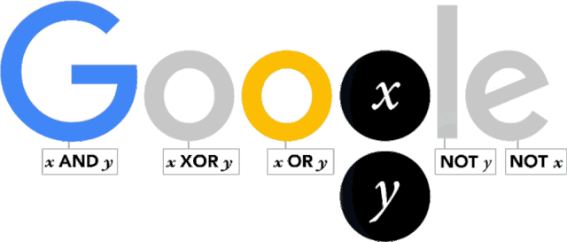
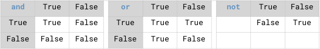
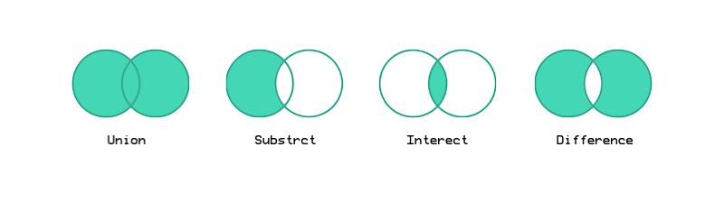
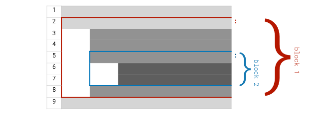

<!-- reading-navigation:start -->

<div dir="rtl" lang="fa">

[بخش قبلی: چند آمادگی پیش از شروع خواندن](Part.1.D.preparation.for.reading.md) · [فهرست مطالب](TOC.md) · [بخش بعدی: مقدارها و عملیات متناظر با آن‌ها](Part.1.E.2.values-and-their-operators.md)

</div>

<!-- reading-navigation:end -->


# درگاه ورود

«یادگیری سریع و یک‌باره» برای بیشتر افراد<a href='#fn1' name='fn1b'><sup>[1]</sup></a>، در بیشتر موقعیت‌ها، چندان شدنی نیست.

برنامه‌نویسی هم همین‌طور است و خودآموزیِ برنامه‌نویسی بیشتر از آن. گاهی وقتی موضوع کمی پیچیده‌تر می‌شود، حتی برداشتن سریعِ قدم‌های اول هم لزوماً آسان نیست.

برای همین، عنوان این فصل را عمداً از «آغاز یادگیری» به «درگاه ورود» تغییر داده‌ام. کار این فصل آن است که درگاهی را به شما نشان دهد؛ اینکه بتوانید از آن وارد شوید، دیگر به خودتان بستگی دارد…

البته درگاهی که من نشان می‌دهم با نقطهٔ شروع بیشتر کتاب‌های آموزش برنامه‌نویسی فرق دارد. تقریباً همهٔ آن‌ها با برنامهٔ «Hello World!» شروع می‌کنند. اما ما چطور؟

بیایید با شناختن یک نفر شروع کنیم…

## جورج بول (George Boole)

در سال ۱۸۳۳، فکری از ذهن جوانی انگلیسیِ هجده‌ساله گذشت:

> باید بتوان **رابطه‌های منطقی** را با **نمادها** بیان کرد.

نام این جوان [George Boole](https://en.wikipedia.org/wiki/George_Boole) بود؛ یکی از الگوهای من که پیش‌تر هم از او نام برده‌ام. او در سال ۱۸۱۵ در شهر کوچک لینکلن، در ۱۲۰ مایلی شمال لندن، به دنیا آمد. پدرش کفاشی بود که علاقهٔ زیادی به علم و ریاضی داشت. جورج تحت تأثیر پدر، با خواندن و خودآموزی رشد کرد. در چهارده‌سالگی، با ترجمهٔ شعری یونانی و انتشار آن در روزنامهٔ محلی، در لینکلن مشهور شد.

در شانزده‌سالگی، مدرسه‌ای محلی او را به‌عنوان معلم استخدام کرد؛ در همان زمان مشغول خواندن کتاب‌های حساب دیفرانسیل و انتگرال بود. در نوزده‌سالگی کسب‌وکار خودش را راه انداخت: دبستانی تأسیس کرد و خود مدیر و معلم آن شد. از بیست‌وسه‌سالگی انتشار مقاله‌های ریاضی را آغاز کرد. او «حساب عملیاتی» را ابداع کرد؛ روشی برای مطالعهٔ حساب دیفرانسیل و انتگرال از راه کار با نمادها. زمانی به تحصیل در کمبریج فکر کرده بود، اما منصرف شد: برای ورود باید پژوهش‌هایش را کنار می‌گذاشت و در درس‌های معمول دورهٔ کارشناسی شرکت می‌کرد. برای کسی که سال‌ها فقط با خودآموزی پیش رفته بود، این وضعیت واقعاً تحمل‌ناپذیر بود.

در سال ۱۸۴۷، وقتی جورج ۳۲ سال داشت، نخستین کتابش، [THE MATHEMATICAL ANALYSIS OF LOGIC](http://www.gutenberg.org/ebooks/36884)، منتشر شد. سرانجام فکری که در هجده‌سالگی به ذهنش رسیده بود شکل گرفت. کتاب کوتاه بود، فقط ۸۶ صفحه، اما سرانجام به یکی از گنجینه‌های بشر بدل شد. بول در آن به‌خوبی توضیح داد که چگونه می‌توان اندیشه‌های منطقی را به صورت جبری بیان کرد.

در سال ۱۸۴۹، در ۳۴ سالگی، کالج تازه‌تأسیس Queen's College او را به‌عنوان نخستین استاد ریاضی خود استخدام کرد. پس از آن، نوشتن مشهورترین کتابش، [AN INVESTIGATION OF THE LAWS OF THOUGHT](http://www.gutenberg.org/ebooks/15114)، را آغاز کرد. در پیشگفتار آن نوشت:

> “The design of the following treatise is to investigate the fundamental laws of those operations of the mind by which reasoning is performed; to give expression to them in the symbolical language of a Calculus, and upon this foundation to establish the science of Logic and construct its method; …”
>
> «هدف این رساله بررسی قوانین بنیادیِ آن دسته از فعالیت‌های ذهن است که استدلال به‌واسطهٔ آن‌ها انجام می‌شود؛ بیان این قوانین با زبان نمادینِ یک دستگاه محاسباتی؛ و بر این پایه، بنا کردن علم منطق و ساختن روش آن؛ …»

بول در دوران تدریس در دانشگاه دو کتاب درسی نوشت: یکی دربارهٔ معادلات دیفرانسیل و دیگری دربارهٔ معادلات تفاضلی. کتاب نخست، [A TREATISE ON DIFFERENTIAL EQUATIONS](https://archive.org/details/atreatiseondiff06boolgoog/page/n7)، حتی تا امروز هم به‌سختی رقیبی پیدا می‌کند.



جورج بول در سال ۱۸۶۴ بر اثر ذات‌الریه درگذشت.

در دوران زندگی او، مردم چندان به Boolean algebra علاقه نشان ندادند. حدود هفتاد سال بعد، پس از انتشار مقالهٔ مشهور کلود شانون ([Claude Elwood Shannon](https://en.wikipedia.org/wiki/Claude_Shannon)) با عنوان [A SYMBOLIC ANALYSIS OF RELAY AND SWITCHING CIRCUITS](https://www.cs.virginia.edu/~evans/greatworks/shannon38.pdf)، استفادهٔ گسترده و عملی از Boolean algebra آغاز شد.

در اوقات فراغت می‌توانید نگاهی هم به این کتاب بیندازید: [The Logician and the Engineer: How George Boole and Claude Shannon Created the Information Age](https://www.amazon.com/gp/product/B0091XBUTM/ref=dbs_a_def_rwt_hsch_vapi_tkin_p1_i4). می‌توان گفت بدون **Boolean algebra** جورج بول و **logic circuit**های کلود شانون، نه کامپیوترهای بعدی به وجود می‌آمدند، نه اینترنت و نه عصر اطلاعات امروز. آن وقت جهان چه شکلی می‌شد؟

در سال ۲۰۱۵، در دویستمین سالگرد تولد جورج بول، Google برای بزرگداشت این نابغهٔ خودآموخته و خدمات بزرگش به بشر، [نشان ویژه‌ای](https://www.google.com/doodles/george-booles-200th-birthday) طراحی کرد.



پیام Google Doodle چنین بود:

> A very happy **11001000**_th_ birthday to genius George Boole!

> **یادداشت مترجم — توضیح تکمیلی:** این پیام تولد بول را تبریک می‌گوید؛ عدد 11001000 در نمایش دودویی برابر با ۲۰۰ در نمایش ده‌دهی است.

## Boolean operations

اگر از تعریف شروع کنیم، **program** هیچ چیز مرموزی ندارد.

program در واقع روندی از انجام کارها با *ترتیبی مشخص* است؛ همان چیزی که به آن procedure می‌گویند. طبق این تعریف، وقتی برای خودتان برنج سرخ‌شده با تخم‌مرغ درست می‌کنید، یک program را اجرا کرده‌اید: مجموعه‌ای از مراحل را به‌ترتیب انجام داده‌اید و در پایان غذا آماده شده است. از این زاویه، همهٔ دستورهای آشپزی program هستند…

تفاوت اینجاست که دستور آشپزی را انسان می‌نویسد و انسان هم اجرا می‌کند؛ اما برنامه‌ای که قرار است نوشتنش را یاد بگیریم، نوشتهٔ انسان است و کامپیوتر آن را اجرا می‌کند. البته دستور آشپزی به زبان طبیعی نوشته می‌شود و برنامهٔ کامپیوتری را برنامه‌نویس با یک زبان برنامه‌نویسی می‌نویسد.

بااین‌حال، مهم‌ترین تفاوت این‌ها نیست؛ مهم‌تر آن است که کامپیوتر می‌تواند **Boolean operations** انجام دهد.

بنابراین، وقتی کد نوشته شد، کامپیوتر در زمان اجرا فقط «کارها را به‌ترتیب انجام» نمی‌دهد؛ می‌تواند «در موقعیت‌های مختلف، کارهای مختلفی انجام دهد». مثلاً «تا وقتی شرطی برقرار نشده، کاری را تکرار کند».

ماشین‌حساب و کامپیوتر هر دو دستگاه الکترونیکی‌اند، اما به زبان ساده، کامپیوتر به این دلیل قدرتمندتر است که **programmable** است. هستهٔ این قابلیت، Boolean operations و **control flow** متناظر با آن است؛ یعنی تعیین مسیر اجرای برنامه. بدون Boolean operations نمی‌توان control flow داشت و بدون آن فقط می‌توان دستورها را پشت سر هم اجرا کرد؛ چیزی که چندان «هوشمند» به نظر نمی‌رسد…

### Boolean value

در Python، **Boolean value** با `True` و `False` نمایش داده می‌شود؛ دو مقدار برای بیان درست یا نادرست بودن.

**توجه:** حروف بزرگ و کوچک را دقیق رعایت کنید. Python interpreter به بزرگی و کوچکی حروف حساس است؛ از نظر آن، `True` و `true` یکسان نیستند.

هر **logical expression** یک Boolean value برمی‌گرداند.

```python
from IPython.core.interactiveshell import InteractiveShell
InteractiveShell.ast_node_interactivity = "all"
# 请暂时忽略以上两行……

1 == 2
1 != 2
```

    False
    True

`1 == 2` به زبان طبیعی یعنی «آیا ۱ برابر ۲ است؟»؛ روشن است که Boolean value آن `False` است.

`1 != 2` یعنی «آیا ۱ با ۲ برابر نیست؟»؛ Boolean value آن هم `True` است.

**توجه:** برای بیان «برابر بودن» در Python از `==` استفاده می‌شود؛ **نه از یک علامت مساوی!**

**دوباره توجه کنید:** یک علامت مساوی، یعنی `=`، کاربرد دیگری دارد. یکی از چیزهایی که تازه‌کارها دیرتر به آن عادت می‌کنند این است که operatorهای زبان برنامه‌نویسی همیشه همان کاربرد آشنای قبلی را ندارند. البته با کمی تمرین به آن عادت می‌کنید.

### Logical operators

**Logical operator**های Python در جدول زیر آمده‌اند. برای فهم آسان‌تر می‌توان آن‌ها را comparison operator نیز نامید.

| Comparison operator | معنا | مثال | Boolean value |
| --- | --- | --- | --- |
| `==` | برابر با | `1 == 2` | `False` |
| `!=` | نابرابر با | `1 != 2` | `True` |
| `>` | بزرگ‌تر از | `1 > 2` | `False` |
| `>=` | بزرگ‌تر یا مساوی | `1 >= 1` | `True` |
| `<` | کوچک‌تر از | `1 < 2` | `True` |
| `<=` | کوچک‌تر یا مساوی | `1 <= 2` | `True` |
| `in` | عضو بودن | `'a' in 'basic'` | `True` |

علاوه بر برابر بودن، بزرگ‌تر بودن و کوچک‌تر بودن، Python یک logical operator دیگر هم دارد: `in`.

عبارت `'a' in 'basic'` به زبان طبیعی چنین است:

> «آیا `'a'` در stringِ `'basic'` وجود دارد؟»؛ یعنی بررسی رابطهٔ عضویت.

> **یادداشت مترجم — توضیح تکمیلی:** در اصطلاح دقیق مستندات Python، عملگرهایی مثل `==` و `<` از نوع comparison و `in` برای آزمون عضویت است. نویسنده در اینجا از عنوان کلی logical operators استفاده می‌کند. [مرجع رسمی](https://docs.python.org/3/reference/expressions.html#comparisons).

### Boolean operators

در مثال‌های بالا، **operand**ها، یعنی مقدارهایی که operator روی آن‌ها کار می‌کند، عدد و string بودند.

operatorهایی که برای Boolean valueها به کار می‌روند بسیار ساده‌اند؛ فقط سه مورد: «و»، «یا» و «نقیض».

> این سه به‌ترتیب با `and`، `or` و `not` نمایش داده می‌شوند.

**توجه:** هر سه با حروف کوچک نوشته می‌شوند. چون فقط دو Boolean value داریم، نتیجه‌های ممکن هم محدودند؛ همان‌طور که در تصویر زیر می‌بینید:



> **یادداشت مترجم — توضیح تکمیلی:** خلاصهٔ جدول تصویر: `and` فقط وقتی هر دو مقدار درست باشند درست است؛ `or` وقتی دست‌کم یکی درست باشد درست است؛ و `not` درست و نادرست را معکوس می‌کند. این توضیح دربارهٔ ورودی‌های Boolean است.

فعلاً کاری به شیوهٔ کار functionِ `print()` نداشته باشید؛ فقط به نتیجهٔ Boolean operations در کد زیر توجه کنید:

```python
print('(True and False) yields:',  True and False)
print('(True and True) yields:',  True and True)
print('(False and True) yields:',  False and True)
print('(True or False) yields:',  True or False)
print('(False or True) yields:',  False or True)
print('(False or False) yields:',  False or False)
print('(not True) yields:',  not True)
print('(not False) yields:',  not False)
```

    (True and False) yields: False
    (True and True) yields: True
    (False and True) yields: False
    (True or False) yields: True
    (False or True) yields: True
    (False or False) yields: False
    (not True) yields: False
    (not False) yields: True

تصور نکنید Boolean operations چیزی است که فقط دانش‌آموزان رشته‌های علمی باید بلد باشند یا به کارشان می‌آید. تقسیم دانش‌آموزان به رشته‌های ادبی، علمی و هنری، شکل خاصی از دسته‌بندی در چین است که واقعاً می‌تواند آسیب‌زا باشد. برای نمونه، طراحان هم هنگام ساختن تصویر با کامپیوتر، برای ترکیب شکل‌های مختلف بارها از عملیات «یا»، «و» و «نقیض» استفاده می‌کنند. فرصت کردید این صفحه را ببینید: [Boolean Operations used by Sketch App](https://sketchapp.com/docs/shapes/boolean-operations/). چنین نرم‌افزارهای طراحی‌ای در نهایت به کار همه می‌آیند. تازه، مگر دانش‌آموزان هنر نیازی به یادگیری درس‌های ادبی یا علمی ندارند؟ آن‌ها هم درس‌های عمومی دارند…



> **یادداشت مترجم — توضیح تکمیلی:** تصویر، ترکیب هندسی شکل‌ها را نشان می‌دهد: اجتماع، ناحیه‌های شکل‌ها را با هم می‌گیرد؛ اشتراک، بخش مشترک را نگه می‌دارد؛ تفاضل، بخش یک شکل را از دیگری حذف می‌کند؛ و تفاضل متقارن، بخش مشترک را حذف و بخش‌های غیرمشترک را نگه می‌دارد.

## Control flow

توانایی Boolean operations است که امکان **control flow**، یعنی تعیین روند اجرا بر اساس شرایط، را فراهم می‌کند.

```python
import random
r = random.randrange(1, 1000)
# 请暂时忽略以上两句的原理，只需要了解其结果：
# 引入随机数，而后，每次执行的时候，r 的值不同

if r % 2 == 0:
    print(r, 'is even.')
else:
    print(r, 'is odd.')
```

    693 is odd.

می‌توانید برنامهٔ بالا را چند بار اجرا کنید و نتیجه‌های متفاوتش را ببینید. برای اجرا در Notebook، cell بالا را انتخاب کنید و `shift + enter` را بزنید.

حالا به کد نگاه کنید؛ فعلاً بقیهٔ بخش‌ها را کنار بگذارید و فقط قسمت اصلی را ببینید:

```python
    ...
    if r % 2 == 0:
        ...
    else:
        ...
```

statementِ `if/else` کار **branch** را انجام می‌دهد؛ یعنی مسیر اجرا را دوشاخه می‌کند. `%` علامت محاسبهٔ باقی‌مانده است. اگر باقی‌ماندهٔ تقسیم `r` بر `2` برابر `0` باشد، عدد زوج است؛ در غیر این صورت فرد است. بیان Boolean این شرط می‌شود `r % 2 == 0`.

این بار یک علامت مساوی، یعنی `=`، را دیده‌اید: `r = random.randrange(1, 1000)`.

این نماد در بیشتر زبان‌های برنامه‌نویسی معنای **assignment** دارد؛ یعنی مقدار دادن.

در `r = 2`، نام `r` یک **variable** است. فعلاً variable را جایی برای نگهداری مقدار در برنامه در نظر بگیرید. `=` نماد assignment است و `2` یک **literal** از نوع عدد صحیح؛ یعنی مقداری که مستقیماً در کد نوشته شده است.

statementِ `r = 2` به زبان طبیعی یعنی:

> «مقدار `2` را در variableای به نام `r` نگه دار.»

فعلاً به سازوکار دو خط اول توجه نکنید؛ فقط نتیجه را بدانید: `random.randrange(1, 1000)` یک عدد صحیح تصادفی بین ۱ و ۱۰۰۰ برمی‌گرداند؛ شامل `1` و بدون خود `1000`. هر بار که برنامهٔ بالا اجرا می‌شود، یک عدد تصادفی تازه تولید می‌شود و به کمک `=` در variableِ `r` قرار می‌گیرد.

«هوشمندی» برنامهٔ کامپیوتری، دست‌کم در مقایسه با ماشین‌حساب، نخست از توانایی Boolean operations می‌آید. مزیت دیگر کامپیوتر این است که خسته نمی‌شود؛ به‌هرحال خودش هم پول برق را نمی‌دهد! برای همین در «تکرار» بسیار خوب عمل می‌کند؛ اصطلاح این کار در برنامه‌نویسی **loop** است. برنامهٔ زیر همهٔ عددهای فردِ کوچک‌تر از `10` را چاپ می‌کند:

```python
for i in range(10):
    if i % 2 != 0:
        print(i)
```

    1
    3
    5
    7
    9

مقدار برگشتیِ `range(10)` دنبالهٔ عددهای صحیح از `0` تا `9` را بیان می‌کند. مقدار شروعِ پیش‌فرض `0` است؛ حد چپ، یعنی `0`، داخل بازه است و حد راست، یعنی `10`، بیرون آن.

توصیف برنامهٔ بالا با زبان طبیعی تقریباً چنین است؛ توضیح‌ها بعد از `#` نوشته شده‌اند:

```python
for i in range(10): # 对于 0～9 中的所有数字都带入 i 这个变量，执行一遍以下任务：
    if i % 2 != 0:  #     如果 i 除以 2 的余数不等于零的话，执行下面的语句：
        print(i)    #         向屏幕输出 i 这个变量中所保存的值
```

> **یادداشت مترجم — توضیح تکمیلی:** معنای commentهای بالا: هر عدد از ۰ تا ۹ را به‌ترتیب در `i` قرار بده؛ اگر باقی‌ماندهٔ تقسیمش بر ۲ صفر نبود، مقدار `i` را روی صفحه چاپ کن. commentهای چینیِ بلوک‌های کد برای حفظ عینیِ مثال‌های اصلی دست‌نخورده‌اند.

حتی اگر از کامپیوتر بخواهید عددهای فردِ کوچک‌تر از ده میلیارد را چاپ کند، بدون تردید کارش را انجام می‌دهد؛ کافی است چنین عدد بزرگی را در پرانتز functionِ `range()` بنویسید…

بیایید کار کمی پیچیده‌تری به آن بدهیم؛ مثلاً چاپ همهٔ **عددهای اول** کوچک‌تر از `100`.

طبق تعریف، عدد اول دست‌کم `2` است و فقط وقتی بر خودش یا `1` تقسیم شود باقی‌ماندهٔ `0` دارد. **algorithm**، یعنی روش گام‌به‌گامِ تشخیص اول بودن، چنین است:

> * فرض کنید `n` عددی صحیح و `n >= 2` باشد.
> * اگر `n == 2`، عدد اول است.
> * اگر `n > 2`، آن را بر تک‌تک عددهای `2` تا `n - 1` تقسیم کنید و ببینید آیا باقی‌مانده `0` می‌شود.
>   * اگر چنین شد، ادامه لازم نیست؛ عدد اول نیست.
>   * اگر همه را امتحان کردید و هیچ باقی‌مانده‌ای `0` نشد، عدد اول است.

پس به دو **nested loop**، یعنی دو loop تو‌در‌تو، نیاز دارید. اولی مقدار عددِ تقسیم‌شونده، `n`، را از `2` تا `99` طی می‌کند؛ چون مسئله عددهای کوچک‌تر از `100` است، خود `100` را نمی‌گیرد. دومی داخل اولی است و مقسوم‌علیه `i` را از `2` تا `n - 1` به‌ترتیب طی می‌کند:

```python
for n in range(2, 100): #range(2,100)表示含左侧 2，不含右侧 100，是不是第三次看到这个说法了？
    if n == 2:
        print(n)
        continue
    for i in range(2, n):
        if (n % i) == 0:
            break
    else:                  # 这里目前你可能看不懂…… 但先关注结果吧。
        print(n)
```

    2
    3
    5
    7
    11
    13
    17
    19
    23
    29
    31
    37
    41
    43
    47
    53
    59
    61
    67
    71
    73
    79
    83
    89
    97

## Algorithm یعنی چه؟

می‌توان algorithm بالا را بهتر کرد؛ برنامه‌نویس‌ها اغلب به این کار **optimization** می‌گویند.<a id='plusone'></a>

> کافی است مقسوم‌علیه‌ها را از `2` تا عدد صحیحِ بلافاصله پس از جذر `n` امتحان کنیم…

```python
for n in range(2, 100):
    if n == 2:
        print(n)
        continue
    for i in range(2, int(n ** 0.5)+1): #为什么要 +1 以后再说…… n 的 1/2 次方，相当于根号 n。
        if (n % i) == 0:
            break
    else:
        print(n)
```

    2
    3
    5
    7
    11
    13
    17
    19
    23
    29
    31
    37
    41
    43
    47
    53
    59
    61
    67
    71
    73
    79
    83
    89
    97

> **یادداشت مترجم — توضیح تکمیلی:** در کد، `n ** 0.5` جذر `n` است. چون حد بالای `range()` وارد دنباله نمی‌شود، `+1` باعث می‌شود خودِ بخش صحیح جذر هم آزموده شود؛ این نکته در [فصل control flow](Part.1.E.3.controlflow.md) باز می‌شود.

پیدا کردن algorithm کارآمدتر، یا به‌عبارت دیگر، بهینه‌کردن پیوستهٔ برنامه و بالا بردن کارایی آن، در نهایت کار برنامه‌نویس است، نه خود زبان برنامه‌نویسی. دربارهٔ سریع‌ترین algorithm تشخیص اول بودن می‌توانید [بحث Stack Overflow](https://stackoverflow.com/questions/1801391/what-is-the-best-algorithm-for-checking-if-a-number-is-prime) را بخوانید؛ اگر وقت بیشتری داشتید، نگاهی هم به [Wikipedia](https://en.wikipedia.org/wiki/Generating_primes) بیندازید.

در نهایت، **همهٔ ابزارها همین‌طورند: فایده‌شان به کسی بستگی دارد که از آن‌ها استفاده می‌کند**. یاد گرفتن کار با ابزار مهم است، اما مهم‌تر این است که هم‌زمان توانایی خودتان را هم پیوسته بهتر کنید.

شاید در آغاز، یادگیری کدنویسی دشوار و دور از دسترس به نظر برسد، اما این فقط یک تصور است؛ کارهای بسیار دشوارتری هم وجود دارد. کدنویسی در نهایت ابزاری پایه است و باز هم به توانایی اندیشیدن تکیه دارد. مثل سواد خواندن و نوشتن: یاد گرفتنش واقعاً دشوار است؛ از دبستان تا پایان دبیرستان بیش از ده سال زمان می‌گذاریم تا توانایی پایهٔ خواندن را به دست آوریم. بااین‌حال، حتی میان فارغ‌التحصیلان دانشگاه و تحصیلات تکمیلی هم کسانی که خوب می‌نویسند کم‌اند. چون آنچه ارزش دارد با واژه‌ها نوشته شود، اندیشه است؛ و آنچه ارزش دارد با کد نوشته شود، آفرینش است، یا دست‌کم راه‌حلی مؤثر برای مسئله‌ای معنادار. اندیشیدن و حل مسئله، خود مهارتی جداست؛ مهارتی که باید تمام عمر آن را پرورش داد.

## Function یعنی چه؟

تا اینجا بارها functionِ `print()` را دیده‌ایم. کار ساده‌ای دارد: مقدارهایی را که به آن می‌دهید روی صفحه نمایش می‌دهد. البته استفاده از آن جزئیات زیادی هم دارد که به‌تدریج توضیح می‌دهیم.

فعلاً مهم‌تر آن است که ساختار پایهٔ یک **function** را بشناسید. مفهوم‌های مرتبط با آن عبارت‌اند از: **function name**، **parameter**، **return value** و **call**؛ یعنی نام، ورودی‌های تعریف‌شده، مقدار برگشتی و فراخوانی آن.

برای نمونه، function ساده‌تری مثل `abs()` را در نظر بگیرید: عددی را به‌عنوان ورودی می‌گیرد، محاسبه می‌کند و قدرمطلق آن را برمی‌گرداند.

```python
a = abs(-3.1415926)
a
```

    3.1415926

در خط اول کد بالا:

> * functionای با نام `abs` را call کرده‌ایم؛ به این شکل: `abs(-3.1415926)`.
> * با این کار یک ورودی با مقدار `-3.1415926` به آن داده‌ایم.
> * function پس از دریافت آن، درون خودش بر اساس مقدار ورودی محاسبه‌ای انجام داده است.
> * سپس مقداری برگردانده؛ return value همان قدرمطلقِ ورودی، یعنی `3.1415926`، است.
> * در پایان این مقدار در variableِ `a` قرار گرفته است.

> **یادداشت مترجم — توضیح تکمیلی:** parameter نام ورودی در تعریف function است؛ argument مقداری است که هنگام call به آن می‌دهید. نویسنده در این توضیح مقدماتی، واژهٔ parameter را برای ورودیِ هنگام فراخوانی هم به کار برده است. [توضیح رسمی این تفاوت](https://docs.python.org/3/faq/programming.html#faq-argument-vs-parameter).

از نظر ساختاری، هر function یک برنامهٔ کامل است، زیرا بخش‌های اصلی برنامه **input**، **processing** و **output** هستند:

> * ورودی دارد: می‌تواند از بیرون مقدارهایی را از راه parameterها بگیرد.
> * پردازش دارد: درون آن کدی برای انجام کاری مشخص وجود دارد؛ به‌ویژه می‌تواند از «ورودی» به «خروجی» برسد.
> * خروجی دارد: می‌تواند return value را به بیرون تحویل دهد…

functionای که call می‌شود را می‌توان **subprogram** هم دانست. وقتی اجرای برنامهٔ اصلی به call آن می‌رسد، کد آن function اجرا می‌شود و سپس اجرا به برنامهٔ اصلی برمی‌گردد…

می‌توانیم فرایند تشخیص اول بودن عدد را به صورت function بنویسیم تا بعداً، هر جا لازم شد، آن را call کنیم:

```python
def is_prime(n):            # 定义 is_prime()，接收一个参数
    if n < 2:              # 开始使用接收到的那个参数（值）开始计算……
        return False       # 不再是返回给人，而是返回给调用它的代码……
    if n == 2:
        return True
    for m in range(2, int(n**0.5)+1):
        if (n % m) == 0:
            return False
    else:
        return True

for i in range(80, 110):
    if is_prime(i):          # 调用 is_prime() 函数，
        print(i)            # 如果返回值为 True，则向屏幕输出 i
```

    83
    89
    97
    101
    103
    107
    109

## چند نکتهٔ تکمیلی

### Statement

یک برنامهٔ کامل از یک یا چند **statement** تشکیل می‌شود؛ دستورهایی که برنامه را می‌سازند. معمولاً توصیه می‌شود در هر خط فقط یک statement نوشته شود.

```python
for i in range(10):
    if i % 2 != 0:
        print(i)
```

    1
    3
    5
    7
    9

### Statement block

در Python، **leading whitespace**، یعنی فاصلهٔ ابتدای خط که از space یا Tab `⇥` تشکیل می‌شود، معنای ویژه‌ای دارد.

اگر خطی با فاصله شروع شود، Python آن را همراه با دستورهای مجاورِ دارای تورفتگی یکسان، جزو یک **statement block** در نظر می‌گیرد. چنین blockای با statementای آغاز می‌شود که در پایانش `:` دارد. تعداد فاصله‌های ابتدای دستورهای یک block باید یکسان باشد. شاید دشوار به نظر برسد، اما برنامه‌نویس‌ها معمولاً از ویرایشگرهایی مثل [Visual Studio Code](https://code.visualstudio.com) استفاده می‌کنند که ابزارهای زیادی برای وارد کردن آسانِ تورفتگی یکدست دارند.

برنامهٔ بالا سه statement و دو block دارد: blockِ loopِ `for`، block شرطیِ `if` را در خود جا داده است. به `:` در پایان خط اول و دوم توجه کنید.

در بسیاری از زبان‌های دیگر، مثل JavaScript، از `{}` برای مشخص کردن block استفاده می‌شود. شیوهٔ Python در این زمینه متفاوت است؛ تصویر زیر نحوهٔ سازمان‌دهی blockها را نشان می‌دهد:



> **یادداشت مترجم — توضیح تکمیلی:** نکتهٔ اصلی تصویر این است که دستورهای هم‌سطح، تورفتگی یکسان دارند و دستورهای داخل یک block یک سطح جلوتر نوشته می‌شوند. با کم شدن تورفتگی، از آن block خارج می‌شویم.

> **توجه:** در یک فایل، Tab و space را با هم مخلوط نکنید؛ یا همه‌جا از space استفاده کنید یا همه‌جا از Tab.

### Comment

در برنامهٔ Python می‌توانید با `#`، **comment** بنویسید.

comment بخشی از فایل برنامه است که برای خواندن انسان نوشته می‌شود، نه برای کامپیوتر. در کدهای این فصل commentهای زیادی وجود دارد.

کدی که انسان به زبان Python می‌نویسد باید به کمک Python **interpreter** به زبان ماشین ترجمه شود تا کامپیوتر آن را «بفهمد» و دستورها را اجرا کند. interpreter هنگام ترجمهٔ برنامه، وقتی به `#` می‌رسد، آن نماد و ادامهٔ خط را نادیده می‌گیرد.

> **یادداشت مترجم — توضیح تکمیلی:** توضیح بالا ساده‌سازی شده است. در پیاده‌سازی رایج CPython، کد ابتدا به bytecode تبدیل و سپس اجرا می‌شود. همچنین `#` داخل string آغاز comment نیست. بنگرید به [واژه‌نامهٔ رسمی Python دربارهٔ bytecode](https://docs.python.org/3/glossary.html#term-bytecode) و [تعریف comment](https://docs.python.org/3/reference/lexical_analysis.html#comments).

### Operator

comparison operatorهایی که در این فصل دیدیم مقدارهای سمت چپ و راستشان را مقایسه می‌کنند و Boolean value برمی‌گردانند.

همچنین دیدیم که operatorِ `%` دو عدد صحیح را به هم مرتبط می‌کند: سمت چپ عدد تقسیم‌شونده است و سمت راست مقسوم‌علیه. مقدار expressionِ `11 % 3` برابر `2` است. برای عددها، operatorهای `+`، `-`، `*`، `/`، `//`، `%` و `**` را داریم؛ به‌ترتیب برای جمع، تفریق، ضرب، تقسیم، تقسیم با گرد کردن به پایین، باقی‌مانده و توان.

### ترکیب assignment با operatorها

حالا می‌دانید variable و assignment چیست. بنابراین با دیدن `x = 1` می‌فهمید که مقدار `1` در variableِ `x` قرار می‌گیرد.

اما شاید دیدن `x += 1` گیج‌کننده باشد. این یعنی چه؟

این فقط یکی از شیوه‌های رایج نوشتن در زبان برنامه‌نویسی است و در این مثال معادل `x = x + 1` است.

شاید خود `x = x + 1` هم هنوز عجیب به نظر برسد؛ چون هنوز عادت نکرده‌اید که `=` را نماد assignment و `==` را نماد مقایسهٔ برابری بدانید.

معنای `x = x + 1` این است: مقدار expressionِ `x + 1` را در variableِ `x` قرار بده. پس از آن، مقداری که `x` نگه می‌دارد دیگر مقدار قبلی نیست…

```python
x = 0
x += 1
print(x)
```

    1

فهمش دشوار نیست؛ فقط باید به آن عادت کنید. operatorهای جمع، تفریق، ضرب، تقسیم، تقسیم با گرد کردن به پایین، باقی‌مانده و توان را می‌توان همراه با assignment به کار برد.

```python
x = 11
x %= 3   # x = x % 3
print(x)
```

    2

## جمع‌بندی

مفهوم‌های مهم این فصل در فهرست زیر آمده‌اند. شناخت آن‌ها و رابطه‌هایشان، پایهٔ قدم بعدی است.

> * داده: integer و Boolean value؛ operator؛ variable و assignment؛ expression
> * function، subprogram، parameter، return value و call
> * control flow، branch و loop
> * algorithm و optimization
> * program: statement، comment و statement block
> * input، processing و output
> * interpreter

شاید متوجه شده باشید که اگر عنوان بخش‌های این فصل را کنار هم بگذاریم، شبیه فهرست یک کتاب آموزش برنامه‌نویسی می‌شود؛ فقط ترتیب توضیح مفهوم‌ها فرق دارد. در واقع هم همین است.

این مفهوم‌ها عمدتاً **language independent** هستند؛ یعنی به زبان برنامه‌نویسی خاصی وابسته نیستند. در آینده هر زبانی یاد بگیرید، چه C++، چه JavaScript و چه Golang، این مفهوم‌ها همچنان وجود دارند.

پس از یاد گرفتن یک زبان برنامه‌نویسی، یادگیری زبان‌های دیگر بسیار آسان‌تر می‌شود. تازه وقتی یکی را یاد بگیرید، دیر یا زود در جریان کار سراغ بقیه هم می‌روید: شاید برای استفادهٔ بهتر از مجموعهٔ Microsoft Office یکی دو روز صرف یادگیری VBA کنید؛ برای ساختن صفحهٔ وب، JavaScript یاد بگیرید؛ برای تغییر افزونهٔ یک ویرایشگر ببینید با Ruby نوشته شده و با خواندن کلیات مستندات رسمی، کار با Ruby را شروع کنید؛ یا برای مصورسازی داده دریابید که بلد نبودن R کمی دست‌وپایتان را می‌بندد…

وقتی این مفهوم‌ها را در ذهن داشته باشید، می‌بینید ساختار تقریباً همهٔ کتاب‌های مقدماتی برنامه‌نویسی از همین‌ها ساخته شده است. چون پایهٔ زبان‌ها یکسان است و همه ابزارهایی برای فرمان دادن به کامپیوترند. به‌هرحال input و output لازم داریم؛ هیچ زبانی بدون Boolean operations، control flow یا function نیست و هر زبان سطح‌بالا به compiler نیاز دارد… بنابراین تسلط بر این مفهوم‌های پایه، زیربنای یادگیری پیوسته در آینده است.

> **یادداشت مترجم — توضیح تکمیلی:** عبارت‌های «هیچ زبانی» در بند بالا تعمیم آموزشی نویسنده‌اند، نه حکمی بدون استثنا دربارهٔ همهٔ زبان‌های ممکن. همچنین شیوهٔ اجرای زبان‌های سطح‌بالا متفاوت است و ممکن است از compiler، interpreter یا ترکیبی از آن‌ها استفاده شود؛ داشتن compiler مستقل شرط همگانی نیست. [توضیح رسمی Python دربارهٔ interpreter](https://docs.python.org/3/glossary.html#term-interpreted).

-----
**پاورقی**

<a name='fn1'>[1]</a>: برای افرادی که توانایی خودآموزی بالایی دارند و تجربهٔ زیادی در این زمینه اندوخته‌اند، یادگیری سریع اغلب واقعاً ممکن و عملی است. دانش و تجربهٔ انباشتهٔ آن‌ها هنگام یادگیری مهارتی تازه نقش بزرگی بازی می‌کند؛ تا جایی که به نظر می‌رسد در مقایسه با دیگران، با زمانی بسیار کم کل مسیر خودآموزی را طی می‌کنند. به بیان دیگر، شما هم در آینده، وقتی خودآموزی را آموخته و توانایی‌تان را حسابی پرورش داده باشید، اغلب می‌توانید کاری کنید که از دید دیگران «یادگیری سریع و یک‌باره» به نظر برسد.

<a href='#fn1b'><small>↑بازگشت به متن↑</small></a>


<!-- reading-navigation:start -->

<div dir="rtl" lang="fa">

[بخش قبلی: چند آمادگی پیش از شروع خواندن](Part.1.D.preparation.for.reading.md) · [فهرست مطالب](TOC.md) · [بخش بعدی: مقدارها و عملیات متناظر با آن‌ها](Part.1.E.2.values-and-their-operators.md)

</div>

<!-- reading-navigation:end -->
