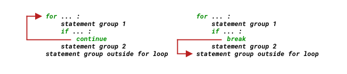

<!-- reading-navigation:start -->

<div dir="rtl" lang="fa">

[بخش قبلی: مقدارها و عملیات متناظر با آن‌ها](Part.1.E.2.values-and-their-operators.md) · [فهرست مطالب](TOC.md) · [بخش بعدی: Functionها](Part.1.E.4.functions.md)

</div>

<!-- reading-navigation:end -->


# Control flow

حالا که با عملیات پایه روی مقدارها کمی بیشتر آشنا شده‌ایم، باید دوباره به control flow برگردیم و آن را عمیق‌تر بشناسیم.

قبلاً این برنامهٔ پیدا کردن عددهای اول را دیده‌ایم:

```python
for n in range(2, 100):
    if n == 2:
        print(n)
        continue
    for i in range(2, n):
        if (n % i) == 0:
            break
    else:
        print(n)
```

این برنامه هم *branch* دارد و هم *loop*. control flow هرقدر هم پیچیده باشد، همین دو کافی‌اند؛ همان‌طور که مدار الکتریکی، هرقدر هم پیچیده باشد، در نهایت از دو وضعیتِ وصل و قطع ساخته می‌شود.

> امروز این موضوع بدیهی به نظر می‌رسد، اما همیشه این‌طور نبوده است. مقاله‌ای در سال ۱۹۶۶ تغییر بزرگی به وجود آورد: *Flow diagrams, turing machines and languages with only two formation rules*، نوشتهٔ Böhm و Jacopini. در واقع، تا پایان قرن گذشته طول کشید که statementِ `GOTO` تقریباً از زبان‌های مختلف «ناپدید» شود…
>
> هر پیشرفتی، کوچک یا بزرگ، واقعاً دشوار و زمان‌بر و پرزحمت است؛ همه‌جا همین‌طور است. اگر علاقه و فرصت داشتید، توضیح کوتاه [Wikipedia دربارهٔ Minimal structured control flow](https://en.wikipedia.org/wiki/Control_flow#Goto) را بخوانید.

> **یادداشت مترجم — توضیح تکمیلی:** بیان دقیق‌تر نتیجهٔ یادشده این است که با اجرای ترتیبی، انتخاب و تکرار می‌توان الگوریتم‌ها را بیان کرد. ادعای «ناپدید شدن» `GOTO` هم توصیف کلی نویسنده از کاهش کاربرد آن است؛ این statement در برخی زبان‌ها همچنان وجود دارد.

## Statementِ if

ساده‌ترین ساختار statementِ `if` چنین است. به `:` در پایان خط اول و تورفتگیِ خط دوم توجه کنید:

```python
if expression:
    statements
```

اگر مقدار expression درست محسوب شود، `statements` داخل blockِ `if` اجرا می‌شود. در غیر این صورت، آن block کاری نمی‌کند و اجرا از statement بعد از `if` ادامه پیدا می‌کند.

```python
import random
r = random.randrange(1, 1000)

if r % 2 == 0:
    print(f'{r} is even.')
```

    372 is even.

اگر بخواهیم چه در حالت درست و چه در حالت نادرستِ expression کاری متناسب انجام دهیم، چنین می‌نویسیم:

```python
if expression:
    statements_for_True
else:
    statements_for_False
```

اگر مقدار expression درست محسوب شود، `statements_for_True` در blockِ `if` اجرا می‌شود؛ وگرنه `statements_for_False` در blockِ `else` اجرا می‌شود.

```python
import random
r = random.randrange(1, 1000)

if r % 2 == 0:
    print(f'{r} is even.')
else:
    print(f'{r} is odd.')
```

    945 is odd.

گاهی چند وضعیت متفاوت داریم و برای هرکدام می‌خواهیم کار متناسبی انجام دهیم. آن وقت می‌توان چنین نوشت:

```python
if expression_1:
    statements_for_expression_1_True

elif expression_2:
    statements_for_expression_2_True

elif expression_3:
    statements_for_expression_3_True

elif expression_...:
    statements_for_expression_..._True
```

Python برای این branch چندحالته از `elif` استفاده می‌کند؛ شبیه کاربرد `switch` یا `case` در زبان‌های دیگر…

`elif` کوتاه‌شدهٔ `else if` است و همان نقش را دارد.

> **یادداشت مترجم — توضیح تکمیلی:** شرط‌ها به‌ترتیب بررسی می‌شوند و فقط blockِ نخستین شرطِ درست اجرا می‌شود. بلوک بالا الگوی نمایشی است؛ بخش دارای `...` کد آمادهٔ اجرا نیست. نسخه‌های جدید Python ساختار `match` هم دارند، اما این فصل به شیوهٔ توضیح زمان نگارش وفادار مانده است. [مرجع رسمی if](https://docs.python.org/3/reference/compound_stmts.html#the-if-statement).

برنامهٔ زیر نتیجهٔ انداختن دو تاس را شبیه‌سازی می‌کند: مجموع برابر `7` مساوی محسوب می‌شود؛ بیشتر از `7` «بزرگ» و کمتر از `7` «کوچک» است.

```python
import random
r = random.randrange(2, 13)

if r == 7:
    print('Draw!')
elif r < 7:
    print('Small!')
elif r > 7:
    print('Big!')
```

    Big!

> **یادداشت مترجم — توضیح تکمیلی:** این مثال عددهای ۲ تا ۱۲ را با احتمال یکسان انتخاب می‌کند؛ توزیع واقعی مجموع دو تاس یکسان نیست، چون مثلاً برای مجموع ۷ حالت‌های بیشتری از مجموع ۲ وجود دارد. بنابراین این «شبیه‌سازی» فقط دامنهٔ مجموع را بازنمایی می‌کند، نه احتمال واقعی آن را. همین نکته دربارهٔ بازی پایان فصل هم برقرار است. [مستندات randrange](https://docs.python.org/3/library/random.html#random.randrange).

البته می‌توانید حالتی را هم شبیه‌سازی کنید که تاس‌ها از محل بازی بیرون می‌افتند و نتیجه نامعتبر است؛ در این مثال، عدد نهایی `0` یا `1`، یعنی کمتر از `2`، نمایندهٔ آن حالت است:

```python
import random
r = random.randrange(0, 13) # 生成的随机数应该从 0 开始了；

if r == 7:
    print('Draw!')
elif r >= 2 and r < 7:      # 如果这里直接写 elif r < 7:，那么，else: 那一部分永远不会被执行……
    print('Small!')
elif r > 7:
    print('Big!')
else:
    print('Not valid!')
```

    Small!

## Loopِ for

در Python، loopِ `for` از شمارنده‌ای به شکل رایج در بعضی زبان‌های دیگر استفاده نمی‌کند؛ در مثال‌های ما به‌جایش از `range()` استفاده می‌شود که من آن را «سازندهٔ دنبالهٔ حسابیِ عددهای صحیح» می‌نامم.

loop در زبان C به این شکل نوشته می‌شود:

```C
for( a = 0; a < 10; a = a + 1 ){
    printf("value of a: %d\n", a);
}
```

همان کار در Python چنین است:

```python
for a in range(10):
    print(f'value of a: {a}') #每次 a 的值都不同，从 0 递增至 9
```

    value of a: 0
    value of a: 1
    value of a: 2
    value of a: 3
    value of a: 4
    value of a: 5
    value of a: 6
    value of a: 7
    value of a: 8
    value of a: 9

### Functionِ range()

`range()` یک built-in است و [مستنداتش](https://docs.python.org/3/library/functions.html#func-range) چنین ساختاری را نشان می‌دهد:

> **range**(_stop_)
>
> **range**(_start, stop[, step]_)

وقتی فقط یک argument بدهید، آن argument مقدار `stop` در نظر گرفته می‌شود و دنباله‌ای از عددهای صحیح از `0` تا `stop - 1` ساخته می‌شود.

این موضوع توضیح می‌دهد که چرا گاهی در محاسبه‌های مربوط به loopِ `for ... in range(...):` کنار variable، `+ 1` می‌بینیم: دنبالهٔ `range(n)` خود `n` را ندارد، اما گاهی به آن هم نیاز داریم. [به مثال بخش «Algorithm یعنی چه؟» در فصل نخست برگردید](Part.1.E.1.entrance.md#plusone).

```python
from IPython.core.interactiveshell import InteractiveShell
InteractiveShell.ast_node_interactivity = "all"

range(10)
list(range(10)) # 将 range(10) 转换成 list，以便清楚看到其内容。
```

    range(0, 10)

    [0, 1, 2, 3, 4, 5, 6, 7, 8, 9]

مقدار پیش‌فرض `start` برابر `0` است. برای تعیین نقطهٔ شروع باید دو argument به `range()` بدهید؛ مثل `range(2, 13)`…

```python
list(range(2, 13))
```

    [2, 3, 4, 5, 6, 7, 8, 9, 10, 11, 12]

argument سوم اختیاری است: `step` یا اندازهٔ گام، همان اختلاف ثابت بین جمله‌های دنبالهٔ حسابی است و مقدار پیش‌فرضش `1` است. مثلاً `range(1, 10, 2)` دنبالهٔ `[1, 3, 5, 7, 9]` را بیان می‌کند. پس برای چاپ عددهای فرد بین ۰ و ۱۰ می‌توان چنین نوشت:

```python
for i in range(1, 10, 2):
    print(i)
```

    1
    3
    5
    7
    9

می‌توانیم دنباله‌ای با عددهای منفی هم بسازیم:

```python
list(range(0, -10, -1))
```

    [0, -1, -2, -3, -4, -5, -6, -7, -8, -9]

> **یادداشت مترجم — توضیح تکمیلی:** `for` به `range()` محدود نیست و می‌تواند روی هر iterable، یعنی چیزی که عناصرش را یکی‌یکی در اختیار loop می‌گذارد، حرکت کند. `range` هم، با وجود عنوان مقدماتی این بخش، در واقع یک نوع built-in است و یک sequence تغییرناپذیر می‌سازد، نه list آمادهٔ همهٔ عددها. [مستندات range](https://docs.python.org/3/library/stdtypes.html#ranges).

### Continue، Break و Pass

هنگام اجرای loop می‌توان با `continue` و `break` هم مسیر اجرا را تغییر داد؛ معمولاً در پی بررسی یک شرط، همان‌طور که قبلاً دیده‌اید:

```python
for n in range(2, 100):
    if n == 2:
        print(n)
        continue
    for i in range(2, n):
        if (n % i) == 0:
            break
    else:
        print(n)
```

`continue` بقیهٔ دستورهای دور جاری را رد می‌کند و به دور بعد می‌رود؛ اما `break` همان loop را پایان می‌دهد و اجرای دستورهای پس از loop را آغاز می‌کند:



> **یادداشت مترجم — توضیح تکمیلی:** خلاصهٔ مسیرهای تصویر: `continue` به دور بعدِ نزدیک‌ترین loop می‌رود و `break` از همان loop خارج می‌شود. در loopهای تو‌در‌تو، هیچ‌یک مستقیماً همهٔ loopهای بیرونی را متوقف نمی‌کنند.

به blockِ `for` می‌توان `else` هم افزود؛ یکی از ویژگی‌های متمایز Python. blockِ `else` در پایان `for`، *وقتی loop بدون اجرای `break` تمام شده باشد* اجرا می‌شود.

```python
for n in range(2, 100):
    if n == 2:
        print(n)
        continue
    for i in range(2, n):
        if (n % i) == 0:
            break
    else:               # 下一行的 print(n) 事实上属于语句块 for i in range(2, n):
        print(n)        # 整个循环结束，都没有发生 break 的情况下，才执行一次 print(n)
```

    2
    3
    5
    7
    11
    13
    17
    19
    23
    29
    31
    37
    41
    43
    47
    53
    59
    61
    67
    71
    73
    79
    83
    89
    97

دو قطعه‌کد زیر را با هم مقایسه کنید:

```python
for n in range(2, 100):
    if n == 2:
        print(n)
        continue
    for i in range(2, n):
        if (n % i) == 0:
            break
    print(n)            # 事实上相当于针对 range(2, 100) 中每个 n 都执行了一次 print(n)
                        # 这个 print(n) 属于语句块 for n in range(2, 100):
```

```python
for n in range(2, 100):
    if n == 2:
        print(n)
        continue
    for i in range(2, n):
        if (n % i) == 0:
            break
        print(n)            # 事实上相当于针对 range(2, n) 中每个 i 都执行了一次 print(n)
```

    2
    3
    5
    5
    5
    7
    7
    7
    7
    7
    9
    11
    11
    11
    ...
    97
    97
    97
    97
    99

> **یادداشت مترجم — توضیح تکمیلی:** در قطعهٔ اول، `print(n)` بیرون loop داخلی است و برای هر `n` یک بار اجرا می‌شود؛ برای `2` هم چاپِ داخل شرط انجام می‌شود. در قطعهٔ دوم، چاپ داخل loop داخلی است و فقط در دورهایی انجام می‌شود که پیش از آن `break` رخ نداده باشد. تورفتگی، این تفاوت رفتاری را ایجاد می‌کند. خروجیِ دارای `...` در اصل خلاصه‌شده است و عیناً حفظ شده است.

statementِ `pass` هیچ کاری انجام نمی‌دهد.

برای نمونه:

```python
def someFunction():
    pass
```

یا:

```python
for i in range(100):
    pass
    if i % 2 == 0:
        pass
```

از زاویه‌ای دیگر شاید روشن‌تر باشد: `pass` بیشتر به کار کسی می‌آید که دارد برنامه را می‌نویسد. می‌توانید با آن جای بخشی از کد را نگه دارید، ابتدا قسمت‌های دیگر را بنویسید و بعد برای تکمیل کدی که باید آنجا قرار بگیرد برگردید.

هنگام نوشتن شرط‌ها یا loopهای تو‌در‌تو، `pass` بسیار به کار می‌آید؛ چون نوشتن ساختار تو‌در‌تو به تمرکز زیادی نیاز دارد و به‌آسانی ممکن است ترتیبش به هم بریزد. برای همین اغلب ابتدا با `pass` جای بخش‌ها را مشخص می‌کنیم و بعد یکی‌یکی کاملشان می‌کنیم.

## Loopِ while

امروزه بیشتر زبان‌های برنامه‌نویسی دو ساختار loop در اختیار می‌گذارند:

> * **Collection-controlled loop**؛ تکرار بر پایهٔ عناصر یک مجموعه
> * **Condition-controlled loop**؛ تکرار بر پایهٔ برقرار بودن یک شرط

ساختار `for ... in ...` که دیدیم از نوع اول است. ساختار نوع دوم در Python، loopِ `while` است.

قالب `while` چنین است:

```python
while expression:
    statements
```

برنامهٔ نمایش عددهای دنبالهٔ فیبوناچیِ کوچک‌تر از ۱۰۰۰ چنین است:

```python
n = 1000
a, b = 0, 1
while a < n:
    print(a, end=' ')
    a, b = b, a+b
print()
```

    0 1 1 2 3 5 8 13 21 34 55 89 144 233 377 610 987

> **یادداشت مترجم — توضیح تکمیلی:** در دنبالهٔ فیبوناچی، پس از ۰ و ۱، هر جمله جمع دو جملهٔ قبلی است. در `a, b = b, a+b`، ابتدا هر دو مقدارِ سمت راست با مقدارهای قبلی محاسبه می‌شوند و سپس به `a` و `b` داده می‌شوند. `while` پیش از هر دور شرط را می‌سنجد؛ اگر شرط از ابتدا نادرست باشد، بدنه اصلاً اجرا نمی‌شود. [مرجع assignment](https://docs.python.org/3/reference/simple_stmts.html#assignment-statements).

تفاوت `for` و `while` چیست؟ چه وقت باید کدام را به کار برد؟

`for` برای iteration روی داده‌های sequence مناسب‌تر است؛ مثلاً کار کردن با تک‌تک نویسه‌های یک string یا استفاده از دنبالهٔ برگشتیِ `range()` به‌عنوان indexهای یک sequence.

`while` انعطاف بیشتری دارد، چون کافی است بعد از آن یک logical expression قرار دهید.

## بازیِ حدس بزرگ یا کوچک با تاس

هنوز شاید نتوانید هر برنامه‌ای را که می‌خواهید بنویسید، اما حالا دست‌کم توانایی اولیهٔ «خواندن» را دارید. با این معرفی کلی، احتمالاً بخشی از کدها را می‌فهمید؛ دیگر در نظرتان نوشته‌هایی رمزآلود نیستند…

برنامهٔ زیر بازی‌ای است که در آن کاربر با برنامه تاس می‌اندازد و بزرگ یا کوچک بودن را حدس می‌زند. قانون‌ها چنین‌اند:

> * کامپیوتر در هر دور عدد صحیحی بین `2` و `12` تولید می‌کند تا انداختن دو تاس توسط ربات را شبیه‌سازی کند.
> * کاربر و ربات در آغاز هرکدام ۱۰ سکه دارند.
> * از کاربر خواسته می‌شود بزرگ یا کوچک بودن را حدس بزند:
>   * ورودی `b` یعنی «بزرگ».
>   * ورودی `s` یعنی «کوچک».
>   * ورودی `q` یعنی «خروج».
> * مقایسهٔ ورودی کاربر و عدد تصادفی این حالت‌ها را دارد:
>   * اگر عدد کمتر از `7` باشد و کاربر «کوچک» گفته باشد، کاربر می‌برد.
>   * اگر عدد کمتر از `7` باشد و کاربر «بزرگ» گفته باشد، کاربر می‌بازد.
>   * اگر عدد برابر `7` باشد، با هر حدسی نتیجه مساوی است؛ نه برد و نه باخت.
>   * اگر عدد بیشتر از `7` باشد و کاربر «کوچک» گفته باشد، کاربر می‌بازد.
>   * اگر عدد بیشتر از `7` باشد و کاربر «بزرگ» گفته باشد، کاربر می‌برد.
> * شرط پایان بازی:
>   * تعداد سکه‌های یکی از دو طرف، کاربر یا ربات، به `0` برسد.
>   * کاربر با وارد کردن `q` بازی را متوقف کند.

```python
from random import randrange

coin_user, coin_bot = 10, 10 # 可以用一个赋值符号分别为多个变量赋值
rounds_of_game = 0

def bet(dice, wager):    # 接收两个参数，一个是骰子点数，另一个用户的输入
    if dice == 7:
        print(f'The dice is {dice};\nDRAW!\n') # \n 是换行符号
        return 0
    elif dice < 7:
        if wager == 's':
            print(f'The dice is {dice};\nYou WIN!\n')
            return 1
        else:
            print(f'The dice is {dice};\nYou LOST!\n')
            return -1
    elif dice > 7:
        if wager == 's':
            print(f'The dice is {dice};\nYou LOST!\n')
            return -1
        else:
            print(f'The dice is {dice};\nYou WIN!\n')
            return 1

while True:         #  除 for 之外的另外一个循环语句
    print(f'You: {coin_user}\t Bot: {coin_bot}')
    dice = randrange(2, 13)   # 生成一个 2 到 12 的随机数
    wager = input("What's your bet? ")
    if wager == 'q':
        break
    elif wager in 'bs':  # 只有当用户输入的是 b 或者 s 得时候，才 “掷骰子”……
        result = bet(dice, wager)
        coin_user += result    # coin_user += result 相当于 coin_user = coin_user + result
        coin_bot -= result
        rounds_of_game += 1
    if coin_user == 0:
        print("Woops, you've LOST ALL, and game over!")
        break
    elif coin_bot == 0:
        print("Woops, the robot's LOST ALL, and game over!")
        break

print(f"You've played {rounds_of_game} rounds.\n")
print(f"You have {coin_user} coins now.\nBye!")
```

> **یادداشت مترجم — توضیح تکمیلی:** در کد اصلی، بررسی `wager in 'bs'` دقیقاً معادل «فقط `b` یا `s`» نیست: string خالی و `'bs'` هم در این آزمون پذیرفته می‌شوند. همچنین عدد تصادفی پیش از اعتبارسنجی ورودی ساخته می‌شود، هرچند نتیجه فقط در branch مربوط پردازش می‌شود. این ناهماهنگی‌ها برای حفظ اصل در کد اصلاح نشده‌اند. برای بررسی دقیق عضویتِ string، [مستندات رسمی](https://docs.python.org/3/reference/expressions.html#membership-test-operations) را ببینید.

## جمع‌بندی

با control flow است که می‌توان از برنامه سخن گفت.

> * برای رسیدگی به یک حالت از `if ...` استفاده کنید.
> * برای دو حالت درست و نادرست از `if ... else ...` استفاده کنید.
> * برای چند حالت از `if ... elif ... elif ... else ...` استفاده کنید.
> * برای iteration روی نوع‌های ترتیبی از `for ... in ...` استفاده کنید. اگر به حالت پایان loop بدون `break` نیاز دارید، `for ... else ...` را به کار ببرید.
> * برای loopهای دیگر از `while ...` استفاده کنید.
> * statementهای مرتبط دیگر عبارت‌اند از `continue`، `break` و `pass`.
> * function از دید control flow، در واقع یک subprogram است.


<!-- reading-navigation:start -->

<div dir="rtl" lang="fa">

[بخش قبلی: مقدارها و عملیات متناظر با آن‌ها](Part.1.E.2.values-and-their-operators.md) · [فهرست مطالب](TOC.md) · [بخش بعدی: Functionها](Part.1.E.4.functions.md)

</div>

<!-- reading-navigation:end -->
