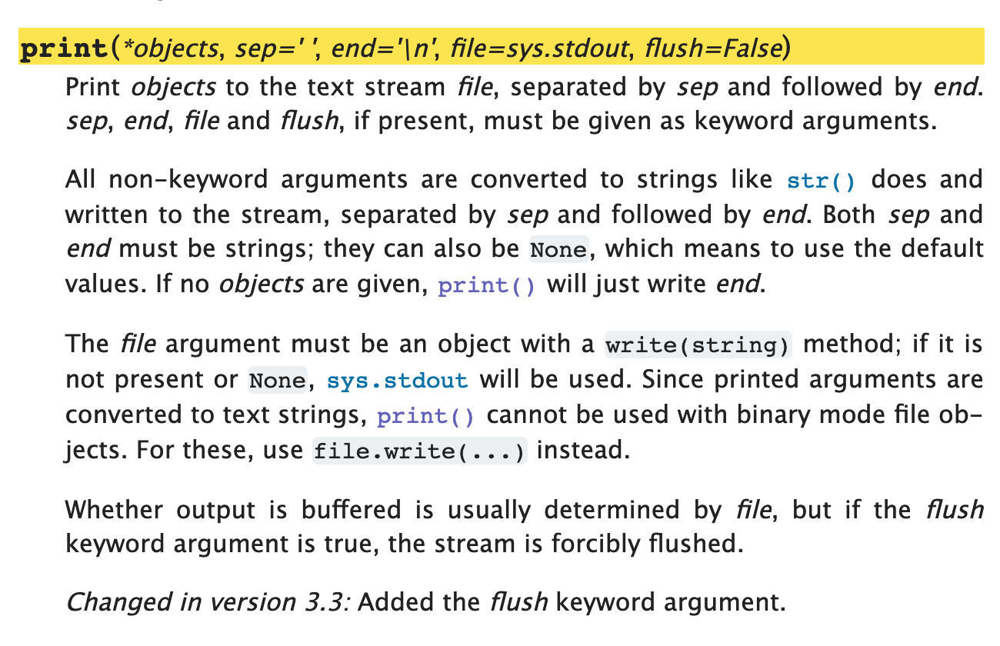
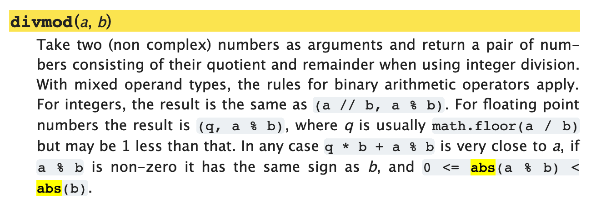
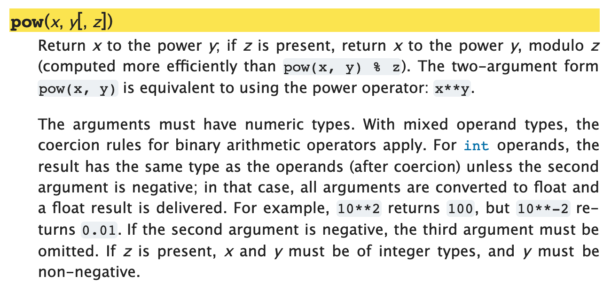
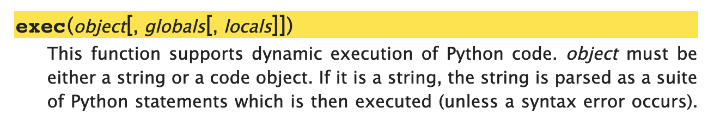
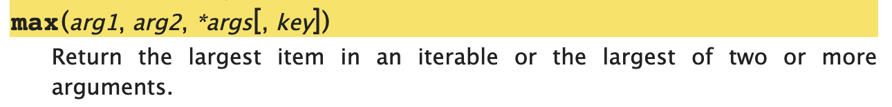
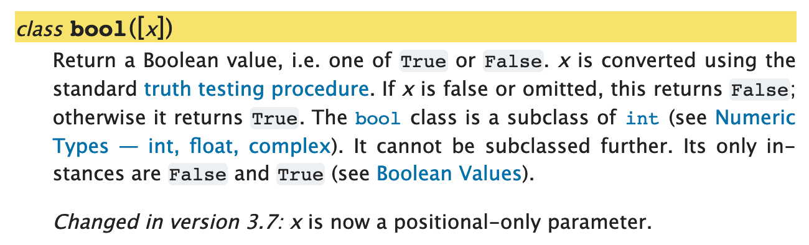

<!-- reading-navigation:start -->

<div dir="rtl" lang="fa">

[بخش قبلی: Control flow](Part.1.E.3.controlflow.md) · [فهرست مطالب](TOC.md) · [بخش بعدی: Stringها](Part.1.E.5.strings.md)

</div>

<!-- reading-navigation:end -->


# Functionها

function در واقع برنامه‌ای کامل است که می‌توان آن را call کرد. ورودی می‌گیرد، پردازش می‌کند و خروجی می‌دهد. ازآنجاکه اغلب در برنامهٔ اصلی call می‌شود، معمولاً بیشتر به یک subprogram شباهت دارد.

برای شناختن یک function، کافی است دو جنبهٔ آن را بشناسید:

> * **ورودی** آن چگونه ساخته می‌شود؟ چه parameterهایی دارد و چطور باید مقدارشان را مشخص کرد؟
> * **خروجی** آن چیست؟ return value دقیقاً چه چیزی است؟

از این زاویه، گاو هم برای انسان یک function است: *علف* می‌خورد و *شیر* می‌دهد… البته شوخی می‌کنم!

هنگام استفاده از function، اغلب *عمداً* کاری به شیوهٔ پردازش داخلیِ آن از ورودی تا خروجی نداریم. مثل استفادهٔ روزمره از لامپ: معمولاً کافی است بدانیم چطور با کلید کار کنیم. اینکه چرا با زدن کلید به یک سمت روشن می‌شود و با زدن به سمت دیگر خاموش، چیزی نیست که ما به‌عنوان کاربر حتماً لازم باشد بدانیم…

البته اگر طراح کلید باشید، موضوع فرق می‌کند و باید سازوکارش را بشناسید. اما در نهایت، باز هم می‌خواهید کاربرتان با ساده‌ترین و راحت‌ترین رابط ممکن کار کند، نه اینکه برای استفاده از محصول شما مجبور باشد همهٔ اصول درونی‌اش را بفهمد…

هنگام برنامه‌نویسی با Python، بیشتر وقت‌ها فقط از functionهایی استفاده می‌کنیم که دیگران از قبل نوشته‌اند؛ یا به اصطلاح تخصصی‌تر، functionهایی که به‌خوبی **encapsulate** شده‌اند. آنچه باید انجام دهیم ــ همان «یاد گرفتن استفاده از function» ــ چیزی جز «خواندن راهنمای محصول برای فهمیدن روش استفاده از آن» نیست. واقعاً چیز مرموزی ندارد…

> **یادداشت مترجم — توضیح تکمیلی:** encapsulation در اینجا یعنی جزئیات انجام کار درون function قرار گرفته است و شما برای استفاده از آن کافی است شیوهٔ دادن ورودی و گرفتن خروجی را بدانید.

**توجه**

> هدف اصلی این فصل یاد دادن نوشتن function نیست؛ می‌خواهیم با چند مثال، *تا حدی یاد بگیرید توضیح استفاده از functionها را در مستندات رسمی بخوانید*. به عبارت «تا حدی» توجه کنید: **اصلاً نترسید اگر در آغاز همه‌چیز را کامل نمی‌فهمید**.

همهٔ functionهایی که در این فصل مثال می‌زنیم از یک صفحهٔ مستندات رسمی آمده‌اند: [Built-in Functions](https://docs.python.org/3/library/functions.html).

> https://docs.python.org/3/library/functions.html

## مثالِ print()

### استفادهٔ پایه

`print()` از نخستین functionهایی است که تازه‌کارها با آن روبه‌رو می‌شوند؛ فعلاً کاری نداریم که پرکاربردترین هم هست یا نه.

کار اصلی آن نمایش مقدارهای ورودی روی صفحه است. اگر هیچ argumentای به آن ندهید، یک خط خالی نمایش می‌دهد:

```python
print('line 1st')
print('line 2nd')
print()
print('line 4th')
```

    line 1st
    line 2nd
    
    line 4th

می‌توانید چند argument هم به آن بدهید و آن‌ها را با `,` جدا کنید. function مقدارها را یکی‌یکی روی صفحه نمایش می‌دهد و به‌طور پیش‌فرض بینشان یک فاصله می‌گذارد.

```python
print('Hello,', 'jack', 'mike', '...', 'and all you guys!')
```

    Hello, jack mike ... and all you guys!

وقتی بخواهیم مقدار variable یا expression را در string قرار دهیم، می‌توانیم از f-string استفاده کنیم:

```python
name = 'Ann'
age = '22'
print(f'{name} is {age} years old.')
```

    Ann is 22 years old.

اما این قابلیتِ `print()` نیست؛ قابلیتِ [f-string](https://docs.python.org/3/library/stdtypes.html#printf-style-string-formatting) است. بخش‌هایی که در f-string داخل `{}` قرار می‌گیرند expression هستند. هنگام ساخته شدن string نهایی، *مقدار* آن expressionها، نه خود variable یا expression، در جای مربوط قرار می‌گیرد…

> **یادداشت مترجم — توضیح تکمیلی:** مقصد پیوند بالا در متن اصلی دربارهٔ قالب‌بندی قدیمی با `%` است، نه f-string. توضیح مرتبط را در [مستندات رسمی formatted string literals](https://docs.python.org/3/reference/lexical_analysis.html#f-strings) بخوانید.

```python
name = 'Ann'
age = '22'
f'{name} is {age} years old.'
```

    'Ann is 22 years old.'

پس در `print(f'{name} is {age} years old.')`، functionِ `print()` همچنان همان کار اصلی‌اش را انجام می‌دهد: هرچه به آن بدهید روی صفحه نمایش می‌دهد.

### توضیح مستندات رسمیِ print()

تصویر زیر [مستندات رسمی](https://docs.python.org/3/library/functions.html#print) این function است:



مهم‌ترین بخشی که باید بفهمید این خط است:

> `print(*object, sep=' ', end='\n', file=sys.stdout, flush=False)` <a href='#fn1' name='fn1b'><sup>[1]</sup></a>

فعلاً فقط به parameterهایی توجه کنید که `=` دارند: `sep=' '`، `end='\n'`، `file=sys.stdout` و `flush=False`.

از میان آن‌ها ابتدا این سه را در نظر بگیرید:

> * `sep=' '`: وقتی چند argument دریافت شود، جداکنندهٔ پیش‌فرض در خروجی یک فاصله، یعنی `' '`، است.
> * `end='\n'`: پایان خروجی به‌طور پیش‌فرض نویسهٔ رفتن به خط بعد، یعنی `'\n'`، است.
> * `file=sys.stdout`: مقصد پیش‌فرض خروجی `sys.stdout` است؛ یعنی در استفادهٔ معمول همان صفحه‌ای که کاربر با آن کار می‌کند…

یعنی این function چند parameter با مقدار پیش‌فرض دارد؛ حتی اگر هنگام call مقدارشان را مشخص نکنیم، همچنان وجود دارند.

پس وقتی `print('Hello', 'world!')` را call می‌کنیم، مانند این است که `print('Hello', 'world!', sep=' ', end='\n', file=sys.stdout, flush=False)` را call کرده باشیم.

```python
import sys                                  # 如果没有这一行，代码会报错

print('Hello', 'world!')                    # 下一行的输出和这一行相同
print('Hello', 'world!', sep=' ', end='\n', file=sys.stdout, flush=False)
print('Hello', 'world!', sep='-', end='\t')
print('Hello', 'world!', sep='~')           # 上一行的末尾是 \t，所以，这一行并没有换行显示
print('Hello', 'world!', sep='\n')          # 参数之间用换行 \n 分隔
```

    Hello world!
    Hello world!
    Hello-world!	Hello~world!
    Hello
    world!

> **یادداشت مترجم — توضیح تکمیلی:** `\t` نویسهٔ Tab است؛ برای همین دو خروجیِ مربوط در یک خط دیده می‌شوند. `sys.stdout` دقیق‌تر «جریان خروجی استاندارد» است و الزاماً صفحه‌نمایش نیست. `flush=False` هم یعنی `print()` مجبور نیست داده‌های بافرشده را همان لحظه به مقصد بفرستد؛ `flush=True` این کار را درخواست می‌کند. [مرجع رسمی print](https://docs.python.org/3/library/functions.html#print).

خیلی‌ها فقط کتاب‌ها و آموزش‌های گوناگون را می‌خوانند و هرگز سراغ مستندات رسمی نمی‌روند؛ در نهایت هم ضرر زیادی می‌کنند. فقط کمی وقت بیشتر لازم است تا بفهمند `print()` می‌تواند در فایل هم داده بنویسد: کافی است parameterِ `file` را برابر یک file object باز قرار دهند. واقعاً خیلی‌ها اصلاً این را نمی‌دانند…

حالا می‌توان نکتهٔ دیگری را هم روشن کرد:

> return valueِ `print()` برابر `None` است. توجه کنید: چیزی که روی صفحه نمایش می‌دهد با return valueِ خود function یکی نیست.

برای مثال، به `print(print(1))` نگاه کنید. `print()` دو بار call می‌شود. بار نخست، `print(1)`، چیزی روی صفحه نمایش می‌دهد که شکل کاملش در واقع `str(1) + '\n'` است، و بعد `None` برمی‌گرداند. بار دوم، callِ بیرونیِ `print()` همین `None` را نمایش می‌دهد:

```python
print(print(1))
```

    1
    None

«**خواندن راهنما**» همین است: شاید همه را بخوانید و همه را نفهمید، اما خواندن همیشه از نخواندن بهتر است؛ چون بالاخره بخش‌هایی هست که می‌فهمید…

## Keyword arguments

در Python، ورودی‌های function دو نوع‌اند:

> * **Positional arguments**؛ در مستندات اغلب به شکل *arg* کوتاه می‌شود.
> * **Keyword arguments**؛ در مستندات اغلب به شکل *kwarg* کوتاه می‌شود.

در تعریف function، نویسنده parameterهایی را که `=` دارند، یعنی برایشان مقدار پیش‌فرض تعیین شده، Keyword Arguments می‌نامد و بقیه را Positional Arguments.

هنگام call کردن function دارای چنین parameterهایی، اگر مقدارشان را ندهید، مقدار پیش‌فرضِ تعیین‌شده در تعریف به کار می‌رود؛ اگر مقدار بدهید، مقدار دریافتی جای آن را می‌گیرد.

> **یادداشت مترجم — توضیح تکمیلی:** متن اصلی در اینجا «مقدار پیش‌فرض داشتن» را با «keyword بودن» یکی گرفته است؛ این دو مفهوم یکسان نیستند. positional argument هنگام call با جایگاهش مشخص می‌شود؛ keyword argument با نوشتن نام، مثل `reverse=True`. parameter می‌تواند مقدار پیش‌فرض داشته باشد و همچنان ورودی را به صورت positional بپذیرد. در signatureِ `sorted()`، ستارهٔ تنها یعنی parameterهای پس از آن فقط با نام داده می‌شوند. [تفاوت argument و parameter](https://docs.python.org/3/faq/programming.html#faq-argument-vs-parameter) و [انواع parameter](https://docs.python.org/3/glossary.html#term-parameter).

برای نمونه، signatureِ `sorted()` چنین است:

> `sorted(iterable, *, key=None, reverse=False)`

فعلاً فقط به `reverse` توجه کنید:

```python
from IPython.core.interactiveshell import InteractiveShell
InteractiveShell.ast_node_interactivity = "all"

sorted('abdc')
sorted('abdc', reverse=True)
```

    ['a', 'b', 'c', 'd']
    ['d', 'c', 'b', 'a']

## Positional arguments

همان‌طور که از نامش پیداست، positional argument ورودی‌ای است که جایگاهش مشخص می‌کند به کدام parameter مربوط است. `divmod()` را مثال بزنیم؛ [مستندات رسمی‌اش](https://docs.python.org/3/library/functions.html#divmod) چنین است:



این function دقیقاً دو argument می‌گیرد و دادن هر دو ضروری است.

> * هنگام call، نخستین argument داخل پرانتز عدد تقسیم‌شونده و دومی مقسوم‌علیه است؛ این‌ها ورودی function هستند.
> * return value یک **tuple** است؛ بعداً روشن می‌کنیم چیست. دو مقدار دارد: اولی خارج‌قسمت و دومی باقی‌مانده است؛ این‌ها خروجی function هستند.

شما به‌عنوان «کاربر این function» نمی‌توانید معنای این دو جایگاه را جابه‌جا کنید؛ در واقع نیازی هم ندارید. طبق تعریف، معنای مقدار داده‌شده را جایگاه argument تعیین می‌کند.

```python
from IPython.core.interactiveshell import InteractiveShell
InteractiveShell.ast_node_interactivity = "all"

divmod(11, 3)
a, b = divmod(11, 3)
a
b

divmod(3, 11)
a, b = divmod(3, 11)
a
b
```

    (3, 2)
    3
    2
    (0, 3)
    0
    3

## Optional positional arguments

بعضی functionها، مثل `pow()`، **optional positional argument** دارند؛ یعنی ورودی‌ای که می‌توان با جایگاه مشخص داد، اما دادن آن الزامی نیست.



بنابراین `pow()` دو شیوهٔ استفاده دارد که نتیجه‌شان متفاوت است:

> * `pow(x, y)` مقدار `x ** y` را برمی‌گرداند.
> * `pow(x, y, z)` مقدار `x ** y % z` را برمی‌گرداند.

```python
from IPython.core.interactiveshell import InteractiveShell
InteractiveShell.ast_node_interactivity = "all"

pow(2, 3)
pow(2, 3, 4)
```

    8
    0

به `[, z]` در پرانتزِ signatureِ `pow()` توجه کنید. این نشانه‌گذاری دقیق است: اگر `z` را ندهید، ویرگول `,` پیش از آن هم لازم نیست.

به مستندات `exec()` نگاه کنید؛ فعلاً کاری به کاربردش نداشته باشید. به دو براکت تو‌در‌توی signature توجه کنید:



معنای براکت‌ها چنین است:

> * `object` که بیرون براکت‌هاست، ورودی ضروری است و هنگام call باید داده شود.
> * می‌توانید argument دوم را بدهید؛ به‌عنوان `globals` دریافت می‌شود.
> * اگر argument دوم وجود داشته باشد، سومی به‌عنوان `locals` دریافت می‌شود.
> * اما نمی‌توانید بدون مشخص کردن positional argumentِ `globals`، مقدار `locals` را بدهید…

> **یادداشت مترجم — توضیح تکمیلی:** براکت‌های `[]` در این تصاویر، نشانهٔ اختیاری بودن در مستندات‌اند؛ آن‌ها را در call واقعی تایپ نمی‌کنیم. این تصاویر و محدودیت‌های بیان‌شده مربوط به نسخهٔ زمان نگارش‌اند. signatureهای فعلی را در [مستندات pow](https://docs.python.org/3/library/functions.html#pow) و [مستندات exec](https://docs.python.org/3/library/functions.html#exec) بررسی کنید؛ به‌ویژه از Python 3.13 می‌توان `globals` و `locals` را به صورت keyword هم داد، پس محدودیت آخر دیگر حکم کلی نسخه‌های جدید نیست.

## Positional parameter با قابلیت دریافت چند مقدار

دوباره به `print()` برگردیم. پیش از نخستین positional parameter آن، `object`، یک ستاره آمده است: `*object, ...`.

برای کاربر function، این یعنی آن بخش می‌تواند چندین argument بگیرد؛ یا به تعبیر نویسنده، یک list یا tuple دریافت کند.

اگر دقیق‌تر به `print()` نگاه کنید، فقط یک جایگاه از این نوع دارد:


چون جایگاه، معنای مقدار را تعیین می‌کند، عموماً در یک function حداکثر یک parameter از این نوع می‌تواند وجود داشته باشد؛ وگرنه از کجا معلوم شود کدام مقدار متعلق به کدام است؟

اگر چند positional parameter دیگر هم وجود داشته باشند، آن parameter که چند مقدار می‌گیرد باید در پایانِ آن‌ها بیاید؛ مانند `max()`:



> **یادداشت مترجم — توضیح تکمیلی:** `*object` در signature به معنی پذیرفتن تعداد متغیری positional argument است، نه اینکه دادن یک list خودکار آن را به چند argument تبدیل کند. listِ بدون بازکردن، یک argument واحد است؛ برای باز کردن عناصر هنگام call از `*` استفاده می‌شود. همچنین `max()` شکل دیگری دارد که یک iterable می‌گیرد؛ این دو شکل در تصویر مستندات آمده‌اند. [مرجع argument list](https://docs.python.org/3/tutorial/controlflow.html#arbitrary-argument-lists) و [مستندات max](https://docs.python.org/3/library/functions.html#max).

## Class هم function است

شاید هنوز دقیق ندانید class چیست، اما اگر هنگام خواندن مستندات رسمی، پیش از بعضی built-inها واژهٔ class دیدید، مثل `class bool([x])`، تعجب نکنید. نویسنده در اینجا class را در اصل نوع خاصی از function می‌داند؛ یعنی چیزی که می‌توان آن را هم مانند function به کار برد:



> **یادداشت مترجم — توضیح تکمیلی:** عنوان و ادعای این بخش ساده‌سازیِ نادقیق متن اصلی است. class خودِ function نیست؛ یک نوع object است که معمولاً **callable** است، یعنی می‌توان آن را با پرانتز call کرد. بنابراین `bool(...)` از نظر شکل استفاده شبیه function است، اما `bool` یک class یا type است. همین شباهت در شیوهٔ استفاده برای هدف فعلی فصل کافی است. [تعریف رسمی class](https://docs.python.org/3/glossary.html#term-class) و [مستندات bool](https://docs.python.org/3/library/functions.html#bool).

```python
from IPython.core.interactiveshell import InteractiveShell
InteractiveShell.ast_node_interactivity = "all"

bool()
bool(3.1415926)
bool(-3.1415926)
bool(1 == 2)
bool(None)
```

    False
    True
    True
    False
    False

## جمع‌بندی

نکته‌های اصلی که باید از این فصل، دست‌کم به‌طور کلی، بفهمید ساده‌اند:

> * می‌توانید function را یک محصول و خودتان را کاربر آن محصول در نظر بگیرید.
> * حالا که کاربر محصول هستید، عادت خوبی بسازید: حتماً خودتان راهنمای محصول را بخوانید.
> * هنگام call کردن function، به *شیوهٔ استفاده از optional positional argumentها* و *مقدار پیش‌فرض parameterهایی که با نام مشخص می‌شوند* توجه کنید.
> * در بخش signature به دو نماد `[]` و `=` دقت کنید.
> * همهٔ functionها return value دارند؛ حتی اگر درونشان مقداری برای بازگرداندن تعیین نشود، مقدار پیش‌فرض `None` را دارند.
> * همچنین با حوصله بخوانید که هنگام استفاده از آن function به چه چیزهایی باید توجه کرد؛ کاربرد اصلی راهنمای محصول همین است…

دانستن همین‌ها هم خیلی خوب است!

مثل وقتی که نقشه‌ای در دست دارید: نمی‌توانید یک‌باره همهٔ جزئیاتش را بشناسید، اما می‌توانید چند دقیقه وقت بگذارید و «راهنمای علائم» یا Legend آن را بفهمید؛ بدانید کدام خط نشان‌دهندهٔ اتوبوس است، کدام مترو و کدام پل. بعد بدانید که شمال بالاست، جنوب پایین، غرب چپ و شرق راست؛ آن وقت می‌توانید کم‌کم خود نقشه را بررسی کنید…

برای یاد گرفتن استفاده از Python، احتمالاً صفحه‌ای که در آینده بیشتر از همه به آن مراجعه می‌کنید این است:

> * https://docs.python.org/3/library/index.html
>
> و نخستین صفحه‌هایی که مرتب می‌خوانید و برای جست‌وجو به آن‌ها برمی‌گردید، این دو خواهند بود:
> * https://docs.python.org/3/library/functions.html
> * https://docs.python.org/3/library/stdtypes.html

راستی، پس از این فصل، تقریباً در استفاده از `print()` «**استاد**» شده‌اید!

-----
**پاورقی**

(۲۰۱۹.۰۲.۱۴) <a name='fn1'>[1]</a>: در [مستندات رسمی](https://docs.python.org/3/library/functions.html#print) functionِ `print()`، عبارت `sep=''` حتماً اشتباه تایپیِ `sep=' '` است. می‌توان با کد زیر بررسی کرد:

```python
print('a', 'b', sep='')
print('a', 'b')
```

(۲۰۱۹.۰۳.۱۶) یکی از خوانندگان یادآوری کرد: https://github.com/selfteaching/the-craft-of-selfteaching/issues/111

> اما حالا، در ۲۰۱۹.۰۳.۱۶، اگر `sep=' '` را از مستندات کپی و جای‌گذاری کنید، معلوم می‌شود که فاصله دارد.
>
> آیا اصلاح شده است؟

برگشتم و گزارش اشکالی را که در ۲۰۱۹.۰۲.۱۳ ثبت کرده بودم بررسی کردم: [https://bugs.python.org/issue35986](https://bugs.python.org/issue35986). نتیجه این بود: «اشکالی از آن‌ها نبود؛ مشکل از تنظیمات فونتِ مرورگر خودم بود»…

بااین‌حال تصمیم گرفتم این بخش را در کتاب نگه دارم تا مردم ببینند «نگهداری روزمرهٔ نرم‌افزار چه شکلی دارد». وجود چنین نمونه‌ای اینجا مفید است.

<a href='#fn1b'><small>↑بازگشت به متن↑</small></a>


<!-- reading-navigation:start -->

<div dir="rtl" lang="fa">

[بخش قبلی: Control flow](Part.1.E.3.controlflow.md) · [فهرست مطالب](TOC.md) · [بخش بعدی: Stringها](Part.1.E.5.strings.md)

</div>

<!-- reading-navigation:end -->
