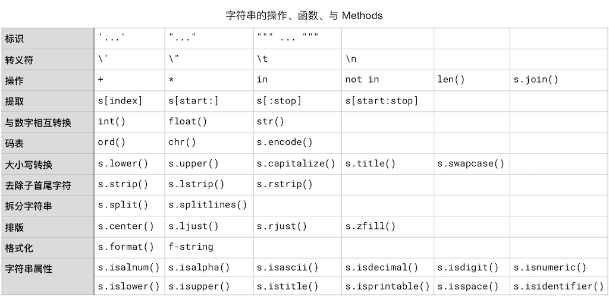

<!-- reading-navigation:start -->

<div dir="rtl" lang="fa">

[بخش قبلی: Functionها](Part.1.E.4.functions.md) · [فهرست مطالب](TOC.md) · [بخش بعدی: Containerهای داده](Part.1.E.6.containers.md)

</div>

<!-- reading-navigation:end -->


# Stringها

در هر کتاب برنامه‌نویسی، بحث stringها معمولاً طولانی است؛ درست مثل کتاب‌های دستور زبان انگلیسی که بحث فعل‌ها دست‌کم دوسوم مطالبشان را به خود اختصاص می‌دهد. چاره‌ای هم نیست، چون پردازش string یکی از رایج‌ترین نیازهای برنامه‌های کامپیوتری است. از کارهای اصلی برنامه‌ها برقراری ارتباط میان انسان و کامپیوتر است و انسان‌ها با stringها سروکار دارند، نه با عددهای دودویی.

در کامپیوتر، همه‌چیز در نهایت باید به مقدارهای عددی تبدیل شود. ازآنجاکه کامپیوتر بر مدارهای الکتریکی تکیه دارد، در نهایت فقط می‌تواند با `1` و `0` کار کند؛ بنابراین، بنیادی‌ترین شکل نمایش عددها دودویی است. حتی integerها و عددهای floating-point هم سرانجام به نمایش دودویی تبدیل می‌شوند. به همین دلیل است که در همهٔ زبان‌های برنامه‌نویسی، حاصل `1.1 + 2.2` آن `3.3`ای نیست که انتظار دارید.

```python
1.1 + 2.2
```

    3.3000000000000003

چون همهٔ مقدارها در نهایت به نمایش دودویی تبدیل می‌شوند، ممکن است در این تبدیل، دقت بخش اعشاری کاهش پیدا کند. وقتی چند عدد floating-point به دودویی تبدیل می‌شوند، با هم محاسبه می‌شوند و نتیجه دوباره به ده‌دهی برمی‌گردد، این کاهش دقت می‌تواند بیشتر هم بشود. پس دقت عددهای floating-point در کامپیوتر محدود است. اگر علاقه دارید بیشتر بدانید، [مستندات moduleِ decimal](https://docs.python.org/3/library/decimal.html) را بخوانید.

> **یادداشت مترجم — توضیح تکمیلی:** ادعای «همهٔ زبان‌ها» در متن اصلی بیش‌ازحد کلی است. مثال بالا به نمایش معمول binary floating-point مربوط است؛ همهٔ کسرهای ده‌دهی در این نمایش دقیق نیستند. این محدودیت لزوماً در هر محاسبه بیشتر نمی‌شود و همهٔ زبان‌ها و نوع‌های عددی هم رفتار یکسانی ندارند. بنگرید به [مستندات رسمی خطاهای floating-point](https://docs.python.org/3/tutorial/floatingpoint.html).

string هم همین‌طور است. هر string از صفر یا چند character تشکیل می‌شود و سرانجام باید به مقدارهای عددی و سپس به نمایش دودویی تبدیل شود. مقدار string خالی `None` است و حتی همین `None` هم در نهایت به `0` دودویی تبدیل می‌شود.

> **یادداشت مترجم — توضیح تکمیلی:** دو جملهٔ آخرِ اصل نادرست‌اند: string خالی `''` است، نه `None`، و این دو object یکسان نیستند. هر دو در بررسی truth value نادرست محسوب می‌شوند، ولی این به معنی یکسان بودن مقدار یا نمایش حافظهٔ آن‌ها با عدد صفر نیست. بنگرید به [Truth Value Testing](https://docs.python.org/3/library/stdtypes.html#truth-value-testing).

## تبدیل characterها به code point و برعکس

مدت‌ها پیش، پردازندهٔ مرکزی کامپیوترها حداکثر می‌توانست با عددهای دودویی ۸بیتی کار کند؛ بنابراین کامپیوترهای آن زمان تنها می‌توانستند ۲۵۶ character، یعنی 2<sup>8</sup> character، را پردازش کنند. جدول کد مورد استفاده در آن دوره ASCII نام داشت. امروزه بیشتر پردازنده‌ها ۶۴بیتی‌اند، پس می‌توان از جدول کدی با ظرفیت 2<sup>64</sup> استفاده کرد که [Unicode](https://zh.wikipedia.org/wiki/Unicode) نام دارد. پس از سال‌ها گردآوری، نسخهٔ `11.0.0` که در ۵ ژوئن ۲۰۱۸ منتشر شد، بیش از ۱۳۰ هزار character داشت؛ تعداد characterها در سال ۲۰۰۵ از ۱۰۰ هزار گذشته بود<a href='#fn1' name='fn1b'><sup>[1]</sup></a>.

> **یادداشت مترجم — توضیح تکمیلی:** این توضیح تاریخی و فنیِ اصل دقیق نیست. ASCII استاندارد ۷بیتی و شامل ۱۲۸ کد است؛ ۲۵۶ حالت به یک byte هشت‌بیتی مربوط می‌شود، نه تعداد characterهایی که یک کامپیوتر می‌تواند در کل پردازش کند. Unicode هم ظرفیت خود را از ۶۴بیتی بودن CPU نمی‌گیرد؛ محدودهٔ code pointهای آن از U+0000 تا U+10FFFF است. code point عددی است که به یک character نسبت داده می‌شود و encoding شیوهٔ ذخیرهٔ آن را تعیین می‌کند. آمار سال ۲۰۱۸ مربوط به زمان نگارش است، نه وضعیت امروز. بنگرید به [Unicode HOWTO](https://docs.python.org/3/howto/unicode.html) و [Unicode 11.0](https://www.unicode.org/versions/Unicode11.0.0/).

functionِ `ord()` یک character را به code point آن تبدیل می‌کند. فقط یک character می‌پذیرد و در غیر این صورت خطا می‌دهد؛ خروجی آن کد Unicode آن character است. functionِ مقابلش `chr()` است که دقیقاً یک integer به‌عنوان argument می‌گیرد و character متناظر را برمی‌گرداند. دادن چند character به `ord()` باعث خطا می‌شود.

```python
from IPython.core.interactiveshell import InteractiveShell
InteractiveShell.ast_node_interactivity = "all"

ord('a')
chr(122)

ord('氅')  # 完了，汉字也有你不认识的吧？
chr(25354) # 这个字估计你也不认识……

# ord('Python') # 这一句会报错
```

    97
    'z'
    27653
    '挊'

## نوشتن string

برای مشخص کردن یک string چهار راه داریم: استفاده از single quote، double quote، سه single quote یا سه double quote:

> **یادداشت مترجم — توضیح تکمیلی:** single quote همان `'` و double quote همان `"` است. در مثال‌های سه‌quoteای، `\n` نشانهٔ newline است؛ هنگام نمایش با `print()` به‌جای دیده شدن این نشانه، خط عوض می‌شود. جمله‌های انگلیسی مثال‌ها می‌گویند: «سادگی بهتر از پیچیدگی است» و «پیچیدگی بهتر از درهم‌پیچیدگی است».

```python
'Simple is better than complex.' # 用单引号
```

    'Simple is better than complex.'

```python
"Simple is better than complex." # 用双引号
```

    'Simple is better than complex.'

```python
# 用三个单引号。注意输出结果中的 \n
# 这个字符串，看起来是两行，保存在内存或者变量之中的时候，
# 是一整串，其中的换行是用 \n 表示的。
'''
Simple is better than complex.
Complex is better than complicated.
'''
```

    '\nSimple is better than complex.\nComplex is better than complicated.\n'

```python
#用三个双引号。注意输出结果中的 \n
"""
Simple is better than complex.
Complex is better than complicated.
"""
```

    '\nSimple is better than complex.\nComplex is better than complicated.\n'

```python
print(
"""
Simple is better than complex.
Complex is better than complicated.
"""
) 
# 用 print() 输出的时候，\n 就是不可见字符，字符串本身如下：
# '\nSimple is better than complex.\nComplex is better than complicated.\n'
# 其中的 \n 被打印出来的时候显示成换行
```

    Simple is better than complex.
    Complex is better than complicated.

## تبدیل میان string و مقدار عددی

stringهایی را که از رقم‌ها ساخته شده‌اند می‌توان به مقدار عددی تبدیل کرد: برای تبدیل به integer از `int()` و برای تبدیل به عدد floating-point از `float()` استفاده می‌کنیم.

برعکس، با `str()` می‌توان مقدار عددی را به نوع string تبدیل کرد.

توجه کنید وقتی `int()` یک string به‌عنوان argument می‌گیرد، فقط می‌تواند آن را به integer تبدیل کند. آخرین خط مثال زیر، اگر از حالت comment خارج شود، خطا می‌دهد:

```python
from IPython.core.interactiveshell import InteractiveShell
InteractiveShell.ast_node_interactivity = "all"

int('3')
float('3')
str(3.1415926)
# int('3.1415926') # 这一行会报错
```

    3
    3.0
    '3.1415926'

functionِ built-inِ `input()` ورودی صفحه‌کلید کاربر را می‌گیرد و آن را به‌صورت string برمی‌گرداند. می‌توان یک string هم به‌عنوان argument به آن داد تا پیش از گرفتن ورودی، به‌عنوان پیام راهنما روی صفحه نمایش داده شود. این argument اختیاری است: اگر فقط `input()` بنویسید، هنگام درخواست ورودی پیامی نمایش داده نمی‌شود.

کد زیر خطا می‌دهد، چون `age < 18` در این وضعیت مقایسهٔ معتبری نیست: `age` همان string برگشتی از `input()` است، نه عدد؛ بنابراین نمی‌توان آن را به این شکل با عدد مقایسه کرد…

```python
age = input('Please tell me your age: ')
if age < 18:
    print('I can not sell you drinks...')
else:
    print('Have a nice drink!')
```

    Please tell me your age:  19
    
    ---------------------------------------------------------------------------
    
    TypeError                                 Traceback (most recent call last)
    
    <ipython-input-9-0573fe379e83> in <module>
          1 age = input('Please tell me your age: ')
    ----> 2 if age < 18:
          3     print('I can not sell you drinks...')
          4 else:
          5     print('Have a nice drink!')
    
    TypeError: '<' not supported between instances of 'str' and 'int'

باید آن را به شکل زیر تغییر بدهیم تا احتمالاً کار کند:
چرا «احتمالاً» و نه «حتماً»؟ اگر کاربر `eighteen` یا ` 十八 `، یعنی «هجده» به انگلیسی یا چینی، و مانند آن را وارد کند، باز هم `int()` نمی‌تواند تبدیل را انجام دهد و خطای `ValueError` رخ می‌دهد. ورودی کاربر در کنترل ما نیست و می‌تواند خطاهای گوناگونی ایجاد کند. فعلاً مسئله را ساده می‌کنیم: در پیام راهنما نمونهٔ درست می‌آوریم و فرض می‌کنیم کاربر مطابق آن ورودی درستی می‌دهد.

```python
age = int(input('''Please tell me your age:
 an int number , e.g: 22
'''))
if age < 18:
    print('I can not sell you drinks...')
else:
    print('Have a nice drink!')
```

    Please tell me your age:  19
    Have a nice drink!

**توجه:** اگر این فایل `.ipynb` را با برنامهٔ دسکتاپ [Nteract](https://nteract.io/) می‌خوانید، این برنامه در حال حاضر از call کردن `input()` پشتیبانی نمی‌کند…

> **یادداشت مترجم — نیازمند بررسی:** این هشدار وضعیت Nteract در زمان نگارش کتاب را توصیف می‌کند. سازگاری نسخهٔ فعلی آن با ورودی تعاملی در این ترجمه آزمایش نشده است. خروجی ثبت‌شدهٔ مثال پیشین نیز پیام راهنمای قدیمیِ یک‌خطی را نشان می‌دهد و با متن چندخطی کد یکسان نیست؛ هر دو مطابق اصل حفظ شده‌اند.

## Escape character

یک character مهم داریم به نام **escape character**، یعنی `\`؛ نویسنده اشاره می‌کند که در برخی متن‌های چینی نام دیگری هم برای آن به کار می‌برند و نام انگلیسی‌اش را _Escaping Character_ می‌آورد. این نشانه به‌خودی‌خود یک character معمولی محسوب نمی‌شود؛ برای اینکه خود آن را در string داشته باشید باید `\\` بنویسید:

```python
'\\'
```

    '\\'

```python
'\'
```

      File "<ipython-input-10-d44a383620ab>", line 1
        '\'
           ^
    SyntaxError: EOL while scanning string literal

پیام خطای بالا `SyntaxError: EOL while scanning string literal` است. علت این است که `\'` به معنی خود characterِ single quote، یعنی `'`، است؛ نشانه‌ای که می‌توان روی صفحه نمایش داد، نه quoteای که مرز string را مشخص می‌کند. عجله نکنید؛ تقریباً هر تازه‌کاری بار اول از خواندن این توضیح کمی گیج می‌شود… پس Python هنگام بررسی این string، پیش از رسیدن به quote پایانی، به `EOL`، مخفف End Of Line، یعنی پایان خط رسیده است.

> **یادداشت مترجم — توضیح تکمیلی:** متن دقیق SyntaxError ممکن است در نسخه‌های جدید Python متفاوت باشد؛ خروجی تاریخی کتاب تغییر نکرده است.

فرض کنید می‌خواهید stringِ `He said, it's fine.` را نمایش دهید. اگر آن را در double quote قرار دهید مشکلی نیست، اما single quote دردسر درست می‌کند، چون Python آن quote بعد از `it` را پایان string در نظر می‌گیرد.

```python
'He said, it's fine.'
```

      File "<ipython-input-11-2bcf2ca6dd95>", line 1
        'He said, it's fine.'
                     ^
    SyntaxError: invalid syntax

پس باید از escape character، یعنی `\`، استفاده کنید:

```python
from IPython.core.interactiveshell import InteractiveShell
InteractiveShell.ast_node_interactivity = "all"

# 要么你这么写：
'He said, it\'s fine.'
# 要么你这么写：
"He said, it's fine."
# 要么，不管用单引号还是双引号标示字符串，都习惯于用 \' 和 \" 书写属于字符串内部的引号……
"He said, it\'s fine."
```

    "He said, it's fine."
    "He said, it's fine."
    "He said, it's fine."

دو کاربرد رایج دیگر `\` ترکیب آن با `t` و `n` است: `\t` نشان‌دهندهٔ tab است، همان چیزی که با کلید TAB `⇥` وارد می‌کنید؛ `\n` نشان‌دهندهٔ newline است، همان چیزی که با Enter `⏎` ایجاد می‌کنید.

به دلایل تاریخی، سیستم‌عامل‌های Linux، Mac و Windows از نشانه‌های یکسانی برای پایان خط استفاده نمی‌کنند. سیستم‌های Unix-like، از جمله macOS امروزی، از `\n`، Windows از `\r\n` و Macintoshهای قدیمی Apple از `\r` استفاده می‌کنند؛ بنگرید به [Wikipedia: Newline](https://en.wikipedia.org/wiki/Newline).

بنابراین، string دو شکل دارد: **raw** و **presentation**. در شکل دوم، `\t` به tab و `\n` به رفتن به خط بعد تبدیل می‌شود.

هنگام برنامه‌نویسی، آنچه در کد می‌نویسیم _raw_ است و مثلاً وقتی با `print()` آن را روی صفحه نمایش می‌دهیم، با _presentation_ روبه‌رو هستیم:

> **یادداشت مترجم — توضیح تکمیلی:** نویسنده در اینجا raw را به معنای نمایش نوشتاریِ string به کار برده است؛ آن را با اصطلاح دقیق **raw string literal**، یعنی string با پیشوند `r`، یکی نگیرید. در string معمولی، escapeها هنگام تفسیر literal پردازش می‌شوند و `print()` مقدار حاصل را نمایش می‌دهد. بنگرید به [String and Bytes literals](https://docs.python.org/3/reference/lexical_analysis.html#string-and-bytes-literals).

```python
s = "He said, it\'s fine." # raw
print(s)                   # presentation
```

    He said, it's fine.

بعداً با نگاهی به این دو functionِ built-in می‌توانید جزئیات بیشتری یاد بگیرید:
> * **ascii**(_object_) https://docs.python.org/3/library/functions.html#ascii
> * **repr**(_object_) https://docs.python.org/3/library/functions.html#repr

## Operatorهای string

stringها را می‌توان با فاصلهٔ `' '` یا `+` به هم متصل کرد:

> **یادداشت مترجم — توضیح تکمیلی:** عبارت «با فاصله» در اصل ممکن است گمراه‌کننده باشد. در مثال دوم، دو **literal** کنار هم قرار گرفته‌اند و Python آن‌ها را به هم متصل می‌کند؛ فاصلهٔ بینشان به خروجی اضافه نمی‌شود. این شیوه برای اتصال دو variable کاربرد ندارد. در مثال اول، `' '` خودش یک string حاوی فاصله است و با `+` به دو string دیگر متصل می‌شود.

```python
'Hey!' + ' ' + 'You!' # 使用操作符 +
```

    'Hey! You!'

```python
'Hey!' 'You!' # 空格与 + 的作用是相同的。
```

    'Hey!You!'

همچنین می‌توان از operatorِ تکرار، یعنی `*` همراه با یک integer استفاده کرد. `'Ha' * 3` یعنی stringِ `'Ha'` سه بار تکرار شود:

```python
'Ha' * 3
```

    'HaHaHa'

```python
'3.14' * 3
```

    '3.143.143.14'

operatorهای `in` و `not in` هم برای stringها قابل استفاده‌اند: بررسی می‌کنند که یک character یا string در string دیگری وجود دارد یا نه و یک Boolean value برمی‌گردانند:

```python
'o' in 'Hey, You!'
```

    True

## Index در string

string از دنباله‌ای از characterها ساخته شده است. در Python مفهومی به نام **container** داریم که قبلاً به آن اشاره کرده‌ایم و بعداً بیشتر توضیحش می‌دهیم. فعلاً کافی است بدانید string نوعی container است. containerها به دو دستهٔ مرتب و نامرتب تقسیم می‌شوند و string یک **container مرتب** است.

هر character در string یک index دارد و شمارش indexها از `0` شروع می‌شود. نکتهٔ جالب اینکه index می‌تواند منفی هم باشد:

| 0    | 1    | 2    | 3    | 4    | 5    |
| ---- | ---- | ---- | ---- | ---- | ---- |
| P    | y    | t    | h    | o    | n    |
| -6   | -5   | -4   | -3   | -2   | -1   |

```python
s = 'Python'
for char in s:
    print(s.index(char), char)
```

    0 P
    1 y
    2 t
    3 h
    4 o
    5 n

عنصرهای یک container مرتب index دارند؛ string هم یک container مرتب از characterهاست. پس می‌توانیم با index، مقدار درون container را به دست آوریم. می‌توانید `[]` را یکی از operatorهای container مرتب بدانید؛ فعلاً آن را «operatorِ index» می‌نامیم. به `[]` بعد از `s` و variableِ `i` درون آن در خط سوم کد زیر توجه کنید:

```python
s = 'Python'
for i in range(len(s)):
    print(s[i])

#上面的代码仅是为了演示索引操作符的使用，更简洁的写法是：
for i in s:
    print(i)
```

    P
    y
    t
    h
    o
    n

با operatorِ index می‌توان **یک یا چند عنصر**، یعنی character یا بخشی از string، را بر اساس index از این container مرتب **بیرون کشید**. اصطلاح تخصصی این کار **slicing** است. داخل `[]` می‌توان یک، دو یا سه integer نوشت؛ اگر دو مقدار بنویسیم با `:` جدا می‌شوند. در نهایت چهار شکل زیر را داریم:

> * `s[index]` — character دارای indexِ `index` را برمی‌گرداند.
> * `s[start:]` — همهٔ characterها از indexِ `start` تا پایان string را برمی‌گرداند.
> * `s[start:stop]` — همهٔ characterها از indexِ `start` تا *پیش از* indexِ `stop` را برمی‌گرداند.
> * `s[:stop]` — همهٔ characterها از ابتدای string تا *پیش از* indexِ `stop` را برمی‌گرداند.
> * `s[start:stop:step]` — characterها را از indexِ `start` تا *پیش از* indexِ `stop`، با گام `step` انتخاب می‌کند.

یادآوری: در `range(1,2)`، `random.randrange(100, 1000)` و `s[start:stop]` یک قاعدهٔ مشترک داریم: مرز چپ، یعنی `1`، `100` یا `start`، شامل می‌شود؛ مرز راست، یعنی `2`، `1000` یا `stop`، شامل نمی‌شود.

> **یادداشت مترجم — توضیح تکمیلی:** اصل از «چهار شکل» نام می‌برد، ولی پنج مورد فهرست می‌کند. همچنین `s[index]` اصطلاحاً indexing است و فقط شکل‌های دارای `:`، slicing هستند. خروجی مثال چاپ characterها فقط یک بار حروف را نشان می‌دهد، در حالی که اجرای هر دو loopِ کد، آن‌ها را دو بار چاپ می‌کند. در مثال قبل‌تر نیز `s.index(char)` جای نخستین رخداد را می‌دهد؛ فقط چون حروف Python تکراری نیستند، نتیجه همان index جاری است.

```python
from IPython.core.interactiveshell import InteractiveShell
InteractiveShell.ast_node_interactivity = "all"

s = 'Python'
s[1]
s[2:]
s[2:5]
s[:5]
s[1:5:2]
```

    'y'
    'thon'
    'tho'
    'Pytho'
    'yh'

## Functionهای built-in برای کار با string

از میان [functionهای built-inِ Python](https://docs.python.org/3/library/functions.html#slice)، این‌ها می‌توانند string را پردازش کنند: `ord()`، `input()`، `int()`، `float()`، `len()` و `print()`. دوباره توجه کنید که `ord()` فقط یک character به‌عنوان argument می‌پذیرد.

> **یادداشت مترجم — توضیح تکمیلی:** پیام چینیِ ورودی در مثال زیر می‌گوید «این عدد را دوباره وارد کنید: 3.14».

```python
from IPython.core.interactiveshell import InteractiveShell
InteractiveShell.ast_node_interactivity = "all"

ord('\n')
ord('\t')
ord('\r')
chr(65) # 与 ord() 相对的函数
s = input('请照抄一遍这个数字 3.14: ')
int('3')
# int(s) 这一句会报错…… 所以暂时注释掉了
float(s) * 9
len(s)
print(s*3)
```

    10
    9
    13
    'A'
    请照抄一遍这个数字 3.14:  3.14
    3
    28.26
    4
    3.143.143.14

## Methodهای string

در Python، string یک **object** است؛ دقیق‌تر بگوییم، objectای از classِ `str`.

هنوز بخش اول کتاب را تمام نکرده‌اید و لازم نیست فعلاً دقیقاً بدانید object چیست. کافی است بدانید درون یک object تعداد زیادی function وجود دارد… این functionها نام ویژه‌ای دارند: **method**های class. مشکل اینجاست که واژهٔ عمومی «روش» در بحث برنامه‌نویسی هم زیاد به کار می‌رود؛ مثلاً «روش کار با عددها». نویسنده برای جلوگیری از این ابهام، از اینجا به بعد نام انگلیسی **Method** را برای روش‌های class به کار می‌برد.

string، methodهای قابل‌استفادهٔ زیادی دارد. همهٔ methodهای `str` که در ادامه معرفی می‌شوند در بخش [Text Sequence Type](https://docs.python.org/3/library/stdtypes.html#text-sequence-type-str) مستندات رسمی آمده‌اند.

برای call کردن methodهای classِ `str` از نشانهٔ `.` استفاده می‌کنیم؛ مثلاً:

```python
'Python'.upper()
```

### تبدیل حروف بزرگ و کوچک

برای تبدیل حروف بزرگ و کوچک string، `str.upper()`، `str.lower()`، `str.swapcase()` و `str.casefold()` را داریم. `str.capitalize()` هم برای بزرگ کردن حرف ابتدای جمله و `str.title()` برای بزرگ کردن حرف اول هر واژه به کار می‌روند:

```python
from IPython.core.interactiveshell import InteractiveShell
InteractiveShell.ast_node_interactivity = "all"

'Now is better than never.'.upper()

# 在 Python 命令行工具之中，单个下划线，是个特殊变量；
# 保存着最近的语句或者表达式的结果
# 上一个 Cell 执行过后，_ 中保存着 'NOW IS BETTER THAN NEVER.'

_.lower()
```

    'NOW IS BETTER THAN NEVER.'
    
    'now is better than never.'

```python
from IPython.core.interactiveshell import InteractiveShell
InteractiveShell.ast_node_interactivity = "all"

# casefold() 也是转换成小写，但它能处理更多欧洲语言字符

'ß'.casefold()           # 德语字符中，大写 ß 的小写形式是 ss
len('ß'.casefold())
'ß'.lower()              # lower() 对这类字符无能为力……
len('ß'.lower())
# casefold
'\u0132'                # IJ 这个字符的 Unicode 编码
'\u0132'.casefold()
'\u0132'.lower()        # 对这个字符来说，lower() 和 casefold 的效果一样
len('\u0132'.casefold())

# 这是一篇有用的文章：
# Truths programmers should know about case
# https://www.b-list.org/weblog/2018/nov/26/case/
```

    'ss'
    2
    'ß'
    1
    'IJ'
    'ij'
    'ij'
    1

```python
from IPython.core.interactiveshell import InteractiveShell
InteractiveShell.ast_node_interactivity = "all"

s = 'Now is better than never.'
s.capitalize() # 句首字母大写
s.title() # 每个单词首字母大写
```

    'Now is better than never.'
    'Now Is Better Than Never.'

```python
s = 'Now is better than never.'
s.swapcase() # 逐个字符更替大小写
s.title()
s.title().swapcase()
```

    'nOW IS BETTER THAN NEVER.'
    'Now Is Better Than Never.'
    'nOW iS bETTER tHAN nEVER.'

همچنین هنگام کار با stringهای غیرانگلیسی، مثلاً چینی، اغلب به `str.encode()` نیاز پیدا می‌کنیم:

> **یادداشت مترجم — توضیح تکمیلی:** `encode()` یک object از نوع bytes برمی‌گرداند؛ این کار متفاوت از تغییر بزرگی و کوچکی حروف است. در مثال casefold، commentِ اصل دربارهٔ «حرف بزرگ ß» دقیق نیست؛ `ß` حرف کوچک آلمانی است و casefold آن را به `ss` تبدیل می‌کند تا مقایسهٔ بدون حساسیت به بزرگی حروف آسان‌تر شود. بنگرید به [str.casefold](https://docs.python.org/3/library/stdtypes.html#str.casefold).

```python
# str.encode(encoding="utf-8", errors="strict")
# 关于更多可能的 encoding list, 请参阅：
# https://docs.python.org/3/library/codecs.html#standard-encodings
s = '简单优于复杂。'
s.encode()
```

    b'\xe7\xae\x80\xe5\x8d\x95\xe4\xbc\x98\xe4\xba\x8e\xe5\xa4\x8d\xe6\x9d\x82\xe3\x80\x82'

### جست‌وجو و جایگزینی

از methodِ `str.count()` شروع کنیم که تعداد رخدادهای یک substring را می‌شمارد؛ یعنی functionای که در classِ `str` تعریف شده است. substring بخشی از یک string است.

مستندات رسمی این‌طور نوشته است:

> `str.count(sub[,start[,end]])`

برای اینکه اولین بار راحت‌تر خوانده شود، در توضیح زیر مقدارهای پیش‌فرض را هم اضافه کرده‌ایم:

> `str.count(sub [,start=0[, end=len(str)]])`

در اینجا `[]` نشان می‌دهد parameter اختیاری است. قرار گرفتن یک جفت bracket داخل جفتی دیگر یعنی اگر parameterِ اختیاری `start` را بدهید، می‌توانید parameterِ اختیاری دیگری به نام `end` هم بدهید.

نشانهٔ `=` هم یعنی parameter مقدار پیش‌فرض دارد. اگر این توضیح برایتان آشناست، یعنی مطالب قبلی را واقعاً با دقت خوانده‌اید… در کنار ارجاع‌های زیاد به مفاهیمی که هنوز نیاموخته‌ایم، نکته‌ها بارها تکرار می‌شوند.

> * اگر فقط `sub` داده شود، جست‌وجو از اولین character تا پایان string انجام می‌شود.
> * اگر بعد از آن یک argument اختیاری بدهید، همان `start` است؛ جست‌وجو از آنجا تا پایان string انجام می‌شود.
> * اگر پس از `start` یک argument دیگر هم بدهید، همان `end` است؛ جست‌وجو از `start` تا `end - 1` انجام می‌شود و character دارای indexِ `end` را در بر نمی‌گیرد.
>
> مقدار برگشتی، تعداد رخدادهای `sub` در string است.

توجه: index اولین character برابر با `0` است.

```python
from IPython.core.interactiveshell import InteractiveShell
InteractiveShell.ast_node_interactivity = "all"

s = """Simple is better than complex.
Complex is better than complicated."""
s.lower().count('mp')
s.lower().count('mp', 10)
s.lower().count('mp', 10, 30)
```

    4
    3
    1

در ادامه نمونه‌هایی از methodهای جست‌وجو و جایگزینی `str`، یعنی `str.find()`، `str.rfind()` و `str.index()`، آمده است:

```python
from IPython.core.interactiveshell import InteractiveShell
InteractiveShell.ast_node_interactivity = "all"

s = """Simple is better than complex.
Complex is better than complicated."""

print('Example of str.find():')
# str.find(sub[, start[, end]])
s.lower().find('mpl')
s.lower().find('mpl', 10)
s.lower().find('mpl', 10, 20) # 没有找到就返回 -1
print()

print('Example of str.rfind():')
# str.rfind(sub[, start[, end]])
# rfind() 返回最后 sub 出现的那次的位置；find()是最早的那次
s.lower().rfind('mpl')
s.lower().rfind('mpl', 10)
s.lower().rfind('mpl', 10, 20) # 没有找到就返回 -1
print()

print('Example of str.index():')
# str.index(sub[, start[, end]])
# 作用与 find() 相同，但如果没找到的话，会触发 ValueError 异常
# https://docs.python.org/3/library/exceptions.html#ValueError
s.lower().index('mpl')
# str.rindex(sub[, start[, end]])
# 作用与 rfind() 相同，但如果没找到的话，会触发 ValueError 异常
s.lower().rindex('mpl')
print()
```

    Example of str.find():
    
    2
    24
    -1
    Example of str.rfind():
    56
    56
    -1
    Example of str.index():
    2
    56

`str.startswith()` و `str.endswith()` بررسی می‌کنند که آیا یک *string* با *substring* مشخصی آغاز می‌شود یا پایان می‌یابد:

```python
s = """Simple is better than complex.
Complex is better than complicated."""

# str.startswith(prefix[, start[, end]])
print("s.lower().startswith('S'):", \
      s.lower().startswith('S'))
print("s.lower().startswith('b', 10):", \
      s.lower().startswith('b', 10))
print("s.lower().startswith('e', 11, 20):", \
      s.lower().startswith('e', 11, 20))

# str.endswith(suffix[, start[, end]])
print("s.lower().endswith('.'):", \
      s.lower().endswith('.'))
print("s.lower().endswith('.', 10):", \
      s.lower().endswith('.', 10))
print("s.lower().endswith('.', 10, 20):", \
      s.lower().endswith('.', 10, 20))

# 好玩：中国人一不小心就会把这两个函数写成或者记成
# startwith() 和 endwith() —— 少写一个 s!
```

    s.lower().startswith('S'): False
    s.lower().startswith('b', 10): True
    s.lower().startswith('e', 11, 20): True
    s.lower().endswith('.'): True
    s.lower().endswith('.', 10): True
    s.lower().endswith('.', 10, 20): False

پیش از جست‌وجو برای یافتن موقعیت، اغلب لازم است مطمئن شوید string موردنظر اصلاً در متن وجود دارد. در این صورت می‌توانید از operatorِ `in` استفاده کنید:

```python
s = """Simple is better than complex.
Complex is better than complicated."""
# 如果你只想知道 “有没有”，而无需知道 “在哪里”，那么可以用：
print('mpl' in s)
```

    True

وقتی جست‌وجو ممکن است، جایگزینی هم باید ممکن باشد! توضیح `str.replace()` چنین است:

> `str.replace(old, new[, count])`

`old` را با `new` جایگزین می‌کند و این کار را برای `count` رخداد انجام می‌دهد. منظور از رخداد، هر مورد مشخصی است که پردازش می‌شود. parameterِ `count` اختیاری است.

```python
s = """Simple is better than complex.
Complex is better than complicated."""

# str.startswith(prefix[, start[, end]])
print("s.lower().replace('mp', '[ ]', 2):\n")
print(s.lower().replace('mp', '[ ]', 2))
```

    s.lower().replace('mp', '[ ]', 2):
    
    si[ ]le is better than co[ ]lex.
    complex is better than complicated.

یک method ویژه هم برای جایگزینی TAB، یعنی `\t`، داریم:

> `str.expandtabs( tabsize=8)`

کارش ساده است: TABهای string را با فاصله جایگزین می‌کند؛ به‌طور پیش‌فرض هرکدام را با `8` فاصله. البته می‌توانید تعداد فاصله‌ها را خودتان مشخص کنید.

> **یادداشت مترجم — توضیح تکمیلی:** توضیح اصل دربارهٔ تعداد فاصله‌ها دقیق نیست. `tabsize` فاصلهٔ بین tab stopها را تعیین می‌کند؛ هر TAB به تعداد فاصلهٔ لازم تا tab stop بعدی تبدیل می‌شود، نه همیشه دقیقاً هشت فاصله. خود خروجی مثال هم این تفاوت را نشان می‌دهد. بنگرید به [str.expandtabs](https://docs.python.org/3/library/stdtypes.html#str.expandtabs).

```python
from IPython.core.interactiveshell import InteractiveShell
InteractiveShell.ast_node_interactivity = "all"

# str.expandtabs(tabsize=8)
s = "Special\tcases\taren't\tspecial\tenough\tto\tbreak\tthe\trules."
s.expandtabs()
s.expandtabs(2)
```

    "Special cases   aren't  special enough  to      break   the     rules."
    "Special cases aren't  special enough  to  break the rules."

### حذف characterها از دو سر string

> `str.strip([chars])`

رایج‌ترین کاربرد آن حذف همهٔ whitespaceها از ابتدا و انتهای string است؛ از جمله فاصله، tab و newline.

```python
from IPython.core.interactiveshell import InteractiveShell
InteractiveShell.ast_node_interactivity = "all"

s = "\r \t Simple is better than complex.    \t \n"
s
s.strip()
```

    '\r \t Simple is better than complex.    \t \n'
    
    'Simple is better than complex.'

اما اگر یک string به‌عنوان argument بدهید، همهٔ characterهای آن به‌عنوان characterهای قابل‌حذف از دو سر متن در نظر گرفته می‌شوند. حذف ادامه پیدا می‌کند تا character تازهٔ ابتدا یا انتها دیگر در argument نباشد:

```python
from IPython.core.interactiveshell import InteractiveShell
InteractiveShell.ast_node_interactivity = "all"

s = "Simple is better than complex."
s
s.strip('Six.p')    # p 全部处理完之后，p 并不在首尾，所以原字符串中的 p 字母不受影响；
s.strip('pSix.mle') # 这一次，首尾的 p 被处理了…… 参数中的字符顺序对结果没有影响，换成 Sipx.mle 也一样……
```

    'Simple is better than complex.'
    'mple is better than comple'
    ' is better than co'

می‌توان فقط سمت چپ را با `str.lstrip()` یا فقط سمت راست را با `str.rstrip()` پردازش کرد:

```python
from IPython.core.interactiveshell import InteractiveShell
InteractiveShell.ast_node_interactivity = "all"

# str.lstrip([chars])
s = "Simple is better than complex."
s
s.lstrip('Six.p')    # p 全部处理完之后，p 并不在首部，所以原字符串中的 p 字母不受影响；
s.lstrip('pSix.mle') # 这一次，首部的 p 被处理了…… 参数中的字符顺序对结果没有影响，换成 Sipx.mle 也一样……
```

    'Simple is better than complex.'
    'mple is better than complex.'
    ' is better than complex.'

```python
from IPython.core.interactiveshell import InteractiveShell
InteractiveShell.ast_node_interactivity = "all"

# str.rstrip([chars])
s = "Simple is better than complex."
s
s.rstrip('Six.p')    # p 全部处理完之后，p 并不在尾部，所以原字符串中的 p 字母不受影响；
s.rstrip('pSix.mle') # 这一次，尾部的 p 被处理了…… 参数中的字符顺序对结果没有影响，换成 Sipx.mle 也一样……
```

    'Simple is better than complex.'
    'Simple is better than comple'
    'Simple is better than co'

### تقسیم string

در کامپیوتر، داده‌ها معمولاً در فایل نگهداری می‌شوند. کامپیوتر در پردازش داده‌های دارای قالب مشخص خوب عمل می‌کند؛ یعنی داده‌هایی که طبق الگوی معینی چیده شده‌اند. spreadsheetها و databaseها از راه‌های نگهداری چنین داده‌هایی‌اند. Excel از Microsoft و Numbers از Apple می‌توانند جدول را به فایل `.csv` صادر کنند. این فایل متنی است و هر خط آن ممکن است چند داده داشته باشد که با `,` یا `;` یا `\t` از هم جدا شده‌اند:

```text
Name,Age,Location
John,18,New York
Mike,22,San Francisco
Janny,25,Miami
Sunny,21,Shanghai
```

وقتی چنین محتوایی از فایل متنی خوانده و در یک variable ذخیره شود، مقدار variable به این شکل خواهد بود:

> `'Name,Age,Location\nJohn,18,New York\nMike,22,San Francisco\nJanny,25,Miami\nSunny,21,Shanghai'`

روی چنین stringای کارهای زیادی می‌توان انجام داد؛ از رایج‌ترین‌ها `str.splitlines()` و `str.split()` هستند. `str.partition()` هم وجود دارد که اگر فرصت داشتید می‌توانید توضیحش را در [مستندات رسمی](https://docs.python.org/3/library/stdtypes.html#str.partition) بخوانید.

خروجی `str.splitlines()` یک **list** است؛ مفهومی که پیش‌تر اشارهٔ کوتاهی به آن داشته‌ایم و در فصل بعد مفصل بررسی می‌کنیم. هر خطِ جداشده یکی از عنصرهای این list خواهد بود.

```python
from IPython.core.interactiveshell import InteractiveShell
InteractiveShell.ast_node_interactivity = "all"

s = """Name,Age,Location
John,18,New York
Mike,22,San Francisco
Janny,25,Miami
Sunny,21,Shanghai"""

s                 # s 被打印出来的时候，\n 都被转换成换行了
s.splitlines()    # 注意输出结果前后的方括号，[]，表示这个返回结果是一个 List
```

    'Name,Age,Location\nJohn,18,New York\nMike,22,San Francisco\nJanny,25,Miami\nSunny,21,Shanghai'
    
    ['Name,Age,Location',
     'John,18,New York',
     'Mike,22,San Francisco',
     'Janny,25,Miami',
     'Sunny,21,Shanghai']

`str.split()` یک string را بر اساس جداکننده تقسیم می‌کند:

> `str.split(sep=None, maxsplit=-1)`

```python
from IPython.core.interactiveshell import InteractiveShell
InteractiveShell.ast_node_interactivity = "all"

s = """Name,Age,Location
John,18,New York
Mike,22,San Francisco
Janny,25,Miami
Sunny,21,Shanghai"""

r = s.splitlines()[2]   # 取出返回列表中索引值为 2 的那一行
r
r.split()               # 如果没有给 str.split() 传递参数，那么默认为用 None 分割（各种空白，比如，\t 和 \r 都被当作 None）
r.split(sep=',')
r.split(',')            # 上一行可以这样写。

r.split(sep=',', maxsplit=1)  # 第二个参数指定拆分几次
# r.split(sep=',', 1)         # 上一行不能这样写。
r.split(sep=',', maxsplit=0)  # 0 次，即不拆分
r.split(sep=',', maxsplit=-1) # 默认值是 -1，拆分全部
```

    'Mike,22,San Francisco'
    ['Mike,22,San', 'Francisco']
    ['Mike', '22', 'San Francisco']
    ['Mike', '22', 'San Francisco']
    ['Mike', '22,San Francisco']
    ['Mike,22,San Francisco']
    ['Mike', '22', 'San Francisco']

### اتصال stringها

در آینده زیاد از `str.join()` استفاده خواهید کرد، بااین‌حال توضیح مستندات رسمی آن کوتاه است:

> `str.join(_iterable_)`
>
> یک string برمی‌گرداند که از اتصال stringهای موجود در iterable ساخته شده است. اگر در iterable مقداری غیر از string، از جمله objectهای [`bytes`](https://docs.python.org/3/library/stdtypes.html#bytes)، وجود داشته باشد، خطای [`TypeError`](https://docs.python.org/3/library/exceptions.html#TypeError) رخ می‌دهد. جداکنندهٔ میان عنصرها همان stringای است که این method روی آن call شده است.

argument آن یک [iterable](https://docs.python.org/3/glossary.html#term-iterable) است. شاید هنوز دقیقاً ندانید iterable چیست، اما ظاهراً مثال این method را می‌توان فهمید؛ شاید بپرسید «آن bracketها چه کار می‌کنند؟» یا شاید listای را که قبلاً معرفی کردیم به یاد بیاورید:

> **یادداشت مترجم — توضیح تکمیلی:** iterable چیزی است که می‌توان عنصرهایش را یکی‌یکی پیمود. در این مثال، listِ حرف‌ها پیموده می‌شود و چون جداکننده string خالی است، حرف‌ها بدون فاصله به هم متصل می‌شوند. در مثال split، مقدار پیش‌فرض `sep=None` به معنی تقسیم بر اساس دنباله‌های whitespace است؛ نه اینکه خود `None` یک character جداکننده باشد.

```python
s = ''
t = ['P', 'y', 't', 'h', 'o', 'n']
s.join(t)
```

    'Python'

### چیدمان string

برای قرار دادن string در وسط خط، ابتدا باید طول کل خط را مشخص کنیم:

> `str.center(width[, fillchar])`

توجه کنید که parameter دوم اختیاری است و فقط یک character می‌پذیرد؛ `char` کوتاه‌شدهٔ _character_ است.

```python
from IPython.core.interactiveshell import InteractiveShell
InteractiveShell.ast_node_interactivity = "all"

s = 'Sparse is better than dense!'
s.title().center(60)
s.title().center(60, '=')
s.title().center(10) # 如果宽度参数小于字符串长度，则返回原字符串

s = 'Sparse is better than dense!'
s.title().rjust(60)
s.title().rjust(60, '.')
```

    '                Sparse Is Better Than Dense!                '
    
    '================Sparse Is Better Than Dense!================'
    
    'Sparse Is Better Than Dense!'
    
    '                                Sparse Is Better Than Dense!'
    
    '................................Sparse Is Better Than Dense!'

برای تراز کردن string در سمت چپ یا راست:

> * `str.ljust(width)`
> * `str.rjust(width)`

method دیگری هم هست که طول string را به مقدار مشخصی می‌رساند و سمت چپ آن را با `0` پر می‌کند. مثلاً هنگام تولید گروهی نام فایل‌ها بسیار کاربردی است…

```python
for i in range(1, 11):
    filename = str(i).zfill(3) + '.mp3'
    print(filename)
```

    001.mp3
    002.mp3
    003.mp3
    004.mp3
    005.mp3
    006.mp3
    007.mp3
    008.mp3
    009.mp3
    010.mp3

### قالب‌بندی string

قالب‌بندی string یعنی قرار دادن مقدار variableهای مشخص در جای مشخصی از string. دو روش رایج آن `str.format()` و `f-string` هستند.

#### استفاده از str.format()

توضیح این method در [مستندات رسمی](https://docs.python.org/3/library/stdtypes.html#str.format) را فعلاً هرقدر تلاش کنید نمی‌فهمید:

> `str.format(*args, **kwargs)`

پیش از parameter یک `*` اضافه شده است… فعلاً نمی‌شود درست توضیحش داد؛ توضیح هم بدهیم هنوز قابل‌فهم نیست… پس از آن می‌گذریم و فقط به شیوهٔ استفاده از این method توجه می‌کنیم.

کار آن چنین است:

> * در string یک یا چند placeholder قرار می‌دهیم؛ یعنی جای خالی‌ای که با `{}` مشخص می‌شود.
> * سپس argumentهای متناظر `str.format()` به‌ترتیب در این جایگاه‌ها قرار می‌گیرند.

در placeholderها می‌توان از indexهایی استفاده کرد که از صفر شروع می‌شوند.

```python
from IPython.core.interactiveshell import InteractiveShell
InteractiveShell.ast_node_interactivity = "all"

name = 'John'
age = 25
'{} is {} years old.'.format(name, age)
# 不写占位符索引就默认每个占位符的索引从第一个开始是 0, 1, 2 ...（占位符数量 - 1)
# '{} {}'.format(a, b) 和 '{0} {1}'.format(a, b) 是一样的。

# '{0} is {2} years old.'.format(name, age)
# 这一句会报错，因为 2 超出实际参数索引极限

# 两个连续使用的大括号，不被认为是占位符；且只打印出一对大括号
"Are you {0}? :-{{+}}".format(name)

# "%s is %d years old." % (name, age)
# 上一行这是兼容 Python 2 的老式写法，可以从此忽略……

# str.fomrat() 里可以直接写表达式……
'{} is a grown up? {}'.format(name, age >= 18)
```

    'John is 25 years old.'
    'Are you John? :-{+}'
    'John is a grown up? True'

#### استفاده از f-string

کار _f-string_ شبیه `str.format()` است، ولی نوشتارش کوتاه‌تر است: کافی است پیش از quote آغاز string حرف `f` بگذارید:

```python
from IPython.core.interactiveshell import InteractiveShell
InteractiveShell.ast_node_interactivity = "all"

# https://docs.python.org/3/library/stdtypes.html#printf-style-bytes-formatting
# f-string

name = 'John'
age = 25
f'{name} is {age} years old.'
f'{name} is a grown up? {age >= 18}'
```

    'John is 25 years old.'
    'John is a grown up? True'

در `str.format()` می‌توان ترتیب indexها را دلخواه تعیین کرد و از این جهت انعطاف بیشتری داشت. مثال زیر فقط برای نشان دادن امکان تعیین دلخواه ترتیب argumentهاست:

> **یادداشت مترجم — توضیح تکمیلی:** در f-string هم می‌توان expressionها را با هر ترتیب دلخواه نوشت؛ مقایسهٔ نویسنده به معنی ناتوانی f-string در جابه‌جا کردن مقدارها نیست. پیوند داخل commentِ مثال f-string به قالب‌بندی bytes مربوط است، نه f-string؛ مرجع مرتبط [Formatted string literals](https://docs.python.org/3/reference/lexical_analysis.html#f-strings) است. commentِ `str.fomrat()` در اصل نیز غلط املایی دارد و منظور همان `str.format()` است.

```python
name = 'John'
age = 25
'{1} is {0} years old.'.format(name, age)
```

    '25 is John years old.'

### ویژگی‌های string

string مجموعه‌ای از methodها هم دارد که Boolean value برمی‌گردانند و برای بررسی ویژگی‌های characterهای تشکیل‌دهندهٔ آن به کار می‌روند:

```python
# str.isalnum()
print("'1234567890'.isalnum():", \
      '1234567890'.isalnum()) # '3.14'.isalnum() 返回的是 False

# str.isalpha()
print("'abcdefghij'.isalpha():", \
      'abcdefghij'.isalpha())

# str.isascii()
print("'山巅一寺一壶酒'.isascii():", \
      '山巅一寺一壶酒'.isascii())

# str.isdecimal()
print("'0.123456789'.isdecimal():", \
      '0.1234567890'.isdecimal())

# str.isdigit()
print("'0.123456789'.isdigit():", \
      '0.1234567890'.isdigit())       #  注意，如果字符串是 identifier，返回值也是 False

# str.isnumeric()
print("'0.123456789'.isnumeric():", \
      '0.1234567890'.isnumeric())

# str.islower()
print("'Continue'.islower():", \
      'Continue'.islower())

# str.isupper()
print("'Simple Is Better Than Complex'.isupper():", \
      'Simple Is Better Than Complex'.isupper())

# str.istitle()
print("'Simple Is Better Than Complex'.istitle():", \
      'Simple Is Better Than Complex'.istitle())

# str.isprintable()
print("'\t'.isprintable():", \
      '\t'.isprintable())

# str.isspace()
print("'\t'.isspace():", \
      '\t'.isspace())

# str.isidentifier()
print("'for'.isidentifier():", \
      'for'.isidentifier())
```

    '1234567890'.isalnum(): True
    'abcdefghij'.isalpha(): True
    '山巅一寺一壶酒'.isascii(): False
    '0.123456789'.isdecimal(): False
    '0.123456789'.isdigit(): False
    '0.123456789'.isnumeric(): False
    'Continue'.islower(): False
    'Simple Is Better Than Complex'.isupper(): False
    'Simple Is Better Than Complex'.istitle(): True
    '	'.isprintable(): False
    '	'.isspace(): True
    'for'.isidentifier(): True

## جمع‌بندی

این فصل نسبتاً مفصل و پرجزئیات به نظر می‌رسد. بااین‌حال، هم این فصل و هم فصل بعد، دربارهٔ containerها، تمرین خوبی برای پرورش صبر هستند…

اما اگر خودتان مطالب فصل را در یک جدول دسته‌بندی و خلاصه کنید، می‌بینید آن‌قدرها هم پیچیده نیست. موضوع همچنان همان است: چگونه با string کار کنیم؟ با operatorها، functionهای built-in و methodها. فقط operatorهای string با operatorهای عددی فرق دارند؛ وقتی نوع داده متفاوت است، طبیعی است operatorها هم فرق کنند! مهم‌ترین تفاوت این است که string یک container مرتب است، پس index دارد و می‌توان با index بخشی از آن را بیرون کشید… بقیهٔ کارها هم معمول‌اند: پردازش با functionها و methodها؛ فقط تعداد methodها کمی بیشتر است.

وقتی مطالب را به جدول تبدیل کنید، می‌بینید به خاطر سپردن همهٔ آن‌ها چندان هم دشوار نیست…

> * برای اینکه جدول در یک صفحه جا بگیرد، به‌جای شکل کامل و درست `str.xxx`، از `s.xxx` استفاده شده است…
> * همچنین برای آسان‌تر شدن دسته‌بندی و یادآوری، `len()` و `s.join()` هم در ردیف عملیات قرار گرفته‌اند…



> **یادداشت مترجم — توضیح تکمیلی:** تصویر، مطالب همین فصل را دسته‌بندی می‌کند: تعریف string و index، اتصال و تکرار و membership، functionهای built-in، و methodهای تغییر حروف، جست‌وجو و جایگزینی، حذف whitespace، تقسیم و اتصال، چیدمان و قالب‌بندی و بررسی ویژگی‌ها. توضیح فارسی این دسته‌ها در متن آمده است؛ برای فهمشان لازم نیست فقط به تصویر تکیه کنید.

راه «به خاطر سپردن» این نیست که از همین حالا فقط به جدول خیره شوید… راه درست این است که کدهای این فصل را بارها بخوانید، تک‌تک اجرا کنید و خروجی را ببینید؛ کمی هم تغییرشان بدهید و نتیجه را تجربه کنید. پس از چند بار، با نگاه به جدول نکته‌ها را به یاد بیاورید و این کار را تا جا افتادنشان ادامه دهید.

## چرا مقدارهای عددی به‌اندازهٔ stringها مفصل بررسی نشدند؟

در فصل قبل، عملیات روی انواع مقدارها را به‌طور کلی بررسی کردیم. بعد، به‌جای ادامهٔ بحث محاسبات عددی، مستقیم به فصل stringها «پریدیم». در واقع، یک جدول و یک فهرست کافی است، چون این نکته‌ها پیش‌تر به‌صورت پراکنده گفته شده‌اند:

operatorها و functionهای built-in رایج Python برای عددها، به‌ترتیب **تقدم** از کم به زیاد:

| نام | عملیات | نتیجه | پیوند مستندات رسمی |
| --- | ----------------- | ------------------------------------------------------------| ------------------------------------------------------------ |
| جمع | `1 + 2` | 3 | |
| تفریق | `2 - 1` | 1 | |
| ضرب | `3 * 5` | 15 | |
| تقسیم | `6 / 2` | 3.0 | |
| خارج‌قسمت | `7 // 3` | 2 | |
| باقی‌مانده | `7 % 3` | 1 | |
| منفی | `-6` | -6 | |
| مثبت | `+6` | 6 | |
| قدرمطلق | `abs(-1)` | 1 | [`abs()`](https://docs.python.org/3/library/functions.html#abs) |
| تبدیل به integer | `int(3.14)` | 3 | [`int()`](https://docs.python.org/3/library/functions.html#int) |
| تبدیل به floating-point | `float(3)` | 3.0 | [`float()`](https://docs.python.org/3/library/functions.html#float) |
| خارج‌قسمت و باقی‌مانده | `divmod(7, 3)` | 2, 1 | [`divmod()`](https://docs.python.org/3/library/functions.html#divmod) |
| توان | `pow(2, 10)` | 1024 | [`pow()`](https://docs.python.org/3/library/functions.html#pow) |
| توان | `3 ** 2` | 9 | |

functionهای built-inِ Python برای کار با عددها:

> * `abs(n)`، *قدرمطلق* argumentِ `n` را برمی‌گرداند.
> * `int(n)`، عدد *floating-point*ِ `n` را به *integer* تبدیل می‌کند.
> * `float(n)`، *integer*ِ `n` را به عدد *floating-point* تبدیل می‌کند.
> * `divmod(n, m)`، تقسیم `n` بر `m` را حساب می‌کند و دو integer، یعنی *خارج‌قسمت* و *باقی‌مانده*، برمی‌گرداند.
> * `pow(n, m)` برای توان‌رسانی است و `n` به *توان* `m` را برمی‌گرداند.
> * `round(n)` نزدیک‌ترین *integer* به عدد *floating-point*ِ `n` را برمی‌گرداند.

> **یادداشت مترجم — توضیح تکمیلی:** جدول یک ترتیب کاملاً دقیقِ تقدم نیست؛ مثلاً ضرب، تقسیم، floor division و باقی‌مانده هم‌تقدم‌اند، همان‌طور که جمع و تفریق هم‌تقدم‌اند. `divmod()` برای ورودی floating-point هم تعریف شده و همیشه دو integer برنمی‌گرداند؛ در مثال integer، خروجی دقیق آن tupleِ `(2, 1)` است. در حالت تساوی فاصله، `round()` مقدار زوج را انتخاب می‌کند. بنگرید به [Operator precedence](https://docs.python.org/3/reference/expressions.html#operator-precedence)، [divmod](https://docs.python.org/3/library/functions.html#divmod) و [round](https://docs.python.org/3/library/functions.html#round).

moduleِ Python برای محاسبات ریاضی پیچیده‌تر، math است؛ بنگرید به:

> https://docs.python.org/3/library/math.html

-----
**پاورقی**

<a name='fn1'>[1]</a>: بنگرید به https://en.wikipedia.org/wiki/Unicode

<a href='#fn1b'><small>↑ بازگشت به متن ↑</small></a>


<!-- reading-navigation:start -->

<div dir="rtl" lang="fa">

[بخش قبلی: Functionها](Part.1.E.4.functions.md) · [فهرست مطالب](TOC.md) · [بخش بعدی: Containerهای داده](Part.1.E.6.containers.md)

</div>

<!-- reading-navigation:end -->
