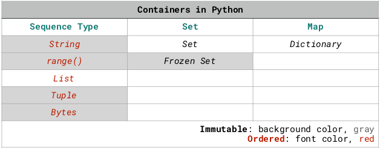
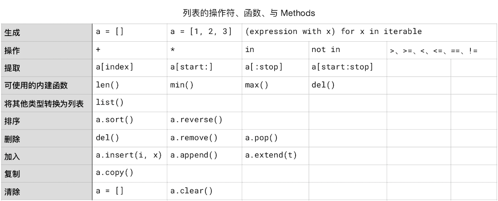
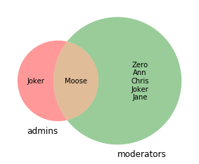

<!-- reading-navigation:start -->

<div dir="rtl" lang="fa">

[بخش قبلی: Stringها](Part.1.E.5.strings.md) · [فهرست مطالب](TOC.md) · [بخش بعدی: فایل‌ها](Part.1.E.7.files.md)

</div>

<!-- reading-navigation:end -->


# Containerهای داده

در Python مفهومی به نام **container** داریم؛ چیزی که داده‌ها را در خود نگه می‌دارد.

از جملهٔ آن‌ها **string**، **دنبالهٔ حسابی** ساخته‌شده با `range()`، **list**، **tuple**، **set** و **dictionary** هستند.

هرکدام از این containerها کاربرد خود را دارند. آن‌ها به **mutable** و **immutable** هم تقسیم می‌شوند؛ یعنی containerهایی که می‌توان خودشان را تغییر داد و containerهایی که نمی‌توان تغییرشان داد. list، set و dictionary قابل‌تغییرند؛ string، دنبالهٔ حسابیِ ساخته‌شده با `range()` و tuple تغییرناپذیرند. setها هم دو نوع دارند: **set** که mutable است و **frozenset** که immutable است.

string، دنبالهٔ حسابیِ ساخته‌شده با `range()`، list و tuple از **sequence type**ها هستند، ولی set و dictionary نامرتب‌اند.

> **یادداشت مترجم — توضیح تکمیلی:** دربارهٔ dictionary، این توصیف اصل نیاز به اصلاح دارد: از Python 3.7 به بعد، حفظ ترتیب درج عنصرها جزو تضمین‌های زبان است. بااین‌حال، dictionary یک mapping است، نه sequence؛ ترتیب داشتن آن به معنی دسترسی با index عددی مثل list نیست. بنگرید به [Mapping Types — dict](https://docs.python.org/3/library/stdtypes.html#typesmapping).



> **یادداشت مترجم — توضیح تکمیلی:** تصویر، containerها را بر اساس نوع و تغییرپذیری دسته‌بندی می‌کند: string، range و tuple تغییرناپذیرند؛ list تغییرپذیر است؛ set تغییرپذیر و frozenset تغییرناپذیر است؛ dictionary هم یک mapping تغییرپذیر است. نکتهٔ ترتیب dictionary را باید با یادداشت بالا در نظر گرفت.

همچنین set عنصر تکراری ندارد.

## Iteration

عنصرهای درون containerهای داده را می‌توان **iterate** کرد؛ یعنی یکی‌یکی به آن‌ها دسترسی پیدا کرد و پردازششان کرد. این ویژگی را **iterable** بودن می‌نامیم.

برای containerهای داده، operatorِ `in` را داریم که بررسی می‌کند عنصری به یک container تعلق دارد یا نه.

iterable بودن containerها و وجود `in` باعث می‌شود نوشتن loop در Python بسیار ساده و راحت باشد؛ مثلاً برای string که containerای از characterهاست:

```python
for c in 'Python':
  print(c)
```

    P
    y
    t
    h
    o
    n

پیش از پیدایش Python، برای نوشتن loopای که به تک‌تک characterهای string دسترسی پیدا کند، معمولاً باید چیزی شبیه این می‌نوشتید؛ مثلاً در C:

``` C
# Written in C
char *string;

scanf("%s",string);
int i=strlen(string);
int k = 0;
while(k<i){
      printf("%c", string[k]);
      k++;
  }
```

در Python، برای یک loopِ سادهٔ `for` کافی است تعداد تکرار را مشخص کنید، چون functionِ `range()` را داریم:

```python
for i in range(10):
  print(i)
```

    0
    1
    2
    3
    4
    5
    6
    7
    8
    9

حتی در JavaScript که کمی «امروزی‌تر» از C است، معمولاً باید چنین چیزی می‌نوشتید:

```c
var i;
for (i = 0; i < 10; i++) {
  console.log(i)
}
```

البته گاهی به شمارنده‌های پیچیده‌تر نیاز داریم. Python هم فقط loopِ `for` ندارد؛ `while` هم هست و هرجا لازم باشد می‌توان شمارندهٔ پیچیده‌تری نوشت.

> **یادداشت مترجم — توضیح تکمیلی:** مثال‌های C و JavaScript صرفاً مقایسه‌های آموزشی نویسنده‌اند، نه تنها شیوهٔ ممکن در این زبان‌ها. کد C به همین شکل نمونهٔ اجرایی سالمی نیست: برای `string` حافظه‌ای اختصاص داده نشده است و خط اول آن هم comment معتبر C نیست. برچسب بلوک JavaScript در اصل `c` است؛ مطابق درخواست، هیچ‌یک از بلوک‌ها اصلاح نشده‌اند. همچنین `in` در ساختار loopِ `for` بخشی از syntax آن است، نه اجرای جداگانهٔ آزمون membership.

## List

list هم مانند string یک container از نوع **sequence** است و عنصرهای آن index دارند.

عنصرهای list می‌توانند از نوع‌های متفاوت باشند. بااین‌حال، هنگام حل مسئله‌های واقعی معمولاً ترجیح می‌دهیم listهایی از داده‌های هم‌نوع بسازیم. اگر با listای از داده‌های ناهم‌نوع روبه‌رو شویم، احتمالاً سعی می‌کنیم آن‌ها را بر اساس نوع جدا و مرتب کنیم. این‌گونه کارها حتی با حوزه‌ای به نام **data cleaning** مرتبط‌اند؛ یعنی آماده و منظم کردن داده‌ها برای استفاده.

### ساخت list

چند راه برای ساخت list داریم:

```python
a_list = []
b_list = [1, 2, 3]
list(), or list(iterable)            # 这是 Type Casting
[(expression with x) for x in iterable]
```

```python
a_list = []
a_list.append(1)
a_list.append(2)
print(a_list, f'has a length of {len(a_list)}.')

#range() 返回的不是 list，需要用 list() 转换，否则也没办法调用 .append()
b_list = list(range(1, 9))
b_list.append(11)
print(b_list, f'has a length of {len(b_list)}.')

c_list = [2**x for x in range(8)]
print(c_list, f'has a length of {len(c_list)}.')
```

    [1, 2] has a length of 2.
    [1, 2, 3, 4, 5, 6, 7, 8, 11] has a length of 9.
    [1, 2, 4, 8, 16, 32, 64, 128] has a length of 8.

آخرین روش واقعاً جالب است:

```python
[2**x for x in range(8)]
```

این روش **[list comprehension](https://docs.python.org/3.7/tutorial/datastructures.html#tut-listcomps)** نام دارد.

واژهٔ *comprehend*، علاوه بر «فهمیدن»، معنی «دربرگرفتن» هم می‌دهد؛ با این معنا بهتر می‌توان نام *list comprehension* را فهمید. نویسنده می‌گوید در ترجمه‌های چینی، نام‌هایی با معنای «مولد list» یا «عبارت تولید list» به کار رفته که مناسب‌اند، اما نامی با معنای «تجزیه‌کنندهٔ list» چندان خوب نیست، چون انگار جهت عملیات را برعکس نشان می‌دهد…

در list comprehension می‌توان `for`ها را تو‌در‌تو به کار برد و حتی شرط `if` هم اضافه کرد. در مستندات رسمی مثالی هست که دو list با عنصرهای نه‌کاملاً یکسان را با کنار گذاشتن موارد یکسان، در یک list ترکیب می‌کند؛ مثال زیر کمی بازنویسی شده است:

> **یادداشت مترجم — توضیح تکمیلی:** توضیح این پاراگراف اصل با کدی که بلافاصله پس از آن آمده سازگار نیست: کد زیر ابتدا یک list از عددهای تصادفی می‌سازد و سپس عددهای زوج آن را جدا می‌کند، نه اینکه دو list را با `for`های تو‌در‌تو ترکیب کند. همچنین بلوک نخستِ «راه‌های ساخت list» شامل شبه‌کد است؛ خط‌های `list(), or list(iterable)` و `[(expression with x) for x in iterable]` را نباید عیناً اجرا کرد. در `random.randrange(1, 100)` نیز ۱۰۰ شامل نمی‌شود، برخلاف تعبیر «۱ تا ۱۰۰» در comment.

```python
import random

n = 10

# 生成一个 n 个元素的序列，每个元素是 1~100 之间的随机数
a_list = [random.randrange(1, 100) for i in range(n)]
print(f'a_list comprehends {len(a_list)} random numbers: {a_list}')

# 从 a_list 里把偶数都挑出来
b_list = [x for x in a_list if x % 2 == 0]
print(f'... and it has {len(b_list)} even numbers: {b_list}')
```

    a_list comprehends 10 random numbers: [52, 34, 7, 96, 33, 79, 95, 18, 37, 46]
    ... and it has 5 even numbers: [52, 34, 96, 18, 46]

### Operatorهای list

operatorهای list مانند string هستند، چون هر دو container مرتب‌اند. operatorهای list عبارت‌اند از:

> * اتصال: `+`؛ برخلاف literalهای string، نمی‌توان از کنار هم نوشتن با فاصلهٔ `' '` استفاده کرد.
> * تکرار: `*`
> * عملیات منطقی: `in` و `not in`، و نیز `<`، `<=`، `>`، `>=`، `!=` و `==`

دو list هم مانند دو string قابل‌مقایسه‌اند؛ یعنی می‌توان روی آن‌ها عملیات منطقی انجام داد. شیوهٔ مقایسه هم همان است: عنصرها از ابتدای دو list یکی‌یکی مقایسه می‌شوند و «به‌محض روشن شدن نتیجه، کار متوقف می‌شود».

```python
from IPython.core.interactiveshell import InteractiveShell
InteractiveShell.ast_node_interactivity = "all"

a_list = [1, 2, 3]
b_list = [4, 5, 6]
c_list = a_list + b_list * 3
c_list
7 not in c_list
a_list > b_list
```

    [1, 2, 3, 4, 5, 6, 4, 5, 6, 4, 5, 6]
    True
    False

### دسترسی به عنصرهای list با index

طبعاً list هم عملیات مبتنی بر index دارد. ازآنجاکه list یک sequenceِ mutable است، نه‌فقط می‌توان عنصرها را بیرون کشید، بلکه می‌توان آن‌ها را حذف یا حتی جایگزین کرد.

```python
import random
n = 3
a_list = [random.randrange(65, 91) for i in range(n)]
b_list = [chr(random.randrange(65, 91)) for i in range(n)]
print(a_list)
c_list = a_list + b_list + a_list * 2
print(c_list)

print()
# 根据索引提取（Slicing）
print(c_list[3])        # 返回索引值为 3 的元素值
print(c_list[:])        # 相当于 c_list，返回整个列表
print(c_list[5:])       # 从索引为 5 的值开始直到末尾
print(c_list[:3])       # 从索引 0 开始，直到索引 3 之前（不包括 3）
print(c_list[2:6])      # 从索引 2 开始，直到索引 6 之前（不包括 6）

print()
# 根据索引删除
del c_list[3]
print(c_list)           # del 是个命令，del c_list[3] 是一个语句；不能这么写：print(del c_list[3])
del c_list[5:8]
print(c_list)

print()
# 根据索引替换
c_list[1:5:2] = ['a', 2]  # s[start:stop:step] = t，跟 range 的三个参数类似；
                         # len(t) = len([start:stop:step]) 必须为真
print(c_list)
```

    [77, 66, 79]
    [77, 66, 79, 'L', 'Z', 'R', 77, 66, 79, 77, 66, 79]
    
    L
    [77, 66, 79, 'L', 'Z', 'R', 77, 66, 79, 77, 66, 79]
    ['R', 77, 66, 79, 77, 66, 79]
    [77, 66, 79]
    [79, 'L', 'Z', 'R']
    
    [77, 66, 79, 'Z', 'R', 77, 66, 79, 77, 66, 79]
    [77, 66, 79, 'Z', 'R', 77, 66, 79]
    
    [77, 'a', 79, 2, 'R', 77, 66, 79]

نکتهٔ مهم این است که **list** یک sequenceِ mutable است، ولی **string** یک sequenceِ immutable. پس با اینکه می‌توان با index به characterهای string دسترسی پیدا کرد، نمی‌توان به همین روش آن‌ها را حذف یا جایگزین کرد.

```python
s = 'Python'[2:5]
print(s)
del s[2]  # 这一句会报错
```

    tho
    
    ---------------------------------------------------------------------------
    
    TypeError                                 Traceback (most recent call last)
    
    <ipython-input-7-c9c999709965> in <module>
          1 s = 'Python'[2:5]
          2 print(s)
    ----> 3 del s[3]  # 这一句会报错
    
    TypeError: 'str' object doesn't support item deletion

قبلاً گفته بودیم:

> string literal یک container مرتب و immutable است؛ بنابراین، هرچند methodهایی برای کار با آن وجود دارند، این methodها خود string را تغییر نمی‌دهند، بلکه پس از عملیات مقداری برمی‌گردانند که می‌توان به variable دیگری داد.

اما در containerِ mutableای مانند list، عملیات می‌تواند **خود آن container را تغییر دهد**.

> **یادداشت مترجم — توضیح تکمیلی:** در traceback مثال string، اصل `del s[3]` را نشان می‌دهد، در حالی که خود کد `del s[2]` دارد؛ هر دو بدون تغییر حفظ شده‌اند. در مثال list، عبارت `c_list[:]` یک کپی سطحی می‌سازد، نه همان object؛ elementهای درونیِ مشترک همچنان می‌توانند مشترک بمانند. بنگرید به [More on Lists](https://docs.python.org/3/tutorial/datastructures.html#more-on-lists).

```python
s = 'Python'
L = list(s)
print(s)
print(L)
del L[2]
print(L) # 用 del 对 L 操作之后，L 本身少了 1 个元素
```

    Python
    ['P', 'y', 't', 'h', 'o', 'n']
    ['P', 'y', 'h', 'o', 'n']

### Functionهای built-in برای list

list و string هر دو container هستند و در عمل این functionهای built-in را می‌توان برای هر دو به کار برد:

> * `len()`
> * `max()`
> * `min()`

```python
import random
n = 3

# 生成 3 个随机数，构成一个列表
a_list = [random.randrange(65, 91) for i in range(n)]
b_list = [chr(random.randrange(65, 91)) for i in range(n)]
print(a_list)
print(b_list)

# 列表可以使用操作符 + 和*
c_list = a_list + b_list + a_list * 2
print(c_list)

a_list *= 3
print(a_list)

# 内建函数操作 len()、max()、min()
print(len(c_list))
print(max(b_list)) # 内建函数内部做了异常处理，可以比较字符和数字 —— 初学者最讨厌这种事情了……
print(min(b_list)) # 注意，max() 和 min() 应用的是 b_list, len() 应用的是 c_list —— 请自行找到对应的 list 进行分析。

print('X' not in b_list)
```

    [89, 84, 85]
    ['X', 'B', 'X']
    [89, 84, 85, 'X', 'B', 'X', 89, 84, 85, 89, 84, 85]
    [89, 84, 85, 89, 84, 85, 89, 84, 85]
    12
    X
    B
    False

### Methodها

string literal و خروجی `range()` هر دو immutable هستند، اما list یک **نوع mutable** است؛ پس دست‌کم می‌توان آن را با methodِ `sort()` مرتب کرد:

```python
import random
n = 10
a_list = [random.randrange(1, 100) for i in range(n)]
print(f'a_list comprehends {len(a_list)} random numbers:\n', a_list)

a_list.sort()
print('the list sorted:\n', a_list)

a_list.sort(reverse=True) #reverse 参数，默认是 False
print('the list sorted reversely:\n', a_list)
```

    a_list comprehends 10 random numbers:
     [98, 9, 95, 15, 80, 70, 98, 82, 88, 46]
    the list sorted:
     [9, 15, 46, 70, 80, 82, 88, 95, 98, 98]
    the list sorted reversely:
     [98, 98, 95, 88, 82, 80, 70, 46, 15, 9]

اگر همهٔ عنصرهای list از نوع string باشند، باز هم می‌توان آن را مرتب کرد:

```python
import random
n = 10

a_list = [chr(random.randrange(65, 91)) for i in range(n)]
# chr() 函数会返回指定 ascii 码的字符，ord('A') 是 65
print(f'a_list comprehends {len(a_list)} random string elements:\n', a_list)

a_list.sort()
print('the list sorted:\n', a_list)

a_list.sort(reverse=True) #reverse 参数，默认是 False
print('the list sorted reversely:\n', a_list)

print()

b_list = [chr(random.randrange(65, 91)) +\
            chr(random.randrange(97, 123))\
            for i in range(n)]
# 可以在行末加上 \ 符号，表示 “该行未完待续……”

print(f'b_list comprehends {len(b_list)} random string elements:\n', b_list)

b_list.sort()
print('the sorted:\n', b_list)

b_list.sort(key=str.lower, reverse=True)
# key 参数，默认是 None
# key=str.lower 的意思是，在比较排序的时候，先全都转换成小写再比较排序……
# —— 但并不改变原有值
print('the sorted reversely:\n', b_list)
```

    a_list comprehends 10 random string elements:
     ['B', 'U', 'H', 'D', 'C', 'V', 'V', 'Q', 'U', 'P']
    the list sorted:
     ['B', 'C', 'D', 'H', 'P', 'Q', 'U', 'U', 'V', 'V']
    the list sorted reversely:
     ['V', 'V', 'U', 'U', 'Q', 'P', 'H', 'D', 'C', 'B']
    
    b_list comprehends 10 random string elements:
     ['Nl', 'Mh', 'Ta', 'By', 'Ul', 'Nc', 'Gu', 'Rp', 'Pv', 'Bu']
    the sorted:
     ['Bu', 'By', 'Gu', 'Mh', 'Nc', 'Nl', 'Pv', 'Rp', 'Ta', 'Ul']
    the sorted reversely:
     ['Ul', 'Ta', 'Rp', 'Pv', 'Nl', 'Nc', 'Mh', 'Gu', 'By', 'Bu']

**توجه:** نمی‌توان هر چیزی را بی‌قاعده با هر چیز دیگر مقایسه کرد… عنصرهای مورد مقایسه باید هم‌نوع باشند؛ بنابراین، listای که از عنصرهای هم‌نوع ساخته نشده باشد نمی‌تواند از methodِ `sort()` استفاده کند. کد زیر خطا می‌دهد:

> **یادداشت مترجم — توضیح تکمیلی:** شرط دقیق، قابل‌مقایسه بودن مقدارهاست، نه لزوماً یکسان بودن نوعشان؛ مثلاً integer و float معمولاً با هم قابل‌مقایسه‌اند، ولی string و integer در این مثال نیستند. commentِ مثال `max(b_list)` که از امکان مقایسهٔ character و عدد سخن می‌گوید هم نادرست است؛ آن list فقط string دارد. همچنین `sort()` خود list را تغییر می‌دهد و `None` برمی‌گرداند؛ بنابراین assignmentِ نمونهٔ خطادار حتی برای داده‌های قابل‌مقایسه نیز list مرتب‌شده را در variable قرار نمی‌دهد. بنگرید به [list.sort](https://docs.python.org/3/library/stdtypes.html#list.sort).

```python
a_list = [1, 'a', 'c']
a_list = a_list.sort() # 这一句会报错
```

    ---------------------------------------------------------------------------
    
    TypeError                                 Traceback (most recent call last)
    
    <ipython-input-12-acb9480a455d> in <module>
          1 a_list = [1, 'a', 'c']
    ----> 2 a_list = a_list.sort() # 这一句会报错
    
    TypeError: '<' not supported between instances of 'str' and 'int'

**sequenceهای mutable** methodهای دیگری هم دارند: `a.append()`، `a.clear()`، `a.copy()`، `a.extend(t)`، `a.insert(i，x)`، `a.pop([i])`، `a.remove(x)` و `a.reverse()`…

> **یادداشت مترجم — توضیح تکمیلی:** در فهرست اصل، داخل `a.insert(i，x)` یک ویرگول تمام‌عرض آمده است؛ در کد اجرایی باید ویرگول ASCII به کار رود. مثال‌های زیر افزودن یک عنصر، پاک‌کردن، کپی‌کردن، تفاوت کپی با assignment، افزودن عنصرهای container دیگر، درج و معکوس کردن ترتیب را نشان می‌دهند. کپی list در این مثال سطحی است، نه کپی مستقلِ همهٔ objectهای تو‌در‌تو.

```python
import random
n = 3
a_list = [random.randrange(65, 91) for i in range(n)]
b_list = [chr(random.randrange(65, 91)) for i in range(n)]
print(a_list)
c_list = a_list + b_list + a_list * 2
print(c_list)

# 在末尾追加一个元素
c_list.append('100')
print(c_list)

# 清空序列
print()
print(a_list)
a_list.clear()
print(a_list)

print()
# 拷贝一个列表
d_list = c_list.copy()
print(d_list)
del d_list[6:8]
print(d_list)
print(c_list)             # 对一个拷贝操作，不会更改 “原件”

print()
# 演示拷贝 .copy() 与赋值 = 的不同
e_list = d_list
del e_list[6:8]
print(e_list)
print(d_list)             # 对 e_list 操作，相当于对 d_list 操作

# 在末尾追加一个列表
print()
print(a_list)
a_list.extend(c_list)      # 相当于 a_list += c_list
print(a_list)

# 在某索引位置插入一个元素
print()
print(a_list)
a_list.insert(1, 'example')   # 在索引 1 的位置插入 'example'
a_list.insert(3, 'example')   # 在索引 3 的位置插入 'example'；
print(a_list)

# 排序

# a_list.sort() 这一句会出错，因为当前列表中的元素，是 int 和 str 混合的。

print()
print(a_list)
a_list.reverse()
print(a_list)
x = a_list.reverse() # reverse() 只对当前序列操作，并不返回一个逆序列表；返回值是 None
print(x)
```

    [90, 88, 73]
    [90, 88, 73, 'T', 'N', 'Y', 90, 88, 73, 90, 88, 73]
    [90, 88, 73, 'T', 'N', 'Y', 90, 88, 73, 90, 88, 73, '100']
    
    [90, 88, 73]
    []
    
    [90, 88, 73, 'T', 'N', 'Y', 90, 88, 73, 90, 88, 73, '100']
    [90, 88, 73, 'T', 'N', 'Y', 73, 90, 88, 73, '100']
    [90, 88, 73, 'T', 'N', 'Y', 90, 88, 73, 90, 88, 73, '100']
    
    [90, 88, 73, 'T', 'N', 'Y', 88, 73, '100']
    [90, 88, 73, 'T', 'N', 'Y', 88, 73, '100']
    
    []
    [90, 88, 73, 'T', 'N', 'Y', 90, 88, 73, 90, 88, 73, '100']
    
    [90, 88, 73, 'T', 'N', 'Y', 90, 88, 73, 90, 88, 73, '100']
    [90, 'example', 88, 'example', 73, 'T', 'N', 'Y', 90, 88, 73, 90, 88, 73, '100']
    
    [90, 'example', 88, 'example', 73, 'T', 'N', 'Y', 90, 88, 73, 90, 88, 73, '100']
    ['100', 73, 88, 90, 73, 88, 90, 'Y', 'N', 'T', 73, 'example', 88, 'example', 90]
    None

یک statement و دو method برای حذف یک عنصر داریم: `del`، `a.pop([i])` و `a.remove(x)`. به تفاوت آن‌ها توجه کنید.

> **یادداشت مترجم — توضیح تکمیلی:** `del` بر اساس index حذف می‌کند؛ `pop()` بر اساس index حذف می‌کند و مقدار حذف‌شده را هم برمی‌گرداند؛ `remove()` نخستین عنصر برابر با مقدار داده‌شده را حذف می‌کند و مقدار برگشتی‌اش `None` است. bracket در `pop([i])` فقط نشانهٔ اختیاری بودن parameter در توضیح مستندات است.

```python
import random
n = 3
a_list = [random.randrange(65, 91) for i in range(n)]
print(a_list)

# 插入
print()
a_list.insert(1, 'example')   # 在索引 1 的位置插入 'example'

# 删除
print()
print(a_list)
a_list.remove('example')      # 去除 'example' 这个元素，如果有多个 'example'，只删除第一个
print(a_list)

# pop() 删除并返回被删除的值

print()
print(a_list)
p = a_list.pop(2)      # 去除索引为 2 的元素，且返回元素的值，赋值给 p
print(a_list)
print(p)

# pop() 与 del，或者 remove() 的区别
print()
a_list.insert(2, 'example')
a_list.insert(2, 'example')
print(a_list)
del a_list[2]
print(a_list)

print()
print(a_list.remove('example')) # a_list.remove() 这个 Method 的返回值是 None
print(a_list)
```

    [88, 84, 69]
    
    [88, 'example', 84, 69]
    [88, 84, 69]
    
    [88, 84, 69]
    [88, 84]
    69
    
    [88, 84, 'example', 'example']
    [88, 84, 'example']
    
    None
    [88, 84]

### جمع‌بندی کوتاه

شاید مفهوم تازه‌ای به نظر برسد و خواندن همهٔ مثال‌ها هم وقت ببرد؛ بااین‌حال، از نظر عملیات، تفاوت کار با list و string چندان زیاد نیست. نکتهٔ اصلی این است که یکی immutable و دیگری mutable است. پس list می‌تواند کارهایی مثل `a.sort()` و `a.remove()` انجام دهد که string نمی‌تواند. string را هم می‌توان مرتب کرد، اما نتیجه را باید جداگانه گرفت؛ در حالی که list می‌تواند خودش را مستقیماً تغییر دهد…

وقتی مطالب را در جدول دسته‌بندی کنید، فهمیدن و به خاطر سپردنشان واقعاً آسان می‌شود:



> **یادداشت مترجم — توضیح تکمیلی:** محورهای تصویر عبارت‌اند از ساخت list، اتصال و تکرار و مقایسه، index و slicing و تغییر عنصرها، functionهای `len()` و `max()` و `min()`، و methodهای افزودن، حذف، کپی، مرتب‌سازی و معکوس کردن. توضیح فارسی همهٔ این محورها در همین بخش آمده است.

## Tuple

پس از اینکه ساختن و کار با list را خوب یاد گرفتید، فهمیدن **tuple** آسان می‌شود، چون تفاوت اصلی آن‌ها فقط دو مورد است:

> * list یک container مرتب و *mutable* است؛ tuple یک container مرتب و *immutable*.
> * list با *bracket*، یعنی `[]`، و tuple با *پرانتز*، یعنی `()`، مشخص می‌شود.

برای ساخت tuple از پرانتز استفاده می‌کنیم:

```python
a = ()
```

به این ترتیب یک tuple خالی ساخته می‌شود.

چند عنصر را با `,` از هم جدا می‌کنیم.

هنگام ساخت tuple چندعنصری، می‌توان پرانتز را ننوشت.

```python
a = 1, 2, 3   # 不建议这种写法
b = (1, 2, 3) # 在创建元组的时候建议永远不省略圆括号……
print(a)
print(b)
a == b
```

    (1, 2, 3)
    (1, 2, 3)
    True

**توجه:** برای ساخت tuple تک‌عنصری، چه پرانتز بگذارید و چه نگذارید، حتماً باید پس از همان یک عنصر **یک ویرگول** `,` قرار دهید:

```python
from IPython.core.interactiveshell import InteractiveShell
InteractiveShell.ast_node_interactivity = "all"

a = 2, # 注意这个末尾的逗号 , 它使得 a 变量被定义为一个元组，而不是数字
a

b = 2  # 整数，赋值
b

c = (2) # 不是元组
c
type(c) # 还是 int

d = (2,) # 这才是元组
d
a == d
```

    (2,)
    2
    2
    int
    (2,)
    True

tuple یک sequenceِ immutable است؛ بنابراین نمی‌توان عنصرهایش را حذف کرد.

اما می‌توان به انتهای آن عنصر اضافه کرد. پس به‌طور دقیق، «تغییرناپذیر» دربارهٔ tuple یعنی «**قسمتِ موجودِ فعلی تغییر نمی‌کند**»…

> **یادداشت مترجم — توضیح تکمیلی:** این تعبیر اصل دقیق نیست. در مثال زیر، خود tuple به هیچ وجه تغییر نمی‌کند؛ `+=` یک tuple تازه می‌سازد و نام `a` را به آن نسبت می‌دهد. تغییر مقدار `id()` هم همین را نشان می‌دهد. این کار افزودن درجا به tuple قبلی نیست. بنگرید به [Tuples](https://docs.python.org/3/library/stdtypes.html#tuples).

```python
a = 1,
print(a)
print(id(a))
a += 3, 5
print(a)
print(id(a)) # id 并不相同 —— 实际上是在内存中另外新创建了一个元组……
```

    (1,)
    4593032496
    (1, 3, 5)
    4592468976

تازه‌کارها معمولاً کنجکاوند تفاوت list و tuple را بدانند. نخست، کاربردشان فرق می‌کند: اگر بعداً لازم است داده‌ها را تغییر دهید، list بسازید؛
اگر به تغییر نیازی ندارید، tuple بسازید. دوم، از دید کامپیوتر، tuple نسبت به list حافظهٔ کمتری اشغال می‌کند.

> **یادداشت مترجم — توضیح تکمیلی:** عددهای حافظه در خروجی زیر به نسخه و پیاده‌سازی Python و محیط اجرا وابسته‌اند و تضمین همیشگی نیستند. `__sizeof__()` نیز اندازهٔ تمام objectهای ارجاع‌داده‌شده درون container را محاسبه نمی‌کند؛ بنگرید به [object.__sizeof__](https://docs.python.org/3/reference/datamodel.html#object.__sizeof__). مقدارهای `id()` در مثال قبلی هم در هر اجرا می‌توانند فرق کنند.

```python
from IPython.core.interactiveshell import InteractiveShell
InteractiveShell.ast_node_interactivity = "all"

n = 10000 #@param {type:"number"}
a = range(n)
b = tuple(a) # 把 a 转换成元组
c = list(a) # 把 a 转换成列表
a.__sizeof__()
b.__sizeof__()
c.__sizeof__()
```

    48
    
    80024
    
    90088

وقتی شیوهٔ نوشتن tuple را شناختید، متوجه می‌شوید که دنبالهٔ حسابیِ خروجی `range()` همان tuple است؛ یعنی `range(6)` معادل `(0, 1, 2, 3, 4, 5)` است.

> **یادداشت مترجم — توضیح تکمیلی:** این ادعای اصل نادرست است: `range()` یک object از نوع range برمی‌گرداند، نه tuple. این دو می‌توانند هنگام iteration مقدارهای یکسان بدهند، اما نوع و شیوهٔ نگهداری‌شان متفاوت است. range ابتدا، انتها و گام را نگه می‌دارد و همهٔ عنصرها را مثل tuple ذخیره نمی‌کند؛ به همین دلیل اندازهٔ نمونهٔ range در مثال بالا کوچک است. بنگرید به [Ranges](https://docs.python.org/3/library/stdtypes.html#ranges).

## Set

containerِ **set** از دو جهت با list فرق دارد: اول، عنصر تکراری ندارد؛ دوم، نامرتب است. setها هم دو نوع دارند: **set** که mutable است و **frozenset** که immutable است.

برای ساخت set، عنصرها را داخل **brace**، یعنی `{}`، قرار می‌دهیم و با `,` از هم جدا می‌کنیم:

```python
primes = {2, 3, 5, 7, 11, 13, 17}
primes
```

    {2, 3, 5, 7, 11, 13, 17}

### ساخت set

توجه: برای ساخت set خالی باید از `set()` استفاده کرد، نه `{}`:

```python
from IPython.core.interactiveshell import InteractiveShell
InteractiveShell.ast_node_interactivity = "all"

a = {} # 注意这样创建的是一个 dict（字典），而不是 set 集合
b = set() # 这样创建的才是空集合
type(a)
type(b)
```

    dict
    set

همچنین می‌توان داده‌های sequence را با **casting** به set تبدیل کرد. نتیجه یک set است که عنصرهای تکراری از آن **حذف شده‌اند**.

```python
from IPython.core.interactiveshell import InteractiveShell
InteractiveShell.ast_node_interactivity = "all"

a = "abcabcdeabcdbcdef"
b = range(10)
c = [1, 2, 2, 3, 3, 1]
d = ('a', 'b', 'e', 'b', 'a')
set(a)
set(b)
set(c)
set(d)
```

    {'a', 'b', 'c', 'd', 'e', 'f'}
    {0, 1, 2, 3, 4, 5, 6, 7, 8, 9}
    {1, 2, 3}
    {'a', 'b', 'e'}

برای set هم می‌توان از *comprehension* استفاده کرد:

```python
a = "abcabcdeabcdbcdef"
b = {x for x in a if x not in 'abc'}
b
```

    {'d', 'e', 'f'}

### عملیات

تبدیل دادهٔ sequence به set یعنی **حذف تکرارها**. طبعاً با `in` می‌توان بررسی کرد عنصری به set تعلق دارد یا نه. `len()`، `max()` و `min()` هم روی set قابل‌استفاده‌اند، اما `del` نه؛ چون عنصرهای set، index ندارند و set یک container مرتب نیست. برای حذف عنصر باید از `set.remove(elem)` استفاده کرد. frozenset تغییرناپذیر است، پس `set.remove(elem)` برای آن قابل‌استفاده نیست.

> **یادداشت مترجم — توضیح تکمیلی:** منظور از نبودن کاربرد `del`، حذف یک عنصر set با index است؛ حذف خود نامی که به set اشاره می‌کند با `del` همچنان ممکن است. عنصرهای set باید hashable باشند؛ یعنی مقدار hash پایداری داشته باشند تا قابل نگهداری در set باشند. list معمولی hashable نیست. بنگرید به [Set Types](https://docs.python.org/3/library/stdtypes.html#set-types-set-frozenset).

setها operatorهای متناظر با عملیات مجموعه‌ای دارند:

> * اجتماع: `|`
> * اشتراک: `&`
> * تفاضل: `-`
> * تفاضل متقارن: `^`

مثال سادهٔ قبلی، `set('abcabcdeabcdbcdef')`، برای شروع بد نبود؛ اما مجموعه‌ای که برای خواننده معنای خاصی ندارد به فهم بیشتر کمک چندانی نمی‌کند.

در واقع، هر **data structure** کاربردهای خودش را دارد. در این فصل از اصطلاح «container» استفاده کرده‌ایم؛ نویسنده این دو نام را در این بحث اشاره به یک چیز می‌داند. مثلاً اگر بخواهیم کاربران زیادی را مدیریت کنیم، set می‌تواند بسیار به کار بیاید.

فرض کنید دو set داریم؛ یکی برای مدیران، admins، و دیگری برای ناظران، moderators:

```python
admins = {'Moose', 'Joker', 'Joker'}
moderators = {'Ann', 'Chris', 'Jane', 'Moose', 'Zero'}
```

آن وقت:

```python
admins = {'Moose', 'Joker', 'Joker'}
moderators = {'Ann', 'Chris', 'Jane', 'Moose', 'Zero'}

admins                 # 去重自动完成
'Joker' in admins      # Joker 是否是 admins？
'Joker' in moderators  # Joker 是否是 moderator？
admins | moderators    # admins、moderator，或者身兼两职的，即，两个角色中的所有人 in admins or moderators or both
admins & moderators    # 既是 admins 又是 moderator 的都有谁？in both admins and moderators
admins - moderators    # 是 admins 但不是 moderator 的都有谁？in admins but not in moderators
admins ^ moderators    # admins 和 moderator 中不是身兼两职的都有谁？in admins or moderator but not both
```

    {'Joker', 'Moose'}
    True
    False
    {'Ann', 'Chris', 'Jane', 'Joker', 'Moose', 'Zero'}
    {'Moose'}
    {'Joker'}
    {'Ann', 'Chris', 'Jane', 'Joker', 'Zero'}

```python
# 这个 cell 集合运算图示需要安装 matplotlib 和 matplotlib-venn
# !pip install matplotlib
# !pip install matplotlib-venn
import matplotlib.pyplot as plt
from matplotlib_venn import venn2

admins = {'Moose', 'Joker', 'Joker'}
moderators = {'Ann', 'Chris', 'Jane', 'Moose', 'Zero'}

v = venn2(subsets=(admins, moderators), set_labels=('admins', 'moderators'))
v.get_label_by_id('11').set_text('\n'.join(admins & moderators))
v.get_label_by_id('10').set_text('\n'.join(admins - moderators))
v.get_label_by_id('01').set_text('\n'.join(moderators - admins))

plt.show()
```



> **یادداشت مترجم — توضیح تکمیلی:** بخش مشترک نمودار، Moose را نشان می‌دهد که هم مدیر است و هم ناظر؛ بخش فقط مدیران شامل Joker است؛ بخش فقط ناظران شامل Ann، Chris، Jane و Zero است. اجتماع همهٔ این افراد، اشتراک فقط Moose، تفاضل مدیران از ناظران فقط Joker و تفاضل متقارن همه به‌جز Moose است. کد رسم تصویر به matplotlib و matplotlib-venn نیاز دارد؛ commentهای نصب مطابق اصل حفظ شده‌اند.

هر operator بالا یک شکل دیگر هم دارد: انجام همان کار با methodهای classِ set.

| معنی | Operator | Method | معادل method |
| :------: | :----: | :---------------------: | :--: |
| اجتماع | <code>&#124;</code> | `set.union(*others)` | <code>set &#124; other &#124; ...</code> |
| اشتراک | `&` | `set.intersection(*others)` | `set & other & ...` |
| تفاضل | `-` | `set.difference(*others)` | `set - other - ...` |
| تفاضل متقارن | `^` | `set.symmetric_difference(other)` | `set ^ other` |

توجه کنید methodهای اجتماع، اشتراک و تفاضل می‌توانند چند set به‌عنوان argument بگیرند، `(*other)`؛ اما methodِ تفاضل متقارن فقط یک argument می‌گیرد، `(other)`.

دلیل اصلی توصیه به استفادهٔ بیشتر از methodها به‌جای operatorهای set، **خوانایی** بهتر برای انسان است؛ چون کد مفید و معنادار در نهایت به نگهداری توسط انسان نیاز دارد.

```python
from IPython.core.interactiveshell import InteractiveShell
InteractiveShell.ast_node_interactivity = "all"

admins = {'Moose', 'Joker', 'Joker'}
moderators = {'Chris', 'Moose', 'Jane', 'Zero'}

admins.union(moderators)
admins.intersection(moderators)
admins.difference(moderators)
admins.symmetric_difference(moderators)
```

    {'Chris', 'Jane', 'Joker', 'Moose', 'Zero'}
    {'Moose'}
    {'Joker'}
    {'Chris', 'Jane', 'Joker', 'Zero'}

### عملیات منطقی

دو set را می‌توان با هم مقایسه کرد و Boolean value گرفت.

**set** `==` **other**
> `True`: set و other برابرند.

**set** `!=` **other**
> `True`: set و other برابر نیستند.

**isdisjoint**(_other_)
> `True`: set و other هیچ عنصر مشترکی ندارند؛ یعنی `set & other == None`.

**issubset**(_other_)، **set** `<=` **other**
> `True`: set زیرمجموعهٔ other است.

**set** `<` **other**
> `True`: set زیرمجموعهٔ محض other است؛ معادل `set <= other && set != other`.

**issuperset**(_other_)، **set** `>=` **other**
> `True`: set ابرمجموعهٔ other است.

**set** `>` **other**
> `True`: set ابرمجموعهٔ محض other است؛ معادل `set >= other && set != other`.

> **یادداشت مترجم — توضیح تکمیلی:** در توضیح isdisjoint، عبارت اصل اشتباه است: اشتراک دو setِ جدا از هم یک set خالی است، نه `None`. همچنین `&&` در دو عبارت توضیحی بالا syntax معتبر Python نیست و منظور رابطهٔ منطقی «و» است که در Python با `and` نوشته می‌شود. زیرمجموعهٔ محض یعنی همهٔ عنصرهای اولی در دومی باشند، ولی دو set برابر نباشند؛ برای ابرمجموعهٔ محض، رابطه برعکس است.

### به‌روزرسانی

methodهای زیر خود set را به‌روزرسانی می‌کنند:

**add**(*elem*)
> elem را به set اضافه می‌کند.

**remove**(*elem*)
> elem را از set حذف می‌کند؛ اگر آن عنصر وجود نداشته باشد، خطای KeyError رخ می‌دهد.

**discard**(*elem*)
> اگر عنصر در set وجود داشته باشد، آن را حذف می‌کند.

**pop**()
> یک عنصر را به‌صورت تصادفی از set حذف می‌کند و مقدار حذف‌شده را برمی‌گرداند؛ انجام این کار روی set خالی باعث خطای KeyError می‌شود.

> **یادداشت مترجم — توضیح تکمیلی:** واژهٔ «تصادفی» در اصل دقیق نیست. set.pop یک عنصر دلخواه و نامعین برمی‌دارد؛ تضمینی برای تصادفی بودن آماری آن وجود ندارد. بنگرید به [set.pop](https://docs.python.org/3/library/stdtypes.html#frozenset.pop).

**clear**()
همهٔ عنصرها را از set حذف می‌کند.

**set.update**(*_others_)، معادل `set |= other | ...`
> set را به‌روزرسانی می‌کند و همهٔ عنصرهای others را به آن اضافه می‌کند.

**set.intersection_update**(*_others_)، معادل `set &= other & ...`
> set را به‌روزرسانی می‌کند و فقط عنصرهایی را نگه می‌دارد که هم در set و هم در همهٔ others وجود دارند.

**set.difference_update**(*_others_)، معادل `set -= other | ...`
> set را به‌روزرسانی می‌کند و همهٔ عنصرهایی را که در others وجود دارند حذف می‌کند.

**set.symmetric_difference_update**(_other_)، معادل `set ^= other`
> set را به‌روزرسانی می‌کند و فقط عنصرهایی را نگه می‌دارد که در set یا other وجود دارند، اما نه در هر دو. **توجه:** این method *فقط یک argument* می‌پذیرد.

### Frozenset

نوع دیگری از set هم داریم به نام **frozenset**. رابطهٔ frozenset با set مانند رابطهٔ tuple با list است: اولی containerِ immutable و دومی mutable است؛ نویسنده این دسته‌بندی را صرفاً برای کاهش مصرف حافظه می‌داند.

> **یادداشت مترجم — توضیح تکمیلی:** کاربرد frozenset فقط صرفه‌جویی حافظه نیست. تغییرناپذیری آن اهمیت معنایی دارد و خود frozenset، برخلاف set، hashable است؛ پس می‌تواند keyِ dictionary یا عنصر set دیگری باشد. بنگرید به [frozenset](https://docs.python.org/3/library/stdtypes.html#frozenset).

اگر فرصت داشتید، نگاهی به این پیوند کافی است:

> https://docs.python.org/3/library/stdtypes.html#frozenset

## Dictionary

**mapping** دستهٔ جداگانه‌ای از containerهاست. در این دسته یک نوع container داریم به نام **dictionary**. ابتدا یک مثال ببینیم:

```python
phonebook = {'ann':6575, 'bob':8982, 'joe':2598, 'zoe':1225}
phonebook
```

هر عنصر dictionary دو بخش دارد: **key** و **value** که با یک colon به هم متصل می‌شوند.

مثلاً در عنصر `'ann':6575`، مقدار `'ann'` همان key و `6575` همان value است.

dictionary مستقیماً از key برای دسترسی استفاده می‌کند و آن را به value متناظرش نگاشت می‌کند:

```python
phonebook = {'ann':6575, 'bob':8982, 'joe':2598, 'zoe':1225}
phonebook['bob']
```

    8982

در یک dictionary، همهٔ keyها یکتا هستند. اگر هنگام ساخت dictionary یک key تکرار شود، مانند set «**تکرارها خودکار حذف می‌شوند**»: آخرین جفت key:value باقی می‌ماند. به بیان دیگر، آخرین جفت، value قبلی همان key را **به‌روزرسانی** می‌کند. این نوع داده mapping نامیده می‌شود، چون هر key در آن به دقیقاً یک value متناظر اشاره دارد.

> **یادداشت مترجم — توضیح تکمیلی:** keyها باید hashable باشند. «یک نوع» در اینجا به نوع built-inِ dict اشاره دارد، نه اینکه نتوان mapping دیگری با ابزارها یا classهای دیگر ساخت.

```python
phonebook = {'ann':6575, 'bob':8982, 'joe':2598, 'zoe':1225, 'ann':6585}
phonebook
```

    {'ann': 6585, 'bob': 8982, 'joe': 2598, 'zoe': 1225}

وقتی کار با list را یاد گرفته باشید، فهمیدن عملیات dictionary دشوار نیست؛ فقط چند method بیشتر دارد.

کمی حوصله به خرج دهید، کدهای زیر را با دقت بخوانید و حدس بزنید خروجی هرکدام چیست.

### ساخت dictionary

```python
from IPython.core.interactiveshell import InteractiveShell
InteractiveShell.ast_node_interactivity = "all"

aDict = {}
bDict = {'a':1, 'b':2, 'c':3}
aDict
bDict
```

    {}
    {'a': 1, 'b': 2, 'c': 3}

### به‌روزرسانی یک عنصر

```python
from IPython.core.interactiveshell import InteractiveShell
InteractiveShell.ast_node_interactivity = "all"

phonebook1 = {'ann':6575, 'bob':8982, 'joe':2598, 'zoe':1225, 'ann':6585}

phonebook1['joe']
phonebook1['joe'] = 5802
phonebook1
phonebook1['joe']
```

    2598
    {'ann': 6585, 'bob': 8982, 'joe': 5802, 'zoe': 1225}
    5802

### افزودن عنصرها

```python
from IPython.core.interactiveshell import InteractiveShell
InteractiveShell.ast_node_interactivity = "all"

phonebook1 = {'ann':6575, 'bob':8982, 'joe':2598, 'zoe':1225, 'ann':6585}
phonebook2 = {'john':9876, 'mike':5603, 'stan':6898, 'eric':7898}

phonebook1.update(phonebook2)
phonebook1
```

    {'ann': 6585,
     'bob': 8982,
     'joe': 2598,
     'zoe': 1225,
     'john': 9876,
     'mike': 5603,
     'stan': 6898,
     'eric': 7898}

### حذف یک عنصر

```python
from IPython.core.interactiveshell import InteractiveShell
InteractiveShell.ast_node_interactivity = "all"

phonebook1 = {'ann':6575, 'bob':8982, 'joe':2598, 'zoe':1225, 'ann':6585}

del phonebook1['ann']
phonebook1
```

    {'bob': 8982, 'joe': 2598, 'zoe': 1225}

### Operatorهای منطقی

```python
phonebook1 = {'ann':6575, 'bob':8982, 'joe':2598, 'zoe':1225, 'ann':6585}

'ann' in phonebook1

phonebook1.keys()
'stan' in phonebook1.keys()

phonebook1.values()
1225 in phonebook1.values()

phonebook1.items()
('stan', 6898) in phonebook1.items()
```

    True
    dict_keys(['ann', 'bob', 'joe', 'zoe'])
    False
    dict_values([6585, 8982, 2598, 1225])
    True
    dict_items([('ann', 6585), ('bob', 8982), ('joe', 2598), ('zoe', 1225)])
    False

### Functionهای built-inِ قابل‌استفاده

```python
from IPython.core.interactiveshell import InteractiveShell
InteractiveShell.ast_node_interactivity = "all"

phonebook1 = {'ann':6575, 'bob':8982, 'joe':2598, 'zoe':1225, 'ann':6585}
phonebook2 = {'john':9876, 'mike':5603, 'stan':6898, 'eric':7898}
phonebook1.update(phonebook2)

len(phonebook1)
max(phonebook1)
min(phonebook1)
list(phonebook1)
tuple(phonebook1)
set(phonebook1)
sorted(phonebook1)
sorted(phonebook1, reverse=True)
```

    8
    'zoe'
    'ann'
    ['ann', 'bob', 'joe', 'zoe', 'john', 'mike', 'stan', 'eric']
    ('ann', 'bob', 'joe', 'zoe', 'john', 'mike', 'stan', 'eric')
    {'ann', 'bob', 'eric', 'joe', 'john', 'mike', 'stan', 'zoe'}
    ['ann', 'bob', 'eric', 'joe', 'john', 'mike', 'stan', 'zoe']
    ['zoe', 'stan', 'mike', 'john', 'joe', 'eric', 'bob', 'ann']

### Methodهای رایج

```python
from IPython.core.interactiveshell import InteractiveShell
InteractiveShell.ast_node_interactivity = "all"

phonebook1 = {'ann':6575, 'bob':8982, 'joe':2598, 'zoe':1225, 'ann':6585}
phonebook2 = {'john':9876, 'mike':5603, 'stan':6898, 'eric':7898}

phonebook3 = phonebook2.copy()
phonebook3

phonebook3.clear()
phonebook3

phonebook2                      # .copy() 的 “原件” 不会发生变化

p = phonebook1.popitem()
p
phonebook1

p = phonebook1.pop('adam', 3538)
p
phonebook1

p = phonebook1.get('adam', 3538)
p
phonebook1

p = phonebook1.setdefault('adam', 3538)
p
phonebook1
```

    {'john': 9876, 'mike': 5603, 'stan': 6898, 'eric': 7898}
    {}
    {'john': 9876, 'mike': 5603, 'stan': 6898, 'eric': 7898}
    ('zoe', 1225)
    {'ann': 6585, 'bob': 8982, 'joe': 2598}
    3538
    {'ann': 6585, 'bob': 8982, 'joe': 2598}
    3538
    {'ann': 6585, 'bob': 8982, 'joe': 2598}
    3538
    {'ann': 6585, 'bob': 8982, 'joe': 2598, 'adam': 3538}

## Iteration روی عنصرهای containerهای مختلف

بارها نیاز داریم عنصرهای یک container را یکی‌یکی پردازش کنیم یا روی آن‌ها محاسبه انجام دهیم. برای این کار با loopِ `for` آن‌ها را iterate می‌کنیم.

تا اینجا به iteration روی عنصرهای `range()` و `list` عادت کرده‌ایم:

```python
for i in range(3):
    print(i)
```

    0
    1
    2

```python
for i in [1, 2, 3]:
    print(i)
```

    1
    2
    3

### گرفتن index هم‌زمان با iteration

گاهی می‌خواهیم هم عنصر یک container مرتب و هم index آن را به دست آوریم. functionِ `enumerate()` در این کار به ما کمک می‌کند:

```python
s = 'Python'
for i, c in enumerate(s):
    print(i, c)

```

    0 P
    1 y
    2 t
    3 h
    4 o
    5 n

```python
for i, v in enumerate(range(3)):
    print(i, v)
```

    0 0
    1 1
    2 2

```python
L = ['ann', 'bob', 'joe', 'john', 'mike']
for i, L in enumerate(L):
    print(i, L)
```

    0 ann
    1 bob
    2 joe
    3 john
    4 mike

```python
t = ('ann', 'bob', 'joe', 'john', 'mike')
for i, t in enumerate(t):
    print(i, t)
```

    0 ann
    1 bob
    2 joe
    3 john
    4 mike

### مرتب‌سازی پیش از iteration

با `sorted()` و `reversed()` می‌توان پیش از iteration ترتیب را مشخص کرد:

> **یادداشت مترجم — توضیح تکمیلی:** `sorted()` مرتب می‌کند، اما `reversed()` فقط ترتیب موجود را برعکس می‌کند؛ لزوماً مرتب‌سازی انجام نمی‌دهد. همچنین در چند مثال این بخش، نام container، یعنی `L` یا `t`، دوباره برای variableِ loop استفاده شده است. مثال اجرا می‌شود، ولی پس از loop آن نام دیگر به container قبلی اشاره نمی‌کند و خوانایی هم کمتر می‌شود؛ نام‌ها مطابق اصل حفظ شده‌اند.

```python
t = ('bob', 'ann', 'john', 'mike', 'joe')
for i, t in enumerate(sorted(t)):
    print(i, t)
```

    0 ann
    1 bob
    2 joe
    3 john
    4 mike

```python
t = ('bob', 'ann', 'john', 'mike', 'joe')
for i, t in enumerate(sorted(t, reverse=True)):
    print(i, t)
```

    0 mike
    1 john
    2 joe
    3 bob
    4 ann

```python
t = ('bob', 'ann', 'john', 'mike', 'joe')
for i, t in enumerate(reversed(t)):
    print(i, t)
```

    0 joe
    1 mike
    2 john
    3 ann
    4 bob

### Iteration هم‌زمان روی چند container

با کمک functionِ `zip()` می‌توان هم‌زمان عنصرهای دو یا چند container را iterate کرد. برای این کار بهتر است تعداد عنصرهای containerها برابر باشد.

> **یادداشت مترجم — توضیح تکمیلی:** برابر بودن طول‌ها اجباری نیست؛ در حالت پیش‌فرض، zip با تمام شدن کوتاه‌ترین iterable متوقف می‌شود. بنگرید به [zip](https://docs.python.org/3/library/functions.html#zip).

```python
chars = 'abcdefghijklmnopqrstuvwxyz'
nums = range(1, 27)
for c, n in zip(chars, nums):
    print(f"Let's assume {c} represents {n}.")
```

    Let's assume a represents 1.
    Let's assume b represents 2.
    Let's assume c represents 3.
    Let's assume d represents 4.
    Let's assume e represents 5.
    Let's assume f represents 6.
    Let's assume g represents 7.
    Let's assume h represents 8.
    Let's assume i represents 9.
    Let's assume j represents 10.
    Let's assume k represents 11.
    Let's assume l represents 12.
    Let's assume m represents 13.
    Let's assume n represents 14.
    Let's assume o represents 15.
    Let's assume p represents 16.
    Let's assume q represents 17.
    Let's assume r represents 18.
    Let's assume s represents 19.
    Let's assume t represents 20.
    Let's assume u represents 21.
    Let's assume v represents 22.
    Let's assume w represents 23.
    Let's assume x represents 24.
    Let's assume y represents 25.
    Let's assume z represents 26.

### Iteration روی عنصرهای dictionary

```python
phonebook1 = {'ann':6575, 'bob':8982, 'joe':2598, 'zoe':1225, 'ann':6585}

for key in phonebook1:
    print(key, phonebook1[key])
```

    ann 6585
    bob 8982
    joe 2598
    zoe 1225

```python
phonebook1 = {'ann':6575, 'bob':8982, 'joe':2598, 'zoe':1225, 'ann':6585}

for key, value in phonebook1.items():
    print(key, value)
```

    ann 6585
    bob 8982
    joe 2598
    zoe 1225

## جمع‌بندی

مطالب این فصل فقط «زیاد» بودند؛ وقتی رابطهٔ منطقی آن‌ها روشن شود، ساده به نظر می‌رسند. آغاز همین فصل بهترین جمع‌بندی آن است.

در پایان فقط دو پیوند مرجع اضافه می‌کنیم؛ بعداً هرجا چیزی روشن نبود، می‌توانید آنجا را بگردید و پاسخ را پیدا کنید:

> * https://docs.python.org/3/tutorial/datastructures.html#dictionaries
> * https://docs.python.org/3/library/stdtypes.html#typesmapping


<!-- reading-navigation:start -->

<div dir="rtl" lang="fa">

[بخش قبلی: Stringها](Part.1.E.5.strings.md) · [فهرست مطالب](TOC.md) · [بخش بعدی: فایل‌ها](Part.1.E.7.files.md)

</div>

<!-- reading-navigation:end -->
