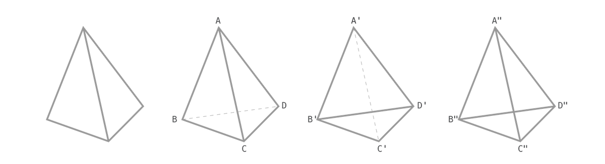
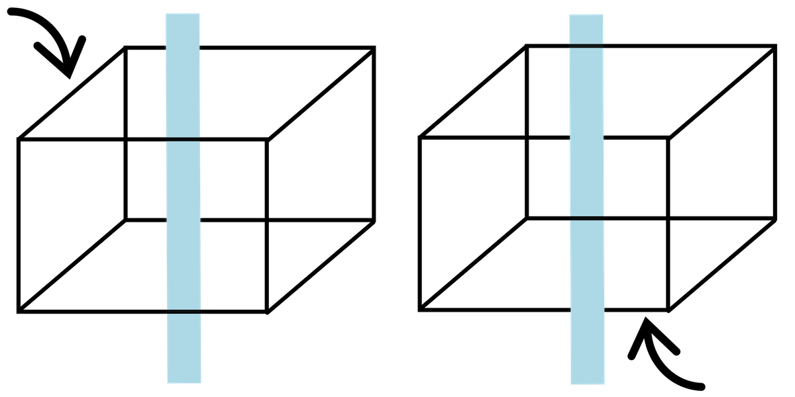
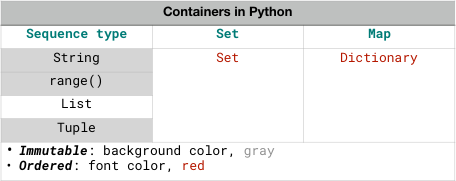
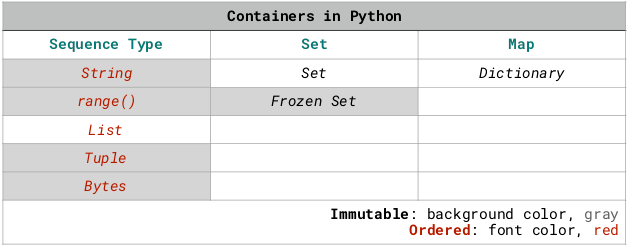
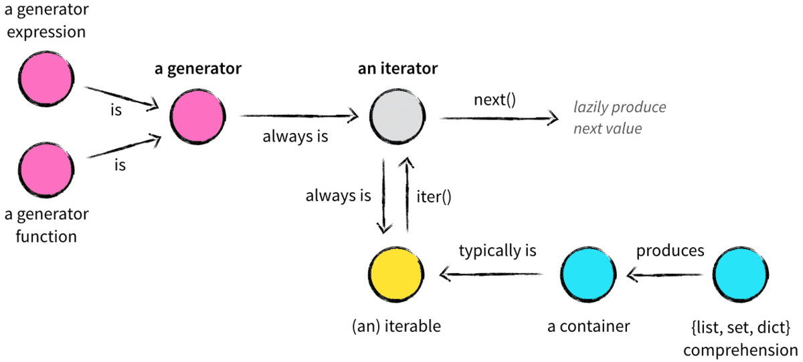

<!-- reading-navigation:start -->

<div dir="rtl" lang="fa">

[بخش قبلی: فایل‌ها](Part.1.E.7.files.md) · [فهرست مطالب](TOC.md) · [بخش بعدی: آموزش رسمی: The Python Tutorial](Part.1.G.The-Python-Tutorial-local.md)

</div>

<!-- reading-navigation:end -->


<a id="如何从容应对含有过多-过早引用-的知识"></a>
# چطور با دانشی که پر از Forward Reference است، با آرامش روبه‌رو شویم؟

اصطلاح «Forward Reference» ([ارجاع به چیزی که هنوز معرفی نشده است](https://en.wikipedia.org/wiki/Forward_declaration#id=Forward_reference)) در اصل از حوزهٔ کامپیوتر آمده است.

> **یادداشت مترجم — توضیح تکمیلی:** منظور این است که پیش از تعریف یا توضیح یک چیز، به آن اشاره کنیم یا از آن استفاده کنیم.

تقریباً در همهٔ زبان‌های برنامه‌نویسی، برای استفاده از variableها این شرط وجود دارد: «اول declaration، بعد استفاده». استفادهٔ مستقیم از variableای که declaration نشده، مجاز نیست. در Python هم همین‌طور است. اگر هرگز مقداری به `an_undefined_variable` نداده باشید و مستقیماً از آن استفاده کنید، مثلاً با `print(an_undefined_variable)`، این خطا را می‌گیرید: `NameError: name 'an_undefined_variable' is not defined`.

> **یادداشت مترجم — توضیح تکمیلی:** بیان بالا دربارهٔ «تقریباً همهٔ زبان‌ها» کلی است و قواعد زبان‌ها یکسان نیست. در Python، مسئله declaration جداگانه نیست؛ هنگام ارزیابی یک نام، آن نام باید به چیزی متصل شده باشد و در scope مربوط پیدا شود. assignment یکی از راه‌های ایجاد این اتصال است. تعریف یک function که در بدنه‌اش از نامی استفاده می‌شود، لزوماً مستلزم آن نیست که همان لحظه آن نام تعریف شده باشد؛ مهم زمان اجرای آن بخش است. بنگرید به [قواعد نام‌ها و اتصال آن‌ها در Python](https://docs.python.org/3/reference/executionmodel.html#naming-and-binding). نویسنده در ادامه از Forward Reference به‌صورت استعاری، برای «مفهومی که پیش از توضیح کافی به کار رفته» استفاده می‌کند.

```python
print(an_undefined_variable)
```

    ---------------------------------------------------------------------------
    
    NameError                                 Traceback (most recent call last)
    
    <ipython-input-1-7e0e1cc14e37> in <module>
    ----> 1 print(an_undefined_variable)
    
    NameError: name 'an_undefined_variable' is not defined

ساختار دانشی که پر از Forward Reference باشد، در ذهن به ساختارهایی شبیه «شکل‌های ناممکن» تبدیل می‌شود؛ همان شکل‌هایی که M. C. Escher در کشیدنشان مهارت داشت.



در تصویر بالا، سه شکل مخروط‌مانند اول معمولاً باعث سردرگمی دیداری نمی‌شوند؛ به‌ویژه شکل اول.

وقتی خط‌چین اضافه می‌شود، مثل شکل‌های دوم و سوم، فرض ما این است که خط‌چین «بخشی را نشان می‌دهد که در حالت عادی نباید دیده شود». در نتیجه، نقطهٔ `C` باید نسبت به `B` و `D` به ما نزدیک‌تر باشد؛ و `C'` باید نسبت به `B'` و `D'` از ما دورتر باشد…

اما در شکل چهارم، چون هم `B"D"` و هم `A"C"` خطِ پیوسته‌اند، ناگهان مبنای تشخیصمان را از دست می‌دهیم: بالاخره `C"` به ما نزدیک‌تر است یا دورتر؟

ابهام دربارهٔ جای یک نقطه، رابطهٔ آن را با سه نقطهٔ دیگر هم مبهم می‌کند. حالا اگر شکل به‌جای مخروط، مکعب باشد چه؟ ابهام دربارهٔ جای هر نقطه، ابهام‌های بیشتری دربارهٔ رابطهٔ آن با نقطه‌های بیشتری ایجاد می‌کند… اگر شکل، چندوجهیِ پیچیده‌تری باشد چطور؟



اگر این نقطه‌های سردرگم‌کننده را به Forward Reference تشبیه کنید، روشن می‌شود چرا ساختار دانشی که «Forward Referenceهای زیادی» دارد، این‌قدر گیج‌کننده است و سروکله زدن با آن این‌قدر خسته‌تان می‌کند، نه؟

<a id="过早引用就是无所不在"></a>
## Forward Reference همه‌جا هست

اما زندگی و یادگیری و کار، کامپیوتر نیستند و به این قاعده اعتنایی ندارند. بارها پیش می‌آید که چیزی را، چه تعریف شده باشد و چه نشده باشد، چه تعریفش روشن باشد و چه نباشد، بی‌مقدمه وسط می‌اندازند و به کار می‌برند.

برای بیشتر بچه‌هایی که به آن‌ها می‌گویند «فهمیده نیستی»، ریشهٔ تقریباً همهٔ رنج‌ها همین‌جاست: تعریف دقیق «فهمیده بودن» چیست؟ چه رفتاری نشانهٔ فهمیده بودن است و چه رفتاری نیست؟ چه‌بسا تمام کودکی‌شان را صرف حدس زدن این موضوع کنند و آخرش هم سرگردان بمانند. پدر و مادرشان هرگز به این فکر نکرده‌اند که وقتی با بچه حرف می‌زنند یا از او انتظاری دارند، بهتر است «اول تعریف کنند و بعد به کار ببرند»؛ یا حتی اگر از قبل توضیحی داده‌اند، توضیحشان مبهم بوده است… این بچه‌های بیچاره هم چاره‌ای ندارند جز اینکه با ترس و نگرانی راهشان را پیدا کنند؛ درست مثل جور کردن تکه‌های یک پازل در تاریکی.

البته در واقع، کار پدر و مادرها هم آسان نیست. جزئیات زیادی هست که گفتنشان به بچه فایده‌ای ندارد، یا نمی‌شود به‌روشنی توضیحشان داد؛ یا حتی اگر با زحمت فراوان توضیحشان بدهید، بچه اصلاً گوش نمی‌کند… بنابراین، گاهی واقعاً چاره‌ای نیست جز اینکه این Forward Referenceهای آزاردهنده همان‌طور باقی بمانند.

در رابطهٔ عاشقانه هم وضع همین است. بسیاری از مفاهیم، واقعاً و بدون تردید، Forward Reference هستند. عشق دقیقاً چیست؟ در آغاز، هیچ‌کس درست نمی‌داند. تجربه هم نشان می‌دهد بیشتر آدم‌های دوروبرمان به‌اندازهٔ خودمان سردرگم‌اند. «دانشی» هم که از رمان و فیلم گرفته‌ایم، هرچند برای خودمان دل‌نشین بوده، تقریباً به‌طور قطع برای طرف مقابل دردسرهای بی‌پایان می‌آورد؛ از نگاه او، شما انبوهی Forward Reference در هوا پخش کرده‌اید…

وقتی وارد محیط کار می‌شویم، در شغل‌های فنی وضع نسبتاً بهتر است. در حوزه‌های دیگر، Forward Reference همه‌جا هست؛ آن هم پنهان و نادیدنی. کار به جایی می‌رسد که آدم‌ها برایش دانشی رازآلود ساخته‌اند و اسمش را گذاشته‌اند «قواعد نانوشته».

هرچه سن آدم‌ها بالاتر می‌رود، دوست پیدا کردن برایشان سخت‌تر می‌شود. ساده‌ترین توضیح این است که گذشتهٔ هرکس برای دیگران مجموعه‌ای از Forward Referenceهاست. پس «زنده‌باد تفاهم»؟ کار خیلی سختی است! در مهدکودک و دبستان، آدم‌ها تقریباً نیازی ندارند آگاهانه برای فهمیدن یکدیگر تلاش کنند؛ حتی ضرورتی برایش احساس نمی‌کنند. در دورهٔ متوسطه، به‌خاطر انباشته شدن Forward Referenceها، فهمیدن یکدیگر کم‌کم به درجات مختلف دشوار می‌شود. بعد از دانشگاه و چند سال کار، نه‌تنها درک متقابل سخت‌تر و سخت‌تر می‌شود، بلکه فشار بزرگ‌تری هم به آن اضافه می‌شود: کارهای زندگی بیشتر می‌شوند و انرژی ذهنی بیشتری می‌گیرند. وقتی با Forward Reference نامفهومی روبه‌رو می‌شوید، دیگر کجا حوصلهٔ سروکله زدن با آن را دارید؟

<a id="不懂也要硬着头皮读完"></a>
## حتی اگر نمی‌فهمید، به هر زحمتی هست تا آخر بخوانید

واقعیت این است که بیشتر مهارت‌هایی که یادگیری‌شان دشوار است، چنین ویژگی‌ای دارند. معمولاً دربارهٔ این نوع دانش می‌گویند «منحنی یادگیری تندی دارد». اما این تعبیر فقط یک توصیف است و در عمل کمکی به یادگیری نمی‌کند. آیا برای روبه‌رو شدن با این وضعیت، راهبرد مؤثری وجود دارد؟

اول باید مهارت مهمی را یاد بگیرید:

> **حتی اگر نمی‌فهمید، تا آخر بخوانید؛ بعد بارها تکرار کنید.**

این مهم‌ترین نقطهٔ شروع است. ساده به نظر می‌رسد؛ شاید حتی کمی بی‌معنی. اما بعداً هرچه جلوتر بروید، عمیق‌تر درمی‌یابید که بیشتر آدم‌ها همین راهبرد ساده را نمی‌دانند و به همین خاطر بارها و بارها ضرر می‌کنند.

ساختار دانشی که پر از Forward Reference است، اصلاً نمی‌تواند با یک بار خواندن فهمیده شود. حتی برای فهمیدن کامل یک فیلم خوب هم باید چند بار تماشایش کنید؛ چه برسد به یادگیری دانشی پیچیده و مهم با این حجم از اطلاعات، نه؟ مثلاً [Pulp Fiction (1994)](https://www.imdb.com/title/tt0110912/) به کارگردانی Quentin Tarantino، [Fight Club (1999)](https://www.imdb.com/title/tt0137523/) به کارگردانی David Fincher، [Inception (2010)](https://www.imdb.com/title/tt1375666/) به کارگردانی Christopher Nolan، یا [Shutter Island (2010)](https://www.imdb.com/title/tt1130884/) به کارگردانی Martin Scorsese…

پس از همان ابتدا آماده باشید که *قرار است بارها تکرار کنید*. از همان ابتدا هم بپذیرید که *بار اول فقط کلیات را خواهید فهمید*.

قدیمی‌ها می‌گفتند: «کتاب را صد بار بخوانید، معنایش خودبه‌خود آشکار می‌شود.» دلیلش همین است. فقط آن زمان اصطلاحی از حوزهٔ کامپیوتر نداشتند که از آن کمک بگیرند؛ در نتیجه، خود این حرف هم به یک Forward Reference تبدیل می‌شد. کسی که هرگز تجربهٔ «صد بار خواندن» نداشته، حتماً فکر می‌کند این حرف فقط برای گول زدن اوست…

خوانندهٔ باتجربه وقتی کتابی برمی‌دارد تا مهارتی را خودش یاد بگیرد، اول نگاهی به فهرست مطالب (Table of Contents) می‌اندازد تا ببیند آیا مفهومی هست که اصلاً با آن آشنا نباشد. بعد واژه‌نامه (Glossary) را ورق می‌زند تا ببیند تا چه حد می‌تواند آن مفاهیم را بفهمد. سپس سراغ نمایه (Index) می‌رود و با کمک شمارهٔ صفحه‌ها، مستقیم به بخش‌های مربوط مراجعه می‌کند تا بیشتر جست‌وجو کند… پیش از خواندن سراسر کتاب، منابع (References) انتهای آن را هم نگاه می‌کند تا ببیند نویسنده به کتاب‌های کدام صاحب‌نظران برجسته استناد کرده؛ چه‌بسا همان موقع چند کتاب دیگر هم بخرد.

این کار آشکارا نشانهٔ تجربه است. بزرگ‌ترین فایده‌اش این است که «تا جای ممکن تعداد زیادی از Forward Referenceها را از پیش باز می‌کند» و بار فهمیدن را برای خود خواننده بسیار سبک‌تر می‌کند.

بنابراین، راه درست در دور اول این است که کتاب را **یک‌نفس، بدون توقف برای فهم تک‌تک جزئیات**، تا آخر بخوانید.

تعبیر چینیِ این کار، یعنی «عناب را درسته قورت دادن»، از ابتدا معنایی منفی داشته است. اما در این وضعیت خاص، بهترین راهبرد همین است. کسانی که عادت دارند از همان شروع خیلی دقیق و موشکاف باشند، اینجا ضرر می‌کنند: هرچه دقیق‌تر می‌شوند، Forward Referenceهای مختلف راحت‌تر دلسردشان می‌کنند. در نتیجه احساس شکست هم سریع‌تر در آن‌ها جمع می‌شود. چه‌بسا در پایان، همین‌ها زودتر از همه کنار بکشند؛ و علت شکستشان هم چیزی نباشد جز «بیش‌ازحد دقیق بودن»…

اگر بخواهیم برای این نوع خواندن در دور اول تعبیر مثبت‌تری پیدا کنیم، می‌شود گفت: «*برای کاوش در سرزمینی ناشناخته، اول نقشه‌ای سرسری بکشید.*» داشتن نقشه همیشه از نداشتنش بهتر است. البته بهتر است نقشه دقیق باشد، اما حتی «نقشهٔ نادقیق» هم هزاران بار بهتر از «هیچ نقشه‌ای نداشتن» است، نه؟ تازه، همیشه می‌توان آن را اصلاح کرد. کدام نقشهٔ دنیا از ابتدا همین‌قدر دقیق بوده و با اصلاح‌های تدریجی به شکل امروزی‌اش نرسیده است؟

<a id="磨练-只字不差-的能力"></a>
## مهارت «خواندن بدون جا انداختن حتی یک کلمه» را پرورش دهید

یاد گرفتن مهارت تازه از راه خواندن، به‌ویژه وقتی بخواهید «تا جای ممکن فقط با خواندن» یاد بگیرید، قطعاً با «خواندن برای لذت بردن» خیلی فرق دارد.

برای خواندن یک لطیفه، رمان یا مقاله‌ای که این روزها همه دنبالش هستند، معمولاً نیازی به خواندن دقیق نیست. مرور سرسری کافی است؛ نهایتاً در بخش‌هایی که خیلی به آن‌ها علاقه دارید، سرعتتان را کم می‌کنید و با دقت بیشتری می‌خوانید…

اما اگر برای یاد گرفتن مهارت تازه می‌خوانید، باید مهارت ویژهٔ «**خواندن بدون جا انداختن حتی یک کلمه**» را به کار ببرید.

بله، این مهارتی است که همهٔ خودآموزهای توانمند دارند و مرتب از آن استفاده می‌کنند. به‌ویژه هنگام خواندن تعریف یک مفهوم مهم، باید همین کار را بکنید: تک‌تک کلمه‌های تعریف کاربرد دارند و باید در معنی هر واژه و دامنهٔ مصداق‌های آن دقت کنید. آن مفهوم چیست؟ چه چیزی نیست؟ دقیقاً چه معنایی دارد و چه چیزهایی را در بر می‌گیرد؟ بنابراین، موقع استفاده از آن باید مراقب چه چیزهایی باشید؟

نکتهٔ جالب این است که بیشتر کسانی که در خودآموزی ضعیف‌اند، همه‌چیز را مثل رمان می‌خوانند: همین‌طور گذری و سرسری…

آیا دقت کرده‌اید که بیشتر آدم‌ها موقع تماشای فیلم، بیشتر جزئیات را از دست می‌دهند؟ بااین‌حال، ظاهراً این موضوع از لذت تماشایشان کم نمی‌کند. حتی می‌توانند از تکه‌هایی که بعد از ندیدن انبوه جزئیات باقی مانده، یک «داستان کامل» بسازند؛ البته معمولاً در واقع «داستان دیگری که ظاهراً کامل است». بعد وقتی دربارهٔ همان فیلم با آن‌ها حرف می‌زنید، اغلب حس می‌کنید انگار در یک سینما ننشسته‌اید و یک فیلم را ندیده‌اید…

شاید مهم‌ترین دامِ آنچه «ضعف در خودآموزی» می‌نامیم، همین باشد:

> بسیاری از آدم‌ها هر بار که مهارت تازه‌ای یاد می‌گیرند، فقط به این دلیل که نمی‌توانند بدون جا انداختن حتی یک کلمه بخوانند، جزئیات زیادی را از دست می‌دهند. در پایان، درست مثل کسی که «نسخهٔ بدل و ناقصِ فیلم دیگری را دیده»، در واقع «نسخهٔ بدل و ناقصی از مهارت دیگری را یاد گرفته‌اند»…

در یادگیری Python، مثالی هست که این وضعیت را نشان می‌دهد.

در Python می‌توان به loopِ `for` یک بخش `else` اضافه کرد. کافی است در Google عبارت [`for else python`](https://www.google.com/search?q=for+else+python) را جست‌وجو کنید تا ببینید چند نفر مدام می‌پرسند این بخش چه‌کار می‌کند. لینک‌های دیگری هم پیدا می‌کنید که معنای این «رازِ» `for... else` را توضیح می‌دهند و اسم‌هایی مثل «syntactic sugar» رویش می‌گذارند…

درحالی‌که [آموزش رسمی](https://docs.python.org/3/tutorial/controlflow.html#break-and-continue-statements-and-else-clauses-on-loops) خیلی روشن توضیحش داده و مثال هم آورده است:

> statementهای loop می‌توانند یک بخش `else` داشته باشند. این بخش وقتی اجرا می‌شود که loop به‌خاطر تمام شدن اعضای list در `for`، یا false شدن شرط در `while`، پایان یابد؛ اما اگر loop با statementِ `break` متوقف شود، اجرا نمی‌شود. loop زیر که به‌دنبال عددهای اول می‌گردد، این موضوع را نشان می‌دهد:
>
> ```python
> >>> for n in range(2, 10):
> ...     for x in range(2, n):
> ...         if n % x == 0:
> ...             print(n, 'equals', x, '*', n//x)
> ...             break
> ...     else:
> ...         # loop fell through without finding a factor
> ...         print(n, 'is a prime number')
> ...
> 2 is a prime number
> 3 is a prime number
> 4 equals 2 * 2
> 5 is a prime number
> 6 equals 2 * 3
> 7 is a prime number
> 8 equals 2 * 4
> 9 equals 3 * 3
> ```

فقط دو حالت وجود دارد:

> * یا اصلاً آن را نخوانده‌اند؛
> * یا خوانده‌اند، اما متوجه این جزئیات نشده‌اند…

حالت دوم ترسناک‌تر است؛ مثل اینکه همان پول را داده باشید، اما نسخهٔ ناقص دیگری از فیلم را دیده باشید…

چرا می‌گویم «خواندن بدون جا انداختن حتی یک کلمه» مهارتی ویژه است؟ خودتان که امتحان کنید، می‌فهمید. آگاهانه سرعتتان را کم کرده‌اید، در معنی هر کلمه و هر واژه تأمل کرده‌اید، حتی برای اینکه درست بفهمید کلی یادداشت برداشته‌اید… اما وقتی دوباره «بدون جا انداختن حتی یک کلمه» می‌خوانید، اغلب «با تعجب کشف می‌کنید» که باز چند جا را از قلم انداخته بودید! بله، این مهارتی است که برای تسلط واقعی بر آن به تمرین مکرر و آموزش طولانی‌مدت نیاز دارید. اصلاً به آن سادگی نیست که به گوش می‌رسد.

پس _در دور دوم و سوم، حتماً باید مهارت ویژهٔ «خواندن بدون جا انداختن حتی یک کلمه» را به کار بگیرید_. همین یک کار کافی است تا **با دیگران فرق داشته باشید**.

<a id="好的记忆力很重要"></a>
## حافظهٔ خوب مهم است

مرحلهٔ بالاترِ «حتی اگر نمی‌فهمید، تا آخر بخوانید» این است: «**حتی اگر هنوز نمی‌فهمید، فعلاً به خاطر بسپارید.**»

آدم‌ها عموماً از «حفظ کردن طوطی‌وار» بدشان می‌آید… اما راستش این نگاه سطحی است. البته کسانی هستند که «در حفظ کردن طوطی‌وار مهارت دارند، اما هیچ کاری بلد نیستند». بااین‌حال، آدم‌های دارای حافظهٔ قوی که در واقع «بسیار خوانده‌اند و خوب به خاطر سپرده‌اند»، بسیار بیشترند.

در حوزه‌هایی که Forward Reference در آن‌ها رایج است، حافظهٔ خوب امتیاز بزرگی است. درست به یاد نیاوردن، نتوانستنِ به خاطر سپردن، یا اصلاً فراموش کردن، از ضعف‌هایی است که بیشترین مانع را در خودآموزی ایجاد می‌کند؛ به‌ویژه وقتی پای «نکته‌های دانشیِ دارای Forward Reference» در میان باشد.

اما چیزی که خیلی‌ها متوجهش نیستند این است که حافظه هم فقط «یک مهارت» است؛ مهارتی که در واقع هر زمان می‌توان با تمرین هدفمند تقویتش کرد.

مهم‌تر اینکه صد جور راه برای جبران محدودیت حافظه وجود دارد. مثلاً روشن‌ترین و ساده‌ترین راه، همان حرف معروف است: «نوشتهٔ کم‌رنگ از حافظهٔ قوی بهتر است»…

پس در بیشتر موقعیت‌های عادی، این «درست یادم نیست، نمی‌توانم به خاطر بسپارم، یا اصلاً یادم رفته» چیزی جز نتیجهٔ تنبلی نیست. اگر کسی تنبل باشد، نخواهد تنبلی‌اش را بپذیرد، و چون نمی‌پذیرد، برای اصلاحش هم کاری نکند، خب… دیگر حرفی نمی‌ماند؛ بگذارید همان‌طور زندگی کند.

> **یادداشت مترجم — توضیح تکمیلی:** نسبت دادن فراموشی به تنبلی، داوری و تأکید انگیزشی نویسنده است، نه معیاری پزشکی برای ارزیابی حافظه. این جمله را نباید تشخیص علت مشکلات حافظه در افراد دانست.

البته برای بهتر به خاطر سپردن دانش کاربردی، راه ساده و عملی دیگری هم هست. در مقایسه با این راه، انواع «روش‌های حفظ سریع» که در بازار پیدا می‌شوند معمولاً چندان فایده‌ای ندارند.

این همان روشی است که در ادامه می‌آید: «مرتب کردن، دسته‌بندی و جمع‌بندی». **وقتی بارها این کارها را انجام دهید، عجیب است اگر مطلب در خاطرتان نماند!**

<a id="尽快开始整理归纳总结"></a>
## هرچه زودتر مرتب کردن، دسته‌بندی و جمع‌بندی را شروع کنید

از زاویه‌ای دیگر، نوشتن کتاب دربارهٔ چنین دانشِ به‌هم‌پیوسته‌ای برای نویسنده فقط یک چالش نیست؛ باری هم هست که نمی‌تواند از زیرش شانه خالی کند.

[The Python Tutorial](https://docs.python.org/3/tutorial/index.html) در وب‌سایت رسمی Python، به‌عنوان بهترین متن آموزشی Python شناخته می‌شود؛ چون نویسنده‌اش همان سازندهٔ زبان Python، یعنی [Guido van Rossum](https://en.wikipedia.org/wiki/Guido_van_Rossum)، است…

Guido van Rossum هرقدر هم بااحتیاط پیش رفته باشد، باز نتوانسته در توضیح‌هایش از تعداد زیادی Forward Reference دوری کند. نشانهٔ این احتیاط را می‌توان در فهرست مطالب دید؛ جایی که پنج بار واژهٔ **More** آمده است:

> * ابزارهای بیشتر برای control flow — More Control Flow Tools
> * بیشتر دربارهٔ تعریف functionها — More on Defining Functions
> * بیشتر دربارهٔ listها — More on Lists
> * بیشتر دربارهٔ شرط‌ها — More on Conditions
> * بیشتر دربارهٔ moduleها — More on Modules

چند بار ابتدا موضوع را اجمالی توضیح داده، بعد در جای دیگری دوباره با عمق بیشتری به آن برگشته است… روشن است که این نویسنده نهایت تلاشش را کرده؛ هم در ساختن یک زبان برنامه‌نویسی و هم در نوشتن یک آموزش.

بااین‌حال، همین کتاب هم برای هر تازه‌کاری دشوار است. نویسندهٔ خوب بودن آسان نیست.

پس بقیهٔ کار ناگزیر بر عهدهٔ خود خواننده است؛ چون حتی تواناترین نویسنده هم فقط تا همین‌جا می‌تواند پیش برود.

بعد از دور اولِ خواندنِ کلی، باید فوراً کارِ «**جمع‌بندی**، **دسته‌بندی**، **مرتب کردن** و **سازمان دادن** نکته‌های کلیدی» را شروع کنید. اینکه خودتان دست‌به‌کار شوید و این کارها را انجام دهید، از ویژگی‌های کسانی است که در یادگیری بسیار موفق‌اند. آن‌ها فقط به روش ساده‌ای مسلط شده‌اند که دیگران اصلاً فکر نکرده‌اند لازم است یادش بگیرند. حتماً دفتری دارند پر از *فهرست*، *نمودار* و *جدول*؛ رایج‌ترین ابزارهای مرتب کردن، سازمان دادن و دسته‌بندی دانش و مفاهیم. استفاده از این ابزارها هم بی‌نهایت ساده به نظر می‌رسد.

گفتن و دیدن این روش بسیار ساده است. اما شاید دقیقاً چون این‌قدر ساده به نظر می‌رسد، بیشتر آدم‌ها نادیده‌اش می‌گیرند… در مقابلِ یادگیرنده‌های موفق، بیشترِ دیگران برای فریب دادن خودشان بهانهٔ یکسانی دارند: «وقتی یکی دیگر قبلاً آماده‌اش کرده، همان را برمی‌داریم و استفاده می‌کنیم!» چقدر هم حق‌به‌جانب به نظر می‌رسد…

اما در واقع، **کافی است خودتان انجامش دهید تا بفهمید**: مرتب کردن، دسته‌بندی، سازمان دادن و دوباره تکرار کردن، فرایندی پردردسر است. دلیل واقعیِ دست‌به‌کار نشدنِ دیگران فقط همین است: دردسرش را دوست ندارند و از زحمتش می‌ترسند. خلاصه‌اش در یک کلمه می‌شود **تنبلی**! ولی چه کسی دلش می‌خواهد قبول کند تنبل است؟ هیچ‌کس. پس برای خودشان دلیل‌های ظاهرپسند پیدا می‌کنند؛ مثل همان «وقتی دیگری قبلاً انجامش داده، چرا من دوباره انجامش بدهم؟» یا این یکی: «اصلاً دنیا را آدم‌های تنبل جلو می‌برند!»

کم‌کم این حرف‌های آبرومندانه کارِ خودفریبی را به بهترین شکل انجام می‌دهند و در نهایت خود شخص هم باورشان می‌کند! به این ترتیب، ایرادی به او اضافه می‌شود که واقعاً وجود دارد، اما هرگز پیدایش نمی‌کند؛ **خودش هم خبر ندارد**.

وقتی برای اولین بار فصل پنجم [آموزش رسمی Python](https://docs.python.org/3/tutorial/datastructures.html) را به‌طور کلی خواندم، همان موقع جدولی از مفهوم‌های مربوط به containerها تهیه کردم:



**اما این تصویر اشتباه است!**

چون در نخستین دورِ «خواندنِ کلیِ بجا»، نوع دادهٔ `Bytes` را کاملاً رد کرده بودم. بعدتر، پس از چند دور مرور و مطالعهٔ عمیق‌تر، رفتم سراغ فصل پنجمِ [The Python Language Reference](https://docs.python.org/3/reference/datamodel.html)، یعنی `Data Model`، و فهمیدم `Set` هم نوع Immutable دارد: `Frozen Set`… البته بزرگ‌ترین اشتباهم این بود که موقع مرتب کردن مطالب، حواسم نبود و «Ordered» را برعکس نوشته بودم!

> **یادداشت مترجم — توضیح تکمیلی:** در متن اصلی، شمارهٔ فصلِ `Data Model` «پنجم» آمده است؛ در [فهرست رسمی Language Reference](https://docs.python.org/3/reference/index.html)، `Data Model` فصل سوم است. نام‌های دقیق typeهای مورد اشاره در Python عبارت‌اند از `bytes`، `set` و `frozenset`. Immutable یعنی محتوای خود object پس از ساخته شدن تغییرپذیر نیست؛ Ordered به وجود ترتیب مشخص برای پیمایش مربوط است، نه لزوماً مرتب بودن بر اساس مقدار. این دو ویژگی را نباید یکی دانست. بنگرید به [نوع‌های استاندارد](https://docs.python.org/3/library/stdtypes.html).

پس حتماً لازم بود دوباره آن را مرتب کنم. بعد از چند دور اصلاح، تصویر به شکل زیر درآمد:



> ضمناً از Python 3.7 به بعد، Dictionary ترتیبِ درج را حفظ می‌کند، یعنی insertion ordered است:<br />
https://docs.python.org/3/library/collections.html#ordereddict-objects

> **یادداشت مترجم — توضیح تکمیلی:** نکتهٔ آموزشی این دو جدول، مقایسهٔ containerها بر اساس ویژگی‌هایی مانند نوع داده، تغییرپذیری و داشتن ترتیب است؛ جدول اول عمداً به‌عنوان نمونهٔ اشتباه آمده است. در استفاده از جدول اصلاح‌شده هم نکتهٔ بعدی نویسنده دربارهٔ `dict` را در نظر بگیرید: حفظ ترتیب درج از Python 3.7 جزو تضمین‌های زبان است؛ در CPython 3.6 نیز وجود داشت، اما ویژگی پیاده‌سازی بود. `set` و `frozenset` ترتیب درجِ تضمین‌شده ندارند. شرح متنی این مفاهیم را در [فصل فارسی containerها](Part.1.E.6.containers.md) و [مستندات رسمی mappingها](https://docs.python.org/3/library/stdtypes.html#mapping-types-dict) ببینید.

این فرایندِ انجام دادن با دست خودتان واقعاً «پردردسر» است؛ اما در عمل فرایندی است که به تقویت حافظه‌تان کمک می‌کند، و برای تقویت آن به دست خودتان، کاملاً ضروری است. عادت کنید خودتان دست‌به‌کار شوید! عادت کنید پیوسته کارتان را اصلاح کنید!

نمونهٔ دیگری از کسی که خوب یاد می‌گیرد ببینید:

> https://nvie.com/posts/iterators-vs-generators/

نویسنده، Vincent Driessen، در این نوشته می‌گوید:

> این نوشته را به‌عنوان مرجعی دم‌دستی برای مراجعهٔ بعدیِ خودم می‌نویسم.

حتی وقتی همین‌طور برای خودش نموداری می‌کشد، دلش نمی‌آید آن را بی‌دقت و نازیبا رها کند:



> **یادداشت مترجم — توضیح تکمیلی:** پیام اصلی نمودار این است که این مفاهیم مرتبط‌اند، اما یکی نیستند: iterable چیزی است که می‌توان روی اعضایش پیمایش کرد؛ iterator وضعیتِ پیشروی در پیمایش را نگه می‌دارد و عضو بعدی را می‌دهد؛ generator نوعی iterator است. در اینجا لازم نیست جزئیات را حفظ کنید؛ نمودار نمونه‌ای از سازمان دادنِ رابطهٔ مفاهیم است. توضیح رسمی را در [واژه‌نامهٔ Python](https://docs.python.org/3/glossary.html#term-iterator) می‌توانید ببینید.

کسانی که در خودآموزی قوی‌اند، یک ویژگی دارند: **از زحمت نمی‌ترسند**. بچه که بودم، مادرم زیاد می‌گفت: «از دردسر می‌ترسی؟ پس چرا زنده‌ای؟ خودِ زندگی چقدر دردسر دارد!» حرف عمیقی است.

<a id="先关注使用再研究原理"></a>
## اول روی استفاده تمرکز کنید، بعد سراغ مبانی بروید

ما انسان‌ها از همان ابتدا در استفاده از چیزها، مهارت‌ها، اصول و دانشی که واقعاً نمی‌فهمیم، توانمند بوده‌ایم…

بیش از سه هزار سال پیش، یک کشتی تجاریِ فنیقی‌های اروپا هنگام حرکت در رود Belus به گل نشست… خدمه به ساحل شنی رفتند. گرسنه بودند؛ چه می‌کردند؟ آتش روشن کردند و غذا پختند. بعد از غذا، با تعجب دیدند روی شن‌های زیر دیگ چیزهای براق و درخشانی هست! دانش شیمی امروز برای آن‌ها Forward Referenceای بود که در تمام عمرشان هم دست‌یافتنی نمی‌شد. ماهیت و سازوکار این ماده را نمی‌فهمیدند، اما با کمی بررسی متوجه شدند زیر دیگ مقداری از سودای طبیعی‌ای چسبیده بود که حمل می‌کردند… پس نتیجه گرفتند اگر سودای طبیعی و شن را با آتش حرارت بدهند، شاید این ماده به وجود بیاید؛ امروزه می‌دانیم شن، ماسهٔ سیلیسی دارد. چند بار آزمایش کردند و موفق شدند. به این ترتیب فنیقی‌ها ساختن مهره‌های شیشه‌ای را یاد گرفتند و ثروت زیادی به دست آوردند…

> **یادداشت مترجم — نیازمند بررسی:** این روایتِ پیدایش شیشه در اصل به‌صورت واقعه‌ای تاریخی نقل شده، اما در این ترجمه صحت تاریخیِ جزئیات آن تأیید نشده است. موقعیت جغرافیایی، شیوهٔ کشف و شرایط لازم برای ساخت شیشه را نباید صرفاً بر اساس این حکایت قطعی دانست؛ همچنین این روایت دستور آزمایش عملی نیست.

حدود دو هزار و پانصد تا دو هزار و ششصد سال پیش، شاکیامونی (Shakyamuni) با فهم خود و مفاهیم محدود آن دوران، تجربهٔ نشستن در مراقبه را به‌تفصیل شرح داد؛ او شش سال پیوسته مراقبه کرده بود. امروز دانشمندان غربی در پژوهش‌های عمیق دربارهٔ مغز دریافته‌اند که [مراقبه (Meditation)](https://en.wikipedia.org/wiki/Meditation) فواید بسیار زیادی برای مغز دارد… این فایده‌ها به‌خودی‌خود فایده‌اند و هیچ ربطی به دین ندارند.

> * [عصب‌پژوه Harvard: مراقبه فقط استرس را کم نمی‌کند؛ مغزتان را هم تغییر می‌دهد](https://www.washingtonpost.com/news/inspired-life/wp/2015/05/26/harvard-neuroscientist-meditation-not-only-reduces-stress-it-literally-changes-your-brain/)
> * [مغز شما هنگام مراقبه؛ توضیح علمیِ اینکه چرا باید هر روز مراقبه کنید](https://www.psychologytoday.com/us/blog/use-your-mind-change-your-brain/201305/is-your-brain-meditation)
> * [پژوهشگران بررسی می‌کنند که مراقبه ظاهراً چگونه مغز بیماران مبتلا به افسردگی را تغییر می‌دهد](https://news.harvard.edu/gazette/story/2018/04/harvard-researchers-study-how-mindfulness-may-change-the-brain-in-depressed-patients/)
> * [محل اثرهای آرام‌بخش مراقبه در مغز مشخص شد](https://www.scientificamerican.com/article/meditations-calming-effects-pinpointed-in-brain/)
> * [گونه‌های مختلف مراقبه، بخش‌های متفاوتی از مغز را تمرین می‌دهند](https://www.newscientist.com/article/2149489-different-meditation-types-train-distinct-parts-of-your-brain/)

> **یادداشت مترجم — نیازمند بررسی:** ادعای «شش سال پیوسته مراقبه کردن» و تعمیمِ فواید مراقبه، به همان صورتِ متن نویسنده منتقل شده‌اند. جزئیات تاریخی و میزان تعمیم‌پذیری نتایج پژوهش‌های ذکرشده در این ترجمه مستقلاً تأیید نشده‌اند؛ این بخش توصیهٔ درمانی نیست.

می‌بینید؟ ما از همان ابتدا می‌توانستیم مستقیماً از چیزها، مهارت‌ها، اصول و دانشی استفاده کنیم که واقعاً نمی‌فهمیدیم! پس چرا بعداً دیگر نتوانستیم؟

یا بهتر است بپرسیم: از چه زمانی از چیزهایی که واقعاً نمی‌فهمیم ترسیدیم، جرئت استفاده از آن‌ها را از دست دادیم و حتی دیگر جرئت امتحان کردنشان را هم نداشتیم؟

یک توضیح نسبتاً آزاردهنده وجود دارد: **مدرسه رفتن خرابمان کرده است**.

همهٔ دانشی که در مدرسه تدریس می‌شود از نوع «اول تعریف، بعد استفاده» است. برعکس، مدرسه همیشه از دانشی که چنین ساختاری ندارد دوری می‌کند. مثلاً درس سرمایه‌گذاری و معامله را در برنامهٔ آموزش اجباریِ هیچ‌جای دنیا نمی‌بینید. با اینکه سرمایه‌گذاری و معامله مهارت‌هایی ضروری‌اند که هرکس باید و ناگزیر است یادشان بگیرد، و از بعضی نظرها حتی از ریاضی و زبان هم مهم‌ترند، مدرسه واقعاً چنین چیزهایی را آموزش نمی‌دهد.

علاوه بر این، مدت مدرسه و دانشگاه رفتنِ آدم‌ها هم بیشتر و بیشتر شده است. دبستان، متوسطه و دورهٔ کارشناسی در مجموع شانزده سال… این همه سال «تربیت شدن» برای بیشتر آدم‌ها فقط توهمی جدی، عمیق و حتی پاک‌نشدنی به وجود می‌آورد: خیال می‌کنند همهٔ دانش‌ها از همین نوع‌اند… اما بدشانسی اینجاست که تقریباً هیچ‌کدام از دانش‌های واقعاً مفید و ضروریِ دنیا از این نوع نیستند؛ حقیقت آزاردهنده‌ای است.

> **یادداشت مترجم — توضیح تکمیلی:** داوری‌های کلیِ این بندها دربارهٔ همهٔ مدرسه‌ها، همهٔ نظام‌های آموزشی و ضرورت سرمایه‌گذاری و معامله، دیدگاه نویسنده‌اند؛ نه نتیجهٔ بررسیِ نظام‌های آموزشی در این ترجمه. عدد شانزده سال هم به مسیر آموزشیِ مورد نظر نویسنده مربوط است و لزوماً برای همهٔ کشورها و افراد صدق نمی‌کند.

اما شما حالا فرق دارید؛ باید از این چارچوب بیرون بیایید. این عادت را در خودتان بسازید:

> به‌هرحال، اول استفاده را شروع کنید. فهم کاملِ مبانی که قرار نیست فوراً ممکن شود؛ زمان زیادی لازم دارد.

اگر اشتباه استفاده کردید، اشکالی ندارد؛ اصلاحش کنید. اگر خوب استفاده نمی‌کنید، اشکالی ندارد؛ با استفادهٔ بیشتر بهتر می‌شوید. همین که شروع به استفاده کنید، سرعت فهمتان بیشتر می‌شود. اینکه «شناخت واقعی از عمل به دست می‌آید» حرف توخالی نیست.

گاهی دقیقاً چون هیچ اشتباهی نکرده‌اید، فرصتی هم برای اصلاح نداشته‌اید؛ در نتیجه هرگز کاری را درست انجام نداده‌اید.

<a id="尊重前人的总结和建议"></a>
## به جمع‌بندی‌ها و توصیه‌های پیشینیان بها بدهید

یکی از رایج‌ترین اشتباه‌های جوان‌ها در زندگی این است که این حرف را کاملاً بی‌ارزش می‌دانند:

> اگر به حرف بزرگ‌ترها گوش ندهید، ضررش را خیلی زود می‌بینید.

برای جوان‌ها، حرف بزرگ‌ترها واقعاً آزاردهنده است؛ به‌خصوص وقتی با احساس فعلی‌شان جور درنمی‌آید.

اما این احساس «آزاردهنده بودن» اغلب یک دام است. چون آن حرف‌ها فقط Forward Reference هستند: در ذهن جوان «اجرا نمی‌شوند» و «TypeError می‌دهند»…

خیلی‌ها هم ناخواسته «گوش ندادن به بزرگ‌ترها» را با «مستقل فکر کردن» اشتباه می‌گیرند و آخرش خودشان ضرر می‌کنند. بدیِ ماجرا این است که وقتی متوجه ضررشان می‌شوند، زمان زیادی از دست رفته و دیگر کاری از دستشان برنمی‌آید.

می‌توانید این را مشاهده کنید: یکی از ویژگی‌های شاگردهای ممتاز این است که «هرچه معلم بگوید انجام می‌دهند»؛ بدون چون‌وچرا.

مثلاً بالاتر به شما گفته شد «باید خودتان دست‌به‌کار شوید». پس از همین حالا، در هرجا که لازم است، واقعاً خودتان کارِ «**جمع‌بندی**، **دسته‌بندی**، **مرتب کردن** و **سازمان دادن** نکته‌های کلیدی» را انجام دهید… آن‌وقت حتماً خوب یاد می‌گیرید. اما اگر در برابر همین توصیه مدام بپرسید «چرا؟»، «راه ساده‌تری نیست؟»… دیگر کارتان تمام است؛ شکستتان حتمی است.

در فرایند یاد گرفتن کدنویسی، چیزهای مهم زیادی هست که در واقع جزو «خودِ زبان برنامه‌نویسی» نیستند. مثلاً اینکه variableها را چطور نام‌گذاری کنید یا کد را چطور سازمان بدهید. این «قواعد» از آن‌هایی نیستند که به‌محض زیر پا گذاشتنشان بمیرید<a href='#fn1' name='fn1b'><sup>[1]</sup></a>. تازه در ابتدای کار، همین چیزها پرحرفی و دردسر اضافی به نظر می‌رسند… اما اگر رعایتشان نکنید، یا حتی از وجودشان خبر نداشته باشید، در نهایت هرگز نمی‌توانید پروژهٔ بزرگی بنویسید و همیشه در حد کارهای کوچک می‌مانید. چرا؟ می‌شود با همان جمله‌ای جواب داد که بیشتر از همه از آن بدتان می‌آید:

> بزرگ که شدید، می‌فهمید…

یکی از فایده‌های خودآموزیِ برنامه‌نویسی این است که فرصت می‌دهد خوبیِ «قواعد» و «توصیه‌ها» را ببینید. همین‌طور فرصت می‌دهد ببینید رعایت نکردنشان چه ضرری دارد؛ ضرری که اغلب خیلی زود گریبانتان را می‌گیرد.

در Python مفهومی هست به نام PEP، کوتاه‌شدهٔ Python Enhancement Proposals. حتماً زمانی برای خواندنش بگذارید؛ بارها بخوانید و خوب به خاطر بسپارید:

> https://www.python.org/dev/peps/pep-0008/

> **یادداشت مترجم — توضیح تکمیلی:** PEP نام یک مجموعه سند است، نه فقط یک سند. لینک نویسنده به PEP 8، راهنمای سبک نوشتن کد Python، اشاره دارد. توضیح فرایند و انواع PEP را در [PEP 1](https://peps.python.org/pep-0001/) و خود راهنمای سبک را در [PEP 8](https://peps.python.org/pep-0008/) ببینید.

در نهایت درمی‌یابید که موضوع فقط برنامه‌نویسی نیست. فکر و وسعت نگاهی که پشت چنین چیزهایی است، برای کل زندگی بسیار مفید است.

-----
**پاورقی**

<a name='fn1'>[1]</a>: شاید واقعاً هم به مرگ منجر شود… این خبرِ سپتامبر ۲۰۱۸ را دربارهٔ اتفاقی در San Francisco ببینید: [برنامه‌نویسی به چهار همکارش در یک شرکت سازندهٔ نرم‌افزار ERP شلیک کرد](https://www.theregister.co.uk/2018/09/20/developer_work_shooting/).

> **یادداشت مترجم — توضیح تکمیلی:** این ارجاع و لحن آن از نویسنده است. صرفِ نقل این خبر، رابطهٔ علّی میان رعایت نکردن قواعد کدنویسی و خشونت را اثبات نمی‌کند.

<a href='#fn1b'><small>↑ بازگشت به متن ↑</small></a>


<!-- reading-navigation:start -->

<div dir="rtl" lang="fa">

[بخش قبلی: فایل‌ها](Part.1.E.7.files.md) · [فهرست مطالب](TOC.md) · [بخش بعدی: آموزش رسمی: The Python Tutorial](Part.1.G.The-Python-Tutorial-local.md)

</div>

<!-- reading-navigation:end -->
