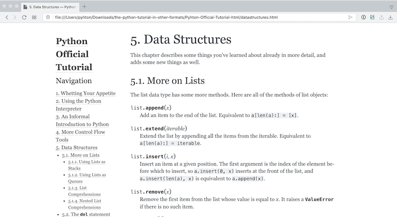
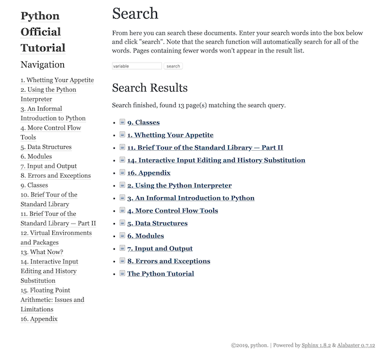

<!-- reading-navigation:start -->

<div dir="rtl" lang="fa">

[بخش قبلی: چطور با دانشی که پر از Forward Reference است، با آرامش روبه‌رو شویم؟](Part.1.F.deal-with-forward-references.md) · [فهرست مطالب](TOC.md) · [بخش بعدی: دست‌وپاچلفتی بودن و صبوری](Part.2.A.clumsy-and-patience.md)

</div>

<!-- reading-navigation:end -->


<a id="官方教程the-python-tutorial"></a>
# آموزش رسمی: The Python Tutorial

درست است که شیوهٔ چیدن مطالب برنامه‌نویسی در هفت فصلِ بخش اول، بسیار متفاوت و واقعاً مؤثر بود:

> * برخلاف آموزش‌های دیگر، با «Hello world!» شروع نکرد؛
> * ترتیب مطالبش هم مثل همهٔ کتاب‌های آموزش برنامه‌نویسیِ بازار نبود؛
> * از همان ابتدا روح برنامه را به شما شناساند: عملیات Boolean؛
> * خیلی زود روشن کرد که برنامه‌های معنادار در اصل فقط دو جزء اصلی دارند: عملیات و کنترل جریان؛
> * خیلی زود نشان داد که از زاویه‌ای دیگر، functionها چیزی نیستند جز «محصول‌هایی که برنامه‌نویس در نقش کاربر از آن‌ها استفاده می‌کند»؛
> * روی ابتدایی‌ترین و درعین‌حال مهم‌ترین نوع داده، یعنی string، تأکید کرد؛
> * از دیدگاه containerها، بیشترِ «نوع‌های دادهٔ مهم» در Python را به شما شناساند؛
> * و مهم‌تر از همه، قول «یادگیری فوری» نداد، اما قول داد «شما را وارد این دنیا کند»… و روشن است که به این قول عمل کرد.

اما هدف اصلیِ بخش اول این بود که شما را **با الفبای این حوزه آشنا کند**. کار این بخش هنوز آن نیست که شما را به کسی تبدیل کند که «برنامه‌نویسی را یاد گرفته است». بیشتر به شما این توانایی را می‌دهد که از این به بعد منابع مهم‌تری، مثل آموزش رسمی و مستندات مرجع، بخوانید. مطالب بخش اول بیشتر شبیه **راهنمای علائم نقشه** هستند، نه خود نقشه.

مهم‌ترین نتیجهٔ چند بار خواندن بخش اول این است:

> حالا می‌توانید خودتان در مستندات رسمی دنبال پاسخ بگردید…

دست‌کم، از این به بعد خواندن [The Python Tutorial](https://docs.python.org/3/tutorial/index.html) آن‌قدر سخت نیست؛ حداقل می‌توانید بیشتر مطالبش را با تکیه بر خودتان بفهمید…

هم‌زمان با ادامهٔ خواندن این کتاب، هر وقت فرصت پیدا کردید، بارها به The Python Tutorial سر بزنید.

<a id="官方文档中最重要的链接"></a>
## مهم‌ترین لینک‌ها در مستندات رسمی

شاید Python در میان همهٔ زبان‌های برنامه‌نویسیِ امروز، بهترین عملکرد را در زمینهٔ مستندسازی (Documenting) داشته باشد؛ انگار واقعاً لازم نیست بعد از «بهترین»، عبارت «یکی از» را اضافه کنیم. جامعهٔ Python برای ساختن مستندات کامل، حتی ابزار ویژه‌ای هم دارد: [Sphinx](http://www.sphinx-doc.org/en/master/). این حاصل اهمیتی است که جامعهٔ Python از همان ابتدا به [قواعد مستندسازی](https://devguide.python.org/documenting/) می‌داد. خیلی از مستندات کامپیوتری که در اینترنت می‌بینید، احتمالاً در این وب‌سایت میزبانی می‌شوند: [Read the Docs](https://readthedocs.org)…

نشانی مستندات رسمی Python این است:

> https://docs.python.org/3/

دو لینکی که در آن برای تازه‌کارها از همه مهم‌ترند، عبارت‌اند از:

> * **[Tutorial؛ آموزش](https://docs.python.org/3/tutorial/index.html)**: https://docs.python.org/3/tutorial/index.html
> * **[Library Reference؛ مرجع کتابخانه](https://docs.python.org/3/library/index.html)**: https://docs.python.org/3/library/index.html

از نظر نظری، وقتی مفاهیم پایه را بدانید، بهترین کار این است که خودتان بارها The Python Tutorial رسمی را بخوانید. هیچ کتاب مقدماتی‌ای از آن بهتر نیست؛ چون نویسنده‌اش همان سازندهٔ Python است: [Guido van Rossum](https://en.wikipedia.org/wiki/Guido_van_Rossum)، کسی که به او «دیکتاتور خیرخواه» می‌گویند.

> **یادداشت مترجم — توضیح تکمیلی:** ارزیابی «بهترین بودن» آموزش و مستندات، نظر نویسنده است. لقب Guido van Rossum به نقش تاریخی او در هدایت Python اشاره دارد؛ این عبارت را نباید توصیف ساختار کنونی ادارهٔ پروژه دانست. دربارهٔ ساختار ادارهٔ Python، [PEP 13](https://peps.python.org/pep-0013/) را ببینید.

خودش خوش‌تیپ است، اما پلاک ماشینش از خودش هم جذاب‌تر است؛ تصویر از [صفحهٔ شخصی](https://gvanrossum.github.io) Guido van Rossum گرفته شده است:


> **یادداشت مترجم — توضیح تکمیلی:** اشارهٔ طنزآمیز این تصویر به نوشتهٔ PYTHON روی پلاک است. نام خانوادگی در این جملهٔ متن اصلی به‌شکل «van Rossume» آمده؛ این لغزش املایی در ترجمه با صورت شناخته‌شدهٔ «van Rossum» نوشته شده است.

<a id="为什么一定要阅读官方文档"></a>
## چرا حتماً باید مستندات رسمی را بخوانید؟

با خریدن یکی دو کتاب آموزش Python نمی‌شود به‌طور کامل بر Python مسلط شد. در واقع، در این جمله می‌توانید به‌جای Python نام هر زبان دیگری را بگذارید.

ویژگی‌های کتاب آموزشی و مستندات رسمی خیلی با هم فرق دارند؛ مثلاً مخاطب، شیوهٔ سازمان دادن مطالب و نوع بیانشان… اما بزرگ‌ترین تفاوت در «جامع بودن» است. هیچ کتاب آموزشیِ واحدی نمی‌تواند به‌اندازهٔ مستندات رسمی جامع باشد. مزیت کتاب‌های آموزشی این است که بیشتر برای تازه‌کارها و کسانی طراحی شده‌اند که تازه وارد این حوزه می‌شوند؛ اما در مقابل، از جامعیت و عمق مطالب کم کرده‌اند.

مثلاً در همین کتاب، دربارهٔ [Bytes Object](https://docs.python.org/3/library/stdtypes.html#bytes-objects) بحث نخواهیم کرد. فقط من هم چنین انتخابی نکرده‌ام؛ آموزش‌های مشهور Python مثل [Think Python: How to Think Like a Computer Scientist](http://greenteapress.com/thinkpython2/html/index.html) و [Dive into Python](https://linux.die.net/diveintopython/html/toc/index.html) هم به موضوع Bytes Object نپرداخته‌اند.

> **یادداشت مترجم — توضیح تکمیلی:** `bytes` نوعی داده برای نگهداری دنباله‌ای از بایت‌هاست و با `str`، که برای متن به کار می‌رود، یکسان نیست. مقایسهٔ نویسنده با کتاب‌های دیگر به نسخه‌های مورد اشارهٔ او مربوط است، نه لزوماً نسخه‌های تازهٔ آن‌ها. لینک Dive into Python به کتابی دربارهٔ Python 2 اشاره دارد و نباید کدهایش را بدون بررسی با Python 3 سازگار فرض کرد؛ بنگرید به [معرفی همان کتاب](https://linux.die.net/diveintopython/html/preface.html).

مستندات رسمی در عمل نمی‌توانند بیش‌ازحد برای تازه‌کارها ساده‌سازی شوند؛ بالاخره جامع، معتبر و دقیق بودن وظیفهٔ مهم‌تری برای آن‌هاست. به همین دلیل، خیلی‌ها در شروع سراغ انواع کتاب‌ها و آموزش‌های غیررسمی می‌روند. قرار بود بعد از ورود به این حوزه، «فقط مستندات رسمی را بخوانیم» یا «اولین مرجع جست‌وجو حتماً مستندات رسمی باشد». اما برای خیلی‌ها ماجرا به این تبدیل شده که «از اول تا آخر از مستندات رسمی، یا همان حرفه‌ای‌ترین توضیح‌های مکتوب، دوری کنیم». این خوب نیست و واقعاً ضرر دارد؛ تازه خودتان هم نمی‌توانید بفهمید چقدر ضرر کرده‌اید. مدام خیال می‌کنید همه‌چیز را یاد گرفته‌اید، درحالی‌که دانسته‌هایتان از همان ابتدا اصلاً جامع نبوده است.

این اصل را به خاطر بسپارید و رعایت کنید:

> **اولین مرجع جست‌وجو باید مستندات رسمی باشد.**

برای همین، وقتی با Google جست‌وجو می‌کنم، اغلب از این قالب استفاده می‌کنم:

> `<queries> site:python.org`

گاهی حتی مشخص می‌کنم جست‌وجو در کدام مسیر انجام شود:

> `bytes site:python.org/3/library`؛ این لینک را امتحان کنید: [bytes site:python.org/3/library](https://www.google.com/search?q=byte+site%3Apython.org%2F3%2Flibrary)

> **یادداشت مترجم — توضیح تکمیلی:** در قالب بالا، `<queries>` جای عبارت مورد جست‌وجوی شماست و `site:` دامنه یا مسیر جست‌وجو را محدود می‌کند. لینک اصلی، برخلاف متن نمایشیِ `bytes`، عبارت `byte` را جست‌وجو می‌کند؛ مقصد آن برای وفاداری حفظ شده است. مسیر مستندات کتابخانه روی میزبان `docs.python.org` است؛ برای جست‌وجوی دقیق‌تر می‌توانید از [bytes site:docs.python.org/3/library](https://www.google.com/search?q=bytes+site%3Adocs.python.org%2F3%2Flibrary) استفاده کنید.

این اصل برای هر زبانی کاربرد دارد. در آینده، وقتی package یا library تازه‌ای یاد می‌گیرید، قابلیت‌های جدیدِ نسخهٔ تازهٔ یک زبان را بررسی می‌کنید، یا حتی زبان دیگری می‌آموزید، همین کار را بکنید. آنچه «توانایی فوق‌العاده در خودآموزی» می‌نامیم، اساساً نیرویی است که از چند عادت کوچکِ این‌چنینی و چند روش بسیار پایه‌ای ساخته می‌شود.

<a id="将官方文档拉回本地"></a>
## مستندات رسمی را روی کامپیوتر خودتان داشته باشید

شاید خواندن The Python Tutorial روی کامپیوتر خودتان راحت‌تر باشد؛ به‌ویژه اگر با Sphinx دوباره خروجی بسازید، می‌توانید فهرست کامل مطالب را همیشه در سمت چپ صفحه ببینید:



می‌توانید آموزش را به قالب epub هم تبدیل کنید تا روی دستگاه‌های همراه بخوانید. حتی می‌شود فایل‌های مبدأ `.rst` این صفحه‌ها را به `.ipynb` تبدیل کرد تا هنگام مرورشان در Jupyter Lab، کدهای داخلشان را مستقیماً اجرا کنید…

**توجه**

> همهٔ Code Cellهای این صفحه حاوی دستورهای اجرایی Bash هستند…

اجرای آن‌ها در همین صفحه برای شما فایده‌ای ندارد، چون نتیجهٔ اجرا روی سرور قرار می‌گیرد. باید این دستورها را در Terminal کامپیوتر خودتان اجرا کنید تا نتیجه را روی همان کامپیوتر دریافت کنید.

> **یادداشت مترجم — توضیح تکمیلی:** این توضیح از نسخهٔ Notebook کتاب آمده است؛ این فایل Markdown خودش Code Cell اجرایی ندارد. در Jupyter، محل ایجاد فایل‌ها به محل اجرای kernel بستگی دارد و الزاماً سرور راه‌دور نیست. `%%bash` یک cell magic در IPython است که محتوای cell را با Bash اجرا می‌کند؛ اگر دستورها را در خودِ Bash اجرا می‌کنید، آن خط را وارد نکنید. دستورهای زیر با فرض محیط Unix-like، وجود Bash، و در مواردی Conda و `make` نوشته شده‌اند و برای اجرای مستقیم در CMD یا PowerShell ویندوز مناسب نیستند. `~` در مسیرهای Bash به پوشهٔ خانگی کاربر اشاره دارد. کدهای تاریخیِ اصل بدون تغییر، حتی commentهای چینی، حفظ شده‌اند. این دستورهای نصب، clone، تبدیل و ساخت در جریان ترجمه اجرا نشده‌اند و سازگاری آن‌ها با نسخه‌های امروز تأیید نشده است. بنگرید به [مستندات cell magicهای IPython](https://ipython.readthedocs.io/en/stable/interactive/magics.html#cell-magics).

<a id="安装-git"></a>
### نصب Git

```bash
%%bash
which git
git --version

# 没有的话就执行以下命令安装 git
# conda install -c anaconda git
```

> **یادداشت مترجم — توضیح تکمیلی:** comment چینی می‌گوید اگر Git نصب نیست، دستور نصبِ خط بعد را اجرا کنید. چون آن خط با `#` شروع شده، در این بلوک خودبه‌خود اجرا نمی‌شود. این الگو در commentهای نصبِ بعدی هم به کار رفته است.

<a id="下载源文件"></a>
### دریافت فایل‌های مبدأ

فایل‌های مبدأ The Python Tutorial اینجا هستند:

> https://github.com/python/cpython/tree/master/Doc/tutorial

نشانی repository، یا به‌اختصار repo، این است:

> https://github.com/python/cpython.git

با Git، repo را در پوشهٔ `~/Download/` دریافت کنید:

```bash
%%bash
cd ~/Downloads
# 总计 175M（文件大小随版本变动），所以需要一点时间
git clone https://github.com/python/cpython.git
cd cpython/Doc/tutorial
ls
```

> **یادداشت مترجم — توضیح تکمیلی:** متن اصلی `~/Download/` نوشته، اما کد به `~/Downloads` می‌رود؛ این تفاوت در ترجمه حفظ شده است. comment چینی حجم را در زمان نگارش حدود ۱۷۵ مگابایت دانسته و گفته بسته به نسخه تغییر می‌کند؛ این عدد برآورد امروز نیست. دستور `git clone` کل repository را دریافت می‌کند، نه فقط پوشهٔ آموزش. لینک تاریخیِ بالا به branchِ `master` اشاره دارد؛ برای مبدأ فعلی، [پوشهٔ آموزش در branchِ main](https://github.com/python/cpython/tree/main/Doc/tutorial) را ببینید. مبدأِ branchِ در حال توسعه ممکن است با مستندات نسخهٔ نصب‌شدهٔ شما یکسان نباشد.

<a id="安装-rst2ipynb"></a>
### نصب rst2ipynb

```bash
%%bash
# rst2ipynb needs pandoc and notedown...
which pandoc
which notedown
# 没有这两样东西的话，需要执行下面两行进行安装……
# conda install -c conda-forge pandoc
# conda install -c conda-forge notedown

# install rst2ipynb
cd ~/Downloads
git clone https://github.com/nthiery/rst-to-ipynb.git
cd rst-to-ipynb
pip install .
which rst2ipynb
```

> **یادداشت مترجم — توضیح تکمیلی:** commentها می‌گویند rst2ipynb به Pandoc و notedown نیاز دارد و اگر این دو موجود نیستند، باید دو دستور نصبِ commentشده را اجرا کنید. این‌ها وابستگی‌های روشِ معرفی‌شده در زمان نگارش‌اند؛ وضعیت نگهداری و سازگاری کنونی این زنجیره در این ترجمه آزمایش نشده است.

<a id="批量转换-rst-至-ipynb"></a>
### تبدیل گروهی rst به ipynb

این برنامهٔ rst2ipynb کمی آزاردهنده است: هر بار فقط یک فایل را پردازش می‌کند… کد زیر یک برنامهٔ Bash است که یاد گرفتنش در آینده هم چندان سخت نیست؛ از ظاهرش پیداست که کمی به Python شباهت دارد… بعد از اجرای کد زیر، «هشدارهای» زیادی می‌بینید. اشکالی ندارد؛ فایل‌ها به‌طور عادی تبدیل می‌شوند.

```bash
%%bash
cd ~/Downloads/cpython/Doc/tutorial/
for f in *.rst
    do
        rst2ipynb $f -o "${f/%.rst/.ipynb}"
    done
mkdir ipynbs
mv *.ipynb ipynbs/
```

به این ترتیب، همهٔ فایل‌های rst را به ipynb تبدیل کرده‌اید و در `~/Downloads/cpython/Doc/tutorial/ipynbs/` ذخیره شده‌اند. می‌توانید این پوشه را به هرجایی که دوست دارید منتقل کنید. با JupyterLab محلی یا برنامهٔ [Nteract](https://nteract.io) آن‌ها را باز کنید.

اگر بعداً مرتب لازم داشتید فایل‌های `rst` یک پوشه را گروهی تبدیل کنید، این functionِ Bash را در فایل `~/.bash_profile` بگذارید؛ کافی است کد زیر را به انتهای آن اضافه کنید:

```bash
function rsti {
    for f in *.rst
    do
    rst2ipynb $f -o "${f/%.rst/.ipynb}"
    done
}
```

بعد یک بار در Terminal این دستور را اجرا کنید:

```bash
source ~/.bash_profile
```

از آن به بعد، در پوشه‌ای که فایل‌های `.rst` دارد، کافی است `rsti` را وارد و اجرا کنید…

> **یادداشت مترجم — توضیح تکمیلی:** اطمینان نویسنده دربارهٔ بی‌اشکال بودن هشدارها، گزارش تجربهٔ اوست؛ هر هشداری را نمی‌توان بی‌خطر دانست و باید نتیجهٔ تبدیل را بررسی کرد. این کد فرض می‌کند در پوشهٔ درست هستید، فایل‌های ورودی وجود دارند و پوشهٔ خروجی با وضعیت مورد انتظار سازگار است؛ برای همهٔ نام‌فایل‌ها و اجرای تکراری مقاوم‌سازی نشده است. فایل `~/.bash_profile` هم تنظیمات Bash است، نه همهٔ shellها؛ کد اصلی عمداً اصلاح نشده است.

<a id="用-sphinx-生成-htmlepub-版本"></a>
### ساخت نسخهٔ html/epub با Sphinx

```bash
%%bash
which sphinx-quickstart
# 没有的话就执行下一行：
# conda install -c anaconda sphinx
sphinx-quickstart --version
sphinx-quickstart --help
```

نسخه‌های html و epub را بسازید:

```bash
%%bash
cd ~/Downloads/cpython/Doc/tutorial/
sphinx-quickstart -q output --sep -p 'The Python Tutorial' -a 'Guido van Rossum' -r '1.0' -v '1.0' -l 'en' --suffix '.rst' --master 'index' --ext-autodoc --ext-doctest --ext-intersphinx --ext-todo --ext-coverage --ext-imgmath --ext-mathjax --ext-ifconfig --ext-viewcode --makefile --no-batchfile --no-use-make-mode
cp -f *.rst output/source/
cd output
make html
make epub

# 生成的 html 版本应该在 output/build/html 目录下；
# 生成的 epub 版本应该在 output/build/epub 目录下。

# sphinx-quickstart -q output \
# --sep \
# -p 'The Python Tutorial' \
# -a 'Guido van Rossum' \
# -v '1.0'
# -r '1.0' \
# -l 'en' \
# --suffix '.rst' \
# --master 'index' \
# --ext-autodoc \
# --ext-doctest \
# --ext-intersphinx \
# --ext-todo \
# --ext-coverage \
# --ext-imgmath \
# --ext-mathjax \
# --ext-ifconfig \
# --ext-viewcode \
# --makefile \
# --no-batchfile \
# --no-use-make-mode
```

> **یادداشت مترجم — توضیح تکمیلی:** دو comment چینی محل خروجی‌های html و epub را به‌ترتیب `output/build/html` و `output/build/epub` بیان می‌کنند؛ این مسیرها از دید پوشهٔ پیش از `cd output` هستند. این روشِ ساخت مستقل، به نسخهٔ Sphinx و جزئیات فایل‌های مبدأ CPython وابسته است. گزینه‌های تاریخیِ `sphinx-quickstart` و کپی کردنِ صرفِ فایل‌های `.rst` را نباید دستورِ تضمین‌شده برای ساخت مستندات امروز دانست؛ فایل‌های Python ممکن است به تنظیمات، extensionها و منابع دیگری نیاز داشته باشند. برای روشِ پشتیبانی‌شده به [راهنمای ساخت مستندات Python](https://devguide.python.org/documentation/start-documenting/index.html#building-the-documentation) و برای گزینه‌ها به [مستندات sphinx-quickstart](https://www.sphinx-doc.org/en/master/man/sphinx-quickstart.html) مراجعه کنید.

نسخه‌ای که به این شکل با Sphinx ساخته می‌شود، امکان جست‌وجو در مستندات محلی را دارد و واقعاً کمی راحت‌تر از خواندن در وب‌سایت است:



> **یادداشت مترجم — توضیح تکمیلی:** تصویر اولِ این بخش، فهرست آموزش را کنار محتوای صفحه نشان می‌دهد؛ تصویر دوم، صفحهٔ جست‌وجو و نتیجه‌های پیدا‌شده در همان مجموعهٔ محلی را. منظور، دسترسی به فهرست و جست‌وجو بدون مراجعهٔ مداوم به وب‌سایت است، نه اینکه لازم باشد متن داخل تصویر را بخوانید تا دستورهای ساخت را بفهمید.

<a id="下载已经转换好的版本"></a>
### دریافت نسخهٔ ازپیش‌تبدیل‌شده

اگر در میانهٔ کار مشکلی پیش آمد که نتوانستید حلش کنید، مستقیماً نسخهٔ ازپیش‌تبدیل‌شده را دریافت کنید:

```bash
%%bash
cd ~/Downloads
git clone https://github.com/xiaolai/the-python-tutorial-in-other-formats.git
```

> **یادداشت مترجم — توضیح تکمیلی:** این repository متعلق به منبعی است که نویسنده معرفی کرده؛ نباید به‌روز بودن یا رسمی بودن خروجی‌هایش را فرض کرد. برای دریافت قالب‌های آمادهٔ رسمی، [صفحهٔ دانلود مستندات Python](https://docs.python.org/3/download.html) نیز در دسترس است؛ نسخهٔ مورد نیازتان را بررسی کنید.

<a id="完整的-python-doc-制作"></a>
### ساخت مجموعهٔ کامل مستندات Python

در واقع، مجموعهٔ کامل مستندات Python از قبل فایل‌های لازم برای ساخت خروجی را در repository دارد:

> `cpython/Doc/Makefile`

فقط اگر همهٔ فایل‌ها را در یک epub بسازید، باز کردنش روی دستگاه‌های همراهی مثل iPad کمی سنگین می‌شود. روی دستگاه من ۷۷۰۱ صفحه نشان می‌داد و حتی هنگام ورق زدن هم کمی مکث می‌کرد…

اگر می‌خواهید از این `Makefile` رسمی استفاده کنید، اول مطمئن شوید Sphinx را نصب کرده‌اید. بعد باید یک package دیگر هم نصب کنید:

```bash
pip install blurb
```

سپس در Terminal به پوشهٔ Doc بروید و این دستورها را اجرا کنید:

```bash
make html
make epub
```

> **یادداشت مترجم — توضیح تکمیلی:** تعداد صفحه‌ها و کندیِ گفته‌شده، تجربهٔ نویسنده با نسخه و دستگاه آن زمان است. همچنین نصب Sphinx و blurb به‌تنهایی لزوماً برای ساخت نسخهٔ فعلی کافی نیست؛ وابستگی‌ها و روش آماده‌سازی را از [راهنمای رسمی ساخت مستندات](https://devguide.python.org/documentation/start-documenting/index.html#building-the-documentation) و فایل‌های همان نسخهٔ CPython بررسی کنید. هیچ‌یک از دستورهای این فصل در فرایند ترجمه اجرا نشده است.


<!-- reading-navigation:start -->

<div dir="rtl" lang="fa">

[بخش قبلی: چطور با دانشی که پر از Forward Reference است، با آرامش روبه‌رو شویم؟](Part.1.F.deal-with-forward-references.md) · [فهرست مطالب](TOC.md) · [بخش بعدی: دست‌وپاچلفتی بودن و صبوری](Part.2.A.clumsy-and-patience.md)

</div>

<!-- reading-navigation:end -->
