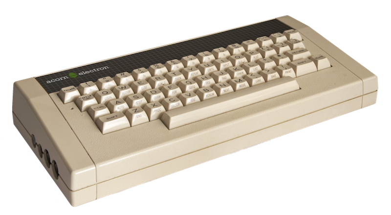

<!-- reading-navigation:start -->

<div dir="rtl" lang="fa">

[بخش قبلی: آموزش رسمی: The Python Tutorial](Part.1.G.The-Python-Tutorial-local.md) · [فهرست مطالب](TOC.md) · [بخش بعدی: تمرین هدفمند](Part.2.B.deliberate-practicing.md)

</div>

<!-- reading-navigation:end -->


# دست‌وپاچلفتی بودن و صبوری

فرایند خودآموزی را در واقع باید به چهار مرحلهٔ زیر تقسیم کرد؛ هرچند این مرحله‌ها اغلب تا حدی با هم هم‌پوشانی دارند:

> * یاد گرفتن
> * تمرین کردن
> * به کار بستن
> * خلق کردن

همین که خواندن بلد باشید، نمی‌توانید جلوی میل خود به خواندن را بگیرید. همین که احساس کنید چیزی «ارزش یاد گرفتن» دارد، دلتان می‌خواهد آن را یاد بگیرید. در واقع همهٔ آدم‌ها همیشه در حال یادگیری‌اند؛ فقط در انتخاب هدف، شیوهٔ یادگیری و میزان کارایی با هم فرق دارند.

بیشتر مردم هرگز این مرحله‌ها را از هم جدا نکرده‌اند و بررسی نکرده‌اند که در هر مرحله باید چه رویکردی داشته باشند. همین توضیح می‌دهد که چرا این‌همه آدم، با وجود میل همیشگی به خواندن و یاد گرفتن، تا پایان عمر هم بر هیچ مهارت قابل‌اعتنایی مسلط نمی‌شوند… چون در همان مرحلهٔ اول راه را اشتباه می‌روند، در مرحلهٔ دوم دست می‌کشند، از مرحلهٔ سوم مستقیم می‌گذرند و همیشه فقط «به‌زحمت کارشان را راه می‌اندازند»؛ مرحلهٔ چهارم هم که اصلاً به فکرشان نرسیده است…

محتوای بخش اول عمدتاً برای نشان دادن فرایند «یاد گرفتن» بود. **یاد گرفتن به تکرار نیاز دارد**؛ گاهی حتی به تکرار بسیار زیاد، به‌ویژه وقتی با ساختاری از دانش روبه‌رو می‌شوید که پر از «ارجاع به مطالب هنوز آموزش‌داده‌نشده» است.

یادگیریِ چندباره، بیش از همه توانایی «دسته‌بندی و سامان دادن» را تقویت می‌کند. جالب‌تر اینکه در بیشتر موارد این اتفاق خودبه‌خود می‌افتد. کافی است به تکرار ادامه دهید تا مغزتان ناخودآگاه مطالبی را که یاد گرفته‌اید از مطالبی که هنوز بر آن‌ها مسلط نشده‌اید جدا کند. پرداختن به دستهٔ اول آسان است و حتی می‌توانید از آن‌ها بگذرید؛ اما دستهٔ دوم توجه و بررسی دقیق‌تری می‌خواهد… در این فرایند، بیشتر کارِ دسته‌بندی و سامان‌دهی به‌طور خودکار انجام می‌شود. در پایان فقط کمی «جمع‌بندی و مرتب‌سازیِ آگاهانه برای تکمیل کار» لازم است؛ و کار تمام است.

بیشتر آدم‌ها همیشه امیدوارند با یک بار خواندن یاد بگیرند؛ پس شکستشان از پیش معلوم است. اما وقتی با این شکست روبه‌رو می‌شوند، نمی‌دانند که هیچ ربطی به استعداد و هوش ندارد، چون وضعیت همه همین است. در دل نتیجه می‌گیرند که استعداد ندارند و حتی به هوش خود شک می‌کنند. بعد بی‌سروصدا کنار می‌کشند، به امید اینکه در جای دیگری استعداد و هوششان را ثابت کنند. آنجا هم دوباره به همان شکست ناگزیر می‌رسند و بارها و بارها برایشان «ثابت می‌شود» که استعداد و هوش کافی ندارند… تا اینکه شبیه آن سگ می‌شوند:

> در یک آزمایش روان‌شناسی، سگی را داخل حصار گذاشتند. حصار چندان بلند نبود و سگ در حالت عادی می‌توانست با یک جهش از آن بگذرد. اما قلادهٔ برقی به گردنش بسته بودند و هر وقت نشانه‌ای از تلاش برای پریدن نشان می‌داد، به او شوک می‌دادند… پس از چند بار تلاش، سگ دیگر برای بیرون پریدن کوشش نکرد؛ با اینکه واقعاً می‌توانست از حصار بگذرد. نتیجهٔ شگفت‌انگیزتر این بود که بعداً، وقتی او را در حصاری بسیار کوتاه گذاشتند، حتی حصاری که می‌توانست بدون پریدن از روی آن قدم بردارد، باز هم آرام داخل حصار ماند.

خودآموزی یک فن است و برنامه‌نویسی هم تا حد زیادی یک فن است. در بیشتر موارد، مسلط شدن بر آن هیچ ربطی به استعداد و هوش ندارد؛ خیلی‌ها مهارت‌های پایهٔ برنامه‌نویسی را در سنین نوجوانی یاد می‌گیرند. بنیادی‌ترین ویژگی همهٔ فن‌ها این است:

> **بیش از هر چیز به زمان متکی‌اند.**

درست مثل مهارت رانندگی است: کسی که بیست سال بدون حادثه رانندگی کرده، قطعاً با کسی که تازه پشت فرمان نشسته فرق دارد؛ اما این تفاوت واقعاً ربط چندانی به استعداد و هوش ندارد…

در بخش دوم بالاخره وارد مرحلهٔ «به کار بستن» می‌شویم. صبر کنید، پس «تمرین» را جا انداختیم؟ نه؛ راهبرد ما این است: **به‌کارگیری را محرک تمرین کنیم**؛ یعنی در جریان استفادهٔ مداوم، تمرین هدفمند را هم پیش ببریم.

تمرین و یادگیری تا حدی هم‌پوشانی دارند. مثلاً ممکن است مطالب بخش اول را دو سه بار «یاد گرفته باشید» و بعد به بخش دوم برسید و «به کار بستن» را شروع کنید. در حین استفاده، هر وقت فرصت یا نیازی پیش بیاید، ممکن است برگردید و مطالب بخش اول را دوباره «مرور کنید»…

فرقی نمی‌کند پیش از این چند بار مرحلهٔ «یاد گرفتن» را تکرار کرده باشید؛ همین که تمرین را شروع کنید، ناگزیر انواع دست‌وپاچلفتی بودن را تجربه خواهید کرد. یک بار علامت نقل‌قول یا پرانتزی را جا می‌اندازید؛ بار دیگر ناخواسته به‌جای نویسه‌های انگلیسی از نشانه‌های تمام‌عرض استفاده می‌کنید؛ یا می‌بینید اشتباهی ساده را مرتب تکرار می‌کنید، مثلاً در پایان خط آغازین یک بلوک دستور، دونقطه را فراموش می‌کنید…

این کاملاً طبیعی است.

هر بار که چیز تازه‌ای را خودتان یاد می‌گیرید، خود را «نوزادی که دوباره به دنیا آمده» تصور کنید. در حقیقت، هر بار خودآموزی واقعاً نوعی تولد دوباره است. وقتی بر مهارت تازه‌ای مسلط شوید، دیگر آدم قبلی نیستید؛ آدم دیگری شده‌اید.

نوزادی که تلوتلوخوران راه رفتن یاد می‌گیرد، واقعاً دست‌وپاچلفتی است؛ اما چه کسی فکر می‌کند دوست‌داشتنی نیست؟

به همین ترتیب، وقتی تازه استفاده از مهارتی را شروع می‌کنید، دست‌وپاچلفتی بودن در واقع دوست‌داشتنی است؛ فقط دیگران دیگر این‌طور نمی‌بینند، چون ظاهر شما ظاهر یک بزرگ‌سال است. اما آن بخش از مغزتان که مشغول یادگیری است، با مغز یک نوزاد تازه‌متولدشده هیچ تفاوتی ندارد.

در بخش اول، ضرورت «تمرین» چندان زیاد نبود… حتی چون با ساختار دانشی روبه‌رو بودیم که در آن «[ارجاع به مطالب هنوز آموزش‌داده‌نشده](Part.1.F.deal-with-forward-references.md)» فراوان است، عجله برای تمرین می‌توانست اثر منفی داشته باشد. وقتی کسی ساختار پیچیدهٔ دانشی را که پیش رویش است درست نمی‌شناسد ــ همان ساختاری که پر از ارجاع به مطالب آینده است ــ و از قبل راهبردی برای مواجهه با آن ندارد، طبق عادت هم‌زمان با یاد گرفتن تمرین می‌کند. وقتی مطلب را درست نفهمیده، طبعاً تمرین هم برایش روشن نیست. کم‌کم احساس شکست آن‌قدر شدید می‌شود که خودبه‌خود دست می‌کشد… حتی ممکن است هرچه بیشتر تمرین کند، بیشتر گرفتار «احساس شکستِ غیرضروری» شود.

همهٔ فعالیت‌هایی که «بیش از هر چیز به زمان متکی‌اند» همین‌طورند: پیش از شروع، باید جدی خودتان را از نظر ذهنی آماده کنید. اینکه با خواندن یک کتاب آموزشی یا گذراندن یک کلاس دیگر «بلد شده‌اید»، معمولاً چیزی جز تصور اشتباه یا توهم نیست.

> - اول باید بدانید که این فرایند قطعاً بسیار طولانی‌تر از «تصور ساده‌انگارانهٔ اولیه» خواهد بود.
> - دوم باید بدانید، و این آگاهی برایتان روزبه‌روز طبیعی‌تر شود، که همه‌جا تکرار فراوان لازم است. خواندن را باید بارها تکرار کنید؛ تمرین را بارها؛ انجام دادن را هم بارها…

با چنین آمادگی ذهنی‌ای، حفظ صبوری نسبتاً آسان‌تر می‌شود.

یکی از ریشه‌های رایج بی‌صبری این است که «از اول آماده نبودیم این‌همه وقت و انرژی صرف کنیم». پس طبیعی است که خیلی زود از «بودجهٔ زمان و انرژی» خود فراتر برویم و راحت‌تر مضطرب شویم؛ درست مثل کسی که سرمایهٔ چندانی ندارد و در کسب‌وکار بیشتر در معرض شکست است.

همین توضیح می‌دهد که چرا هنگام نوشتن این کتاب، مخاطبان اصلی‌ام دانشجویان سال اول دانشگاه و دانش‌آموزان سال اول دبیرستان بودند؛ حتی دانش‌آموزان سال اول دورهٔ متوسطهٔ اول:

> آن‌ها بیش از همه «سرمایهٔ» خودآموزی دارند…

پس از پایان دوران تحصیل، بیشتر مردم دیگر به‌سختی سرمایهٔ لازم برای «یک بعدازظهر کامل خواندن»، «یک روز تمام تمرین کردن» یا «یک شب تا صبح سرگرم چیزی شدن» را دارند. از طرف دیگر، فشارهای زندگی بیشتر و نیاز به «قابل‌استفاده شدنِ» مهارت تازه فوری‌تر می‌شود. در نتیجه، در هر بار خودآموزی، برای «سرمایه‌گذاریِ وقت و انرژی» دست‌به‌عصا و خسیسانه عمل می‌کنند…

**نگاه بودجه‌محور** بسیار مهم است. اینکه کسی این نگاه را داشته باشد یا نه، و این نگاه چقدر پخته باشد، تا حد زیادی توانایی درآمدزایی آیندهٔ او را تعیین می‌کند.

بیشتر مردم نه‌تنها در این زمینه پخته نیستند، بلکه اصلاً تصوری از بودجه‌بندی ندارند! این بنیادی‌ترین علتِ مناسب نبودن بیشتر مردم برای راه‌اندازی کسب‌وکار است.

بدون اغراق، کافی است در آینده فقط به یک اصل پایبند بمانید تا احتمالاً از ۹۹ درصد مردم جلو بیفتید:

> هرگز کاری را که بودجهٔ کافی برایش ندارید شروع نکنید.

شرم‌آور است، اما من تازه پس از چهل‌سالگی، بعد از شکست‌های فراوان در کارآفرینی و سرمایه‌گذاری و پرداخت هزینه‌هایی باورنکردنی، معنای عمیق این اصلِ به‌ظاهر بیش‌ازحد ساده را فهمیدم؛ آن هم منی که مدرک کارشناسی‌ام حسابداری بود! خوش‌شانسی‌ام این بود که برای خودآموزی همیشه بودجهٔ فراوانی کنار می‌گذاشتم…

حدود سال ۱۹۸۴، در شهر مرزی و دورافتادهٔ یانجی (Yanji)، در یک کلاس تابستانیِ آشنایی با کامپیوتر در مرکز محلی کودکان و نوجوانان ثبت‌نام کردم که شهریه‌اش ۱۰ یوان بود. نام خانوادگی معلم «جین» (Jin) بود، زبان BASIC درس می‌داد و دستگاهی که استفاده می‌کردیم این بود:



باید یک نمایشگر تک‌رنگ نُه‌اینچی به آن وصل می‌کردیم. آن موقع دیسکی در کار نبود؛ بنابراین به‌محض قطع برق، همه‌چیز از بین می‌رفت…

بعدها که به دانشگاه رفتم، برای خودآموزی C++ کتاب خریدم؛ اما در جایی گیر کردم:

کدی که نوشته بودم به هیچ وجه compile نمی‌شد… آن زمان پیام‌های خطای compiler به کاملی امروز نبود. Google هم نبود که هر لحظه جست‌وجو کنم و ببینم آیا قبلاً کسی با همان مشکل من روبه‌رو شده است یا نه… دوروبرم هم کسی نبود که با این چیزها سروکار داشته باشد. در دانشگاه کامپیوتر کم بود و برای چیزی به نام «وقت کار با کامپیوتر» باید از قبل درخواست می‌دادیم. آخرش چه شد؟ آخرش رها کردم.

چه چیزی متوقفم کرده بود؟ گفتنش هم خنده‌دار است، هم حرص‌آور:

```c
if (c = 1) {
    ...
}
```

چون به نوشتن BASIC عادت داشتم، «عادت چشمم را کور کرده بود». با اینکه بارها بررسی کردم، اصلاً ندیدم که باید `c == 1` می‌نوشتم!

> **یادداشت مترجم — توضیح تکمیلی:** در C و C++، علامت `=` برای assignment، یعنی مقدار دادن، است و `==` برابری را بررسی می‌کند. خودِ assignment در شرط لزوماً خطای compile نیست؛ بسته به محیط و تنظیمات ممکن است هشدار بدهد یا بدون جلوگیری از اجرا پذیرفته شود، اما در این مثال منظور نویسنده را بیان نمی‌کند. بنابراین نباید از روایت بالا نتیجه گرفت که این شکلِ شرط همیشه مانع compile شدن است. برای جزئیات، [مرجع عملگرهای assignment در C++](https://en.cppreference.com/w/cpp/language/operator_assignment.html) را ببینید. نمونهٔ اصلی بدون تغییر حفظ شده است.

چند سال به‌سرعت گذشت. روزی در کتاب‌فروشی چشمم به یک کتاب آموزش C++ افتاد و یاد چیزی افتادم که سال‌ها پیش رها کرده بودم. کتاب را خریدم و در خانه دوباره با کامپیوترم سراغش رفتم… آن‌وقت فهمیدم مشکل کجا بوده است و دوباره کار را از سر گرفتم…

یاد گرفتم، اما همین؛ واقعاً جایی برای استفاده‌اش نداشتم. وقتی کاربردی نبود، طبعاً تمرین هم کم بود.

چند سال دیگر گذشت و برای تدریس به نیو اورینتال (New Oriental) رفتم. سال ۲۰۰۳، هنگام نوشتن کتاب واژگان، لازم شد فراوانی واژه‌ها را بشمارم. C++ به کارم نیامد، اما با تکیه بر تجربهٔ یادگیری آن، کمی Python یاد گرفتم و برنامه‌ای برای شمارش فراوانی واژه‌ها نوشتم. کتاب «واژگان اصلی TOEFL؛ پیشرفت در ۲۱ روز» (《TOEFL 核心词汇 21 天突破》) هنوز هم فروخته می‌شود. مهارتی که یادگیری‌اش را با شهریهٔ ۱۰ یوان شروع کرده بودم، فقط به‌واسطهٔ همین کتاب در این سال‌ها پول زیادی برایم به همراه آورده است.

خیلی چیزها را همین‌طور، پس از سال‌ها وقفه دوباره از سر گرفته‌ام و بعد به راهم ادامه داده‌ام.

خنده‌دارترینشان گیتار زدن است.

پانزده‌شانزده‌ساله بودم که پدرم برایم گیتار خرید. دلیلش این بود:

> شما که حتی موقع آواز خواندن هم خارج می‌خوانید، بعداً چطور می‌خواهید انگلیسی یاد بگیرید؟

و من شروع کردم به ساز زدن. ۵ یوان دادم و در یک کلاس ثبت‌نام کردم. روز اول یک قطعه یاد گرفتم؛ روز دوم در دعوا گیتار را شکستم و پدرم مجبور شد یک گیتار ارزان‌تر برایم بخرد…

در آن دوران، اولین قطعهٔ هر کسی که گیتار یاد می‌گرفت حتماً «[Romance d'Amour](https://www.youtube.com/results?search_query=Romance+d%27Amour+)» بود؛ من هم استثنا نبودم. قطعهٔ زیبایی است؛ آن‌قدر زیبا که حتی اگر بد هم بنوازید، باز شنیدنی است.

یک روز جلوی دختری خودنمایی می‌کردم و باورنکردنی بود که قطعه را بی‌اشتباه زدم! وقتی تمام شد خیلی به خودم می‌بالیدم… اما دختر با چهره‌ای سردرگم، دو سه ثانیه بعد گفت: «مگر بخش دوم هم ندارد؟» و من مات ماندم: «… هان؟»

بااین‌حال، آن بخش دوم را بالاخره یاد نگرفتم… البته تمرینش کرده بودم، اما بعد استخوان انگشتم شکست و در سال‌های بعد فقط با پیک گیتار می‌زدم. تا اینکه… تا چهل‌وپنج‌سالگی. روزی ناگهان یاد این ماجرا افتادم، نت را پیدا کردم و امتحان کردم؛ کمی وقت گذاشتم و توانستم روان بنوازمش.

پس حدس می‌زنم همین «توانایی بالای خودآموزی» من، در واقع فقط نتیجهٔ بودجهٔ زیادی باشد که به آن اختصاص داده‌ام. «تا زنده‌اید یاد بگیرید» برای من حرف توخالی نیست؛ بنابراین در مقایسه با دیگران، فقط بودجه‌ام بسیار بیشتر و دستم بازتر بوده است.

در نتیجه، موقع یاد گرفتن بیشتر از دیگران تکرار می‌کنم؛ موقع تمرین هم بیشتر؛ و در نهایت، در مقایسه با دیگران خیلی بیشتر از آموخته‌هایم استفاده می‌کنم. این هیچ ربطی به استعداد داشتن یا باهوش بودن ندارد.

البته وقتی چیزهای بیشتری یاد می‌گیرید، انگار باهوش‌تر هم می‌شوید. کسی که تا دبیرستان درس خوانده، معمولاً از کسی که فقط تحصیلات ابتدایی دارد باهوش‌تر به نظر می‌رسد؛ علتش همین است. اما این پدیده همیشه با هوش ذاتی همبستگی مثبت ندارد.

پدیده‌ای هست که کسانی که خودآموزی نمی‌کنند از آن خبر ندارند.

وقتی واقعاً خودآموزی را شروع می‌کنید و ادامه می‌دهید، ابتدا همیشه احساس می‌کنید وقت کم دارید؛ چون در آن زمان هنوز فرق چندانی با دیگران ندارید.

با گذشت زمان، نه‌فقط تفاوت‌ها پدیدار می‌شوند، بلکه تفاوت در برداشتتان از خود نیز روزبه‌روز روشن‌تر می‌شود:

> وقت دیگران بی‌حاصل گذشته، اما وقت شما نتیجه داده است…

در مرحلهٔ بعد، در حالی که دیگران مدام مضطرب‌اند، شما کم‌کم آرام‌تر می‌شوید:

> چون مدت‌هاست عادت کرده‌اید برای به دست آوردن مهارت تازه، وقت زیادی صرف کنید…

بعدتر که واقعاً با این مهارت‌ها کار می‌کنید، پیوسته کارهایی انجام می‌دهید که دیگران، چون وقتشان بی‌حاصل گذشته یا «بودجهٔ» کافی نگذاشته‌اند، نتوانسته‌اند یاد بگیرند یا انجام دهند. در عین حال، به‌خوبی می‌دانید که این نتیجهٔ باهوش یا بااستعداد بودن شما نیست؛ فقط کار لازم را کرده‌اید و «هزینه» و «بودجهٔ» لازم را اختصاص داده‌اید…

آن‌وقت معنای عمیق این جمله را واقعاً درک می‌کنید:

> زندگی طولانی است؛ چرا این‌همه هراس؟

در هر حال، این موضوع تقریباً هیچ ربطی به استعداد و هوش ندارد.


<!-- reading-navigation:start -->

<div dir="rtl" lang="fa">

[بخش قبلی: آموزش رسمی: The Python Tutorial](Part.1.G.The-Python-Tutorial-local.md) · [فهرست مطالب](TOC.md) · [بخش بعدی: تمرین هدفمند](Part.2.B.deliberate-practicing.md)

</div>

<!-- reading-navigation:end -->
