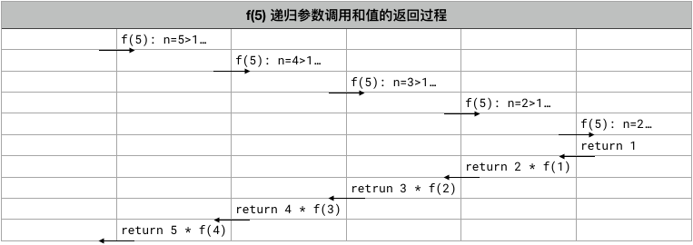

<!-- reading-navigation:start -->

<div dir="rtl" lang="fa">

[بخش قبلی: نام دیگر و function بی‌نام](Part.2.D.3-lambda.md) · [فهرست مطالب](TOC.md) · [بخش بعدی: مستندات function](Part.2.D.5-docstrings.md)

</div>

<!-- reading-navigation:end -->


# functionهای دارای recursion

## recursion

در بحث functionها مفهومی وجود دارد که درک اولیه‌اش نسبتاً دشوار است: **recursive function**؛ یعنی functionی که **درون خودش، خودش را فراخوانی می‌کند**. حتی بیان کردنش هم کمی پیچیده است!

ابتدا مثالی ببینیم. می‌خواهیم functionی به نام `f()` داشته باشیم که *فاکتوریل* (factorial) عدد `n`، یعنی `n!`، را حساب کند. قواعد چنین‌اند:

> - `n! = n × (n-1) × (n-2)... × 1`
> - یعنی `n! = n × (n-1)!`
> - و `n >= 1`
>
> **توجه:** عبارت‌های بالا ریاضی‌اند، نه کد برنامه؛ بنابراین در این قسمت `=` به معنای «*برابر است با*» است، **نه علامت assignment در زبان برنامه‌نویسی**.

> **یادداشت مترجم — توضیح تکمیلی:** دامنهٔ مثال‌های فاکتوریل این فصل، عددهای صحیح مثبت است. در تعریف استاندارد، فاکتوریل صفر هم برابر 1 است، اما functionِ این مثال برای صفر یا عددهای منفی شرط توقف مناسبی ندارد. این محدودیت کد اصلی حفظ شده است. منبع: [مستندات رسمی math.factorial](https://docs.python.org/3/library/math.html#math.factorial).

بنابراین برنامهٔ Python برای محاسبهٔ `f(n)` چنین می‌شود:

```python
def f(n):
    if n == 1:
        return 1
    else:
        return n * f(n-1)

print(f(5))
```

    120

## روند اجرای recursive function

با مثال factorial(5)، جریان اجرای برنامه را بررسی کنیم:



وقتی f(5) فراخوانی می‌شود، function شروع به اجرا می‌کند…
* چون `5 > 1` است، برای محاسبهٔ `n * f(n-1)` باید خودش را دوباره به شکل `f(4)` فراخوانی کند؛ پس باید منتظر بماند تا مقدار `f(4)` برگردد.
* چون `4 > 1` است، برای محاسبهٔ `n * f(n-1)` باید خودش را دوباره به شکل `f(3)` فراخوانی کند؛ پس باید منتظر بماند تا مقدار `f(3)` برگردد.
* چون `3 > 1` است، برای محاسبهٔ `n * f(n-1)` باید خودش را دوباره به شکل `f(2)` فراخوانی کند؛ پس باید منتظر بماند تا مقدار `f(2)` برگردد.
* چون `2 > 1` است، برای محاسبهٔ `n * f(n-1)` باید خودش را دوباره به شکل `f(1)` فراخوانی کند؛ پس باید منتظر بماند تا مقدار `f(1)` برگردد.
* چون `1 == 1` است، دیگر `f()` را فراخوانی نمی‌کند. در این نقطه پیشروی recursion تمام می‌شود و بازگشت مقدارها شروع می‌شود؛ مقدار بازگشتی این بار `1` است.
* مرحلهٔ بعد `2 * 1` را برمی‌گرداند.
* مرحلهٔ بعد `3 * 2` را برمی‌گرداند.
* مرحلهٔ بعد `4 * 6` را برمی‌گرداند.
* مرحلهٔ بعد `5 * 24` را برمی‌گرداند؛ در نهایت، مقدار بازگشتیِ فراخوانی بیرونیِ `f(5)` برابر `120` است…

> **یادداشت مترجم — توضیح تکمیلی:** پیام اصلی نمودار هم همین است: فراخوانی‌ها تا رسیدن به مقدار 1 در انتظار می‌مانند؛ سپس نتیجه‌ها از درونی‌ترین فراخوانی به بیرون برمی‌گردند. توضیح مرحله‌به‌مرحلهٔ بالا، روند داخل تصویر را نیز بیان می‌کند.

اگر چند دستور چاپ اضافه کنیم، روند کلی اجرا روشن‌تر می‌شود:

```python
def f(n):
    print('\tn =', n)
    if n == 1:
        print('Returning...')
        print('\tn =', n, 'return:', 1)
        return 1
    else:
        r = n * f(n-1)
        print('\tn =', n, 'return:', r)
        return r

print('Call f(5)...')
print('Get out of f(n), and f(5) =', f(5))
```

    Call f(5)...
    	n = 5
    	n = 4
    	n = 3
    	n = 2
    	n = 1
    Returning...
    	n = 1 return: 1
    	n = 2 return: 2
    	n = 3 return: 6
    	n = 4 return: 24
    	n = 5 return: 120
    Get out of f(n), and f(5) = 120

کمی ذهن را به چالش می‌کشد… اما اگر موضوع را به چند لایه تقسیم کنید و یکی‌یکی آن‌ها را بفهمید، می‌بینید که واقعاً جالب است.

## نقطهٔ پایان recursion

recursive function باید درون خودش راهی داشته باشد که از ادامهٔ فراخوانی خودش جلوگیری کند؛ وگرنه این تکرار تا ابد ادامه می‌یابد…

در واقع همهٔ ما از کودکی نمونه‌ای از recursion دیده‌ایم؛ فقط آن زمان نمی‌دانستیم اسمش recursion است. آن داستان بی‌پایان را شنیده‌اید؟

> بالای کوهی معبدی بود، در معبد راهبی بود، راهب قصه‌ای می‌گفت؛ می‌گفت…
> > بالای کوهی معبدی بود، در معبد راهبی بود، راهب قصه‌ای می‌گفت؛ می‌گفت…
> > > بالای کوهی معبدی بود، در معبد راهبی بود، راهب قصه‌ای می‌گفت؛ می‌گفت…

اگر آن را به برنامهٔ Python تبدیل کنیم، تقریباً چنین می‌شود:

```python
def a_monk_telling_story():
    print('山上有座庙，庙里有个和尚，和尚讲故事，他说…… ')
    return a_monk_telling_story()

a_monk_telling_story()
```

این یک recursion با *تکرار بی‌پایان* است؛ چون در function هیچ *شرطی برای متوقف کردن فراخوانیِ خودش* تعریف نشده است. برای تکرار بی‌پایان، نام ناخوشایند «loop مرده» را هم به کار می‌برند.

> **یادداشت مترجم — توضیح تکمیلی:** string چینیِ داخل کد همان جملهٔ داستانِ راهب است و عمداً ترجمه نشده است. منظور از «بی‌پایان» در توضیح نویسنده، نداشتن شرط پایان در منطق برنامه است؛ اجرای واقعیِ این مثال در Python معمولاً با رسیدن به محدودیت عمق recursion و خطای RecursionError متوقف می‌شود، نه اینکه واقعاً تا ابد ادامه یابد. منبع: [مستندات رسمی RecursionError](https://docs.python.org/3/library/exceptions.html#RecursionError).

در فیلم مشهور **تلقین** (Inception، *۲۰۱۰*) هم اگر ساختار کلی را در نظر بگیریم، «وارد خواب شدن» نوعی «recursive function» است. اما برخلاف `a_monk_telling_story()`، این یکی تکرار بی‌پایان ندارد؛ چون *شرط توقفِ فراخوانی خودش* را تعیین کرده است:

> در فیلم، دو شرط برای بیدار شدن وجود دارد:
>> * مردن در خواب؛
>> * تجربهٔ یک kick در خواب…
>
> اگر هیچ‌یک از این دو شرط برآورده نشود، وارد حالت limbo می‌شوید؛ در عمل مانند تکرار بی‌پایان است و دیگر نمی‌توانید بیرون بیایید…

برای نمایش موضوع، داستان را این‌طور تغییر داده‌ام:
> * وارد خواب شدن، یعنی `in_dream()`، یک recursive function است.
> * پس از ورود به خواب، دو شرط برای بیدار شدن وجود دارد:
>> * مردن در خواب، یعنی `dead is True`؛
>> * تجربهٔ kick در خواب، یعنی `kicked is True`…
>>
>> هرکدام از این دو شرط برقرار شود، بیدار می‌شوید…

دربارهٔ اینکه چرا می‌میریم یا چطور kick رخ می‌دهد، کمی تنبلی کرده‌ام: هرچه می‌خواهد باشد و هرطور می‌خواهد رخ بدهد؛ احتمال برآورده شدن هر شرط را ۱/۱۰ می‌گیریم… فقط با همین ساده‌سازی است که می‌توانم یک «*برنامهٔ تلقین*» کوتاه و قابل اجرا بنویسم!

> **یادداشت مترجم — توضیح تکمیلی:** kick در این اشارهٔ سینمایی، تکان یا حس سقوطی است که برای بیدار کردن به کار می‌رود؛ limbo هم به وضعیت گرفتار ماندن در لایه‌ای عمیق از خواب اشاره دارد. این بخش یک تشبیه آموزشی و نسخهٔ ساده‌شدهٔ داستان است، نه شرح کامل قواعد فیلم.

اگر این داستان انتزاعی را به برنامهٔ Python تبدیل کنیم تا ببینیم پس از یک بار ورود به خواب چند روز می‌خوابیم، تقریباً چنین می‌شود:

```python
import random

def in_dream(day=0, dead=False, kicked=False):
    dead = not random.randrange(0,10) # 1/10 probability to be dead
    kicked = not random.randrange(0,10) # 1/10 probability to be kicked
    day += 1
    print('dead:', dead, 'kicked:', kicked)

    if dead:
        print((f"I slept {day} days, and was dead to wake up..."))
        return day
    elif kicked:
        print(f"I slept {day} days, and was kicked to wake up...")
        return day

    return in_dream(day)

print('The in_dream() function returns:', in_dream())
```

    dead: False kicked: False
    dead: False kicked: False
    dead: False kicked: False
    dead: False kicked: False
    dead: False kicked: False
    dead: False kicked: False
    dead: False kicked: False
    dead: True kicked: True
    I slept 8 days, and was dead to wake up...
    The in_dream() function returns: 8

اگر برایتان مبهم است که چرا `random.randrange(0,10)` می‌تواند احتمال ۱/۱۰ را نشان دهد، به [بحث مقدارهای Boolean در بخش اول](Part.1.E.2.values-and-their-operators.md) برگردید و دوباره آن را بخوانید.

> **یادداشت مترجم — توضیح تکمیلی:** این فراخوانی یکی از عددهای صحیح 0 تا 9 را انتخاب می‌کند. فقط 0 از نظر Boolean نادرست است؛ بنابراین notِ نتیجه، با احتمال یک‌دهم True می‌شود. چون نتیجه تصادفی است، تعداد روزها و خروجی اجرای شما الزاماً مانند خروجی ثبت‌شده نیست. منابع: [مستندات randrange](https://docs.python.org/3/library/random.html#random.randrange) و [ارزیابی درستی مقدارها](https://docs.python.org/3/library/stdtypes.html#truth-value-testing).

همچنین در Python اگر بخواهید مقداری را با True یا False بررسی کنید، به‌ویژه در دستور شرطی، شکل توصیه‌شده چنین است؛ [PEP8](https://www.python.org/dev/peps/pep-0008/) را ببینید:

```python
if condition:
    pass
```

درست مانند `if dead:` در کد بالا.

نه به این شکل، هرچند معمولاً این شیوه هم مانع اجرای عادی برنامه نمی‌شود<a href='#fn1' name='fn1b'><sup>[1]</sup></a>:

```python
if condition is True:
    pass
```

یا این شکل:

```python
if condition == True:
    pass
```

> **یادداشت مترجم — توضیح تکمیلی:** این شکل‌ها در همهٔ حالت‌ها هم‌معنا نیستند. شرط ساده، truth value مقدار را بررسی می‌کند؛ is هویت را می‌سنجد و == برابری را. برای مثال یک list غیرخالی در شرط درست محسوب می‌شود، اما همان objectِ True نیست. اگر هدف بررسی درستی یک شرط است، شکل اول مناسب است؛ اگر واقعاً هویت یا برابری مدنظر باشد، انتخاب به نیاز برنامه بستگی دارد. منابع: [توصیه‌های PEP 8](https://peps.python.org/pep-0008/#programming-recommendations) و [مقایسه‌ها در مرجع Python](https://docs.python.org/3/reference/expressions.html#comparisons).

برگردیم به recursive functionها. یک **recursive function درست حتماً شرط خروج دارد**؛ وگرنه تکرار آن *بی‌پایان* خواهد بود… برنامهٔ زیر پس از کمی اجرا این پیام را می‌دهد: `RecursionError: maximum recursion depth exceeded`؛ یعنی از حداکثر عمق recursion عبور کرده‌اید. برنامهٔ «راهبِ درون معبدِ بالای کوه که قصه می‌گفت» هم اگر واقعاً اجرا شود، همین سرنوشت را دارد:

```python
def x(n):
    return n * x(n-1)
x(5)
```

    ---------------------------------------------------------------------------

    RecursionError                            Traceback (most recent call last)

    <ipython-input-3-daa4d33fb39b> in <module>
          1 def x(n):
          2     return n * x(n-1)
    ----> 3 x(5)

    <ipython-input-3-daa4d33fb39b> in x(n)
          1 def x(n):
    ----> 2     return n * x(n-1)
          3 x(5)

    ... last 1 frames repeated, from the frame below ...

    <ipython-input-3-daa4d33fb39b> in x(n)
          1 def x(n):
    ----> 2     return n * x(n-1)
          3 x(5)

    RecursionError: maximum recursion depth exceeded

لازم نیست در جزئیات دیگرِ برنامهٔ تلقین عمیق شوید. با همین سه برنامهٔ دارای recursion، یعنی دو مثال شوخی‌آمیز و یک مثال جدی، ویژگی‌های مشترک را دیده‌اید:

> 1. در دستور `return`، نتیجهٔ *فراخوانیِ خودِ function*، یا *expressionی شامل آن فراخوانی*، برگردانده می‌شود.
> 2. برای جلوگیری از تکرار بی‌پایان، *باید دست‌کم یک شرط وجود داشته باشد* که در آن دیگر فراخوانیِ خودِ function برگردانده نشود…

> **یادداشت مترجم — توضیح تکمیلی:** بند اول توصیف شکل مثال‌های همین فصل است، نه شرط عمومی recursion. فراخوانیِ خودِ function لازم نیست حتماً داخل return باشد؛ recursion می‌تواند برای انجام عملی و بدون استفاده از مقدار بازگشتی هم رخ دهد. همچنین فراخوانی می‌تواند غیرمستقیم و از طریق functionهای دیگر باشد. تعریف رسمی، recursive call را فراخوانیِ functionی می‌داند که پیش از آن، اجرای همان function از قبل فعال است. منبع: [مرجع رسمی فراخوانی‌ها](https://docs.python.org/3/reference/expressions.html#calls).

## scopeِ variableها

دوباره به برنامهٔ محاسبهٔ فاکتوریل برگردیم؛ این یکی برنامه‌ای جدی است. این بار نامش را کامل می‌نویسیم: `factorial()`.

```python
def factorial(n):
    if n == 1:
        return 1
    else:
        return n * factorial(n-1)

print(factorial(5))
```

    120

علت اینکه در ابتدا روند اجرای این function گیج‌کننده به نظر می‌رسد، این است که تازه‌کارها هنوز **scope**ِ *variable*ها را به‌خوبی درک نکرده‌اند.

از نظر scope، variableها به دو گروه تقسیم می‌شوند: global variable و local variable.

برای ساده‌تر فهمیدن موضوع می‌توان این‌طور گفت:

> * variableهایی که درون function به آن‌ها مقدار داده می‌شود و سپس استفاده می‌شوند، *local variable* هستند. scope آن‌ها *محلی* است و کد بیرون function نمی‌تواند از آن‌ها استفاده کند.
> * variableهایی که بیرون از همهٔ functionها به آن‌ها مقدار داده می‌شود و سپس استفاده می‌شوند، *global variable* هستند. scope آن‌ها *سراسری* است و هم درون function و هم بیرون آن می‌توان از آن‌ها استفاده کرد.

تعریف چنین است، اما برنامه‌نویسان معمولاً اصل زیر را به‌سختی رعایت می‌کنند:

> درون function هرگز از global variable استفاده نکنید. حتی اگر لازم است global variable را تغییر دهید، فقط از طریق مقدار بازگشتی function و در بیرونِ function آن را تغییر دهید.

شما هم باید همین اصل را رعایت کنید. این اصل را در کار و زندگی روزمره هم می‌توان «فراخوانی» کرد:

> اصلِ انجام کار: کار خودتان را خودتان انجام دهید؛ دربارهٔ کار دیگران، حداکثر با نتیجهٔ کار خودتان کاری کنید که خودشان آن را انجام دهند…

> **یادداشت مترجم — توضیح تکمیلی:** scope محدودهٔ دسترسی به یک نام است. تقسیم‌بندی بالا برای آموزش ساده شده است؛ Python علاوه بر local و global، scopeهای enclosing و built-in هم دارد. همچنین ممنوع کردن استفاده از global variable توصیهٔ طراحیِ نویسنده است، نه محدودیت زبان یا قاعده‌ای بی‌استثنا؛ برای نمونه، خواندن ثابت‌های تعریف‌شده در سطح module کاربردی عادی است. assignment به یک نام global از درون function قواعد ویژه و دستور global را دارد. منبع: [scopeها و namespaceها در آموزش رسمی Python](https://docs.python.org/3/tutorial/classes.html#python-scopes-and-namespaces).

کد زیر را با دقت بیشتری ببینید. وقتی variableی به‌عنوان argument به function داده می‌شود، خودِ آن variable به‌وسیلهٔ function تغییر نمی‌کند. برای مثال، پس از `a = 5`، اگر `a` را به `f(a)` بدهیم، function باید نتیجهٔ کار داخلی خود را برگرداند، اما خودِ `a` عوض نمی‌شود.

```python
def factorial(n):
    if n == 1:
        return 1
    else:
        return n * factorial(n-1)

a = 5
b = factorial(a)   # a 并不会因此改变；
print(a, b)
a = factorial(a)   # 这是你主动为 a 再一次赋值……
print(a, b)
```

    5 120
    120 120

پس از فهمیدن این نکته، وقتی دوباره روند اجرای recursion در `factorial()` را ببینید، این واقعیت را درک می‌کنید:

> هر بار که factorial(n) فراخوانی می‌شود، scope تازه‌ای شکل می‌گیرد. variableِ `n` مقدارش را به‌عنوان argument به function می‌دهد؛ *اما* خودِ آن variableِ `n` تغییر نمی‌کند.

بیایید کد بالا را کمی تغییر دهیم:

```python
def factorial(n):
    if n == 1:
        return 1
    else:
        return n * factorial(n-1)

n = 5              # 这一次，这个变量名称是 n
m = factorial(n)   # n 并不会因此改变；
print(n, m)
```

    5 120

در دستور `m = factorial(n)`، مقدار `n` به‌عنوان argument به `factorial()` داده می‌شود؛ اما هر کاری که درون این function انجام شود، مقدار variableِ بیرونیِ `n` را تغییر نمی‌دهد.

نکتهٔ اصلی همین‌جاست: variableِ `n` درون function با variableِ `n` بیرون function یکی نیست؛ **فقط اتفاقاً نام یکسانی دارند**. اگر هنگام تعریف parameter، نام دیگری انتخاب کنیم هم تفاوتی ایجاد نمی‌شود:

```python
def factorial(x): # 在这个语句块中出现的变量，都是局部变量
    if x == 1:
        return 1
    else:
        return x * factorial(x-1)

n = 5           # 这一次，这个变量名称是 n
m = factorial(n)   # n 并不会因此改变；
print(n, m)
# 这个例子和之前再之前的示例代码有什么区别吗？
# 本质上没区别，就是变量名称换了而已……
```

    5 120

هنگام شروع اجرای function، مقدار `x` از کد بیرونی، یعنی همان دستور فراخوانی function، به آن داده می‌شود. حتی اگر نام variable درون function با نام variable بیرونی یکسان باشد، باز هم یک variable نیستند.

> **یادداشت مترجم — توضیح تکمیلی:** منظور از تغییر نکردن در این مثال‌ها، تغییر نکردن اتصال نام بیرونی به عدد صحیح است. این نتیجه را نباید به همهٔ objectها تعمیم داد: اگر argument یک objectِ mutable مثل list باشد، function می‌تواند محتوای همان object مشترک را تغییر دهد؛ همان‌طور که در [بخش اولِ parameterها و argumentها](Part.2.D.1-args.md) دیدیم. همچنین در فراخوانی درونیِ مثال فاکتوریل، مقدار expressionِ n-1 به parameterِ فراخوانی تازه داده می‌شود و n در فراخوانی فعلی همچنان مقدار خودش را دارد. منبع: [تعریف function در آموزش رسمی](https://docs.python.org/3/tutorial/controlflow.html#defining-functions).

## سه اصل recursive function

حالا می‌توانیم جمع‌بندی کوچکی داشته باشیم.

یک recursive function برای اینکه مفید و مؤثر باشد، باید سه اصل recursion را رعایت کند؛ همان‌طور که یک ربات برای شایستهٔ نامِ ربات بودن باید [سه قانون رباتیکِ آیزاک آسیموف (Isaac Asimov)](https://zh.wikipedia.org/wiki/%E6%9C%BA%E5%99%A8%E4%BA%BA%E4%B8%89%E5%AE%9A%E5%BE%8B) (Three Laws of Robotics) را رعایت کند<a href='#fn2' name='fn2b'><sup>[2]</sup></a>.

> 1. طبق تعریف، recursive function باید درون خودش، خودش را فراخوانی کند.
> 2. باید شرط خروجی تعیین شود.
> 3. روند recursion باید بتواند گام‌به‌گام به شرط خروج نزدیک شود و به آن برسد…

از دید این سه اصل، `factorial()` یک recursive function معتبر و مؤثر است: اصل اول و دوم را رعایت می‌کند و به‌ویژه، بخش «*گام‌به‌گام رسیدن*» در اصل سوم را هم دارد!

اما راستش آن برنامهٔ شوخی‌آمیز تلقین چندان شایسته نیست. اصل اول و دوم را دارد، اما نزدیک بود در اصل سوم از زیر کار در برود: به‌جای *گام‌به‌گام رسیدن*، فقط می‌گوید *بالاخره به هر شکلی حتماً می‌رسد*. روشن است که این دو یک چیز نیستند… ببخشیدش؛ وظیفه‌اش مثال بودن بود، یک بار نمونهٔ مثبت و یک بار نمونهٔ منفی، و در مقام مثال کارش را کامل انجام داده است!

> **یادداشت مترجم — توضیح تکمیلی:** در مورد factorial، رسیدن به شرط خروج فقط برای دامنهٔ ورودیِ مثال، یعنی عددهای صحیح مثبت، برقرار است. در برنامهٔ تصادفیِ خواب هم تعبیر «حتماً می‌رسد» تضمین پایان یافتن در تعداد محدودی فراخوانی نیست؛ برای هر تعداد متناهی از گام‌ها ممکن است هیچ شرطی رخ ندهد و در اجرای واقعی پیش از بیدار شدن به محدودیت recursion برسیم. وجود شرط خروج به‌تنهایی تضمین نمی‌کند که اجرا به آن برسد. منابع برای رفتار ابزارهای استفاده‌شده: [randrange](https://docs.python.org/3/library/random.html#random.randrange) و [محدودیت recursion](https://docs.python.org/3/library/sys.html#sys.getrecursionlimit).

تازه‌کارها در ابتدا، همین که با زحمت می‌فهمند recursive function چیست، بی‌اختیار از خود می‌پرسند: «چطور می‌توانم recursive فکر کردن را یاد بگیرم؟» اما شاید خودِ این پرسش چندان درست یا دقیق نباشد.

دقیق‌تر اینکه recursion یک شیوهٔ حل مسئله است. وقتی مسئله را بتوان گام‌به‌گام به بخش‌های کوچک‌تر و کوچک‌تر تقسیم کرد و هر بخش کوچک را هم با همان الگوریتم حل کرد، استفاده از recursive function کوتاه‌ترین و مؤثرترین راه خواهد بود. پس فقط وقتی به مسئله‌ای برمی‌خوریم که با recursive function حل می‌شود، لازم است چنین functionی بنویسیم.

از این نظر، برنامه‌نویس برای راحتی خودش از recursive function استفاده می‌کند، نه برای راحتی رایانه. برای رایانه فرقی ندارد کار کمتری به آن بدهید یا بیشتر؛ تا برق باشد کار می‌کند و خودش هم قبض برق را نمی‌پردازد…

از نظر نظری، همهٔ کارهایی را که با recursive function انجام می‌شود، بدون آن هم می‌توان انجام داد؛ فقط ممکن است کد طولانی‌تر، پرحرف‌تر و از نظر ظاهری کم‌ظرافت‌تر باشد.

همچنین recursion مانند «sequence type» ویژگی ویژهٔ یک زبان برنامه‌نویسی نیست. در واقع، نوعی الگوریتم و یک فن برنامه‌نویسی است؛ در هر زبان برنامه‌نویسی می‌توان از الگوریتم recursive استفاده کرد و با نوشتن recursive function مسئله‌ها را هوشمندانه حل کرد.

> **یادداشت مترجم — توضیح تکمیلی:** تأکید نویسنده در این چند بند بر مناسب بودن recursion برای بیان بعضی مسئله‌هاست؛ نه تضمین اینکه همیشه سریع‌ترین یا کم‌مصرف‌ترین پیاده‌سازی باشد. در Python هر فراخوانیِ بیشتر، عمق اجرا را افزایش می‌دهد و محدودیت recursion اهمیت عملی دارد؛ بنابراین باید دامنه و اندازهٔ مسئله را هم در نظر گرفت. همچنین عبارت «هر زبان» بیان کلیِ ایده است؛ امکان و شیوهٔ نوشتن فراخوانی recursive به قواعد و امکانات زبان بستگی دارد. منبع برای محدودیت Python: [مستندات رسمی getrecursionlimit](https://docs.python.org/3/library/sys.html#sys.getrecursionlimit).

اما خودِ یادگیری recursive function ذهن را حسابی به کار می‌اندازد! و این بهترین بخش ماجراست. از سردرگمی به سردرگمی کمتر می‌رسید؛ بعد موضوع روشن می‌شود، سپس روشن‌تر و سرانجام کاملاً روشن. این روند بسیار جالب است و حس پیشرفت زیادی به شما می‌دهد.

این فرایند توان ذهنی را تمرین می‌دهد. پس از آن، وقتی دوباره با چیزی روبه‌رو شوید که فهمیدنش برای بیشتر مردم دشوار است، می‌توانید از تجربهٔ این بار و توان ذهنیِ پرورش‌یافتهٔ خود استفاده کنید. جالب است.

تا اینجا، فهم آن «pseudocode» روی جلد باید آسان شده باشد:

```python
def teach_yourself(anything):
    while not create():
        learn()
        practice()
    return teach_yourself(another)

teach_yourself(coding)
```

خودآموزی واقعاً یک recursive function است…

> **یادداشت مترجم — توضیح تکمیلی:** pseudocode روشی برای نمایش ایدهٔ یک الگوریتم است، نه الزاماً برنامه‌ای آمادهٔ اجرا. نام‌های این مثال، مانند کارِ یاد گرفتن و تمرین کردن، نقش نمادین دارند و در این قطعه تعریف نشده‌اند؛ کد جلد را باید در همین معنای آموزشی خواند.

## فکر کنید و تمرین کنید

در یکی از صفحه‌های وب دانشگاه پرینستون (Princeton University)، مثال‌های زیادی از recursion آمده است:

https://introcs.cs.princeton.edu/java/23recursion/

-----
**پاورقی‌ها**

<a name='fn1'>[1]</a>: بحث Stackoverflow را ببینید: [Boolean identity == True vs is True](https://stackoverflow.com/questions/27276610/boolean-identity-true-vs-is-true)

<a href='#fn1b'><small>↑بازگشت به متن↑</small></a>

<a name='fn2'>[2]</a>: تشبیهِ [سه قانون رباتیکِ آسیموف](https://zh.wikipedia.org/wiki/%E6%9C%BA%E5%99%A8%E4%BA%BA%E4%B8%89%E5%AE%9A%E5%BE%8B) (Three Laws of Robotics) از آموزش مشهور Python، یعنی [Think Python: How to Think Like a Computer Scientist](http://greenteapress.com/thinkpython2/html/index.html)، گرفته شده است.

<a href='#fn2b'><small>↑بازگشت به متن↑</small></a>


<!-- reading-navigation:start -->

<div dir="rtl" lang="fa">

[بخش قبلی: نام دیگر و function بی‌نام](Part.2.D.3-lambda.md) · [فهرست مطالب](TOC.md) · [بخش بعدی: مستندات function](Part.2.D.5-docstrings.md)

</div>

<!-- reading-navigation:end -->
