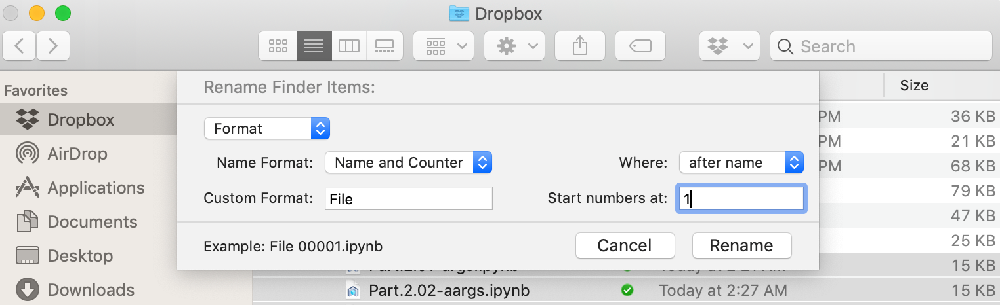

<!-- reading-navigation:start -->

[بخش قبلی: فایل‌های اجرایی Python](Part.2.D.8-main.md) · [فهرست مطالب](TOC.md) · [بخش بعدی: غلبه بر بخش‌های دشوار](Part.3.A.conquering-difficulties.md)

<!-- reading-navigation:end -->

# فکر کردن هدفمند

با گذشت زمان، قدرت این کار را درک خواهید کرد:

> هدفمند فکر کنید که کجا به تمرین هدفمند نیاز دارید.

فقط یک جمله است؛ اما شگفت‌انگیز است که دانستن یا ندانستن همین جمله می‌تواند به‌تدریج تفاوتی از زمین تا آسمان ایجاد کند.

فکر کردن هدفمند، همان سبک‌سنگین کردن و با دقت اندیشیدن است. همین که شروعش کنید، بسیار ساده است؛ اما وقتی ندانید از کجا باید شروع کنید، بی‌نهایت مرموز به نظر می‌رسد. بیایید یک کاربرد دیگرِ «فکر کردن هدفمند» — یعنی همین با دقت اندیشیدن — را ببینیم:

> **این را کجا می‌توانم به کار ببرم؟**

خیلی‌ها چیزی را یاد می‌گیرند، اما چندان تمرینش نمی‌کنند. یک دلیل کاملاً واقعی هم دارند: جایی برای استفاده از آن پیدا نمی‌کنند.

نظام آموزشیِ امتحان‌محور ما هم در این مسئله بی‌تقصیر نیست. پیش از دانشگاه، دوازده سال به مدرسه می‌رویم و بیشترِ آنچه «یاد می‌گیریم» — که بیشتر هم از سر اجبار است — فقط یک کاربرد دارد که آن را به‌طور ملموس تجربه می‌کنیم: امتحان. آزمون ورودی دبیرستان، آزمون ورودی دانشگاه و بی‌شمار «آزمون آزمایشی» برای آماده شدن برای آن‌ها… در نتیجه، هر چیز دیگری هم که یاد می‌گیریم، به‌سختی می‌توانیم کاربردی جز امتحان برایش تصور کنیم.

> **یادداشت مترجم — توضیح تکمیلی:** اشارهٔ نویسنده به نظام آموزشی چین و آزمون‌های ورودی دبیرستان و دانشگاه در آن کشور است.

وقتی خودآموزیِ یک مهارت را شروع می‌کنیم، ارزشمندترین شکلِ فکر کردن هدفمند در طول مسیر این است که مدام از خودمان بپرسیم: «این را کجا می‌توانم به کار ببرم؟»

مثلاً وقتی در میان methodهای string، یعنی کارهایی که می‌توان روی متن انجام داد، به [`str.zfill()`](https://docs.python.org/3/library/stdtypes.html#str.zfill) برمی‌خورید، بلافاصله به فکرتان می‌رسد: «آهان! می‌شود از این برای تغییر نام گروهی فایل‌ها استفاده کرد…»

> **یادداشت مترجم — توضیح تکمیلی:** این تصویر پنجرهٔ تغییر نام گروهی فایل‌ها در Finder را نشان می‌دهد؛ نکتهٔ مثال، مرتب و یکدست کردن نام فایل‌هاست. methodِ [`str.zfill()`](https://docs.python.org/3/library/stdtypes.html#str.zfill) یک string را تا طول مشخص با صفرهای سمت چپ پُر می‌کند؛ مثلاً برای یکدست کردن طولِ شماره‌های به‌کاررفته در نام فایل‌ها مفید است. خودِ این method نام فایل‌ها را تغییر نمی‌دهد و برای آن کار به بخش‌های دیگری از برنامه هم نیاز است.

البته در Mac OS امروزی، ابزار نسبتاً خوبی برای تغییر نام گروهی در خودِ Finder وجود دارد: چند فایل را انتخاب کنید تا فرمان rename را در منوی کلیک راست ببینید. اما این قابلیت به‌تازگی اضافه شده و چند سال پیش وجود نداشت. یعنی چند سال پیش، عده‌ای می‌توانستند با [`str.zfill()`](https://docs.python.org/3/library/stdtypes.html#str.zfill) برنامهٔ ساده‌ای بنویسند و کارشان را انجام دهند؛ در حالی که عده‌ای دیگر، فقط چون سیستم‌عامل چنین قابلیتی در اختیارشان نمی‌گذاشت، یا باید کار را دستی انجام می‌دادند یا تحمل می‌کردند و کلاً از خیرش می‌گذشتند…

> **یادداشت مترجم — توضیح تکمیلی:** «امروزی»، «به‌تازگی» و «چند سال پیش» در این بند به زمان نگارش متن اصلی اشاره دارند؛ این توصیف، گزارشی از زمان نگارش ترجمه نیست.

اما بیشتر وقت‌ها باید برای پیدا کردن کاربرد، وقت بگذارید و فکر کنید.

گاهی پیدا کردن کاربرد واقعاً دشوار است. همهٔ ما به‌آسانی در محدودهٔ دید خودمان گرفتار می‌شویم: دوروبر را نگاه می‌کنیم، کاربردی نمی‌بینیم، پس طبیعی است که از آن استفاده نکنیم؛ حتی شاید بگوییم لازم نیست یادش بگیریم، چه برسد به اینکه احساس کنیم باید تمرینش کنیم…

پس کمی با دقت فکر کنید: بچه‌هایی که در مدرسه در کارها به معلم کمک می‌کنند، در بسیاری از موارد واقعاً آن‌طور که خیلی‌ها تصور می‌کنند، مشغول «چاپلوسی» نیستند — البته نمی‌گویم هیچ‌کس چنین قصدی ندارد! — بلکه فقط «خودشان دنبال کاری برای انجام دادن می‌گردند»…

**دنبال کار گشتن** مؤثرترین راهِ به‌کارگیری آموخته‌هاست. وقتی کاری برای انجام دادن دارید، مسئله‌ای هم هست که باید حلش کنید؛ پس فرصت پیدا می‌کنید بارها برای عبور از دشواری‌ها تلاش کنید و در این فرایند، **از راهِ استفاده کردن، تمرین کنید**…

بنابراین خیلی‌ها در خیلی از موضوع‌ها رابطه را وارونه می‌بینند.

مردم اغلب کسانی را که سخت مشغول کارند مسخره می‌کنند و با خنده می‌گویند: «هر که تواناتر است، بار بیشتری هم روی دوشش می‌گذارند.» انگار آن افراد کمی ساده‌اند.

این حرف واقعاً غلط نیست. اما اگر این‌طور بگوییم دقیق‌تر است: **هر که بیشتر کار می‌کند، توانایی‌های بیشتری پیدا می‌کند.** می‌بینید؟ رابطه را برعکس فهمیده بودیم!

در نهایت، نشانه‌های بیرونیِ کسانی که توانایی خودآموزیِ ضعیفی دارند، کم‌وبیش شبیه هم است؛ دست‌کم این ویژگی در همه‌شان دیده می‌شود: کاری برای انجام دادن به چشمشان نمی‌آید. از کار کردن هم خوششان نمی‌آید. حتی به این فکر نکرده‌اند که تفریح هم نوعی کار است — مثلاً همان تفریح‌های تعطیلات و جشن‌ها که بعدشان از خستگی از پا می‌افتند. از نظر مصرف انرژی یا هزینه، اساساً تفاوتی وجود ندارد؛ فقط این‌ها معمولاً کارهایی هستند که حاصل و خروجی‌ای ندارند.

اگر در ابتدا هیچ کاربردی به ذهنتان نمی‌رسد، می‌توانید یک قدم عقب‌تر بروید و ببینید: «آیا دیگران کاربردی برایش پیدا کرده‌اند؟» مثلاً من عبارت «best applications of python skill» را در Google جست‌وجو کردم و همان صفحهٔ اول به این مقاله رسیدم: «[دقیقاً چه کارهایی می‌توانید با Python انجام دهید؟ — What exactly can you do with Python?](https://medium.freecodecamp.org/what-can-you-do-with-python-the-3-main-applications-518db9a68a78)». کمی که آن را مرور کردم، دیدم خیلی جالب است…

شکل پیشرفته‌ترِ فکر کردن هدفمند — همان با دقت اندیشیدن — چیزی نیست جز اضافه کردن یک واژه به سؤال «این را کجا می‌توانم به کار ببرم؟»:

> این را **دیگر** کجا می‌توانم به کار ببرم؟

به نظرم این سؤال تأثیر بسیار عمیقی بر پرورش فکر دارد؛ کوچک نشماریدش، حتی اگر فقط یک واژه به سؤال قبلی اضافه شده باشد.

وقتی خواندم که در برنامه‌نویسی «قرارداد»های زیادی وجود دارد، با خودم فکر کردم:

> * آهان، پس قراردادها این‌قدر مهم‌اند…
> * آهان، پس با این حال افراد زیادی به قراردادها اهمیت نمی‌دهند…
> * آهان، پس باید کسانی را که قراردادها را رعایت نمی‌کنند، از همان اول کنار گذاشت…
>
> — خب، این اصل را دیگر کجا می‌شود به کار برد؟
>
> — آهان، در زندگی هم همین‌طور است: اگر با آدم‌ها یا موقعیت‌هایی روبه‌رو شدید که در آن‌ها توافق‌ها رعایت نمی‌شوند، مستقیم کنارشان بگذارید؛ عمرتان را هدر ندهید…

یاد گرفتن برنامه‌نویسی واقعاً جالب است. این حوزه را یکی از باهوش‌ترین گروه‌های انسان‌های جهان بنا کرده‌اند و همچنان با تلاش جمعی آن را گسترش می‌دهند. به همین دلیل، در این دنیا شیوه‌های زیادی برای فکر کردن و سنجیدن مسائل وجود دارد؛ چیزهایی که حتی می‌شود بی‌پرده «فلسفهٔ انجام کار» نامید و آن‌ها را به‌طور گسترده در حوزه‌های دیگر، و حتی در هر حوزهٔ دیگری، به کار گرفت.

مثلاً در روش‌شناسیِ توسعه، روشی به نام [MoSCoW Method](https://en.wikipedia.org/wiki/MoSCoW_method) وجود دارد که Clegg Dai آن را در سال ۱۹۹۴ در کتاب *Case Method Fast-Track: A RAD Approach* مطرح کرد. دو حرف o را در این نام گذاشته‌اند تا بتوان این سرواژه را تلفظ کرد؛ تلفظش مثل Moscow، یعنی مسکو، است.

> **یادداشت مترجم — نیازمند بررسی:** نام فرد در متن اصلی به صورت «Clegg Dai» آمده و همان صورت حفظ شده است. ترتیب نام و نام خانوادگی و مشخصات انتساب این روش به کتاب یادشده نیازمند بررسی کتاب‌شناختی است؛ پیوند بیرونی در این مرحله به‌صورت زنده بررسی نشده است.

به زبان ساده، هر چیزی را می‌توان در یکی از این دسته‌ها قرار داد:

> * Must have — حتماً باید وجود داشته باشد.
> * Should have — بهتر است وجود داشته باشد.
> * Could have — می‌تواند وجود داشته باشد.
> * Won't have — قرار نیست وجود داشته باشد.

پس هنگام توسعه، به هر یک از آنچه «نیازمندی» می‌نامیم، یکی از این چهار برچسب را می‌زنیم و دسته‌بندی‌شان می‌کنیم. به این ترتیب، کنار گذاشتن قابلیت‌هایی که در واقع نساختنشان بهتر از ساختنشان است، خیلی آسان می‌شود…

کمی فکر کنید: این روش را دیگر کجا می‌توان به کار برد؟

روشن است که بیرون از برنامه‌نویسی هم کاربردهای زیادی دارد؛ این اصل واقعاً الهام‌بخش است…

من برای نوشتن کتاب همین کار را می‌کنم. در مرحلهٔ آماده‌سازی — که بسیار طولانی‌تر از چیزی است که بیشتر مردم تصور می‌کنند — همهٔ موضوع‌های مرتبطی را که به ذهنم می‌رسد، فهرست می‌کنم… وقتی احساس کردم دیگر چیزی برای اضافه کردن ندارم، برای هر موضوع چند جمله می‌نویسم تا طرح کلی شکل بگیرد… همین‌جا معلوم می‌شود خیلی از موضوع‌ها در واقع باید یک موضوع واحد باشند. بعد از این یک دور گسترش دادن و یک دور جمع‌وجور کردن، به مرحلهٔ بعد می‌روم: اصل MoSCoW را به کار می‌گیرم و به موضوع‌ها برچسب می‌زنم. در این فرایند، همیشه می‌بینم خیلی از موضوع‌هایی که قبلاً ضروری به نظر می‌رسیدند، در واقع می‌توانند برچسب Won't have بگیرند؛ پس حذفشان می‌کنم. بعد نوشتن را از Must have شروع می‌کنم و به Should have می‌رسم. دربارهٔ Could have هم بستگی دارد وقت اجازه بدهد یا نه و شرایط چطور باشد؛ مثلاً اینکه مهلت مشخصی در کار هست یا نه…

وقتی کتاب می‌نویسم، همیشه به نظر دیگران خیلی سریع می‌آیم؛ در واقع هم همین‌طور است، چون روش دارم. اما روشن است که این روش را از کتابی دربارهٔ «چگونه کتاب بنویسیم» نگرفته‌ام؛ آن را در حوزهٔ دیگری یاد گرفته‌ام که ظاهراً هیچ ارتباطی با نوشتن ندارد، و بعد با فکر کردن راه استفاده‌اش را پیدا کرده‌ام…

آنچه «یادگیریِ پویا و کاربردِ انعطاف‌پذیر» یا «رسیدن از فهم یک موضوع به فهم موضوع‌های مشابه» می‌نامند، چیزی جز همین نیست.

<!-- reading-navigation:start -->

[بخش قبلی: فایل‌های اجرایی Python](Part.2.D.8-main.md) · [فهرست مطالب](TOC.md) · [بخش بعدی: غلبه بر بخش‌های دشوار](Part.3.A.conquering-difficulties.md)

<!-- reading-navigation:end -->
