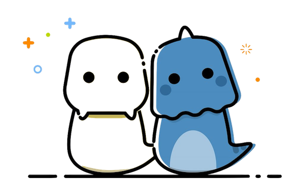
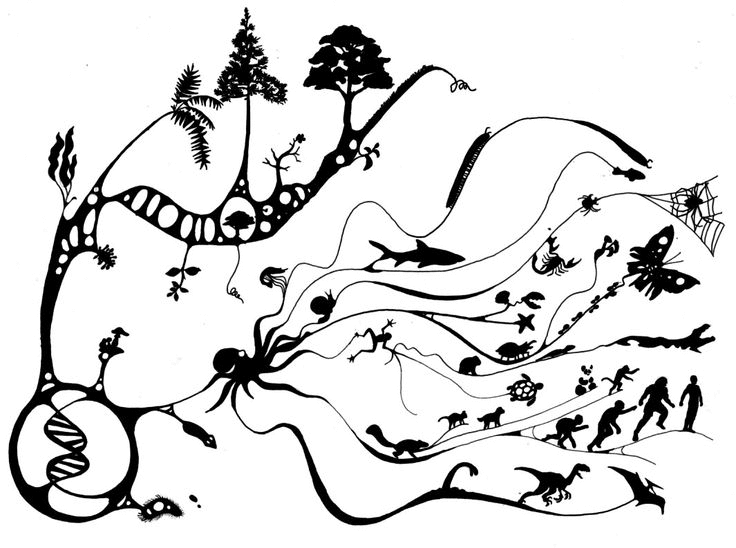
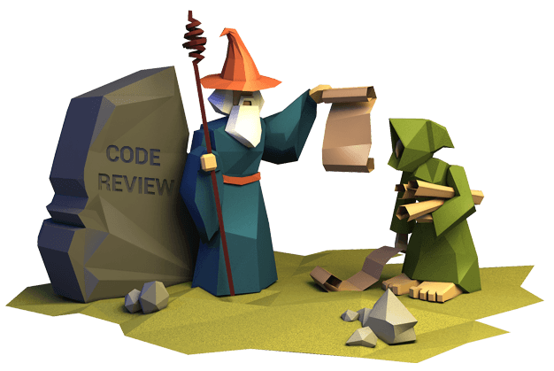

<!-- reading-navigation:start -->

[بخش قبلی: غلبه بر بخش‌های دشوار](Part.3.A.conquering-difficulties.md) · [فهرست مطالب](TOC.md) · [بخش بعدی: class — پیاده‌سازی در Python](Part.3.B.2.classes-2.md)

<!-- reading-navigation:end -->

# class — Object-Oriented Programming

> **یادداشت مترجم — وضعیت ترجمه:** ترجمه و بازبینی اولیهٔ معنا و کامل‌بودن متن انجام شده است؛ این نسخه نهایی نیست. این ترجمه برای مطالعهٔ شخصی و محلی تهیه شده است. منبع، [فصل اصلی به زبان چینی](../../markdown/Part.3.B.1.classes-1.md) است. توضیحات افزوده با عنوان «یادداشت مترجم» مشخص شده‌اند. ساختار عنوان‌ها و مقصد لینک‌های محلی بررسی شده‌اند؛ نمایش راست‌به‌چپ در محیط نهایی، متن داخل تصاویر و دسترس‌پذیری منابع بیرونی به بازبینی جداگانه نیاز دارند.

## Object-Oriented Programming

توجه: مطالب این زیربخش به زبان برنامه‌نویسی خاصی، مثلاً Python، JavaScript یا Golang، اختصاص ندارند.

[Object-Oriented Programming یا OOP](https://en.wikipedia.org/wiki/Object-oriented_programming) یک paradigm در برنامه‌نویسی، یا به بیان دیگر یک methodology است؛ یعنی الگویی برای شیوهٔ انجام کار. می‌توان گفت روشی بسیار بزرگ و مهم است. از نظر من، اینکه مهندسی نرم‌افزار امروز می‌تواند پروژه‌هایی چنین عظیم و پیچیده را به انجام برساند، اساساً مدیون رواج همین روش است.

## اختلاف‌نظرها

امروزه تعداد موافقان و مخالفان OOP اصلاً قابل مقایسه نیست؛ اکثریت قاطع از این paradigm برنامه‌نویسی پشتیبانی می‌کنند.

اما از زاویه‌ای دیگر، در میان مخالفان OOP، نسبت افراد بسیار برجسته بیشتر است. این هم واقعیتی است که در نگاه اول عجیب و متناقض به نظر می‌رسد.

مثلاً خالق Erlang، [Joe Armstrong](https://en.wikipedia.org/wiki/Joe_Armstrong_(programmer))، از OOP خوشش نمی‌آمد و آن را ناکارآمد می‌دانست. تشبیهی هم که به کار می‌برد، هم خنده‌دار بود و هم خوب به هدف می‌زد:

> مشکل زبان‌هایی که از OOP پشتیبانی می‌کنند این است که همیشه یک عالمه محیط و زمینهٔ نامشخص را با خودشان حمل می‌کنند. شما فقط یک موز می‌خواستید، اما چیزی که گیرتان می‌آید، گوریلی است که موز را دستش گرفته… به‌اضافهٔ تمام جنگلی که پشت سر آن گوریل است!  — [Coders at Work](http://www.codersatwork.com)

[Rob Pike](https://en.wikipedia.org/wiki/Rob_Pike)، برنامه‌نویسی که در خلق UTF-8 و Golang نقش داشته، حتی کمتر از این‌ها برای OOP ارزش قائل است. او در یک بحث اینترنتی در سال ۲۰۰۴، مستقیماً OOP را «[اعداد رومیِ دنیای محاسبات](https://groups.google.com/forum/#!topic/comp.os.plan9/VUUznNK2t4Q%5B151-175%5D)» نامید؛ کنایه از چیزی قدیمی و ناکارآمد. هشت سال بعد هم [مقالهٔ قدیمیِ یک استاد Java دربارهٔ OOP را دوباره پیش کشید و دست انداخت](https://plus.google.com/+RobPikeTheHuman/posts/hoJdanihKwb): «نمی‌دانم چه جور ذهنی فکر می‌کند نوشتن ۶ class جدید، بهتر از یک خط جست‌وجو در جدول است؟»

[Paul Graham](https://en.wikipedia.org/wiki/Paul_Graham_(programmer)) ــ همان بنیان‌گذار مشهور Y-Combinator ــ هم چندان اعتنایی به OOP ندارد. او در [Why Arc isn't Especially Object-Oriented](http://www.paulgraham.com/noop.html) می‌گوید به نظرش دلیل محبوبیت OOP این است که برنامه‌نویس‌های متوسط و معمولی (Mediocre programmers) زیادند و شرکت‌های بزرگ از این paradigm استفاده می‌کنند تا جلوی آن‌ها را بگیرند و نگذارند خرابکاری خیلی بزرگی به بار بیاورند…

> **یادداشت مترجم — توضیح تکمیلی:** لینک نام Paul Graham در متن اصلی به‌دلیل نداشتن پرانتز پایانی درست نمایش داده نمی‌شد؛ اینجا فقط قالب لینک اصلاح شده است. لینک Google+ مربوط به Rob Pike عیناً حفظ شده، اما به سرویسی قدیمی و تعطیل‌شده اشاره دارد و دسترسی به آن نیازمند بررسی است.

بااین‌همه، بحث و اختلاف‌نظر یک چیز است و استفادهٔ عملی چیز دیگر. درست مثل زبان انگلیسی که لزوماً عیب‌هایش از زبان‌های دیگر کمتر نیست، اما از همه رایج‌تر است. چه باید کرد؟ از آن استفاده می‌کنیم؛ البته هرجا لازم باشد، گله هم می‌کنیم.

از زاویه‌ای دیگر، فهمیدن اینکه چرا این بزرگان چنین نظری دربارهٔ OOP دارند آسان است: آن‌ها خیلی باهوش‌اند و حوصله ندارند وقتشان را صرف فهمیدن یا تحمل آدم‌های کم‌فهم کنند… ما فرق داریم؛ مهم‌ترین تفاوت این است که نه‌فقط دیگران را بیشتر تحمل می‌کنیم، بلکه با کم‌فهمی خودمان هم بیشتر کنار می‌آییم. برای همین زاویهٔ نگاهمان متفاوت است؛ همین و بس.

ضمن اینکه زبان‌هایی که آن دو نفرِ بالا ساخته‌اند، حالا خودشان هم بسیار رایج‌اند: Erlangِ Joe Armstrong و Golangِ Rob Pike. بعید نیست دیر یا زود شما هم مجبور شوید آن‌ها را یاد بگیرید و به کار ببرید…

## اصطلاحات پایه

OOP روشی برای برنامه‌نویسی است که **object**ها را در مرکز قرار می‌دهد. در این روش می‌توان داده‌ها و فرایندهای محاسباتیِ object را درون خودش **encapsulate** کرد؛ یعنی آن‌ها را درون یک مجموعه قرار داد، به‌طوری که بیرون فقط از راه **interface**ی که از پیش طراحی شده است با آن ارتباط داشته باشد.

برای مثال، می‌توانید لامپ را یک object تصور کنید. کسی که از *لامپ* استفاده می‌کند، فقط با interfaceِ *کلید* سروکار دارد و لازم نیست نگران طراحی و سازوکار درونی لامپ باشد. انصافاً ایدهٔ بسیار بزرگی در طراحی است.

در زندگی با محصولات بی‌شماری روبه‌رو می‌شویم که دانسته یا نادانسته از همین ایده استفاده کرده‌اند؛ این موضوع فقط به برنامه‌نویسی محدود نیست. خودرویی که می‌خرید هم مجموعه‌ای از objectهای encapsulateشده است. وقتی فرمان، یعنی interface، را می‌چرخانید، لازم نیست بدانید طراح خودرو چطور آن را به چرخ‌ها و محورها وصل کرده تا خودرو مطابق خواستهٔ شما بپیچد. کافی است بدانید چرخاندن فرمان خلاف جهت عقربه‌های ساعت یعنی گردش به چپ و چرخاندنش در جهت عقربه‌های ساعت یعنی گردش به راست؛ همین کافی است!

در طراحی برنامه، اغلب لازم است objectهایی با الگوگرفتن از دنیای واقعی بسازیم. مستقیم‌ترین ابزار ما برای این کار **abstraction** است؛ یعنی کنارگذاشتن جزئیات و نگه‌داشتن ویژگی‌های لازم. در دنیای واقعی، کاریکاتوریست‌ها بسیار از این روش استفاده می‌کنند. چرا با دیدن تصویر زیر احساس می‌کنید این دو شبیه انسان‌اند؟ به‌خصوص وقتی کاملاً می‌دانید که انسان واقعی نیستند، اما باز هم آن‌ها را به‌عنوان دو آدمک کارتونی می‌پذیرید؟

این شیوهٔ تصویرکردن، همان abstraction است. بسیاری از جزئیات «غیرضروری» حذف شده‌اند؛ یا از زاویهٔ دیگر، اصلاً انتخاب نشده‌اند. دو ویژگی باقی مانده است: سر و دو چشم. حتی آن «چشم‌ها» هم آن‌قدر ساده شده‌اند که فقط نقطه‌ای سیاه از آن‌ها مانده است…

این «ویژگی‌های ضروری» که نگه داشته‌ایم، **attribute**های object نام دارند. از طرفی، چون این objectهای ساده‌شده بازنماییِ «انسان» هستند، می‌توانند بعضی «رفتارهای ضروری» را هم که پس از abstraction باقی مانده‌اند انجام دهند؛ مثلاً حرف بزنند، گریه کنند یا بخندند. این‌ها **method**های object نام دارند.

از دید ساختن object با یک زبان برنامه‌نویسی، interface از این دو جزء تشکیل می‌شود:

> * *attribute*ها — در زبان طبیعی، معمولاً با اسم توصیف می‌شوند.
> * *method*ها — در زبان طبیعی، معمولاً با فعل توصیف می‌شوند.

از سوی دیگر، هنگام طراحی objectهای پیچیده، لازم است abstraction را تا بالاترین حد پیش ببریم.

طبقه‌بندی جانداران، فرایندی از abstractionهای لایه‌به‌لایه است. وقتی واژهٔ «جاندار» را به کار می‌بریم، منظورمان یک موجود مشخص نیست که بتوانیم به آن اشاره کنیم… بعد شروع می‌کنیم به دسته‌بندی آن‌ها…

> **یادداشت مترجم — توضیح تکمیلی:** تصویر «درخت زندگی» نمونه‌ای از دسته‌بندی شاخه‌شاخهٔ جانداران است. نکتهٔ مورد استفاده در این بحث، حرکت از گروه‌های کلی‌تر به گروه‌های جزئی‌تر است؛ برای فهم استدلال لازم نیست نام تک‌تک شاخه‌های تصویر را بدانید.

بنابراین، هنگام ساختن objectها در برنامه معمولاً این‌طور پیش می‌رویم:

> * ابتدا کلی‌ترین و انتزاعی‌ترین **class** را می‌سازیم؛
> * سپس **subclass**ها را می‌سازیم…

رابطهٔ شمول آن‌ها چنین است:

> Class ⊃ Subclass

در OOP به این رابطه **inheritance** می‌گویند. مثلاً objectِ *سگ* می‌تواند از objectِ *پستاندار*، ویژگی‌ها را به *ارث ببرد*. اگر پستاندار attributeای به نام «سر» داشته باشد، دیگر لازم نیست این attribute را در objectِ سگ دوباره تعریف کنیم؛ چون وقتی سگ از پستاندار inheritance دارد، همهٔ attributeهای پستاندار را هم دارد…

هر بار که یک class ساختیم، می‌توانیم بر اساس آن **instance**های زیادی بسازیم. مثلاً بعد از ساختن classِ «سگ»، می‌توانیم با آن سگ‌های زیادی ایجاد کنیم… این سگ‌ها، *instance*های classِ سگ‌اند.

حالا می‌توانید همهٔ این اصطلاحات را به هم مرتبط کنید؟

> * object، encapsulation، abstraction
> * interface، attribute، method
> * inheritance، class، subclass، instance

این‌ها ابتدایی‌ترین اصطلاحات مربوط به روش OOP هستند. در هر زبان برنامه‌نویسی‌ای که کار کنید، بارها با آن‌ها روبه‌رو خواهید شد.

به نظر می‌رسد دو واژهٔ **object** و **class** اغلب به‌جای هم به کار می‌روند. وقتی عادت کنید مشکلی نیست، اما بعضی تازه‌کارها احساس می‌کنند این باری است که تحملش از توانشان خارج است. این بار مشکل از ترجمهٔ انگلیسی به چینی نیست؛ در دنیای انگلیسی‌زبان هم کاربرد جابه‌جا و نادرست این واژه‌ها باعث می‌شود عدهٔ قابل توجهی ــ گمان می‌کنم بیشتر مردم ــ در نهایت بر روش OOP مسلط نشوند.

تفاوت ظریف، در «زاویهٔ دید» است.

قبلاً وقتی دربارهٔ function حرف می‌زدم، این‌طور بیان کردم:

> - شما یک function نوشته‌اید؛ بعد باید برای استفاده‌کنندهٔ این محصول راهنما بنویسید…
> - البته خودِ آیندهٔ شما هم یکی از استفاده‌کنندگان این محصول است…

class هم همین‌طور است؛ هم سازنده دارد و هم استفاده‌کننده.

می‌توانید آن را گام‌به‌گام این‌طور بفهمید:

> * شما یک class می‌سازید. در این مرحله سازنده هستید و از نگاه شما، آن چیز یک class است؛
> * بعد بر اساس تعریف این class، instanceهای زیادی می‌سازید؛
> * سپس به‌محض اینکه استفاده از این instanceها را شروع کنید، استفاده‌کننده می‌شوید. از نگاه استفاده‌کننده، چیزهایی که با آن‌ها کار می‌کنید، objectهای گوناگون‌اند…

> **یادداشت مترجم — توضیح تکمیلی:** این توضیحِ زاویهٔ دید برای فهم کاربرد واژه‌هاست، نه اینکه نوع یک چیز با تغییر نقش شما عوض شود. در Python، class خودش هم یک object است و instanceِ یک class نیز object است. همچنین در مثال سگ و پستاندار، inheritance میان classهاست؛ سگِ مشخصی که ساخته می‌شود، instance است. منبع: [مستندات رسمی classها](https://docs.python.org/3/tutorial/classes.html).

در پایان، یک نکتهٔ تکمیلی: اشتباه نکنید و تصور نکنید همهٔ classها بازنماییِ چیزها، یعنی اسم‌ها هستند؛ هرچند در بیشتر موارد واقعاً همین‌طور است.

> **یادداشت مترجم — نیازمند بررسی:** تصویر بالا با نام «code-review» در منبع آمده است. متن داخل این تصویر در این نوبت به‌طور مستقل خوانده و ترجمه نشده است؛ اگر حامل مثال یا نکته‌ای فراتر از توضیح مجاور باشد، برای دسترس‌پذیری کامل به بازبینی تصویری نیاز دارد.

بعد از اینکه تا حدی با مفاهیم پایه آشنا شدید، بررسی اینکه Python آن‌ها را چطور پیاده‌سازی می‌کند، دیگر چندان دشوار به نظر نمی‌رسد.

<!-- reading-navigation:start -->

[بخش قبلی: غلبه بر بخش‌های دشوار](Part.3.A.conquering-difficulties.md) · [فهرست مطالب](TOC.md) · [بخش بعدی: class — پیاده‌سازی در Python](Part.3.B.2.classes-2.md)

<!-- reading-navigation:end -->
