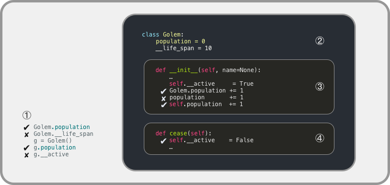

<!-- reading-navigation:start -->

<div dir="rtl" lang="fa">

[بخش قبلی: class — Object-Oriented Programming](Part.3.B.1.classes-1.md) · [فهرست مطالب](TOC.md) · [بخش بعدی: ابزارهای function](Part.3.B.3.decorator-iterator-generator.md)

</div>

<!-- reading-navigation:end -->


# class — پیاده‌سازی در Python

> **یادداشت مترجم — وضعیت ترجمه:** ترجمه و بازبینی اولیهٔ معنا و کامل‌بودن متن انجام شده است؛ این نسخه نهایی نیست. مقایسهٔ بایتیِ تمام بلوک‌های کد و خروجی‌ها با اصل موفق بود. مثال‌ها دوباره اجرا نشده‌اند. ساختار عنوان‌ها و مقصد لینک‌های محلی بررسی شده‌اند؛ نمایش راست‌به‌چپ در محیط نهایی و دسترس‌پذیری منابع بیرونی بررسی نشده است. این ترجمه برای مطالعهٔ شخصی و محلی تهیه شده است. منبع، [فصل اصلی به زبان چینی](../../markdown/Part.3.B.2.classes-2.md) است. کدها، commentها و خروجی‌های ثبت‌شده بدون تغییر حفظ شده‌اند؛ خطاهای منبع در یادداشت‌های جدا توضیح داده می‌شوند.

حالا که بدون دست‌زدن به کد، مفاهیم اصلی OOP را مرتب و روشن کرده‌ایم، از اینجا به بعد همان اصطلاحات انگلیسی را به کار می‌بریم تا برای فهمشان مجبور نباشیم یک دور اضافه هم بزنیم…

## تعریف class

برای تعریف class از keywordِ `class` استفاده می‌کنیم.

تفاوتش با تعریف function این است که دریافت parameterهای class در پرانتزهای `class Classname():` انجام نمی‌شود؛ آن پرانتزها کاربرد دیگری دارند.

اول کد را ببینیم و بعد اجزای آن را یکی‌یکی توضیح بدهیم:

```python
from IPython.core.interactiveshell import InteractiveShell
InteractiveShell.ast_node_interactivity = "all"
import datetime

class Golem:

    def __init__(self, name=None):
        self.name = name
        self.built_year = datetime.date.today().year

    def say_hi(self):
        print('Hi!')

g = Golem('Clay')
g.name
g.built_year
g.say_hi
g.say_hi()
type(g)
type(g.name)
type(g.built_year)
type(g.__init__)
type(g.say_hi)
```

    'Clay'
    2019
    <bound method Golem.say_hi of <__main__.Golem object at 0x10430e7b8>>
    Hi!
    __main__.Golem
    str
    int
    method
    method

در کد بالا، یک class ساخته‌ایم:

```python
class Golem:

    def __init__(self, name=None):
        self.name = name
        self.built_year = datetime.date.today().year
```

در آن، فرایند مقداردهی اولیهٔ object هنگام ساختن یک instance بر اساس این class تعریف شده است؛ یعنی functionِ `__init__()`. چون این function درون class تعریف شده، آن را یکی از methodهای class می‌نامیم.

اینجا `self` یک variable است. تفاوتش با دیگر variableهای برنامه این است که سیستم به‌طور پیش‌فرض آن را می‌شناسد و از آن برای اشاره به instanceای استفاده می‌شود که بعداً با این class ساخته خواهد شد.

برای مثال، بعد از ساختن یک instance از classِ Golem با `g = Golem('Clay')`، وقتی `g.name` را می‌نویسیم، interpreter در scope مربوط به instanceِ `g` دنبال `self.name` می‌گردد…

توجه: تعریف variableِ `self` در عبارت `def __init__(self, ...)` انجام می‌شود. نام‌گذاری این variable اجباری نیست و در واقع هر نامی می‌توانید به آن بدهید. بسیاری از برنامه‌نویس‌های C عادت دارند نام `this` را برایش انتخاب کنند. اما طبق convention، بهتر است فقط از نام `self` استفاده کنید تا باعث سوءتفاهم دیگران نشوید.

> **یادداشت مترجم — توضیح تکمیلی:** در دو بند قبلی، توضیح نویسنده ساده‌سازی دقیقی نیست: self نامی قراردادی برای نخستین parameterِ یک instance method است، نه variableای ویژه که سیستم با این نام بشناسد. هنگام فراخوانی method از طریق instance، Python خودِ instance را به آن parameter می‌دهد. در g.name نیز جست‌وجوی attribute به نام name انجام می‌شود؛ چیزی به نام self.name به‌عنوان کلید در scope جست‌وجو نمی‌شود. منبع: [مستندات methodها](https://docs.python.org/3/tutorial/classes.html#method-objects).

اگر در کد class، functionِ `__init__()` تعریف شده باشد، سیستم آن را functionِ مقداردهی اولیهٔ instance پس از ساخته‌شدنش در نظر می‌گیرد. این نام مشخص و الزامی است؛ functionِ مقداردهی اولیه باید همین نام را داشته باشد. دقت کنید در هر طرف `init` دو underscore، یعنی `_`، وجود دارد.

وقتی با عبارت `g = Golem('Clay')` یک instance از Golem می‌سازیم، این رویدادها پشت سر هم رخ می‌دهند:

> * از این به بعد `g` یک instance ساخته‌شده بر اساس classِ Golem است و برای استفاده‌کننده یک object به حساب می‌آید؛
> * چون در کد classِ Golem، `__init__()` وجود دارد، هنگام ساخته‌شدن `g` باید مقداردهی اولیهٔ آن انجام شود…
> * در فهرست variableهای مربوط به `g`، variableای به نام `self` ظاهر می‌شود که به خودِ `g` اشاره می‌کند؛
> * self.name یک argument به مقدار `'Clay'` دریافت و ذخیره می‌کند؛
> * variableای به نام `self.built_year` ایجاد می‌شود که سال ساخته‌شدن objectِ `g` را نگه می‌دارد…

> **یادداشت مترجم — توضیح تکمیلی:** در توالی بالا، self در واقع parameterِ محلیِ method است، نه attributeای در فهرست variableهای g. argumentِ 'Clay' ابتدا به parameterِ name می‌رسد و سپس با self.name = name در attribute ذخیره می‌شود. سال 2019 و نشانی‌های حافظه در خروجی‌های این فصل متعلق به اجرای ثبت‌شدهٔ منبعند؛ اجرای امروز لزوماً همان سال، نشانی یا جزئیات خروجی را تولید نمی‌کند.

راستی، Golem هم مثل Robot به معنای ربات به کار رفته است. معنای اصلی Golem از اسطوره‌های یهودی می‌آید: آدمکی گِلی که به آن جان بخشیده‌اند…

## inheritance

همین حالا classِ Golem را ساختیم. اگر بخواهیم با inheritance از آن class جدیدی بسازیم، مثلاً `Running_Golem`، یعنی رباتی که می‌تواند بدود، مثل کد زیر عمل می‌کنیم. به پرانتز بعد از `class Running_Golem` دقت کنید:

```python
from IPython.core.interactiveshell import InteractiveShell
InteractiveShell.ast_node_interactivity = "all"
import datetime

class Golem:

    def __init__(self, name=None):
        self.name = name
        self.built_year = datetime.date.today().year

    def say_hi(self):
        print('Hi!')

class Running_Golem(Golem):      # 刚刚就说，这个圆括号另有用途……

    def run(self):
        print("Can't you see? I'm running...")

rg = Running_Golem('Clay')

rg.run
rg.run()
rg.name
rg.built_year
rg.say_hi()
```

    <bound method Running_Golem.run of <__main__.Running_Golem object at 0x1068b37b8>>
    Can't you see? I'm running...
    'Clay'
    2019
    Hi!

به این ترتیب، بر اساس classِ Golem یک subclass به نام `Running_Golem` ساختیم. چون از Golem inheritance دارد، attributeها و methodهای Golem را دارد و علاوه بر آن، یک method دیگر هم دارد: `self.run`.

> **یادداشت مترجم — توضیح تکمیلی:** comment چینیِ داخل کد بالا می‌گوید: «همین حالا گفتیم این پرانتز کاربرد دیگری دارد…». برای حفظ عین کد، متن آن تغییر نکرده است.

## override کردن methodها

وقتی classای با inheritance می‌سازیم، می‌توانیم methodهای parent class را override کنیم؛ یعنی در class جدید تعریف دیگری برای آن‌ها بنویسیم. مثلاً:

```python
from IPython.core.interactiveshell import InteractiveShell
InteractiveShell.ast_node_interactivity = "all"
import datetime

class Golem:

    def __init__(self, name=None):
        self.name = name
        self.built_year = datetime.date.today().year

    def say_hi(self):
        print('Hi!')

class runningGolem(Golem):

    def run(self):
        print("Can't you see? I'm running...")

    def say_hi(self):                            # 不再使用 Parent Class 中的定义，而是新的……
        print('Hey! Nice day, Huh?')

rg = runningGolem('Clay')
rg.run
rg.run()
rg.name
rg.built_year
rg.say_hi()
```

    <bound method runningGolem.run of <__main__.runningGolem object at 0x1068c8128>>
    Can't you see? I'm running...
    'Clay'
    2019
    Hey! Nice day, Huh?

## بررسی یک class

وقتی به‌عنوان استفاده‌کننده می‌خواهیم interfaceِ یک class، یعنی attributeها و methodهای آن را بشناسیم، معمولاً سه راه داریم:

```python
1. help(object)
2. dir(object)
3. object.__dict__
```

```python
from IPython.core.interactiveshell import InteractiveShell
InteractiveShell.ast_node_interactivity = "all"
import datetime

class Golem:

    def __init__(self, name=None):
        self.name = name
        self.built_year = datetime.date.today().year

    def say_hi(self):
        print('Hi!')

class runningGolem(Golem):

    def run(self):
        print('Can\'t you see? I\'m running...')

    def say_hi(self):                            # 不再使用 Parent Class 中的定义，而是新的……
        print('Hey! Nice day, Huh?')

rg = runningGolem('Clay')
help(rg)
dir(rg)
rg.__dict__
hasattr(rg, 'built_year')
```

    Help on runningGolem in module __main__ object:
    
    class runningGolem(Golem)
     |  runningGolem(name=None)
     |
     |  Method resolution order:
     |      runningGolem
     |      Golem
     |      builtins.object
     |
     |  Methods defined here:
     |
     |  run(self)
     |
     |  say_hi(self)
     |
     |  ----------------------------------------------------------------------
     |  Methods inherited from Golem:
     |
     |  __init__(self, name=None)
     |      Initialize self.  See help(type(self)) for accurate signature.
     |
     |  ----------------------------------------------------------------------
     |  Data descriptors inherited from Golem:
     |
     |  __dict__
     |      dictionary for instance variables (if defined)
     |
     |  __weakref__
     |      list of weak references to the object (if defined)
    
    ['__class__',
     '__delattr__',
     '__dict__',
     '__dir__',
     '__doc__',
     '__eq__',
     '__format__',
     '__ge__',
     '__getattribute__',
     '__gt__',
     '__hash__',
     '__init__',
     '__init_subclass__',
     '__le__',
     '__lt__',
     '__module__',
     '__ne__',
     '__new__',
     '__reduce__',
     '__reduce_ex__',
     '__repr__',
     '__setattr__',
     '__sizeof__',
     '__str__',
     '__subclasshook__',
     '__weakref__',
     'built_year',
     'name',
     'run',
     'say_hi']
    {'name': 'Clay', 'built_year': 2019}
    True

## scope

هر variable به یک **scope** تعلق دارد؛ یعنی محدوده‌ای که می‌توان در آن به variable رجوع کرد و با آن کار کرد… این بیان خیلی انتزاعی و دشوارفهم است؛ فقط با مثال می‌توان توضیحش داد.

اول کمی به قابلیت‌های classِ Golem اضافه کنیم. می‌خواهیم هر زمان بدانیم دقیقاً چند Golem فعال است… برای همین، ضمن کار یک method به نام `cease()` هم به Golem اضافه می‌کنیم. بالاخره ربات است؛ هر وقت بخواهیم خاموشش کنیم، می‌گوییم خاموش شود و خاموش می‌شود!

همچنین می‌خواهیم برای ربات یک عمر مفید، مثلاً ۱۰ سال، تعیین کنیم؛

… و از بیرون، هر چند وقت یک‌بار با `Golem.is_active()` همهٔ ربات‌ها را بررسی کنیم؛ بنابراین، وقتی عمرش به پایان رسید، باید بدون اقدام اضافه‌ای از بیرون بتواند خودش را خاموش کند. البته چون کد زیر ساده‌شده است و هدف اصلی توضیح scope است، شبیه‌سازیِ خاموش‌شدن خودکار بعضی ربات‌ها پس از ۱۰ سال را ننوشته‌ایم…

> **یادداشت مترجم — توضیح تکمیلی:** عبارت Golem.is_active() در توضیح منبع دقیق نیست: این یک instance method است و در مثال با g.is_active() روی یک instance فراخوانی می‌شود. خودِ class فهرستی از همهٔ ربات‌ها را بررسی نمی‌کند و زمان‌سنجی هم در کار نیست؛ بررسی عمر فقط هنگام فراخوانی همین method رخ می‌دهد. همچنین cease در این مثال در برابر فراخوانی تکراری محافظت نشده و هر بار شمارنده را کم می‌کند.

پیش از اجرای کد زیر، باید سه built-in functionِ Python را معرفی کنیم:

> * `hasattr(object, attr)` بررسی می‌کند آیا این `object` دارای `attr` است یا نه و مقدار Boolean برمی‌گرداند.
> * `getattr(object, attr)` مقدار `attr` در این `object` را می‌گیرد.
> * `setattr(object, attr, value)` مقدار `attr` در این `object` را برابر `value` قرار می‌دهد.

حالا باید با یک نگاه بتوانید کاربرد این سه built-in function را بفهمید. خودِ قبلی‌تان را به یاد دارید؟ به آن حروف نگاه می‌کردید و هیچ معنایی برایتان نداشتند… مگر چقدر از آن زمان گذشته است!

```python
from IPython.core.interactiveshell import InteractiveShell
InteractiveShell.ast_node_interactivity = "all"
import datetime

class Golem:
    population = 0
    __life_span = 10

    def __init__(self, name=None):
        self.name = name
        self.built_year = datetime.date.today().year
        self.__active = True
        Golem.population += 1          # 执行一遍之后，试试把这句改成 population += 1

    def say_hi(self):
        print('Hi!')

    def cease(self):
        self.__active = False
        Golem.population -= 1

    def is_active(self):
        if datetime.date.today().year - self.built_year >= Golem.__life_span:
            self.cease()
        return self.__active

g = Golem()
hasattr(Golem, 'population')      # True
hasattr(g, 'population')          # True
hasattr(Golem, '__life_span')     # False
hasattr(g, '__life_span')         # False
hasattr(g, '__active')            # False
Golem.population                  # 1
setattr(Golem, 'population', 10)
Golem.population                  # 10
x = Golem()
Golem.population                  # 11
x.cease()
Golem.population                  # 10
getattr(g, 'population')          # 10
g.is_active()
```

    True
    True
    False
    False
    False
    1
    10
    11
    10
    10
    True

اگر امتحان کرده باشید و در خط ۱۳، `Golem.population += 1` را به `population += 1` تغییر داده باشید، پیام زیر را می‌بینید:

```python
     12         self.__active = True
---> 13         population += 1
UnboundLocalError: local variable 'population' referenced before assignment
```
یعنی پیش از آنکه به local variableِ `population` مقداری داده شود، به آن رجوع شده است… چرا؟ چون پس از ساختن `g`، بلافاصله functionِ مقداردهی اولیهٔ `__init()__` اجرا می‌شود، درحالی‌که `population` بیرون از این function تعریف شده است…

> **یادداشت مترجم — توضیح تکمیلی:** نام __init()__ در جملهٔ منبع اشتباه تایپی است؛ نام درستِ method همان __init__ است که در کد آمده است. علت مشخص UnboundLocalError این است که assignmentِ population += 1 باعث می‌شود population در این function محلی در نظر گرفته شود، اما هنوز مقدار محلی ندارد. comment چینی کنار خط اصلی از شما می‌خواهد پس از یک بار اجرا همین تغییر را امتحان کنید. منبع: [قواعد نام‌گذاری و binding](https://docs.python.org/3/reference/executionmodel.html#binding-of-names).

اگر دقیق باشید، می‌بینید در این نسخه نام بعضی variableها با دو underscore، یعنی `__`، شروع می‌شود؛ مثلاً `__life_span` و `self.__active`. طبق توضیح نویسنده از تعریف Python، اگر یک یا چند underscoreِ `_` در آغاز نام variable باشد، آن variable «private variable» است و از بیرون نمی‌توان به آن رجوع کرد. بنا بر conventionِ Python، برای نام‌گذاری private variableها از دو underscore در آغاز استفاده می‌کنیم؛ مانند `__life_span`. می‌توانید برگردید و همهٔ `__life_span`ها را به `_life_span` تبدیل کنید؛ یعنی نام فقط با یک `_` شروع شود. آن وقت مقدار بازگشتیِ `hasattr(Golem, '_life_span')` و `hasattr(g, '_life_span')` هر دو `True` می‌شود.

> **یادداشت مترجم — توضیح تکمیلی:** ادعای بالا دربارهٔ ممنوعیت دسترسی دقیق نیست. یک underscoreِ آغازین فقط conventionِ غیرعمومی‌بودن است و دسترسی را مسدود نمی‌کند. دو underscoreِ آغازین، در نامی که دو underscoreِ پایانی ندارد، در تعریف class موجب name mangling می‌شود؛ مثلاً __life_span به _Golem__life_span تبدیل می‌شود. از بیرون با نام تبدیل‌شده همچنان می‌توان به آن دسترسی داشت؛ پس این سازوکار امنیت یا privacyِ مطلق ایجاد نمی‌کند. منبع: [مستندات private variableها](https://docs.python.org/3/tutorial/classes.html#private-variables).

نگاه به نمودار زیر موضوع را ملموس‌تر می‌کند. در آن، هر کادر نمایندهٔ یک scope است:



پس از شروع اجرای کل کد، در مجموع ۴ scope مطابق شکل داریم:

> * ① بیرون از `class Golem`؛
> * ② درون `class Golem`؛
> * ③ درون `__init__(self, name=None)`؛
> * ④ درون `cease(self)`؛

در scopeِ ① می‌توان به `Golem.population` رجوع کرد و پس از ساختن instanceای از Golem به نام `g`، می‌توان به `g.population` هم رجوع کرد؛ اما `Golem.__life_span` و `g.__active` در scopeِ ① وجود ندارند؛

در scopeِ ② دو variable وجود دارد: `population` و `__life_span`. مورد دوم private است، چون دو نویسهٔ اول نامش underscore، یعنی `__`، هستند. بنابراین در scopeِ ①، `Golem.__life_span` وجود ندارد و مقدار `hasattr(Golem, '__life_span')` برابر `False` است؛

در scopeِ ③ و scopeِ ④، چون parameterِ `self` به هر دو داده شده، می‌توان به `self.xxx`، مثلاً `self.population` یا `self.__life_span`، رجوع کرد؛

در scopeِ ③، `population` وجود ندارد. اگر بخواهیم به مقدارش رجوع کنیم، می‌توانیم از `Golem.population` یا `self.population` استفاده کنیم. به همین ترتیب، `__life_span` هم در scopeِ ③ وجود ندارد؛ برای استفاده از مقدار آن می‌توانیم `Golem.__life_span` یا `self.__life_span` را به کار ببریم؛

scopeِ ④ هم‌سطح scopeِ ③ است؛ بنابراین اینجا هم `population` و `__life_span` به همان صورت وجود ندارند.

> **یادداشت مترجم — توضیح تکمیلی:** نمودار و توضیح بالا برای مقایسهٔ محیط بیرونی، بدنهٔ class و دو method انتخاب شده‌اند؛ کد scopeهای مربوط به methodهای دیگر هم دارد. کادرها را نباید به معنای جست‌وجوی تو‌در‌توی نام‌های ساده در بدنهٔ class دانست: برای دسترسی از method به class attribute باید مسیر مناسب، مثل Golem.population، را به کار برد. self.xxx نیز جست‌وجوی attribute است، نه جست‌وجوی یک نام محلی. منظور از نبودن نام‌های دارای دو underscore در بیرون، در این مثال دسترس‌ناپذیری با همان املای اولیه به‌دلیل name mangling است. منبع: [قواعد resolutionِ نام‌ها](https://docs.python.org/3/reference/executionmodel.html#resolution-of-names).

**تکمیل بحث**

در این مثال، در functionِ `__init__(self, name=None)` هم می‌توان از `self.population` استفاده کرد و هم از `Golem.population`، اما نتیجهٔ استفاده از آن‌ها یکسان نیست:

> * `self.population` همیشه مقدار اولیهٔ `population` در classِ `Golem` را می‌خواند. حتی پس از تغییر مقدار `population` با `setattr(Golem, 'population', 10)`، مقدار `self.population` همچنان `0` می‌ماند، اما مقدار `Golem.population` برابر `10` می‌شود. می‌توانید خودتان امتحان کنید.

> **یادداشت مترجم — توضیح تکمیلی:** ادعای این بند در شکل فعلیِ کد نادرست است. تا وقتی روی instance، attributeِ هم‌نام ایجاد نشده باشد، self.population مقدار فعلیِ class attribute را می‌خواند، نه همیشه مقدار اولیه را. اگر در __init__ به‌جای Golem.population += 1 از self.population += 1 استفاده کنید، خواندنِ اولیه می‌تواند از class باشد، اما assignment یک instance attribute هم‌نام ایجاد می‌کند؛ آن مقدار سپس تغییرهای class attribute را دنبال نمی‌کند. این دو حالت را نباید با هم یکی گرفت. منبع: [class و instance variableها](https://docs.python.org/3/tutorial/classes.html#class-and-instance-variables).

## encapsulation

تا اینجا classِ Golem خوب به نظر می‌رسد، اما یک مشکل دارد: از بیرون می‌توان داده‌هایش را آزادانه تغییر داد. البته با افزودن دو underscore به ابتدای life_span و تبدیل آن به `__life_span`، آن را private کرده‌ایم و از بیرون نمی‌توان به آن رسید؛ یعنی نمی‌توانید به `Golem.__life_span` رجوع کنید. اما Golem.population فرق دارد: هر زمان می‌توان از بیرون به آن رجوع کرد و مقدارش را تغییر داد. کافی است بنویسیم:

```python
Golem.population = 1000000
```

بیایید variableِ `population` را هم private کنیم و نامش را `__population` بگذاریم. بعد اگر لازم شد مقدارش را از بیرون ببینیم، درون class یک function می‌نویسیم که آن مقدار را برگرداند:

```python
from IPython.core.interactiveshell import InteractiveShell
InteractiveShell.ast_node_interactivity = "all"
import datetime

class Golem:
    __population = 0
    __life_span = 10

    def __init__(self, name=None):
        self.name = name
        self.built_year = datetime.date.today().year
        self.__active = True
        Golem.__population += 1

    def say_hi(self):
        print('Hi!')

    def cease(self):
        self.__active = False
        Golem.__population -= 1

    def is_active(self):
        if datetime.date.today().year - self.built_year >= Golem.__life_span:
            self.cease
        return self.__active

    def population(self):
        return Golem.__population

g = Golem('Clay')
g.population
g.population()
```

    <bound method Golem.population of <__main__.Golem object at 0x1068da160>>
    1

اگر بخواهید از بیرون، درست مثل دریافت یک attributeِ class، مستقیماً `g.population` بنویسید و مجبور نباشید با افزودن پرانتز، `g.population()` را برای انتقال argument فراخوانی کنید ــ در واقع argumentِ ضمنیِ `self` منتقل می‌شود ــ می‌توانید در خط پیش از `def population(self):` عبارت `@property` را اضافه کنید:

> **یادداشت مترجم — توضیح تکمیلی:** در مثال قبلی و چند مثال بعدی، داخل is_active عبارت self.cease بدون پرانتز آمده است؛ این فقط به method رجوع می‌کند و آن را اجرا نمی‌کند. برای خاموش‌شدن طبق قصد توضیح، فراخوانی self.cease() لازم است. کد اصلی عمداً تغییر نکرده است. محدودیت private نیز همان name manglingِ توضیح‌داده‌شده است، نه جلوگیری قطعی از دسترسی بیرونی.

```python
class Golem:
    __population = 0
    ...

    @property
    def population(self):
        return Golem.__population
```

بعد از این کار می‌توانید از `g.population` استفاده کنید:

```python
from IPython.core.interactiveshell import InteractiveShell
InteractiveShell.ast_node_interactivity = "all"
import datetime

class Golem:
    __population = 0
    __life_span = 10

    def __init__(self, name=None):
        self.name = name
        self.built_year = datetime.date.today().year
        self.__active = True
        Golem.__population += 1

    def say_hi(self):
        print('Hi!')

    def cease(self):
        self.__active = False
        Golem.__population -= 1

    def is_active(self):
        if datetime.date.today().year - self.built_year >= Golem.__life_span:
            self.cease
        return self.__active

    @property
    def population(self):
        return Golem.__population

g = Golem('Clay')
g.population
# g.population = 100
```

    1

به این ترتیب نه‌فقط می‌توانید مستقیماً به `g.population` رجوع کنید، بلکه دیگر نمی‌توانید از بیرون مستقیماً به `g.population` مقدار بدهید؛ وگرنه خطا می‌گیرید:

```python
---------------------------------------------------------------------------
AttributeError                            Traceback (most recent call last)
<ipython-input-16-5d8c475304d3> in <module>
     26 g = Golem('Clay')
     27 g.population
---> 28 g.population = 100

AttributeError: can't set attribute
```

تا اینجا encapsulation را به‌خوبی انجام داده‌ایم.

اگر حتماً می‌خواهید بتوانید این مقدار را از بیرون تنظیم کنید، باید function دیگری بنویسید و پیش از آن عبارت زیر را اضافه کنید:
```python
    ...

    @property
    def population(self):
        return Golem.__population

    @population.setter
    def population(self, value):
        Golem.__population = value

```

پس از این کار، مقدار attributeِ `.population` را می‌توان از بیرون تنظیم کرد. البته در مثال فعلی ضرورتی برای تنظیم `__population` از بیرون دیده نمی‌شود؛ ادامه فقط برای نشان‌دادن یک مثال است:

> **یادداشت مترجم — توضیح تکمیلی:** commentهای چینی کنار تعریف say_hi در مثال‌های override و بررسی class می‌گویند «دیگر از تعریف parent class استفاده نمی‌شود، بلکه از تعریف جدید استفاده می‌شود…». comment آخرین خطِ مثال زیر هم می‌گوید «پس در بسیاری از موارد، اگر داده‌ها را داخل class، encapsulate نکنید، بعداً دردسرهای زیادی خواهید داشت». در پایانِ همین مثال، setattr روی خودِ Golem، propertyِ population را با عدد 10000 جایگزین می‌کند؛ این با استفاده از setter از طریق instance فرق دارد و نشان می‌دهد property مانع تغییر خودِ class نیست. کدها و commentها عیناً حفظ شده‌اند؛ فهرست شماره‌دارِ help/dir/__dict__ و قطعه‌های دارای ... نیز نمونهٔ توضیحی‌اند، نه همگی برنامه‌های مستقل قابل اجرا. منابع: [property](https://docs.python.org/3/library/functions.html#property) و [setattr](https://docs.python.org/3/library/functions.html#setattr).

```python
from IPython.core.interactiveshell import InteractiveShell
InteractiveShell.ast_node_interactivity = "all"
import datetime

class Golem:
    __population = 0
    __life_span = 10

    def __init__(self, name=None):
        self.name = name
        self.built_year = datetime.date.today().year
        self.__active = True
        Golem.__population += 1

    def say_hi(self):
        print('Hi!')

    def cease(self):
        self.__active = False
        Golem.__population -= 1

    def is_active(self):
        if datetime.date.today().year - self.built_year >= Golem.__life_span:
            self.cease
        return self.__active

    @property
    def population(self):
        return Golem.__population

    @population.setter
    def population(self, value):
        Golem.__population = value

g = Golem('Clay')
g.population
g.population = 100
ga = Golem('New')
g.population
ga.population
help(Golem)
Golem.__dict__
g.__dict__
hasattr(Golem, 'population')
getattr(Golem, 'population')
setattr(Golem, 'population', 10000)
g.population    # 所以，在很多的情况下，不把数据封装在 Class 内部的话，后面会有很多麻烦。
```

    1
    101
    101
    Help on class Golem in module __main__:
    class Golem(builtins.object)
     |  Golem(name=None)
     |
     |  Methods defined here:
     |
     |  __init__(self, name=None)
     |      Initialize self.  See help(type(self)) for accurate signature.
     |
     |  cease(self)
     |
     |  is_active(self)
     |
     |  say_hi(self)
     |
     |  ----------------------------------------------------------------------
     |  Data descriptors defined here:
     |
     |  __dict__
     |      dictionary for instance variables (if defined)
     |
     |  __weakref__
     |      list of weak references to the object (if defined)
     |
     |  population
    mappingproxy({'__module__': '__main__',
                  '_Golem__population': 101,
                  '_Golem__life_span': 10,
                  '__init__': <function __main__.Golem.__init__(self, name=None)>,
                  'say_hi': <function __main__.Golem.say_hi(self)>,
                  'cease': <function __main__.Golem.cease(self)>,
                  'is_active': <function __main__.Golem.is_active(self)>,
                  'population': <property at 0x1068f9d68>,
                  '__dict__': <attribute '__dict__' of 'Golem' objects>,
                  '__weakref__': <attribute '__weakref__' of 'Golem' objects>,
                  '__doc__': None})
    {'name': 'Clay', 'built_year': 2019, '_Golem__active': True}
    True
    <property at 0x1068f9d68>
    10000


<!-- reading-navigation:start -->

<div dir="rtl" lang="fa">

[بخش قبلی: class — Object-Oriented Programming](Part.3.B.1.classes-1.md) · [فهرست مطالب](TOC.md) · [بخش بعدی: ابزارهای function](Part.3.B.3.decorator-iterator-generator.md)

</div>

<!-- reading-navigation:end -->
