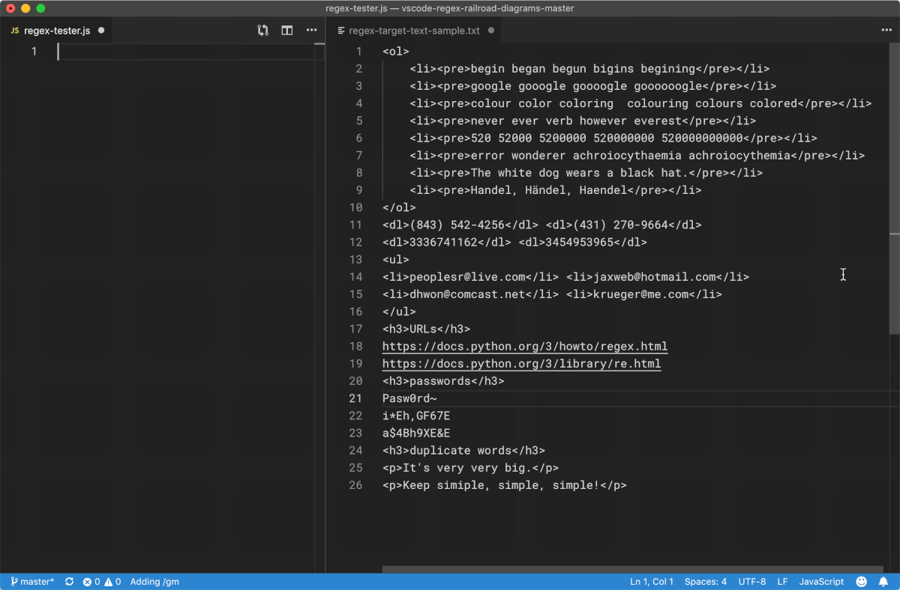
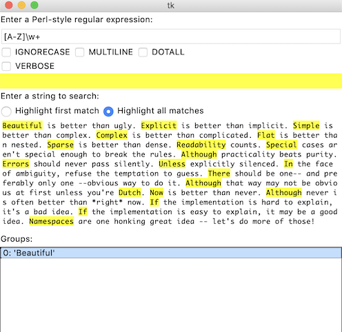
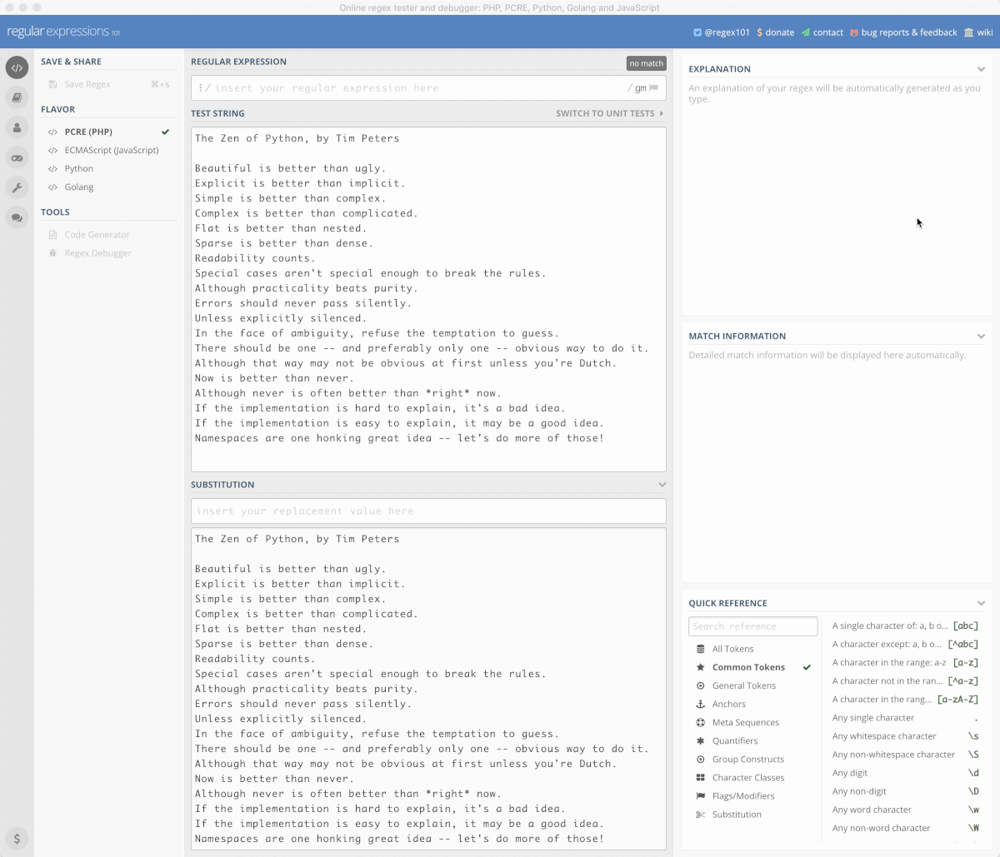

<!-- reading-navigation:start -->

<div dir="rtl" lang="fa">

[بخش قبلی: ابزارهای function](Part.3.B.3.decorator-iterator-generator.md) · [فهرست مطالب](TOC.md) · [بخش بعدی: BNF و EBNF](Part.3.B.5.bnf-ebnf-pebnf.md)

</div>

<!-- reading-navigation:end -->


# Regular Expression

> **یادداشت مترجم — وضعیت ترجمه:** متن کامل با [فصل اصلی به زبان چینی](../../markdown/Part.3.B.4.regex.md) تطبیق و از نظر معنا و ساختار بازبینی شده است؛ این نسخه نهایی نیست و فقط برای مطالعهٔ شخصی و محلی تهیه شده است. کدها، commentها و خروجی‌های ثبت‌شده عیناً حفظ شده‌اند؛ ایرادهای منبع در یادداشت‌های جداگانه توضیح داده می‌شوند. تصاویر و نمایش نهایی راست‌به‌چپ مستقلاً بازبینی دیداری نشده‌اند.

> **یادداشت مترجم — توضیح تکمیلی:** پیش‌نیاز این فصل آشنایی مقدماتی با string، function و فراخوانی آن، list، و خواندن فایل در Python است. Regex زبانی برای توصیف الگوی متن است، نه خودِ متن مورد جست‌وجو. engine برنامه‌ای است که این الگو را تفسیر می‌کند. توضیحات مربوط به معادل‌های واژگانی در آغاز فصل، دربارهٔ ترجمهٔ انگلیسی به چینی‌اند، نه پیشنهاد معادل فارسی برای اصطلاحات.

Regular Expression در اصل زبانی مستقل است؛ کوچک، اما بسیار قدرتمند. آن‌قدر که اگر آن را یاد نگرفته باشید، مهارت‌های برنامه‌نویسی‌ای که پیش از این آموخته‌اید، عملاً ناقص و ناتوان می‌مانند.

Wikipedia، Regular Expression را این‌طور توضیح می‌دهد:

> **Regular Expression**، که در کد معمولاً به شکل regex، regexp یا RE کوتاه می‌شود، مفهومی در علوم کامپیوتر است. در چینی نام‌های دیگری هم دارد که به‌ترتیب معنای «عبارتِ نمایشِ منظم»، «روشِ نمایشِ منظم»، «عبارتِ عملیاتِ منظم»، «عبارتِ عملیاتِ قاعده‌مند» و «روشِ نمایشِ معمول» می‌دهند. Regular Expression با استفاده از یک string، مجموعه‌ای از stringها را که از قاعدهٔ نحوی معینی پیروی می‌کنند توصیف می‌کند و با آن‌ها match می‌شود. در بسیاری از ویرایشگرهای متن، معمولاً از آن برای جست‌وجو و جایگزینی متن‌هایی استفاده می‌شود که با یک pattern مشخص سازگارند. بسیاری از زبان‌های برنامه‌نویسی نیز عملیات روی string را با Regular Expression پشتیبانی می‌کنند؛ مثلاً Perl یک engine قدرتمندِ داخلی برای آن دارد. این مفهوم نخست از راه ابزارهای Unix، مانند sed و grep، رواج پیدا کرد.

در بیشتر آموزش‌هایی که به چینی ترجمه شده‌اند، برای توضیح Regular Expression چنین عبارتی به کار می‌رود:

> یک Regular Expression معمولاً pattern نامیده می‌شود.

اغلب فکر می‌کنم اگر از ابتدا آن را در چینی «عبارتِ دارای قاعده» ترجمه می‌کردند، شاید تازه‌کارها این‌همه احساس فشار نمی‌کردند. برای همه همین‌طور است: وقتی ترکیبی از واژه‌های آشنا را می‌بینیم، اما نمی‌توانیم بی‌واسطه بفهمیم به چه چیزی اشاره دارد، دچار فشاری بی‌دلیل می‌شویم.

از میان معناهای متعدد **Regular**، این تعریف بیش از بقیه با مقصود Regular Expression سازگار است<a href='#fn1' name='fn1b'><sup>[1]</sup></a>:

> ⑭ زبان‌شناسی: باقاعده ▸ regular verbs: فعل‌های باقاعده

برای واژهٔ **Pattern** هم در فرهنگ لغت چند معادل چینی آمده است:

> ① نقش‌ونگار؛ ② طرح و شکل؛ ③ نقشه و نمونهٔ تصویری؛ ④ سرمشق؛ ⑤ الگو؛ ⑥ نمونه؛ ⑦ قالب

در این بافت، ترجمهٔ Pattern به «قالب» آشکارا از معادل رایج چینیِ «الگو» بهتر است؛ حتی «نمونه» هم مناسب‌تر به نظر می‌رسد. «قالب» تصویری روشن می‌سازد: قالبی در دست دارید و دنبال stringهایی می‌گردید که با آن سازگار باشند… در انگلیسی برای «سازگاربودن با قاعده» از **Match** استفاده می‌کنند که در چینی معمولاً «تطبیق» ترجمه می‌شود.

در خودآموزی برنامه‌نویسی، همه‌جا با سردرگمی، مانع یا اتلاف وقتی روبه‌رو می‌شویم که از ترجمه ناشی شده است. اگر بهتر است Regular Expression را «عبارتِ دارای قاعده» بفهمیم، شاید فهمیدن Pattern به معنای «*قاعده*» حتی مستقیم‌تر و دقیق‌تر باشد و هیچ مانعی برای درک آن باقی نگذارد:

> یک Regular Expression، یعنی عبارتی که قاعده‌ای را بیان می‌کند، معمولاً pattern یا همان قاعده نامیده می‌شود.

پس در **Regular Expression** چه می‌نویسیم؟ طبیعتاً **قاعده**… در نهایت، انگار فقط واژهٔ Capture، یعنی گرفتن و نگه‌داشتن بخش مورد نظر، ابهامی ندارد.

حالا که همهٔ اصطلاحات را «رمزگشایی» کرده‌ایم، عبارت زیر را ببینید:

> می‌توانیم قاعده‌های مشخصی بنویسیم تا در متن، stringهای سازگار با آن قاعده‌ها را capture کنیم و سپس روی آن‌ها عملیاتی انجام دهیم…

این بیان را خیلی راحت می‌توان فهمید.

در کد Python زیر، [`\wo\w`](https://regexper.com#%5Cwo%5Cw) یک *Regular Expression* یا *pattern* است؛

و کار `re.findall(pttn, str)` این است که در `str` همهٔ stringهایی را پیدا کند که با این **pattern**، یعنی قاعده، **match** می‌شوند؛ یعنی با آن سازگارند:

```python
import re
str = 'The quick brown fox jumps over the lazy dog'
pttn = re.compile(r'\wo\w')
re.findall(pttn, str)
```

    ['row', 'fox', 'dog']

خلاصه کنیم:

> **Regular Expression**، که معمولاً Regex کوتاه می‌شود، از قدرتمندترین و ضروری‌ترین ابزارهای پردازش متن است. کاربردش این است که در متن، همهٔ نمونه‌هایی را که با یک **pattern** مشخص **match** می‌شوند **scan/search** کند؛ همچنین می‌تواند طبق قاعده، بخشی یا تمام آن‌ها را **capture** کند و آن‌ها را **replace** کند.

از اینجا به بعد، برای پرهیز از ابهام، از کوتاه‌شدهٔ Regex و واژه‌های انگلیسی مربوط به آن استفاده می‌کنیم: pattern، match، capture، replace(ment) و مانند آن‌ها.

گاهی هدف استفاده از Regex، replace نیست، بلکه بررسی قالب داده است؛ مثلاً می‌توان بررسی کرد که رمز عبور واردشده بیش از حد ساده نباشد، مثلاً فقط از رقم تشکیل نشده باشد. همچنین می‌توان سنجید که شمارهٔ تلفن یا شمارهٔ مدرک شناسایی واردشده، قالب مشخصی را رعایت می‌کند یا نه.

در ضمن، هنگام خودآموزی، اینکه به هر راه ممکن اصطلاحات را به زبان ساده و روشنِ «آدمیزاد» بازگو کنید، شیوهٔ رفتاری بسیار مؤثری برای پیشرفت است.

## تجربهٔ دیداری

شنیدن کی بود مانند دیدن.

باید با چشم دید. اینکه راهی پیدا کنید تا مفهومی ناآشنا به شکلی دیداری و ملموس درآید، ساده‌ترین، بی‌واسطه‌ترین و مؤثرترین راه عبور از بسیاری از موانع یادگیری است.

بهتر است ابتدا مستقیماً روند کار Regex را ببینیم. در ادامه، فرایند match کردن چند Regex با یک قطعه متن کوتاه در Visual Studio Code، ویرایشگر کد مایکروسافت، آمده است:



> **یادداشت مترجم — نیازمند بررسی:** هدف این تصویر متحرک، بنا بر توضیح نویسنده، نشان‌دادن روند match شدن چند Regex با یک متن کوتاه در Visual Studio Code است. در این نوبت ابزار مشاهدهٔ تصویر در دسترس نبود؛ تصویر و نوشته‌های داخل آن مستقلاً دیده یا تأیید نشده‌اند. توضیح حاضر فقط بر متن پیرامون تصویر تکیه دارد.

در مخزن کد Python برنامهٔ نمایشی بسیار کوتاهی به نام [`redemo.py`](https://github.com/python/cpython/blob/3.6/Tools/demo/redemo.py) وجود دارد که برای رابط گرافیکی از [Tcl/Tk](https://docs.python.org/3/library/tkinter.html) استفاده می‌کند و برای آزمایش Regular Expression هم به کار می‌رود.

نشانی کد آن این است:

> https://raw.githubusercontent.com/python/cpython/3.6/Tools/demo/redemo.py

ظاهر برنامه هنگام اجرا چنین است:



> **یادداشت مترجم — نیازمند بررسی:** هدف این تصویر، بنا بر توضیح نویسنده، نشان‌دادن رابط گرافیکی برنامهٔ نمایشی redemo است که با آن pattern را روی متن آزمایش می‌کنند. در این نوبت ابزار مشاهدهٔ تصویر در دسترس نبود؛ تصویر و نوشته‌های داخل آن مستقلاً دیده یا تأیید نشده‌اند. توضیح حاضر فقط بر متن پیرامون تصویر تکیه دارد.

در حال حاضر، یعنی سال ۲۰۱۹، راحت‌ترین ابزار آنلاین برای آزمایش Regex، سایت [regex101.com](https://regex101.com) است:

در ادامه، *فرایند* پیدا کردن همهٔ واژه‌هایی را می‌بینید که حرف اولشان بزرگ است؛ ابتدا همه به حروف کوچک و سپس همه به حروف بزرگ تبدیل می‌شوند. Regular Expression مورد استفاده `([A-Z]\w+)` است و عبارت‌های replacement به‌ترتیب `\L$1` و `\U$1` هستند:



> **یادداشت مترجم — نیازمند بررسی:** هدف این تصویر متحرک، بنا بر توضیح نویسنده، نشان‌دادن جست‌وجوی واژه‌های دارای حرف اول بزرگ و تبدیل آن‌ها ابتدا به حروف کوچک و سپس به حروف بزرگ در regex101 است. در این نوبت ابزار مشاهدهٔ تصویر در دسترس نبود؛ تصویر و نوشته‌های داخل آن مستقلاً دیده یا تأیید نشده‌اند. توضیح حاضر فقط بر متن پیرامون تصویر تکیه دارد.

این سایت آن‌قدر خوب است که من معمولاً با ابزار [Nativefier](https://github.com/jiahaog/nativefier) آن را به برنامه‌ای برای دسکتاپ Mac تبدیل می‌کنم و به کار می‌برم. البته محدودیتی هم دارد: کافی است فایل مورد جست‌وجو کمی بزرگ شود تا خطای `timeout` بدهد…

> **یادداشت مترجم — توضیح تکمیلی:** ارزیابی ابزارها، محدودیت زمان اجرا و شیوهٔ بسته‌بندی سایت، گزارش تجربهٔ نویسنده در سال ۲۰۱۹ است، نه تضمینی دربارهٔ وضعیت امروز. لینک برنامهٔ نمایشی نیز به Python 3.6 اشاره دارد؛ اجرای رابط آن به فراهم‌بودن Tk نیاز دارد. شیوهٔ replacement میان engineها فرق دارد: `\L$1` و `\U$1` دستورهای قابل انتقال مستقیم به replacement در Python نیستند؛ در Python می‌توان از function در `re.sub()` و عملیات تبدیل حروف استفاده کرد. منبع: [مستندات رسمی re.sub](https://docs.python.org/3/library/re.html#re.sub).

## آماده‌سازی

به یک فایل متنی نیاز داریم تا هدف تمرین search و replace با Regular Expression باشد. این فایل در پوشهٔ ریشهٔ پروژه قرار دارد و نام آن [`regex-target-text-sample.txt`](../../regex-target-text-sample.txt) است.

در کد زیر، [`beg[iau]ns?`](https://regexper.com#beg[iau]ns?) در عبارت `pttn = r'beg[iau]ns?'` همان patternِ Regex است.

**توجه:** در کد Python، هنگام نوشتن pattern، پیش از stringِ `'...'` حرف `r` می‌گذاریم و آن را به شکل `r'...'` می‌نویسیم؛ زیرا اگر از raw string استفاده نکنیم، باید هر علامت escape را به صورت `\\` بنویسیم. در raw string می‌توان مستقیماً از خودِ `\` استفاده کرد… البته برای جست‌وجوی خودِ نویسهٔ `\` باز هم باید `\\` نوشت.

> **یادداشت مترجم — توضیح تکمیلی:** دو مرحلهٔ تفسیر وجود دارد: ابتدا Python، string را می‌سازد و سپس engineِ Regex آن را می‌خواند. raw string بیشتر escapeهای مرحلهٔ اول را غیرفعال می‌کند، نه مرحلهٔ دوم را. الزام «همهٔ backslashها را دو بار بنویسید» در متن، راهنمایی ساده‌شده است؛ مثلاً Python خودش `\n` را به نویسهٔ پایان خط تبدیل می‌کند و این نویسه نیز می‌تواند در pattern همان پایان خط را match کند. استفاده از raw string معمولاً قصد شما را روشن‌تر می‌کند. برای تکرار مثال‌های خواندن فایل، پوشهٔ کاری باید ریشهٔ پروژه باشد؛ مسیر داخل کد عمداً تغییر نکرده است. همچنین نام `str` در مثال‌ها نام نوع داخلی Python را می‌پوشاند؛ این نام‌گذاری منبع حفظ شده است. منبع: [توضیح backslash در مستندات re](https://docs.python.org/3/library/re.html).

و `re.findall(pttn, str)` یعنی همهٔ stringهای درون `str` را که با قاعدهٔ `pttn` سازگارند پیدا کنید:

```python
import re
with open('regex-target-text-sample.txt', 'r') as f:
    str = f.read()
pttn = r'beg[iau]ns?'
re.findall(pttn, str)
```

    ['begin', 'began', 'begun', 'begin']

محتوای فایل [`regex-target-text-sample.txt`](../../regex-target-text-sample.txt) چنین است:

```html
<ol>
    <li><pre>begin began begun bigins begining</pre></li>
    <li><pre>google gooogle goooogle goooooogle</pre></li>
    <li><pre>coloured color coloring  colouring colored</pre></li>
    <li><pre>never ever verb however everest</pre></li>
    <li><pre>520 52000 5200000 520000000 520000000000</pre></li>
    <li><pre>error wonderer achroiocythaemia achroiocythemia</pre></li>
    <li><pre>The white dog wears a black hat.</pre></li>
    <li><pre>Handel, Händel, Haendel</pre></li>
</ol>
<dl>(843) 542-4256</dl> <dl>(431) 270-9664</dl>
<dl>3336741162</dl> <dl>3454953965</dl>
<ul>
<li>peoplesr@live.com</li> <li>jaxweb@hotmail.com</li>
<li>dhwon@comcast.net</li> <li>krueger@me.com</li>
</ul>
<h3>URLs</h3>
https://docs.python.org/3/howto/regex.html
https://docs.python.org/3/library/re.html
<h3>passwords</h3>
Pasw0rd~
i*Eh,GF67E
a$4Bh9XE&E
<h3>duplicate words</h3>
<p>It's very very big.</p>
<p>Keep it simple, simple, simple!</p>
```

در مثال‌های بعدی گاهی مقدار str را مستقیماً تعیین می‌کنیم، نه اینکه از تمام فایل بالا استفاده کنیم؛ چون بهتر است هنگام مطالعه، string مورد جست‌وجو را همان‌جا ببینید. علاوه بر این، جست‌وجو در کل فایل matchهای زیادی به دست می‌دهد و خواندن را واقعاً دشوار می‌کند.

## precedence

به‌هرحال، شما دیگر کسی نیستید که «هیچ‌چیز نمی‌داند». اکنون یک واقعیت را می‌دانید: زبان برنامه‌نویسی چیزی جز ابزاری برای انجام عملیات نیست.

هر عملیاتی operator و operand دارد. operatorها هم حتماً precedence، یعنی ترتیب تقدم، دارند؛ وگرنه وقتی این‌همه operand و operator کنار هم قرار می‌گیرند، اول باید کدام عملیات انجام شود؟

Regex هم همین‌طور است؛ خودش یک mini language است. operatorهای Regex هم precedence دارند. operandهای آن نام ویژه‌ای دارند: **atom**.

کافی است ابتدا نگاهی کلی به precedenceِ operatorهای آن بیندازید تا شناخت نسبتاً خوبی پیدا کنید:

| رتبه | precedenceِ atomها و operatorها | از بالا به پایین |
|---|-----------------------------------|------------------------|
| 1 | علامت escape | `\` |
| 2 | grouping یا capturing | `(...)` `(?:...)` `(?=...)` `(?!...)` `(?<=...)` `(?<!...)` |
| 3 | quantifier | `a*` `a+` `a?` `a{n, m}` |
| 4 | sequence و anchor | `abc` `^` `$` `\b` `\B` |
| 5 | alternation | `a\|b\|c` |
| 6 | atom | `a` `[^abc]` `\t` `\r` `\n` `\d` `\D` `\s` `\S` `\w` `\W` `.` |

البته اگر پیش از این precedenceِ operatorها را در عبارت‌های Python یا زبان برنامه‌نویسی دیگری خودتان یاد نگرفته و نفهمیده بودید، دیدن این جدول در ابتدای کار نه‌تنها کمکی نمی‌کرد، بلکه فقط سردرگم‌ترتان می‌کرد.

این همان فرایندی است که در آن توانایی فهم، به‌تدریج انباشته و تقویت می‌شود.

## atom

در patternِ Regex، operand، یعنی «مقداری» که عملیات روی آن انجام می‌شود، **atom** نام دارد.

### literal character

پایه‌ای‌ترین atomها، literal characterها هستند که هرکدام یک نویسه‌اند.

literal characterها شامل `a` تا `z`، `A` تا `Z`، `0` تا `9` و نیز `_` می‌شوند؛ هرکدام همان مقدار ظاهری خودشان را نشان می‌دهند.

یعنی معادل مجموعهٔ `string.ascii_letters` و `string.digits` و `_`.

```python
from IPython.core.interactiveshell import InteractiveShell
InteractiveShell.ast_node_interactivity = "all"

import string
string.ascii_letters
string.digits
```

    'abcdefghijklmnopqrstuvwxyzABCDEFGHIJKLMNOPQRSTUVWXYZ'
    '0123456789'

نویسه‌های زیر در Regex معنای ویژه دارند:

> `\` `+` `*` `.` `?` `-` `^` `$` `|` `(` `)` `[` `]` `{` `}` `<` `>`

هنگام نوشتن Regex، اگر نویسهٔ مورد جست‌وجو literal character نیست و از علامت‌های ویژهٔ بالاست، *پیشنهاد می‌کنم* مستقیماً پیش از آن علامت escape، یعنی `\`، بگذارید؛ مثلاً برای جست‌وجوی `'` بنویسید `\'` و برای جست‌وجوی `#` بنویسید `\#`. در واقع `#` علامت ویژهٔ Regex نیست و escape کردنش اختیاری است. شاید این امن‌ترین راه برای تازه‌کارها باشد.

مثل همیشه، همهٔ جزئیات مهم‌اند و باید وقت بگذارید تا کم‌کم با آن‌ها آشنا شوید و به خاطرشان بسپارید.

> **یادداشت مترجم — توضیح تکمیلی:** literal characterها به ASCII محدود نیستند؛ مثلاً یک حرف فارسی هم می‌تواند مستقیماً خودش را نشان دهد. ویژه‌بودن علامت‌ها به بافت بستگی دارد: در Python، `<` و `>` به‌تنهایی ویژه نیستند و `-` معمولاً داخل character set نقش range دارد. `#` با فعال‌بودن VERBOSE و بیرون character set آغاز comment است. جدول بالا راهنمای آموزشی منبع است، نه تعریف دقیق دستور زبان؛ atomها اجزای پایهٔ ساخت عبارتند، نه operatorهایی با پایین‌ترین precedence. منبع: [syntax رسمی re](https://docs.python.org/3/library/re.html#regular-expression-syntax).

### character set به‌عنوان atom

character set هم همچنان یک atom است.

برای مشخص کردن character set از براکت `[]` استفاده می‌کنیم. `[abc]` یعنی «`a` یا `b` یا `c`»؛ به عبارتی هر یک از نویسه‌های `abc`.

مثلاً [`beg[iau]n`](https://regexper.com#beg[iau]n) می‌تواند `begin`، `began` و `begun` را نشان دهد.

```python
import re

str = 'begin began begun bigins begining'
pttn = r'beg[iau]n'
re.findall(pttn, str)
```

    ['begin', 'began', 'begun', 'begin']

داخل براکت می‌توان از دو operator استفاده کرد: `-` برای range و `^` برای نفی.

* `[a-z]` هر نویسه‌ای از حرف کوچک `a` تا حرف کوچک `z` را نشان می‌دهد.
* `[^abc]` هر نویسه‌ای به‌جز `abc` را نشان می‌دهد؛ یعنی نقیض `[abc]`.

توجه کنید که در یک character set، علامت `^` فقط یک بار و فقط بلافاصله پس از `[` می‌تواند بیاید؛ در غیر این صورت اثری ندارد.

> **یادداشت مترجم — توضیح تکمیلی:** منظور از بی‌اثر بودن، نداشتن نقش نفی است؛ `^` در جای دیگرِ character set می‌تواند خودِ نویسهٔ `^` را match کند. تکرار آن هم لزوماً syntax error نیست.

### character class به‌عنوان atom

منظور از این atomها، آن‌هایی است که «یک دسته از نویسه‌ها» را نشان می‌دهند. همه با علامت escape و یک علامت دیگر نوشته می‌شوند، از جمله:

`\d` هر رقم؛ معادل `[0-9]`

`\D` هر نویسهٔ غیررقمی؛ معادل `[^0-9]`

`\w` هر literal character؛ معادل `[a-zA-Z0-9_]`

`\W` هر نویسهٔ غیر literal؛ معادل `[^a-zA-Z0-9_]`

`\s` هر whitespace؛ معادل `[ \f\n\r\t\v]`؛ توجه کنید که نخستین نویسهٔ داخل براکت، فاصله است.

`\S` هر نویسهٔ غیر whitespace؛ معادل `[^ \f\n\r\t\v]`؛ توجه کنید که بلافاصله پس از `^` یک فاصله آمده است.

`.` هر نویسه‌ای به‌جز `\r` و `\n`؛ معادل `[^\r\n]`

> **یادداشت مترجم — توضیح تکمیلی:** هم‌ارزی‌های بالا توصیف دقیق حالت پیش‌فرض stringهای Unicode در Python نیستند. `\d` رقم‌های ده‌دهی Unicode، از جمله رقم‌های فارسی، را هم می‌پذیرد؛ `\w` شامل نویسه‌های حرفی‌عددی Unicode و `_` است؛ `\s` نیز whitespaceهای Unicode بیشتری را در بر می‌گیرد. شکل‌های بزرگِ این escapeها مکمل مجموعهٔ مربوط‌اند. هم‌ارزی‌های ASCII بالا با flagِ `re.ASCII` برقرار می‌شوند. همچنین `\w` نام دیگری برای همهٔ literal characterها نیست. در Python، نقطه به‌طور پیش‌فرض فقط `\n` را کنار می‌گذارد و `\r` را match می‌کند؛ با DOTALL، `\n` را هم می‌پذیرد. منبع: [syntax رسمی re](https://docs.python.org/3/library/re.html#regular-expression-syntax).

اگر بدانید هر حرف، حرف اول کدام واژه است، به‌خاطر سپردن این character classها آسان می‌شود:

> * `d` از digits
> * `w` از word characters
> * `s` از spaces

در مجموعهٔ whitespace، یعنی `[ \f\n\r\t\v]`، علامت `\f` برای رفتن به صفحهٔ بعد است؛ `\n` و `\r` برای رفتن به خط بعد؛ `\t` برای tab و `\v` برای vertical tab که کمتر استفاده می‌شود. escapeهای مربوط به whitespace هم، اگر بدانید هر حرف از چه واژه‌ای آمده، به‌راحتی در خاطر می‌مانند:

> * `f` از flip
> * `n` از new line
> * `r` از return
> * `t` از tab
> * `v` از vertical tab

> **یادداشت مترجم — توضیح تکمیلی:** نام متعارف `\f`، form feed است، نه flip. `\r` همان carriage return و `\n` همان line feed است؛ این‌ها دو نویسهٔ متفاوت‌اند، هرچند در برخی قالب‌های پایان خط با هم استفاده می‌شوند. منبع: [escapeهای string در Python](https://docs.python.org/3/reference/lexical_analysis.html#escape-sequences).

```python
import re

str = '<dl>(843) 542-4256</dl> <dl>(431) 270-9664</dl>'
pttn = r'\d\d\d\-'
re.findall(pttn, str)
```

    ['542-', '270-']

### boundary به‌عنوان atom

با این atomها می‌توان boundary را تعیین کرد؛ می‌توان آن‌ها را «operatorهای تعیین موقعیت» هم نامید.

`^` با موقعیت آغاز string مورد جست‌وجو match می‌شود؛

`$` با موقعیت پایان string مورد جست‌وجو match می‌شود؛

`\b` با word boundary، یعنی مرز واژه، match می‌شود؛ [`er\b`](https://regexper.com#er%5Cb) با `er` در `coder` match می‌شود، اما با `er` در `error` نه؛

`\B` با موقعیتی غیر از word boundary match می‌شود؛ [`er\B`](https://regexper.com#er%5CB) با `er` در `error` match می‌شود، اما با `er` در `coder` نه.

```python
import re

str = 'never ever verb however everest'
pttn = r'er\b'
re.findall(pttn, str)
pttn = r'er\B'
re.findall(pttn, str)
```

    ['er', 'er', 'er']
    ['er', 'er']

**توجه:** در زبان Python، `^` و `$` با `\A` و `\Z` جایگزین شده‌اند.

در واقع هر زبان کم‌وبیش Regex را به شیوهٔ خودش سازگار کرده است. بااین‌حال، بیشتر جزئیات این فصل در زبان‌های مختلف مشترک‌اند.

> **یادداشت مترجم — توضیح تکمیلی:** ادعای جایگزین‌شدن درست نیست: Python هر چهار anchor را پشتیبانی می‌کند. `\A` آغاز کل string و `\Z` پایان کل آن را مشخص می‌کند؛ `^` و `$` با MULTILINE آغاز و پایان هر خط را نیز می‌پذیرند. `$` حتی بدون MULTILINE می‌تواند درست پیش از `\n` پایانی match شود. boundaryها نویسه مصرف نمی‌کنند؛ `\b` معمولاً مرز میان `\w` و `\W`، یا لبهٔ string در کنار `\w` است، نه الزاماً مرز زبانیِ واژه در فارسی. منبع: [مستندات anchorها و boundaryها](https://docs.python.org/3/library/re.html#regular-expression-syntax).

### ترکیب atomها

با پرانتز `()` می‌توان چند atom تک‌نویسه‌ای را به یک atom ترکیب کرد. در نتیجه، string داخل `()` یک atom کامل در نظر گرفته می‌شود و quantifierهایی که به‌زودی می‌خوانیم می‌توانند روی آن عمل کنند.

operatorِ `()` دو کار دارد: **grouping**، یعنی همان گروه‌کردنی که توضیح دادیم، و **capturing** که بعداً به آن می‌پردازیم.

به تفاوت [`er`](https://regexper.com#er)، [`[er]`](https://regexper.com#[er]) و [`(er)`](https://regexper.com#%28er%29) توجه کنید؛ این سه یکسان نیستند.

> * `er` دو atom است: `'e'` و بلافاصله پس از آن `'r'`؛
> * `[er]` یک atom است: یا `'e'` یا `'r'`؛
> * `(er)` یک atom است: `'er'`.

در بخش بعد، هنگام بحث quantifier، دوباره بر این نکته تأکید می‌کنیم.

> **یادداشت مترجم — توضیح تکمیلی:** لینک `(er)` در منبع پرانتز پایانی کافی نداشت؛ فقط قالب لینک اصلاح شده است.

## quantifier

quantifierها عبارت‌اند از: `+`، `?`، `*` و `{n, m}`.

این operatorها تعداد دفعات مجازِ ظاهرشدن atom پیش از خود را محدود می‌کنند؛ نبودن محدودکنندهٔ تعداد، یعنی دقیقاً یک بار ظاهرشدن:

`+` یعنی atom پیش از آن باید دست‌کم یک بار بیاید؛ یعنی تعداد تکرار ≧ ۱.

> مثلاً [`go+gle`](https://regexper.com#go+gle) با `google`، `gooogle`، `goooogle` و مانند آن‌ها match می‌شود؛

`?` یعنی atom پیش از آن حداکثر یک بار می‌تواند بیاید؛ یعنی ۰ ≦ تعداد تکرار ≦ ۱.

> مثلاً [`colou?red`](https://regexper.com#colou?red) با `colored` یا `coloured` match می‌شود؛

`*` یعنی atom پیش از آن می‌تواند اصلاً نیاید یا یک یا چند بار بیاید؛ یعنی تعداد تکرار ≧ ۰.

> مثلاً [`520*`](https://regexper.com#520*) با `52`، `520`، `52000`، `5200000`، `520000000000` و مانند آن‌ها match می‌شود.

`{n}` یعنی atom پیش از آن دقیقاً `n` بار بیاید؛

`{n,}` یعنی atom پیش از آن دست‌کم `n` بار بیاید؛

`{n, m}` یعنی atom پیش از آن دست‌کم `n` و حداکثر `m` بار بیاید.

> مثلاً [`go{2,5}gle`](https://regexper.com#go%7B2,5%7Dgle) با `google`، `gooogle`، `goooogle` یا `gooooogle` match می‌شود، اما با `gogle` و `gooooooogle` نه.

> **یادداشت مترجم — توضیح تکمیلی:** فاصله در نگارش توضیحی `{n, m}` را وارد pattern نکنید؛ syntax معمول Python در اینجا `{n,m}` است، مانند `{2,5}` در مثال اجرایی. منظور از یک بار آمدن نیز یک بار آمدن همان جزء از pattern است، نه الزاماً کل string. تنظیم `InteractiveShell.ast_node_interactivity` در مثال‌های این فصل برای نمایش چند نتیجه در محیط IPython/Jupyter است؛ در یک برنامهٔ عادی Python، صرف نوشتن فراخوانی‌ها نتیجه را چاپ نمی‌کند.

```python
from IPython.core.interactiveshell import InteractiveShell
InteractiveShell.ast_node_interactivity = "all"

import re
with open('regex-target-text-sample.txt', 'r') as f:
    str = f.read()

pttn = r'go+gle'
re.findall(pttn, str)

pttn = r'go{2,5}gle'
re.findall(pttn, str)

pttn = r'colou?red'
re.findall(pttn, str)

pttn = r'520*'
re.findall(pttn, str)
```

    ['google', 'gooogle', 'goooogle', 'goooooogle']
    
    ['google', 'gooogle', 'goooogle']
    
    ['coloured', 'colored']
    
    ['520', '52000', '5200000', '520000000', '520000000000']

quantifier روی atom پیش از خود عمل می‌کند؛ به بیان دیگر، operandِ آن همان atom پیش از operator است.

در بخش پیش گفتیم که باید تفاوت `er`، `[er]` و `(er)` را در نظر بگیرید؛ این‌ها یکسان نیستند.

> * `er` دو atom است: `'e'` و پس از آن `'r'`؛
> * `[er]` یک atom است: یا `'e'` یا `'r'`؛
> * `(er)` یک atom است: `'er'`.

```python
from IPython.core.interactiveshell import InteractiveShell
InteractiveShell.ast_node_interactivity = "all"

import re

str = 'error wonderer severeness'

pttn = r'er'
re.findall(pttn, str)

pttn = r'[er]'
re.findall(pttn, str)

pttn = r'(er)'
re.findall(pttn, str)
```

    ['er', 'er', 'er', 'er']
    ['e', 'r', 'r', 'r', 'e', 'r', 'e', 'r', 'e', 'e', 'r', 'e', 'e']
    ['er', 'er', 'er', 'er']

در مثال بالا، تفاوت `er` و `(er)` دیده نمی‌شود؛ اما با افزودن quantifier، نتیجه فرق می‌کند، چون *quantifier فقط روی همان یک atom پیش از خود عمل می‌کند*:

```python
from IPython.core.interactiveshell import InteractiveShell
InteractiveShell.ast_node_interactivity = "all"

import re

str = 'error wonderer severeness'

pttn = r'er+'
re.findall(pttn, str)

pttn = r'[er]+'
re.findall(pttn, str)

pttn = r'(er)+'
re.findall(pttn, str)
```

    ['err', 'er', 'er', 'er']
    ['err', 'r', 'erer', 'e', 'ere', 'e']
    ['er', 'er', 'er']

## operatorِ alternation، یعنی `|`

operatorِ alternation، یعنی `|`، پایین‌ترین precedence را در میان operatorها دارد. precedenceِ quantifier از آن بالاتر است؛ بنابراین atomهای دو طرف `|` ابتدا تحت عمل quantifier، اگر وجود داشته باشد، قرار می‌گیرند و سپس نوبت به `|` می‌رسد.

پس [`begin|began|begun`](https://regexper.com#begin%7Cbegan%7Cbegun) با `begin` یا `began` یا `begun` match می‌شود.

```python
import re

str = 'begin began begun begins beginn'
pttn = r'begin|began|begun'
re.findall(pttn, str)
```

    ['begin', 'began', 'begun', 'begin', 'begin']

در character set، یعنی atomهای داخل `[]`، رابطهٔ میان اعضا فقط «یا» است؛ انگار میان هر دو عضو داخل براکت، یک `|` حذف‌شده وجود دارد.

**توجه:** `|` داخل براکت علامت ویژه محسوب نمی‌شود و خودِ نویسهٔ `|` را نشان می‌دهد. پرانتزهای داخل براکت هم خودِ `()` را نشان می‌دهند و معنای grouping ندارند.

```python
from IPython.core.interactiveshell import InteractiveShell
InteractiveShell.ast_node_interactivity = "all"

import re

str = 'achroiocythaemia achroiocythemia a|e'
pttn = r'[a|ae]'
re.findall(pttn, str)

pttn = r'[a|e]'
re.findall(pttn, str)

pttn = r'[ae]'
re.findall(pttn, str)

pttn = r'[(ae)]'
re.findall(pttn, str)

pttn = r'[a|ae|(ae)]'
re.findall(pttn, str)
```

    ['a', 'a', 'e', 'a', 'a', 'e', 'a', 'a', '|', 'e']

> **یادداشت مترجم — توضیح تکمیلی:** بلوک بالا پنج بار `findall` را فراخوانی می‌کند، اما منبع فقط یک list خروجی ثبت کرده است؛ آن list با فراخوانی آخر سازگار است و خروجی چهار فراخوانی دیگر حذف شده است. خروجی موجود عیناً حفظ شده و خروجی حدسی جای آن ننشسته است. در مثال پیشینِ `(er)+` نیز `findall` محتوای آخرین captureِ هر match را برمی‌گرداند، نه الزاماً تمام بخشی را که گروه تکرارشونده match کرده است. منبع: [findall](https://docs.python.org/3/library/re.html#re.findall) و [Match.group](https://docs.python.org/3/library/re.html#re.Match.group).

## match و capture

برای capture از پرانتز `()` استفاده می‌کنیم. مقدارهای matchشده با پرانتز موقتاً به شکل یک list دارای index نگه داشته می‌شوند؛ اولی `$1`، دومی `$2` و به همین ترتیب. سپس می‌توان در فرایند replacement از مقدارهای ذخیره‌شده در `$1` و `$2` استفاده کرد.

**توجه:** در Python، پس از استفاده از moduleِ `re`، برای ارجاع به مقدارهای matchشده در `re.sub()`، شیوهٔ شماره‌گذاری `\1`، `\2` و مانند آن است.

> **یادداشت مترجم — توضیح تکمیلی:** بیان «list موقت» در منبع ساده‌سازی است: captureها گروه‌های شماره‌دارِ match هستند و نوع نتیجه به API بستگی دارد؛ `findall` با چند گروه، listای از tupleها می‌دهد. `$1` syntax عمومی همهٔ engineها نیست. در replacementِ Python، `\g<1>` نیز شیوهٔ صریح ارجاع به گروه ۱ است. منبع: [مستندات re](https://docs.python.org/3/library/re.html).

```python
import re
str = 'The white dog wears a black hat.'
pttn = r'The (white|black) dog wears a (white|black) hat.'
re.findall(pttn, str)

repl = r'The \2 dog wears a \1 hat.'
re.sub(pttn, repl, str)

repl = r'The \1 dog wears a \1 hat.'
re.sub(pttn, repl, str)

```

    [('white', 'black')]
    'The black dog wears a white hat.'
    'The white dog wears a white hat.'

## non-capturing match

گاهی نمی‌خواهید محتوای داخل پرانتز capture شود؛ هدف از پرانتز در آن محل فقط grouping است، نه capturing. در این صورت، ابتدای داخل پرانتز `?:` بگذارید: `(?:...)`.

```python
import re
str = 'The white dog wears a black hat.'
pttn = r'The (?:white|black) dog wears a (white|black) hat.'
re.findall(pttn, str)                   # 只捕获了一处，也就是说只有一个值将来可以被引用

repl = r'The \1 dog wears a \1 hat.'    # 之前的一处捕获，在替换时可被多次引用
書評
re.sub(pttn, repl, str)

```

    ['black']
    
    'The black dog wears a black hat.'

> **یادداشت مترجم — توضیح تکمیلی:** در کد بالا، comment اول می‌گوید فقط یک بخش capture شده و فقط یک مقدار برای ارجاع بعدی وجود دارد؛ comment دوم می‌گوید همان capture را می‌توان هنگام replacement چند بار به کار برد. خط مستقل `書評`، به معنای «نقد کتاب»، در خودِ منبع آمده و ظاهراً متنی سرگردان است. این خط string یا comment نیست؛ در اجرای مستقل Python معمولاً به `NameError` می‌انجامد و مانع رسیدن اجرا به `re.sub()` می‌شود. بنابراین خروجی ثبت‌شده را نباید نتیجهٔ اجرای بی‌خطای همین بلوک دست‌نخورده دانست؛ کد و خروجی برای وفاداری تغییر نکرده‌اند.

در کد Python، برای match، capture و replacementِ بعدی راه‌های انعطاف‌پذیرتری وجود دارد، چون می‌توان مستقیماً روی آن مقدارها برنامه نوشت. parameterِ `repl` در `re.sub()` حتی می‌تواند یک function دیگر بگیرد. مطمئنم بعداً خودتان همهٔ مطالب صفحهٔ زیر را با دقت خواهید خواند:

> https://docs.python.org/3/library/re.html

برای non-capturing match چند operator دیگر هم وجود دارد:

 `(?=pattern)`
> positive lookahead assertion: رشتهٔ مورد جست‌وجو را در موقعیتی match می‌کند که بخش پس از آن با pattern سازگار باشد. این match چیزی برای استفادهٔ بعدی capture نمی‌کند. مثلاً [`Windows(?=95|98|NT|2000)`](https://regexper.com#%60Windows(?=95%7C98%7CNT%7C2000)%60)
با `Windows` در `Windows2000` match می‌شود، اما با `Windows` در `Windows3.1` نه. lookahead نویسه‌ای مصرف نمی‌کند؛ یعنی پس از match، جست‌وجوی match بعدی بلافاصله پس از آخرین match آغاز می‌شود، نه پس از نویسه‌هایی که lookahead بررسی کرده است.

`(?!pattern)`
> negative lookahead assertion: رشتهٔ مورد جست‌وجو را در موقعیتی match می‌کند که بخش پس از آن با pattern سازگار نباشد. این match چیزی برای استفادهٔ بعدی capture نمی‌کند. مثلاً [`Windows(?!95|98|NT|2000)`](https://regexper.com#Windows(?=95%7C98%7CNT%7C2000))
با `Windows` در `Windows3.1` match می‌شود، اما با `Windows` در `Windows2000` نه. lookahead نویسه‌ای مصرف نمی‌کند؛ یعنی پس از match، جست‌وجوی match بعدی بلافاصله پس از آخرین match آغاز می‌شود، نه پس از نویسه‌هایی که lookahead بررسی کرده است.

`(?<=pattern)`
> positive lookbehind assertion شبیه positive lookahead است، اما در جهت عکس بررسی می‌کند. مثلاً [`(?<=95|98|NT|2000)Windows`](https://regexper.com#(?%3C=95%7C98%7CNT%7C2000)Windows)
با `Windows` در `2000Windows` match می‌شود، اما با `Windows` در `3.1Windows` نه.

 `(?<!pattern)`
 > negative lookbehind assertion شبیه negative lookahead است، اما در جهت عکس بررسی می‌کند. مثلاً `(?<!95|98|NT|2000)Windows`
با `Windows` در `3.1Windows` match می‌شود، اما با `Windows` در `2000Windows` نه.

> **یادداشت مترجم — توضیح تکمیلی:** assertion شرطی را در یک موقعیت بررسی می‌کند، بدون آنکه متن بررسی‌شده را جزو بخش مصرف‌شدهٔ match قرار دهد. دو lookbehind بالا در moduleِ استاندارد `re` در Python معتبر نیستند، چون شاخه‌های `95`، `98` و `NT` طول ۲ دارند، اما `2000` طول ۴ دارد؛ lookbehind باید fixed-width باشد و این مثال‌ها خطای `look-behind requires fixed-width pattern` می‌دهند. از این محدودیت نمی‌توان به همهٔ engineها تعمیم داد. خودِ assertion گروه capture ایجاد نمی‌کند، ولی می‌توان داخل assertionِ مثبت گروه capture گذاشت. همچنین مقصد لینک negative lookahead در منبع به‌اشتباه شامل `?=` است، نه `?!`؛ مقصد اصلی حفظ شده، پس برای فهم مثال به متن pattern توجه کنید. منبع: [مستندات lookaround](https://docs.python.org/3/library/re.html#regular-expression-syntax).

## flagهای کنترلی

چند flagِ کنترلی سراسری را باید بشناسید؛ از میان آن‌ها، `G` و `M` اغلب به‌طور پیش‌فرض تعیین می‌شوند:

`A`/`ASCII`، پیش‌فرض `False`

> * `\d`، `\D`، `\w`، `\W`، `\s`، `\S`، `\b` و `\B` و مانند آن‌ها به ASCII محدود می‌شوند.
> * شکل inline: `(?a)`
> * ثابت‌های moduleِ re در Python: `re.A` و `re.ASCII`

`I`/`IGNORECASE`، پیش‌فرض `False`

> * بزرگی و کوچکی حروف نادیده گرفته می‌شود.
> * شکل inline: `(?i)`
> * ثابت‌های moduleِ re در Python: `re.I` و `re.IGNORECASE`

`G`/`GLOBAL`، پیش‌فرض `True`
> * پس از یافتن نخستین match بازنمی‌گردد.
> * شکل inline: `(?g)`
> * در moduleِ re در Python این flag تغییرپذیر نیست و پیش‌فرض آن TRUE است.

`L`/`LOCALE`، پیش‌فرض `False`

> * محتوای `\d`، `\D`، `\w`، `\W`، `\s`، `\S`، `\b` و `\B` و مانند آن‌ها با تنظیمات زبان محلی تعیین می‌شود.
> * شکل inline: `(?L)`
> * ثابت‌های moduleِ re در Python: `re.L` و `re.LOCALE`

`M`/`MULTILINE`، پیش‌فرض `True`

> * با این flag، هنگام match شدن `^` و `$` با آغاز و پایان خط، موقعیت‌های پیش و پس از نویسهٔ پایان خط نیز اضافه می‌شوند.
> * شکل inline: `(?m)`
> * ثابت‌های moduleِ re در Python: `re.M` و `re.MULTILINE`

`S`/`DOTALL`، پیش‌فرض `False`
> * باعث می‌شود `.` با هر نویسه‌ای، از جمله نویسهٔ پایان خط، match شود؛ بدون این flag، `.` با هر نویسه‌ای جز `n` و `r` match می‌شود.
> * شکل inline: `(?s)`
> * ثابت‌های moduleِ re در Python: `re.S` و `re.DOTALL`

`X`/`VERBOSE`، پیش‌فرض `False`
> * با تعیین این flag، whitespaceهای pattern نادیده گرفته می‌شوند، مگر داخل پرانتز یا براکت باشند یا پس از backslash، به صورت `\ `، بیایند. در نتیجه می‌توان داخل pattern، comment نوشت و engineِ Regex آن را نادیده می‌گیرد. comment با `#` مشخص می‌شود، اما این علامت نباید پس از string یا backslash باشد.
> * شکل inline: `(?x)`
> * ثابت‌های moduleِ re در Python: `re.X` و `re.VERBOSE`

> **یادداشت مترجم — توضیح تکمیلی:** فهرست بالا چند خطای منبع را دارد. در Python هیچ flagای به نام GLOBAL یا `re.G` وجود ندارد و `(?g)` معتبر نیست. انتخاب API رفتار جست‌وجو را تعیین می‌کند: `search` نخستین match را می‌یابد، `findall` و `finditer` همهٔ matchهای غیرهم‌پوشان را دنبال می‌کنند، و `sub` به‌طور پیش‌فرض همه را جایگزین می‌کند. MULTILINE پیش‌فرض فعال نیست؛ مقدار پیش‌فرض آن `False` است. با فعال‌کردنش `^` بعد از `\n` و `$` پیش از `\n` هم match می‌شوند؛ کل string همچنان آغاز و پایان خودش را دارد. DOTALL فقط استثنای `\n` را برمی‌دارد؛ عبارت `n` و `r` در توضیح منبع فاقد backslash است و حتی `\r` هم در حالت معمول استثنا نیست.
>
> **یادداشت مترجم — توضیح تکمیلی:** LOCALE در Python امروزی فقط برای patternهای `bytes` مجاز است، نه `str`؛ اثر آن بر `\w`، `\W`، `\b`، `\B` و تطبیق بدون حساسیت به بزرگی حروف است، نه همهٔ classهای فهرست‌شده در متن. برای متن فارسی معمولاً stringهای Unicode مناسب‌اند. در توضیح ASCII نیز «محدودشدن» یعنی استفاده از تعریف ASCII برای classها و boundaryها؛ مثلاً `\D` همچنان می‌تواند نویسهٔ غیر ASCII را بپذیرد، چون مکمل رقم‌های ASCII است.
>
> **یادداشت مترجم — توضیح تکمیلی:** در VERBOSE، پرانتزِ معمولی whitespace را حفظ نمی‌کند. whitespace داخل character set یا whitespaceِ escapeشده حفظ می‌شود و فاصله‌گذاری نباید اجزای tokenهای چندنویسه‌ای مانند `(?:` را از هم جدا کند. `#` بیرون character set و بدون escape، comment را تا پایان خط آغاز می‌کند؛ داخل character set یا با escape، خودِ نویسه است. عبارت منبع دربارهٔ «پس از string» قاعدهٔ دقیقی نیست. منبعِ این اصلاح‌ها: [مستندات رسمی flagها](https://docs.python.org/3/library/re.html#flags).

## چند Regex پرکاربرد

این چند Regex پرکاربرد<a href='#fn2' name='fn2b'><sup>[2]</sup></a> ارزش نگه‌داشتن دارند:

* match کردن نام کاربری
> [`/^[a-z0-9_-]{3,16}$/`](https://regexper.com#/%5E[a-z0-9_-]%7B3,16%7D$/)

* match کردن رمز عبور<a href='#fn3' name='fn3b'><sup>[3]</sup></a>
> [`/^[a-z0-9_-]{6,18}$/`](https://regexper.com#/%5E[a-z0-9_-]%7B6,18%7D$/)

* match کردن مقدار HEX
> [`/^#?([a-f0-9]{6}|[a-f0-9]{3})$/`](https://regexper.com#/%5E#?([a-f0-9]%7B6%7D%7C[a-f0-9]%7B3%7D)$/)

* match کردن slug
> [`/^[a-z0-9-]+$/`](https://regexper.com#/%5E[a-z0-9-]+$/)

* match کردن نشانی ایمیل
> [`/^([a-z0-9_\.-]+)@([\da-z\.-]+)\.([a-z\.]{2,6})$/`](https://regexper.com#/%5E([a-z0-9_%5C.-]+)@([%5Cda-z%5C.-]+)%5C.([a-z%5C.]%7B2,6%7D)$/)

* match کردن URL
> [`/^(https?:\/\/)?([\da-z\.-]+)\.([a-z\.]{2,6})([\/\w \.-]*)*\/?$/`](https://regexper.com#/%5E(https?:%5C/%5C/)?([%5Cda-z%5C.-]+)%5C.([a-z%5C.]%7B2,6%7D)([%5C/%5Cw%20%5C.-]*)*%5C/?$/)

* match کردن نشانی IP
> [`/^(?:(?:25[0-5]|2[0-4][0-9]|[01]?[0-9][0-9]?)\.){3}(?:25[0-5]|2[0-4][0-9]|[01]?[0-9][0-9]?)$/`](https://regexper.com/#%2F%5E%28%3F%3A%28%3F%3A25%5B0-5%5D%7C2%5B0-4%5D%5B0-9%5D%7C%5B01%5D%3F%5B0-9%5D%5B0-9%5D%3F%29%5C.%29%7B3%7D%28%3F%3A25%5B0-5%5D%7C2%5B0-4%5D%5B0-9%5D%7C%5B01%5D%3F%5B0-9%5D%5B0-9%5D%3F%29%24%2F)

* match کردن tagِ HTML
> [`/^<([a-z]+)([^<]+)*(?:>(.*)<\/\1>|\s+\/>)$/`](https://regexper.com/#%2F%5E<%28%5Ba-z%5D%2B%29%28%5B%5E<%5D%2B%29*%28%3F%3A>%28.*%29<%5C%2F%5C1>%7C%5Cs%2B%5C%2F>%29%24%2F)

راستی، یک راز کوچک هم بگویم:
> روی Regular Expressionهای بالا کلیک کنید تا به [regexper.com](https://regexper.com) بروید و نمودار تصویری آن‌ها را ببینید. بیشتر Regular Expressionهای داخل markdown cellهای این متن هم چنین لینکی دارند… هنگام دوباره‌خواندن می‌توانید امتحان کنید.

دشوارترین بخش نوشتن Regex، «جامع‌کردن آن» است؛ باید انواع حالت‌های پیش‌بینی‌نشده را در نظر گرفت.

البته جز در صورت ضرورت، نباید بیش از حد برای «جامع‌بودن» وقت صرف کرد. این Regular Expression را ببینید که می‌گویند «تا بیشترین حد ممکن با همهٔ نشانی‌های ایمیل match می‌شود»<a href='#fn4' name='fn4b'><sup>[4]</sup></a>؛ من حتی حوصلهٔ آزمایش‌کردنش را هم ندارم:

> **یادداشت مترجم — توضیح تکمیلی:** slug بخش کوتاه و خوانای نشانی صفحه است. `/.../` در فهرست بالا شیوهٔ نمایش pattern در برخی محیط‌هاست؛ در Python، `/` جداکنندهٔ Regex نیست و نباید دو slash بیرونی را جزو pattern بفرستید. این نمونه‌ها قاعده‌های محدودِ آموزشی‌اند، نه اعتبارسنج‌های جامع یا تضمین امنیت رمز عبور. مثال IP مخصوص شکل نقطه‌دار IPv4 است، نه IPv6؛ ایمیل و URL معتبر می‌توانند از قالب‌های سادهٔ بالا فراتر بروند و Regexِ tag جای parserِ HTML عمومی را نمی‌گیرد. pattern بلند بعدی از منبع تاریخی RFC 822 آمده و در این ترجمه اجرا یا به‌عنوان اعتبارسنج امروزی تأیید نشده است. برای کاربرد واقعی، الزامات خود و ابزار مناسب را مشخص کنید؛ برای نمونه [urllib.parse](https://docs.python.org/3/library/urllib.parse.html)، [ipaddress](https://docs.python.org/3/library/ipaddress.html) و [html.parser](https://docs.python.org/3/library/html.parser.html) در کتابخانهٔ استاندارد Python معرفی شده‌اند.

```regex
(?:(?:\r\n)?[ \t])*(?:(?:(?:[^()<>@,;:\\".\[\] \000-\031]+(?:(?:(?:\r\n)?[ \t]
)+|\Z|(?=[\["()<>@,;:\\".\[\]]))|"(?:[^\"\r\\]|\\.|(?:(?:\r\n)?[ \t]))*"(?:(?:
\r\n)?[ \t])*)(?:\.(?:(?:\r\n)?[ \t])*(?:[^()<>@,;:\\".\[\] \000-\031]+(?:(?:(
?:\r\n)?[ \t])+|\Z|(?=[\["()<>@,;:\\".\[\]]))|"(?:[^\"\r\\]|\\.|(?:(?:\r\n)?[
\t]))*"(?:(?:\r\n)?[ \t])*))*@(?:(?:\r\n)?[ \t])*(?:[^()<>@,;:\\".\[\] \000-\0
31]+(?:(?:(?:\r\n)?[ \t])+|\Z|(?=[\["()<>@,;:\\".\[\]]))|\[([^\[\]\r\\]|\\.)*\
](?:(?:\r\n)?[ \t])*)(?:\.(?:(?:\r\n)?[ \t])*(?:[^()<>@,;:\\".\[\] \000-\031]+
(?:(?:(?:\r\n)?[ \t])+|\Z|(?=[\["()<>@,;:\\".\[\]]))|\[([^\[\]\r\\]|\\.)*\](?:
(?:\r\n)?[ \t])*))*|(?:[^()<>@,;:\\".\[\] \000-\031]+(?:(?:(?:\r\n)?[ \t])+|\Z
|(?=[\["()<>@,;:\\".\[\]]))|"(?:[^\"\r\\]|\\.|(?:(?:\r\n)?[ \t]))*"(?:(?:\r\n)
?[ \t])*)*\<(?:(?:\r\n)?[ \t])*(?:@(?:[^()<>@,;:\\".\[\] \000-\031]+(?:(?:(?:\
r\n)?[ \t])+|\Z|(?=[\["()<>@,;:\\".\[\]]))|\[([^\[\]\r\\]|\\.)*\](?:(?:\r\n)?[
 \t])*)(?:\.(?:(?:\r\n)?[ \t])*(?:[^()<>@,;:\\".\[\] \000-\031]+(?:(?:(?:\r\n)
?[ \t])+|\Z|(?=[\["()<>@,;:\\".\[\]]))|\[([^\[\]\r\\]|\\.)*\](?:(?:\r\n)?[ \t]
)*))*(?:,@(?:(?:\r\n)?[ \t])*(?:[^()<>@,;:\\".\[\] \000-\031]+(?:(?:(?:\r\n)?[
 \t])+|\Z|(?=[\["()<>@,;:\\".\[\]]))|\[([^\[\]\r\\]|\\.)*\](?:(?:\r\n)?[ \t])*
)(?:\.(?:(?:\r\n)?[ \t])*(?:[^()<>@,;:\\".\[\] \000-\031]+(?:(?:(?:\r\n)?[ \t]
)+|\Z|(?=[\["()<>@,;:\\".\[\]]))|\[([^\[\]\r\\]|\\.)*\](?:(?:\r\n)?[ \t])*))*)
*:(?:(?:\r\n)?[ \t])*)?(?:[^()<>@,;:\\".\[\] \000-\031]+(?:(?:(?:\r\n)?[ \t])+
|\Z|(?=[\["()<>@,;:\\".\[\]]))|"(?:[^\"\r\\]|\\.|(?:(?:\r\n)?[ \t]))*"(?:(?:\r
\n)?[ \t])*)(?:\.(?:(?:\r\n)?[ \t])*(?:[^()<>@,;:\\".\[\] \000-\031]+(?:(?:(?:
\r\n)?[ \t])+|\Z|(?=[\["()<>@,;:\\".\[\]]))|"(?:[^\"\r\\]|\\.|(?:(?:\r\n)?[ \t
]))*"(?:(?:\r\n)?[ \t])*))*@(?:(?:\r\n)?[ \t])*(?:[^()<>@,;:\\".\[\] \000-\031
]+(?:(?:(?:\r\n)?[ \t])+|\Z|(?=[\["()<>@,;:\\".\[\]]))|\[([^\[\]\r\\]|\\.)*\](
?:(?:\r\n)?[ \t])*)(?:\.(?:(?:\r\n)?[ \t])*(?:[^()<>@,;:\\".\[\] \000-\031]+(?
:(?:(?:\r\n)?[ \t])+|\Z|(?=[\["()<>@,;:\\".\[\]]))|\[([^\[\]\r\\]|\\.)*\](?:(?
:\r\n)?[ \t])*))*\>(?:(?:\r\n)?[ \t])*)|(?:[^()<>@,;:\\".\[\] \000-\031]+(?:(?
:(?:\r\n)?[ \t])+|\Z|(?=[\["()<>@,;:\\".\[\]]))|"(?:[^\"\r\\]|\\.|(?:(?:\r\n)?
[ \t]))*"(?:(?:\r\n)?[ \t])*)*:(?:(?:\r\n)?[ \t])*(?:(?:(?:[^()<>@,;:\\".\[\]
\000-\031]+(?:(?:(?:\r\n)?[ \t])+|\Z|(?=[\["()<>@,;:\\".\[\]]))|"(?:[^\"\r\\]|
\\.|(?:(?:\r\n)?[ \t]))*"(?:(?:\r\n)?[ \t])*)(?:\.(?:(?:\r\n)?[ \t])*(?:[^()<>
@,;:\\".\[\] \000-\031]+(?:(?:(?:\r\n)?[ \t])+|\Z|(?=[\["()<>@,;:\\".\[\]]))|"
(?:[^\"\r\\]|\\.|(?:(?:\r\n)?[ \t]))*"(?:(?:\r\n)?[ \t])*))*@(?:(?:\r\n)?[ \t]
)*(?:[^()<>@,;:\\".\[\] \000-\031]+(?:(?:(?:\r\n)?[ \t])+|\Z|(?=[\["()<>@,;:\\
".\[\]]))|\[([^\[\]\r\\]|\\.)*\](?:(?:\r\n)?[ \t])*)(?:\.(?:(?:\r\n)?[ \t])*(?
:[^()<>@,;:\\".\[\] \000-\031]+(?:(?:(?:\r\n)?[ \t])+|\Z|(?=[\["()<>@,;:\\".\[
\]]))|\[([^\[\]\r\\]|\\.)*\](?:(?:\r\n)?[ \t])*))*|(?:[^()<>@,;:\\".\[\] \000-
\031]+(?:(?:(?:\r\n)?[ \t])+|\Z|(?=[\["()<>@,;:\\".\[\]]))|"(?:[^\"\r\\]|\\.|(
?:(?:\r\n)?[ \t]))*"(?:(?:\r\n)?[ \t])*)*\<(?:(?:\r\n)?[ \t])*(?:@(?:[^()<>@,;
:\\".\[\] \000-\031]+(?:(?:(?:\r\n)?[ \t])+|\Z|(?=[\["()<>@,;:\\".\[\]]))|\[([
^\[\]\r\\]|\\.)*\](?:(?:\r\n)?[ \t])*)(?:\.(?:(?:\r\n)?[ \t])*(?:[^()<>@,;:\\"
.\[\] \000-\031]+(?:(?:(?:\r\n)?[ \t])+|\Z|(?=[\["()<>@,;:\\".\[\]]))|\[([^\[\
]\r\\]|\\.)*\](?:(?:\r\n)?[ \t])*))*(?:,@(?:(?:\r\n)?[ \t])*(?:[^()<>@,;:\\".\
[\] \000-\031]+(?:(?:(?:\r\n)?[ \t])+|\Z|(?=[\["()<>@,;:\\".\[\]]))|\[([^\[\]\
r\\]|\\.)*\](?:(?:\r\n)?[ \t])*)(?:\.(?:(?:\r\n)?[ \t])*(?:[^()<>@,;:\\".\[\]
\000-\031]+(?:(?:(?:\r\n)?[ \t])+|\Z|(?=[\["()<>@,;:\\".\[\]]))|\[([^\[\]\r\\]
|\\.)*\](?:(?:\r\n)?[ \t])*))*)*:(?:(?:\r\n)?[ \t])*)?(?:[^()<>@,;:\\".\[\] \0
00-\031]+(?:(?:(?:\r\n)?[ \t])+|\Z|(?=[\["()<>@,;:\\".\[\]]))|"(?:[^\"\r\\]|\\
.|(?:(?:\r\n)?[ \t]))*"(?:(?:\r\n)?[ \t])*)(?:\.(?:(?:\r\n)?[ \t])*(?:[^()<>@,
;:\\".\[\] \000-\031]+(?:(?:(?:\r\n)?[ \t])+|\Z|(?=[\["()<>@,;:\\".\[\]]))|"(?
:[^\"\r\\]|\\.|(?:(?:\r\n)?[ \t]))*"(?:(?:\r\n)?[ \t])*))*@(?:(?:\r\n)?[ \t])*
(?:[^()<>@,;:\\".\[\] \000-\031]+(?:(?:(?:\r\n)?[ \t])+|\Z|(?=[\["()<>@,;:\\".
\[\]]))|\[([^\[\]\r\\]|\\.)*\](?:(?:\r\n)?[ \t])*)(?:\.(?:(?:\r\n)?[ \t])*(?:[
^()<>@,;:\\".\[\] \000-\031]+(?:(?:(?:\r\n)?[ \t])+|\Z|(?=[\["()<>@,;:\\".\[\]
]))|\[([^\[\]\r\\]|\\.)*\](?:(?:\r\n)?[ \t])*))*\>(?:(?:\r\n)?[ \t])*)(?:,\s*(
?:(?:[^()<>@,;:\\".\[\] \000-\031]+(?:(?:(?:\r\n)?[ \t])+|\Z|(?=[\["()<>@,;:\\
".\[\]]))|"(?:[^\"\r\\]|\\.|(?:(?:\r\n)?[ \t]))*"(?:(?:\r\n)?[ \t])*)(?:\.(?:(
?:\r\n)?[ \t])*(?:[^()<>@,;:\\".\[\] \000-\031]+(?:(?:(?:\r\n)?[ \t])+|\Z|(?=[
\["()<>@,;:\\".\[\]]))|"(?:[^\"\r\\]|\\.|(?:(?:\r\n)?[ \t]))*"(?:(?:\r\n)?[ \t
])*))*@(?:(?:\r\n)?[ \t])*(?:[^()<>@,;:\\".\[\] \000-\031]+(?:(?:(?:\r\n)?[ \t
])+|\Z|(?=[\["()<>@,;:\\".\[\]]))|\[([^\[\]\r\\]|\\.)*\](?:(?:\r\n)?[ \t])*)(?
:\.(?:(?:\r\n)?[ \t])*(?:[^()<>@,;:\\".\[\] \000-\031]+(?:(?:(?:\r\n)?[ \t])+|
\Z|(?=[\["()<>@,;:\\".\[\]]))|\[([^\[\]\r\\]|\\.)*\](?:(?:\r\n)?[ \t])*))*|(?:
[^()<>@,;:\\".\[\] \000-\031]+(?:(?:(?:\r\n)?[ \t])+|\Z|(?=[\["()<>@,;:\\".\[\
]]))|"(?:[^\"\r\\]|\\.|(?:(?:\r\n)?[ \t]))*"(?:(?:\r\n)?[ \t])*)*\<(?:(?:\r\n)
?[ \t])*(?:@(?:[^()<>@,;:\\".\[\] \000-\031]+(?:(?:(?:\r\n)?[ \t])+|\Z|(?=[\["
()<>@,;:\\".\[\]]))|\[([^\[\]\r\\]|\\.)*\](?:(?:\r\n)?[ \t])*)(?:\.(?:(?:\r\n)
?[ \t])*(?:[^()<>@,;:\\".\[\] \000-\031]+(?:(?:(?:\r\n)?[ \t])+|\Z|(?=[\["()<>
@,;:\\".\[\]]))|\[([^\[\]\r\\]|\\.)*\](?:(?:\r\n)?[ \t])*))*(?:,@(?:(?:\r\n)?[
 \t])*(?:[^()<>@,;:\\".\[\] \000-\031]+(?:(?:(?:\r\n)?[ \t])+|\Z|(?=[\["()<>@,
;:\\".\[\]]))|\[([^\[\]\r\\]|\\.)*\](?:(?:\r\n)?[ \t])*)(?:\.(?:(?:\r\n)?[ \t]
)*(?:[^()<>@,;:\\".\[\] \000-\031]+(?:(?:(?:\r\n)?[ \t])+|\Z|(?=[\["()<>@,;:\\
".\[\]]))|\[([^\[\]\r\\]|\\.)*\](?:(?:\r\n)?[ \t])*))*)*:(?:(?:\r\n)?[ \t])*)?
(?:[^()<>@,;:\\".\[\] \000-\031]+(?:(?:(?:\r\n)?[ \t])+|\Z|(?=[\["()<>@,;:\\".
\[\]]))|"(?:[^\"\r\\]|\\.|(?:(?:\r\n)?[ \t]))*"(?:(?:\r\n)?[ \t])*)(?:\.(?:(?:
\r\n)?[ \t])*(?:[^()<>@,;:\\".\[\] \000-\031]+(?:(?:(?:\r\n)?[ \t])+|\Z|(?=[\[
"()<>@,;:\\".\[\]]))|"(?:[^\"\r\\]|\\.|(?:(?:\r\n)?[ \t]))*"(?:(?:\r\n)?[ \t])
*))*@(?:(?:\r\n)?[ \t])*(?:[^()<>@,;:\\".\[\] \000-\031]+(?:(?:(?:\r\n)?[ \t])
+|\Z|(?=[\["()<>@,;:\\".\[\]]))|\[([^\[\]\r\\]|\\.)*\](?:(?:\r\n)?[ \t])*)(?:\
.(?:(?:\r\n)?[ \t])*(?:[^()<>@,;:\\".\[\] \000-\031]+(?:(?:(?:\r\n)?[ \t])+|\Z
|(?=[\["()<>@,;:\\".\[\]]))|\[([^\[\]\r\\]|\\.)*\](?:(?:\r\n)?[ \t])*))*\>(?:(
?:\r\n)?[ \t])*))*)?;\s*)
```

## یک ماجرای جالب

[ELIZA](https://en.wikipedia.org/wiki/ELIZA) نخستین برنامهٔ «chatbot» در تاریخ بشر بود که در دههٔ شصت میلادی، سال ۱۹۶۶، پیاده‌سازی شد. هستهٔ کارش این بود که با Regular Expression، واژه‌های کلیدی جملهٔ طرف مقابل را match کند و با replacement، «پاسخی» بسازد که معنادار به نظر برسد. در واقع، ELIZA اصلاً نمی‌دانست چه می‌گوید…

چند سال بعد، در آغاز دههٔ هفتاد، سال ۱۹۷۲، chatbot دیگری به نام [Parry](https://en.wikipedia.org/wiki/PARRY)<a href='#fn5' name='fn5b'><sup>[5]</sup></a> نوشته شد… سال بعد، این دو chatbot در ARPANET «به هم رسیدند» و حسابی با هم گفت‌وگو کردند<a href='#fn6' name='fn6b'><sup>[6]</sup></a>:

> ELIZA: Good Evening. Tell me your problems. Please terminate input with a period or a question mark.
>
> PARRY: People get on my nerves sometimes.
>
> ELIZA: I am not sure I understand you fully.
>
> PARRY: You should pay more attention.
>
> ELIZA: Suppose you should pay more attention.
>
> PARRY: You're entitled to your own opinion.
>
> ELIZA: What makes you think I am entitled to my own opinion?
>
> PARRY: It bothers me just to be around people in general.
>
> ELIZA: Please go on.
>
> PARRY: I went to the track at Bay Meadows a while back.
>
> ELIZA: What does that suggest to you?
>
> PARRY: I went to the races.
>
> ......

> **یادداشت مترجم — توضیح تکمیلی:** گفت‌وگوی انگلیسی بالا یک ثبت تاریخی است و عیناً حفظ شده است. ELIZA ابتدا می‌گوید «عصر بخیر، مشکلاتتان را بگویید و ورودی را با نقطه یا علامت سؤال تمام کنید». PARRY می‌گوید مردم گاهی عصبی‌اش می‌کنند؛ ELIZA می‌گوید کاملاً متوجه نشده است. PARRY از او توجه بیشتری می‌خواهد و ELIZA همان خواسته را به خودش برمی‌گرداند. وقتی PARRY می‌گوید «حق دارید نظر خودتان را داشته باشید»، ELIZA می‌پرسد چرا چنین فکری می‌کند. PARRY از ناراحتیِ بودن کنار مردم و رفتن به پیست Bay Meadows می‌گوید؛ ELIZA با «ادامه بدهید» و «این چه چیزی را به ذهن شما می‌آورد؟» پاسخ می‌دهد و PARRY می‌گوید به مسابقه رفته است. نکته، ظاهرِ گفت‌وگوی معنادار از راه بازتاب‌دادن عبارت‌هاست، نه اثبات فهم انسانی. ARPANET شبکه‌ای پژوهشی و از پیش‌زمینه‌های اینترنت بود. «سال بعد» روایت نویسنده است؛ سند پیوندخورده، [RFC 439](https://www.rfc-editor.org/rfc/rfc439)، تاریخ ۲۱ ژانویهٔ ۱۹۷۳ دارد و زمان دقیق اجرای گفت‌وگو را نباید صرفاً از تاریخ انتشار سند نتیجه گرفت.

در ادامه کد بازپیاده‌سازی ELIZA با Python آمده است. می‌توانید آن را مستقیماً اجرا کنید و گفت‌وگو با ELIZA را امتحان کنید:

```python
# %load https://raw.githubusercontent.com/jezhiggins/eliza.py/master/eliza.py
#----------------------------------------------------------------------
#  eliza.py
#
#  a cheezy little Eliza knock-off by Joe Strout
#  with some updates by Jeff Epler
#  hacked into a module and updated by Jez Higgins
#----------------------------------------------------------------------

import string
import re
import random

class eliza:
  def __init__(self):
    self.keys = list(map(lambda x:re.compile(x[0], re.IGNORECASE),gPats))
    self.values = list(map(lambda x:x[1],gPats))

  #----------------------------------------------------------------------
  # translate: take a string, replace any words found in dict.keys()
  #  with the corresponding dict.values()
  #----------------------------------------------------------------------
  def translate(self,str,dict):
    words = str.lower().split()
    keys = dict.keys();
    for i in range(0,len(words)):
      if words[i] in keys:
        words[i] = dict[words[i]]
    return ' '.join(words)

  #----------------------------------------------------------------------
  #  respond: take a string, a set of regexps, and a corresponding
  #    set of response lists; find a match, and return a randomly
  #    chosen response from the corresponding list.
  #----------------------------------------------------------------------
  def respond(self,str):
    # find a match among keys
    for i in range(0, len(self.keys)):
      match = self.keys[i].match(str)
      if match:
        # found a match ... stuff with corresponding value
        # chosen randomly from among the available options
        resp = random.choice(self.values[i])
        # we've got a response... stuff in reflected text where indicated
        pos = resp.find('%')
        while pos > -1:
          num = int(resp[pos+1:pos+2])
          resp = resp[:pos] + \
            self.translate(match.group(num),gReflections) + \
            resp[pos+2:]
          pos = resp.find('%')
        # fix munged punctuation at the end
        if resp[-2:] == '?.': resp = resp[:-2] + '.'
        if resp[-2:] == '??': resp = resp[:-2] + '?'
        return resp

#----------------------------------------------------------------------
# gReflections, a translation table used to convert things you say
#    into things the computer says back, e.g. "I am" --> "you are"
#----------------------------------------------------------------------
gReflections = {
  "am"   : "are",
  "was"  : "were",
  "i"    : "you",
  "i'd"  : "you would",
  "i've"  : "you have",
  "i'll"  : "you will",
  "my"  : "your",
  "are"  : "am",
  "you've": "I have",
  "you'll": "I will",
  "your"  : "my",
  "yours"  : "mine",
  "you"  : "me",
  "me"  : "you"
}

#----------------------------------------------------------------------
# gPats, the main response table.  Each element of the list is a
#  two-element list; the first is a regexp, and the second is a
#  list of possible responses, with group-macros labelled as
#  %1, %2, etc.
#----------------------------------------------------------------------
gPats = [
  [r'I need (.*)',
  [  "Why do you need %1?",
    "Would it really help you to get %1?",
    "Are you sure you need %1?"]],

  [r'Why don\'?t you ([^\?]*)\??',
  [  "Do you really think I don't %1?",
    "Perhaps eventually I will %1.",
    "Do you really want me to %1?"]],

  [r'Why can\'?t I ([^\?]*)\??',
  [  "Do you think you should be able to %1?",
    "If you could %1, what would you do?",
    "I don't know -- why can't you %1?",
    "Have you really tried?"]],

  [r'I can\'?t (.*)',
  [  "How do you know you can't %1?",
    "Perhaps you could %1 if you tried.",
    "What would it take for you to %1?"]],

  [r'I am (.*)',
  [  "Did you come to me because you are %1?",
    "How long have you been %1?",
    "How do you feel about being %1?"]],

  [r'I\'?m (.*)',
  [  "How does being %1 make you feel?",
    "Do you enjoy being %1?",
    "Why do you tell me you're %1?",
    "Why do you think you're %1?"]],

  [r'Are you ([^\?]*)\??',
  [  "Why does it matter whether I am %1?",
    "Would you prefer it if I were not %1?",
    "Perhaps you believe I am %1.",
    "I may be %1 -- what do you think?"]],

  [r'What (.*)',
  [  "Why do you ask?",
    "How would an answer to that help you?",
    "What do you think?"]],

  [r'How (.*)',
  [  "How do you suppose?",
    "Perhaps you can answer your own question.",
    "What is it you're really asking?"]],

  [r'Because (.*)',
  [  "Is that the real reason?",
    "What other reasons come to mind?",
    "Does that reason apply to anything else?",
    "If %1, what else must be true?"]],

  [r'(.*) sorry (.*)',
  [  "There are many times when no apology is needed.",
    "What feelings do you have when you apologize?"]],

  [r'Hello(.*)',
  [  "Hello... I'm glad you could drop by today.",
    "Hi there... how are you today?",
    "Hello, how are you feeling today?"]],

  [r'I think (.*)',
  [  "Do you doubt %1?",
    "Do you really think so?",
    "But you're not sure %1?"]],

  [r'(.*) friend (.*)',
  [  "Tell me more about your friends.",
    "When you think of a friend, what comes to mind?",
    "Why don't you tell me about a childhood friend?"]],

  [r'Yes',
  [  "You seem quite sure.",
    "OK, but can you elaborate a bit?"]],

  [r'(.*) computer(.*)',
  [  "Are you really talking about me?",
    "Does it seem strange to talk to a computer?",
    "How do computers make you feel?",
    "Do you feel threatened by computers?"]],

  [r'Is it (.*)',
  [  "Do you think it is %1?",
    "Perhaps it's %1 -- what do you think?",
    "If it were %1, what would you do?",
    "It could well be that %1."]],

  [r'It is (.*)',
  [  "You seem very certain.",
    "If I told you that it probably isn't %1, what would you feel?"]],

  [r'Can you ([^\?]*)\??',
  [  "What makes you think I can't %1?",
    "If I could %1, then what?",
    "Why do you ask if I can %1?"]],

  [r'Can I ([^\?]*)\??',
  [  "Perhaps you don't want to %1.",
    "Do you want to be able to %1?",
    "If you could %1, would you?"]],

  [r'You are (.*)',
  [  "Why do you think I am %1?",
    "Does it please you to think that I'm %1?",
    "Perhaps you would like me to be %1.",
    "Perhaps you're really talking about yourself?"]],

  [r'You\'?re (.*)',
  [  "Why do you say I am %1?",
    "Why do you think I am %1?",
    "Are we talking about you, or me?"]],

  [r'I don\'?t (.*)',
  [  "Don't you really %1?",
    "Why don't you %1?",
    "Do you want to %1?"]],

  [r'I feel (.*)',
  [  "Good, tell me more about these feelings.",
    "Do you often feel %1?",
    "When do you usually feel %1?",
    "When you feel %1, what do you do?"]],

  [r'I have (.*)',
  [  "Why do you tell me that you've %1?",
    "Have you really %1?",
    "Now that you have %1, what will you do next?"]],

  [r'I would (.*)',
  [  "Could you explain why you would %1?",
    "Why would you %1?",
    "Who else knows that you would %1?"]],

  [r'Is there (.*)',
  [  "Do you think there is %1?",
    "It's likely that there is %1.",
    "Would you like there to be %1?"]],

  [r'My (.*)',
  [  "I see, your %1.",
    "Why do you say that your %1?",
    "When your %1, how do you feel?"]],

  [r'You (.*)',
  [  "We should be discussing you, not me.",
    "Why do you say that about me?",
    "Why do you care whether I %1?"]],

  [r'Why (.*)',
  [  "Why don't you tell me the reason why %1?",
    "Why do you think %1?" ]],

  [r'I want (.*)',
  [  "What would it mean to you if you got %1?",
    "Why do you want %1?",
    "What would you do if you got %1?",
    "If you got %1, then what would you do?"]],

  [r'(.*) mother(.*)',
  [  "Tell me more about your mother.",
    "What was your relationship with your mother like?",
    "How do you feel about your mother?",
    "How does this relate to your feelings today?",
    "Good family relations are important."]],

  [r'(.*) father(.*)',
  [  "Tell me more about your father.",
    "How did your father make you feel?",
    "How do you feel about your father?",
    "Does your relationship with your father relate to your feelings today?",
    "Do you have trouble showing affection with your family?"]],

  [r'(.*) child(.*)',
  [  "Did you have close friends as a child?",
    "What is your favorite childhood memory?",
    "Do you remember any dreams or nightmares from childhood?",
    "Did the other children sometimes tease you?",
    "How do you think your childhood experiences relate to your feelings today?"]],

  [r'(.*)\?',
  [  "Why do you ask that?",
    "Please consider whether you can answer your own question.",
    "Perhaps the answer lies within yourself?",
    "Why don't you tell me?"]],

  [r'quit',
  [  "Thank you for talking with me.",
    "Good-bye.",
    "Thank you, that will be $150.  Have a good day!"]],

  [r'(.*)',
  [  "Please tell me more.",
    "Let's change focus a bit... Tell me about your family.",
    "Can you elaborate on that?",
    "Why do you say that %1?",
    "I see.",
    "Very interesting.",
    "%1.",
    "I see.  And what does that tell you?",
    "How does that make you feel?",
    "How do you feel when you say that?"]]
  ]

#----------------------------------------------------------------------
#  command_interface
#----------------------------------------------------------------------
def command_interface():
  print('Therapist\n---------')
  print('Talk to the program by typing in plain English, using normal upper-')
  print('and lower-case letters and punctuation.  Enter "quit" when done.')
  print('='*72)
  print('Hello.  How are you feeling today?')

  s = ''
  therapist = eliza();
  while s != 'quit':
    try:
      s = input('> ')
    except EOFError:
      s = 'quit'
    print(s)
    while s[-1] in '!.':
      s = s[:-1]
    print(therapist.respond(s))

if __name__ == "__main__":
  command_interface()

```

    Therapist
    ---------
    Talk to the program by typing in plain English, using normal upper-
    and lower-case letters and punctuation.  Enter "quit" when done.
    ========================================================================
    Hello.  How are you feeling today?

-----
> **یادداشت مترجم — توضیح تکمیلی:** خروجی ثبت‌شدهٔ بالا فقط پیام‌های آغاز برنامه است، نه یک جلسهٔ کامل گفت‌وگو؛ نتیجه‌ای به آن افزوده نشده است. کد، commentها، داده‌ها و انتساب‌های Joe Strout، Jeff Epler و Jez Higgins عیناً حفظ شده‌اند. طبق پیام انگلیسی برنامه، باید با انگلیسی معمولی و نشانه‌گذاری متعارف بنویسید و برای پایان `quit` را وارد کنید. این بازپیاده‌سازی در این نوبت به‌صورت تعاملی اجرا نشده است. کد دست‌نخورده نیز محدودیت دارد: ورودی خالی، یا ورودی‌ای که با حذف همهٔ نقطه‌ها و علامت‌های تعجب خالی شود، در دسترسی `s[-1]` می‌تواند `IndexError` ایجاد کند؛ برای استفادهٔ عملی باید این حالت را جداگانه مدیریت کرد، اما در این ترجمه کد منبع اصلاح نشده است.

**پاورقی‌ها**

<a name='fn1'>[1]</a>: تعریف از «فرهنگ دوزبانهٔ انگلیسی‌ـ‌چینی Oxford» درون‌ساختِ سیستم رایانه‌های Apple گرفته شده است.

<a href='#fn1b'><small>↑بازگشت به متن↑</small></a>

<a name='fn2'>[2]</a>: [8 Regular Expressions You Should Know](https://bit.ly/2tz8v9n)، نوشتهٔ Vasili.

<a href='#fn2b'><small>↑بازگشت به متن↑</small></a>

<a name='fn3'>[3]</a>: برای بررسی قدرت رمز عبور با Regular Expression، اغلب باید قاعده‌های پیچیده‌تری تعیین کرد. در یکی از پاسخ‌های Stackoverflow مثال خوبی آمده است: https://stackoverflow.com/a/21456918

<a href='#fn3b'><small>↑بازگشت به متن↑</small></a>

<a name='fn4'>[4]</a>: http://www.ex-parrot.com/pdw/Mail-RFC822-Address.html

<a href='#fn4b'><small>↑بازگشت به متن↑</small></a>

<a name='fn5'>[5]</a>: کد منبع Parry که با Lisp نوشته شده، اینجاست: http://www.cs.cmu.edu/afs/cs/project/ai-repository/ai/areas/classics/parry/

<a href='#fn5b'><small>↑بازگشت به متن↑</small></a>

<a name='fn6'>[6]</a>: متن کامل گفت‌وگوی ELIZA و Parry اینجاست: https://tools.ietf.org/html/rfc439

<a href='#fn6b'><small>↑بازگشت به متن↑</small></a>


<!-- reading-navigation:start -->

<div dir="rtl" lang="fa">

[بخش قبلی: ابزارهای function](Part.3.B.3.decorator-iterator-generator.md) · [فهرست مطالب](TOC.md) · [بخش بعدی: BNF و EBNF](Part.3.B.5.bnf-ebnf-pebnf.md)

</div>

<!-- reading-navigation:end -->
