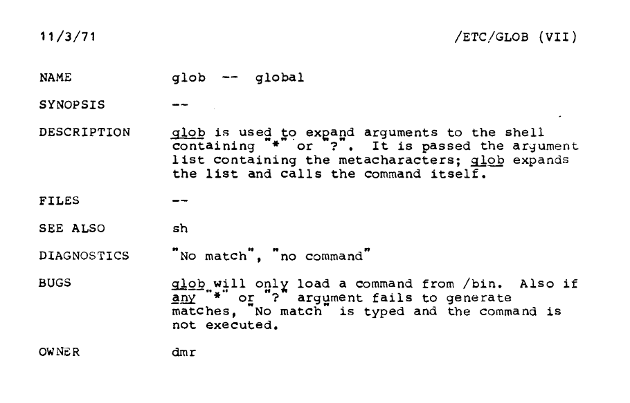

<!-- reading-navigation:start -->

<div dir="rtl" lang="fa">

[بخش قبلی: Regular Expression](Part.3.B.4.regex.md) · [فهرست مطالب](TOC.md) · [بخش بعدی: خردکردن مسئله](Part.3.C.breaking-good-and-bad.md)

</div>

<!-- reading-navigation:end -->


# BNF و EBNF

> **یادداشت مترجم — وضعیت ترجمه:** متن کامل با [فصل اصلی به زبان چینی](../../markdown/Part.3.B.5.bnf-ebnf-pebnf.md) تطبیق و از نظر معنا و کامل‌بودن بازبینی اولیه شده است؛ این نسخه نهایی نیست و فقط برای مطالعهٔ شخصی و محلی تهیه شده است. کدها، grammarها، commentها و خروجی‌های ثبت‌شده بدون تغییر حفظ شده‌اند. بررسی‌های فنی محدود و متمرکز جای اجرای کامل مثال‌ها را نمی‌گیرند؛ همهٔ مثال‌ها دوباره اجرا نشده‌اند. متن داخل تصاویر مستقلاً دیده نشده و نمایش راست‌به‌چپ و پیوندهای بیرونی به‌صورت زنده آزموده نشده‌اند.

> **یادداشت مترجم — توضیح تکمیلی:** برای خواندن این فصل، کافی است با string، رقم و علامت عدد، و مفهوم مقدماتی pattern در Regex آشنا باشید؛ می‌توانید به [فصل Regex](Part.3.B.4.regex.md) مراجعه کنید. grammar مجموعه‌ای از قاعده‌ها برای توصیف ساختار مجاز یک زبان است. BNF و EBNF شیوه‌های نوشتن این قاعده‌ها هستند، نه دستورهایی که مستقیماً در Python اجرا کنید. Parser بخشی از یک برنامه است که ساختار ورودی را بر اساس grammar تشخیص می‌دهد.

معمولاً در کتاب‌های مقدماتی کمتر به بحث Backus-Naur Form، یا BNF، و Extended Backus-Naur Form، یا EBNF، برمی‌خورید. معمولاً هر دو را «موضوع‌هایی که افراد غیرمتخصص نیازی به دانستنشان ندارند» می‌دانند؛ معنای ناگفتهٔ این حرف هم این است که «تازه اگر برایشان توضیح هم بدهیم، باز به‌هیچ‌وجه نمی‌فهمند»…

اما از نظر من، حتماً باید دربارهٔ این موضوع حرف زد؛ هدفی که برای طراحی این «کتاب» در نظر گرفته‌ام، چنین چیزی را ایجاب می‌کند.

اگر دقیق بگوییم، در کتاب «خودآموزی یک مهارت است» (The Craft of Self-Teaching)، که خودآموزی برنامه‌نویسی را نمونهٔ کار قرار داده‌ام، اصلاً لازم نبود شخصاً این‌همه وقت و انرژی صرف نوشتن کنم؛ البته اگر هدف فقط این بود که خواننده «وارد دنیای برنامه‌نویسی» شود. کتاب‌های مقدماتی برنامه‌نویسی، یا برنامه‌نویسی Python، از پیش بسیار زیادند و در میانشان کتاب‌های واقعاً باکیفیت هم کم نیست. اگر در خواندن انگلیسی مشکلی نداشته باشید، می‌بینید که در اینترنت هم آموزش‌های رایگان و بسیار خوبی فراوان است… واقعاً دیگر نوبت به من، لی شیائولای (Li Xiaolai)، نمی‌رسد که یک بار دیگر همین‌ها را بنویسم.

هدف من از نوشتن این کتاب این است:

> خواننده از شناخت توانایی خودآموزی شروع کند، خودآموزی برنامه‌نویسی را نخستین تمرین عملی خود قرار دهد، به‌تدریج این توانایی را به‌طور کامل به دست آورد و بعد، در سال‌های طولانی زندگی، هرچه را لازم داشت یاد بگیرد،

… بی‌آنکه حتماً دنبال کسی بگردد که به او درس بدهد یا دستش را بگیرد. فقط در این صورت است که واژهٔ **آینده** معنایی واقعی پیدا می‌کند.

پس بیش از هر چیز امیدوارم خوانندگان «خودآموزی یک مهارت است»، پس از آشنایی با روش خودآموزی و مفاهیم پایهٔ برنامه‌نویسی و Python در اینجا، بتوانند **خودشان راه بیفتند و مسیرشان را ادامه دهند**. اینکه کجا بروند و تا کجا بتوانند پیش بروند، چیزی نیست که صرفاً با خواست یک‌طرفهٔ منِ نویسنده تعیین شود؛ مگر نه؟

البته کسی که خودآموزی بلد باشد، حتماً بخت بدی نخواهد داشت.

بنابراین، یکی از هدف‌های اصلی این «کتاب» را می‌توان این‌طور هم بیان کرد:

> امیدوارم خواننده پس از خواندن «خودآموزی یک مهارت است» بتواند مستقلاً [مستندات رسمی](https://docs.python.org/3/) را به‌طور کامل و دقیق مطالعه کند؛ حتی مستندات مربوط به انواع زبان‌های برنامه‌نویسی و نرم‌افزارها، از جمله مستندات رسمی آن‌ها را.

خودآموزی برنامه‌نویسی خیلی شبیه این است که تنها وارد جنگلی شوید که هر جور جانوری در آن پیدا می‌شود… آن جنگل هم بسیار بزرگ است. هرچند بعضی جاهایش زیباست، بدون نقشه و قطب‌نما راهتان را گم می‌کنید.

راستش نقشه هم که کم نیست. نه‌فقط Python، بلکه هر زبان برنامه‌نویسی، و حتی هر نرم‌افزاری، مستندات رسمی مفصلی دارد… اما بیشتر مردم هرقدر هم کتاب بخرند و کلاس بروند، باز سراغ «نقشهٔ» رسمی نمی‌روند؛ نمی‌روند که نمی‌روند!

نه اینکه «نقشه‌های شخص ثالث» بهتر باشند؛ گفتن علت واقعی کمی خجالت‌آور است:

> * اول اینکه فکر می‌کنند حجم خواندنی‌های مستندات رسمی خیلی زیاد است… (خب؟ مگر هرچه نقشه مفصل‌تر باشد بهتر نیست؟)
> * بعد هم… نه اینکه اصلاً سراغش نرفته باشند؛ **نمی‌فهمندش**… (خب… این برای تازه‌کارها واقعاً مسئله است!)

برای همین، به نظر من مهم‌ترین کار این «کتاب» این است:

> «راهنمای علائم» نقشه را برای خواننده روشن کند تا از آن پس، هر زمان لازم داشت، بتواند نقشه را کاملاً بفهمد.

هنگام خواندن مستندات رسمی، خیلی‌ها در همان [The Python Tutorial](https://docs.python.org/3/tutorial/index.html) به زحمت می‌افتند… اگر به بخش‌های [Standard Libraries](https://docs.python.org/3/library/index.html) و [Language References](https://docs.python.org/3/reference/index.html) برسند، تقریباً به‌کلی تسلیم می‌شوند. برای نمونه، قطعهٔ زیر از [string — Common string operations](https://docs.python.org/3/library/string.html) گرفته شده است:

> Format Specification Mini-Language — زبان کوچک توصیف قالب‌بندی
> …
> شکل کلی یک format specifier استاندارد چنین است:
```
format_spec     ::=  [[fill]align][sign][#][0][width][grouping_option][.precision][type]
fill            ::=  <any character>
align           ::=  "<" | ">" | "=" | "^"
sign            ::=  "+" | "-" | " "
width           ::=  digit+
grouping_option ::=  "_" | ","
precision       ::=  digit+
type            ::=  "b" | "c" | "d" | "e" | "E" | "f" | "F" | "g" | "G" |
                     "n" | "o" | "s" | "x" | "X" | "%"
```
> …

به اینجا که می‌رسند، با دیدن آن‌همه `::=` و `[]` و `|`، همان‌جا ماتشان می‌برد…

این توصیفی با BNF است؛ آن هم EBNFای که Python برای خودش سفارشی کرده است… برای فهم آن‌ها، البته خوب است بعداً هر وقت فرصت داشتید، دربارهٔ [Context-free Grammar](https://en.wikipedia.org/wiki/Context-free_grammar) هم مطالعه کنید. چه می‌دانید، شاید روزی ذوق کردید و سراغ انواع Parserهایی رفتید که دیگران جرئت نزدیک‌شدن به آن‌ها را ندارند، یا حتی خودتان یک زبان برنامه‌نویسی نوشتید… اما فعلاً کاملاً می‌توانید از آن بحث‌های پیچیده بگذرید، چون هدف کنونی شما فقط این است که «معنای آن علامت‌ها را بفهمید».

راستش واقعاً سخت نیست؛ این فقط روشی برای توصیف syntax است.

مثلاً چه چیزی از نظر syntax یک Integer معتبر است؟ چیزی که با توصیف زیر سازگار باشد، Integer است؛ اینجا از EBNF مربوط به Python استفاده می‌کنیم:

```
integer ::= [sign] digit +
sign    ::= "+" | "-"
digit   ::=  "0" | "1" | "2" | "3" | "4" | "5" | "6" | "7" | "8" | "9"
```
در توصیف بالا فقط چند علامت پایه وجود دارد که معنای هرکدام این است:

> * `::=` تعریف را نشان می‌دهد؛
> * محتوای داخل angle bracketهای `< >`، محتوای الزامی را نشان می‌دهد؛
> * محتوای داخل `[ ]` اختیاری است؛
> * محتوای داخل double quoteهای `" "`، character را نشان می‌دهد؛
> * دو سوی خط عمودی ` | ` گزینه‌های جایگزین‌اند؛ یعنی همان or؛
> * ` * ` یعنی صفر یا چند بار…
> * ` + ` یعنی یک یا چند بار…

> **یادداشت مترجم — توضیح تکمیلی:** ادعای بالا دربارهٔ «الزامی‌بودن» محتوای angle bracketها دقیق نیست. در [شیوهٔ نگارش مستندات Python](https://docs.python.org/3/reference/introduction.html#notation)، عبارتی مانند `<any character>` توضیحی غیررسمی دربارهٔ نمادی است که باید match شود؛ این عبارت یعنی «هر character». در بسیاری از شیوه‌های BNF، angle bracketها نام یک nonterminal را مشخص می‌کنند؛ یعنی بخشی که با قاعده‌های دیگر تعریف می‌شود، نه علامت عمومیِ الزامی‌بودن. terminal جزء نهایی است که دیگر با قاعده‌ای بسط داده نمی‌شود. همچنین باید میان علامت‌های خودِ این شیوهٔ توصیف و characterهای داخل quote تفاوت گذاشت: مثلاً `+` بیرون quote تکرار را می‌رساند، ولی `"+"` خودِ علامت جمع است.

بنابراین:

> 1. تعریف `interger` این است: از یک «`sign` اختیاری» و «مجموعه‌ای از یک یا چند `digit`» تشکیل می‌شود. `+` انتهای خط اول همان نقشی را دارد که `+` در Regex دارد؛
> 2. تعریف `sign` چیست؟ یا `+` است یا `-`؛
> 3. تعریف `digit` چیست؟ هرکدام از مقدارهای `"0"` تا `"9"`…

> **یادداشت مترجم — توضیح تکمیلی:** `interger` در بند اول اشتباه تایپی متن اصلی است؛ نام درست همان `integer` در قاعدهٔ بالاست. «مجموعه» در این توضیح به معنی دنباله‌ای از رقم‌هاست؛ ترتیب رقم‌ها مهم است و منظور نوع دادهٔ set در Python نیست.

پس `99`، `+99` و `-99` همگی `integer`هایی سازگار با توصیف بالا هستند؛ اما `99+` و `99-` قطعاً با این توصیف `integer` سازگار نیستند.

> **یادداشت مترجم — توضیح تکمیلی:** این نمونه، grammar آموزشیِ یک عدد ده‌دهی با علامت اختیاری است، نه grammar واقعی integer literal در Python. literal شیوهٔ نوشتن مستقیم یک مقدار در کد است. در Python علامت `+` یا `-` جزئی از خودِ numeric literal نیست، بلکه operator جداگانه‌ای است. نمونهٔ سادهٔ بالا همچنین بعضی stringها مانند `012` را می‌پذیرد که integer literal ده‌دهی معتبرِ Python 3 نیستند و شکل‌های دیگری مانند `0x10` و `1_000` را پوشش نمی‌دهد. بنگرید به [Numeric literals و Integer literals در مستندات رسمی](https://docs.python.org/3/reference/lexical_analysis.html#numeric-literals).

خیلی ساده است، نه؟ کافی است همهٔ اجزای یک ساختار نحوی را خط‌به‌خط در سمت چپ `::=` بیاورید و بعد در سمت راست، تک‌تکشان را تعریف کنید تا تعریف همهٔ اجزا کامل شود.

شاید کسانی که از قبل با BNF آشنا بوده‌اند کمی تعجب کنند: «چطور حتی از مفاهیم پایه‌ای مثل *terminal* و *nonterminal* هم گذشتی؟» بله، حتی بدون توضیح آن دو مفهوم هم می‌شود موضوع را آن‌قدر روشن کرد که «بلافاصله بتوان از آن استفاده کرد»… این همان چیزی است که اغلب می‌گویم: «انسان این توانایی شگفت‌انگیز را دارد که از چیزهایی که نمی‌فهمد، ماهرانه استفاده کند…»

گسترشی که Python به BNF داده، از Regex الهام گرفته است<a href='#fn1' name='fn1b'><sup>[1]</sup></a>؛ از کاربرد دو علامت آخر، یعنی `*` و `+`، می‌توانید این را ببینید. ضمناً این هم یکی از دلایلی است که این «کتاب» حتماً به Regex می‌پردازد، درحالی‌که کتاب‌های مقدماتی دیگر سراغش نمی‌روند.

از آنجا که مستندات جامعهٔ Python طی بیست‌وچند سال روی هم جمع شده‌اند، شیوهٔ نشانه‌گذاری آن‌ها گاهی یکسان نیست. مثلاً هنگام توصیف [Python Full Grammar specification](https://docs.python.org/3/reference/grammar.html)، از دستگاه نشانه‌گذاری متفاوتی با توصیف String در بالا استفاده کرده‌اند؛ به این شکل:

> * `:` تعریف را نشان می‌دهد؛
> * محتوای داخل `[ ]` اختیاری است؛
> * محتوای داخل quoteهای `' '`، character را نشان می‌دهد؛
> * دو سوی خط عمودی ` | ` گزینه‌های جایگزین‌اند؛ یعنی همان or؛
> * ` * ` یعنی صفر یا چند بار…
> * ` + ` یعنی یک یا چند بار…

یعنی colon یا `:` جای `::=` را گرفته، single quote یعنی `''` جای double quote یعنی `""` آمده و angle bracketهای `<>` هم اصلاً استفاده نشده‌اند:

> **یادداشت مترجم — توضیح تکمیلی:** بلوک زیر عین grammar تاریخیِ نقل‌شده در کتاب است؛ commentهای آن نیز بدون تغییر مانده‌اند. اشارهٔ آن به LL(1)، یعنی شیوهٔ قدیمی Parser در CPython، مربوط به همان دوره است و توصیف وضعیت امروزی نیست. طبق [What’s New in Python 3.9 — New Parser](https://docs.python.org/3.9/whatsnew/3.9.html#new-parser)، Python 3.9 به‌جای Parser قدیمی LL(1)، از Parser مبتنی بر PEG استفاده کرد. PEG کوتاه‌شدهٔ Parsing Expression Grammar است. [Full Grammar specification امروزی](https://docs.python.org/3/reference/grammar.html) با این متن تاریخی یکی نیست؛ برای تشخیص syntax مجاز در نسخهٔ نصب‌شده، مستندات همان نسخه را بخوانید. لازم نیست این بلوک را اجرا کنید؛ با وجود برچسب Python روی بلوک، این متن تعریف grammar است، نه برنامهٔ عادی Python. تفاوت شیوه‌های نشانه‌گذاری را نیز نباید صرفاً خطای یکدستی دانست؛ grammar مورد استفادهٔ Parser و توصیف‌های آموزشی مستندات هدف‌های متفاوتی دارند.

``` python
# Grammar for Python

# NOTE WELL: You should also follow all the steps listed at
# https://devguide.python.org/grammar/

# Start symbols for the grammar:
#       single_input is a single interactive statement;
#       file_input is a module or sequence of commands read from an input file;
#       eval_input is the input for the eval() functions.
# NB: compound_stmt in single_input is followed by extra NEWLINE!
single_input: NEWLINE | simple_stmt | compound_stmt NEWLINE
file_input: (NEWLINE | stmt)* ENDMARKER
eval_input: testlist NEWLINE* ENDMARKER

decorator: '@' dotted_name [ '(' [arglist] ')' ] NEWLINE
decorators: decorator+
decorated: decorators (classdef | funcdef | async_funcdef)

async_funcdef: 'async' funcdef
funcdef: 'def' NAME parameters ['->' test] ':' suite

parameters: '(' [typedargslist] ')'
typedargslist: (tfpdef ['=' test] (',' tfpdef ['=' test])* [',' [
        '*' [tfpdef] (',' tfpdef ['=' test])* [',' ['**' tfpdef [',']]]
      | '**' tfpdef [',']]]
  | '*' [tfpdef] (',' tfpdef ['=' test])* [',' ['**' tfpdef [',']]]
  | '**' tfpdef [','])
tfpdef: NAME [':' test]
varargslist: (vfpdef ['=' test] (',' vfpdef ['=' test])* [',' [
        '*' [vfpdef] (',' vfpdef ['=' test])* [',' ['**' vfpdef [',']]]
      | '**' vfpdef [',']]]
  | '*' [vfpdef] (',' vfpdef ['=' test])* [',' ['**' vfpdef [',']]]
  | '**' vfpdef [',']
)
vfpdef: NAME

stmt: simple_stmt | compound_stmt
simple_stmt: small_stmt (';' small_stmt)* [';'] NEWLINE
small_stmt: (expr_stmt | del_stmt | pass_stmt | flow_stmt |
             import_stmt | global_stmt | nonlocal_stmt | assert_stmt)
expr_stmt: testlist_star_expr (annassign | augassign (yield_expr|testlist) |
                     ('=' (yield_expr|testlist_star_expr))*)
annassign: ':' test ['=' test]
testlist_star_expr: (test|star_expr) (',' (test|star_expr))* [',']
augassign: ('+=' | '-=' | '*=' | '@=' | '/=' | '%=' | '&=' | '|=' | '^=' |
            '<<=' | '>>=' | '**=' | '//=')
# For normal and annotated assignments, additional restrictions enforced by the interpreter
del_stmt: 'del' exprlist
pass_stmt: 'pass'
flow_stmt: break_stmt | continue_stmt | return_stmt | raise_stmt | yield_stmt
break_stmt: 'break'
continue_stmt: 'continue'
return_stmt: 'return' [testlist]
yield_stmt: yield_expr
raise_stmt: 'raise' [test ['from' test]]
import_stmt: import_name | import_from
import_name: 'import' dotted_as_names
# note below: the ('.' | '...') is necessary because '...' is tokenized as ELLIPSIS
import_from: ('from' (('.' | '...')* dotted_name | ('.' | '...')+)
              'import' ('*' | '(' import_as_names ')' | import_as_names))
import_as_name: NAME ['as' NAME]
dotted_as_name: dotted_name ['as' NAME]
import_as_names: import_as_name (',' import_as_name)* [',']
dotted_as_names: dotted_as_name (',' dotted_as_name)*
dotted_name: NAME ('.' NAME)*
global_stmt: 'global' NAME (',' NAME)*
nonlocal_stmt: 'nonlocal' NAME (',' NAME)*
assert_stmt: 'assert' test [',' test]

compound_stmt: if_stmt | while_stmt | for_stmt | try_stmt | with_stmt | funcdef | classdef | decorated | async_stmt
async_stmt: 'async' (funcdef | with_stmt | for_stmt)
if_stmt: 'if' test ':' suite ('elif' test ':' suite)* ['else' ':' suite]
while_stmt: 'while' test ':' suite ['else' ':' suite]
for_stmt: 'for' exprlist 'in' testlist ':' suite ['else' ':' suite]
try_stmt: ('try' ':' suite
           ((except_clause ':' suite)+
            ['else' ':' suite]
            ['finally' ':' suite] |
           'finally' ':' suite))
with_stmt: 'with' with_item (',' with_item)*  ':' suite
with_item: test ['as' expr]
# NB compile.c makes sure that the default except clause is last
except_clause: 'except' [test ['as' NAME]]
suite: simple_stmt | NEWLINE INDENT stmt+ DEDENT

test: or_test ['if' or_test 'else' test] | lambdef
test_nocond: or_test | lambdef_nocond
lambdef: 'lambda' [varargslist] ':' test
lambdef_nocond: 'lambda' [varargslist] ':' test_nocond
or_test: and_test ('or' and_test)*
and_test: not_test ('and' not_test)*
not_test: 'not' not_test | comparison
comparison: expr (comp_op expr)*
# <> isn't actually a valid comparison operator in Python. It's here for the
# sake of a __future__ import described in PEP 401 (which really works :-)
comp_op: '<'|'>'|'=='|'>='|'<='|'<>'|'!='|'in'|'not' 'in'|'is'|'is' 'not'
star_expr: '*' expr
expr: xor_expr ('|' xor_expr)*
xor_expr: and_expr ('^' and_expr)*
and_expr: shift_expr ('&' shift_expr)*
shift_expr: arith_expr (('<<'|'>>') arith_expr)*
arith_expr: term (('+'|'-') term)*
term: factor (('*'|'@'|'/'|'%'|'//') factor)*
factor: ('+'|'-'|'~') factor | power
power: atom_expr ['**' factor]
atom_expr: ['await'] atom trailer*
atom: ('(' [yield_expr|testlist_comp] ')' |
       '[' [testlist_comp] ']' |
       '{' [dictorsetmaker] '}' |
       NAME | NUMBER | STRING+ | '...' | 'None' | 'True' | 'False')
testlist_comp: (test|star_expr) ( comp_for | (',' (test|star_expr))* [','] )
trailer: '(' [arglist] ')' | '[' subscriptlist ']' | '.' NAME
subscriptlist: subscript (',' subscript)* [',']
subscript: test | [test] ':' [test] [sliceop]
sliceop: ':' [test]
exprlist: (expr|star_expr) (',' (expr|star_expr))* [',']
testlist: test (',' test)* [',']
dictorsetmaker: ( ((test ':' test | '**' expr)
                   (comp_for | (',' (test ':' test | '**' expr))* [','])) |
                  ((test | star_expr)
                   (comp_for | (',' (test | star_expr))* [','])) )

classdef: 'class' NAME ['(' [arglist] ')'] ':' suite

arglist: argument (',' argument)*  [',']

# The reason that keywords are test nodes instead of NAME is that using NAME
# results in an ambiguity. ast.c makes sure it's a NAME.
# "test '=' test" is really "keyword '=' test", but we have no such token.
# These need to be in a single rule to avoid grammar that is ambiguous
# to our LL(1) parser. Even though 'test' includes '*expr' in star_expr,
# we explicitly match '*' here, too, to give it proper precedence.
# Illegal combinations and orderings are blocked in ast.c:
# multiple (test comp_for) arguments are blocked; keyword unpackings
# that precede iterable unpackings are blocked; etc.
argument: ( test [comp_for] |
            test '=' test |
            '**' test |
            '*' test )

comp_iter: comp_for | comp_if
sync_comp_for: 'for' exprlist 'in' or_test [comp_iter]
comp_for: ['async'] sync_comp_for
comp_if: 'if' test_nocond [comp_iter]

# not used in grammar, but may appear in "node" passed from Parser to Compiler
encoding_decl: NAME

yield_expr: 'yield' [yield_arg]
yield_arg: 'from' test | testlist
```

حالا که می‌توانید BNF را بخوانید، می‌توانید برای مرور، syntax مربوط به Regex را هم که با BNF توصیف شده است بخوانید<a href='#fn2' name='fn2b'><sup>[2]</sup></a>؛ خیلی کوتاه است:

```html
BNF grammar for Perl-style regular expressions

<RE>             ::=  <union> | <simple-RE>
<union>          ::=  <RE> "|" <simple-RE>
<simple-RE>      ::=  <concatenation> | <basic-RE>
<concatenation>  ::=  <simple-RE> <basic-RE>
<basic-RE>       ::=  <star> | <plus> | <elementary-RE>
<star>           ::=  <elementary-RE> "*"
<plus>           ::=  <elementary-RE> "+"
<elementary-RE>  ::=  <group> | <any> | <eos> | <char> | <set>
<group>          ::=  "(" <RE> ")"
<any>            ::=  "."
<eos>            ::=  "$"
<char>           ::=  any non metacharacter | "\" metacharacter
<set>            ::=  <positive-set> | <negative-set>
<positive-set>   ::=  "[" <set-items> "]"
<negative-set>   ::=  "[^" <set-items> "]"
<set-items>      ::=  <set-item> | <set-item> <set-items>
<set-item>       ::=  <range> | <char>
<range>          ::=  <char> "-" <char>
```

واقعاً به آن اندازه که اول فکر می‌کردید مرموز نبود، نه؟<a href='#fn3' name='fn3b'><sup>[3]</sup></a>

حالا که تا اینجا یاد گرفته‌ایم… بیایید در کنارش یک چیز دیگر را هم خودآموزی کنیم.

نام این یکی `glob` است و کوتاه‌شدهٔ Global است. می‌توانید آن را «نسخهٔ فوق‌العاده ساده‌شدهٔ Regex» در نظر بگیرید. در آغاز، مجموعه‌ای از wildcardها برای match کردن نام فایل‌ها در سیستم‌عامل‌های Unix/Posix بود.

اول تصویری از مستندات glob در سیستم‌عامل Unix سال ۱۹۷۱ ببینید:

> تصویری از صفحهٔ مرجع اصلی glob در Unix سال ۱۹۷۱؛ توجه کنید که مالک آن dmr است، کوتاه‌شدهٔ Dennis Ritchie.

> **یادداشت مترجم — نیازمند بررسی:** فایل محلی تصویر موجود است، اما در این نوبت ابزار مشاهدهٔ تصویر در دسترس نبود؛ خود تصویر و متن داخل آن مستقلاً دیده یا تأیید نشده‌اند. توضیح سال ۱۹۷۱ و مالک dmr صرفاً ترجمهٔ زیرنویس منبع است، نه گزارش مشاهدهٔ تصویر. برای فهم مطلب لازم نیست به نوشته‌های تصویر متکی باشید: در glob، `*` برای صفر یا چند character، `?` برای دقیقاً یک character و `[abc]` برای یک character از میان `a` و `b` و `c` به کار می‌رود. این توضیح دربارهٔ خودِ pattern است؛ جزئیات عبور از جداکنندهٔ مسیر و نام‌های آغازشده با نقطه به ابزار بستگی دارد. برای رفتار Python بنگرید به [مستندات glob](https://docs.python.org/3/library/glob.html) و [fnmatch](https://docs.python.org/3/library/fnmatch.html).

علامت‌های اصلی glob فقط همین چند موردند:

> * `*`
> * `?`
> * `[abc]`
> * `[^abc]`

> **یادداشت مترجم — توضیح تکمیلی:** فهرست بالا عین ادعای نویسنده است؛ اما negation، یعنی کنارگذاشتن characterهای مشخص‌شده، در همهٔ گونه‌های glob یکسان نوشته نمی‌شود. در [fnmatch مربوط به Python](https://docs.python.org/3/library/fnmatch.html)، که glob نیز برای match کردن بخش‌های نام مسیر از آن استفاده می‌کند، شکل درست برای «یک character غیر از `a` و `b` و `c`»، عبارت `[!abc]` است، نه `[^abc]`. در Python، دومی ممکن است خودِ `^` یا یکی از `a` و `b` و `c` را match کند. آن را با `[^abc]` در Regex یکی نگیرید. همچنین تشبیه glob به Regex ساده‌شده برای شروع مفید است، اما این دو زبان یکسان نیستند؛ مثلاً `*` در Regex تکرار جزء قبلی است، ولی در glob خودش جانشین دنباله‌ای از characterها می‌شود.

حالا اگر صفحه‌های Wikipedia دربارهٔ glob و Wildcard character را باز کنید، حتماً می‌توانید «بدون مانع» آن‌ها را بفهمید:

> * https://en.wikipedia.org/wiki/Glob_(programming)
> * https://en.wikipedia.org/wiki/Wildcard_character

ضمناً اگر حالا دوباره سراغ مستندات رسمی Format String بروید، دیگر احساس نمی‌کنید «اصلاً نمی‌شود فهمیدش». برعکس، با خودتان می‌گویید: «چطور قبلاً همین را هم نمی‌فهمیدم؟»

> https://docs.python.org/3/library/string.html#format-string-syntax

در خودآموزی، شکل شکست‌خوردن آدم‌ها ظاهراً هزار جور است، اما در واقع همه یکی است… فقط به این دلیل که از دردسر می‌ترسند یا دانش پایهٔ کافی ندارند، مهم‌ترین مستندات را نمی‌خوانند.

مثلاً هنگام یادگیری انگلیسی، به هیچ قیمتی حاضر نمی‌شوند کتاب grammar بخوانند. مگر grammar انگلیسی چقدر سخت است؟ کتاب هرقدر هم قطور باشد، مگر قرار نیست برای «مراجعه‌کردن و یافتن پاسخ» از آن استفاده کنیم؟ مگر با یادگرفتن چند علامت بیشتر نمی‌شود آن را فهمید؟ مثلاً علامت‌های نوع کلمه: `v.`، `n.`، `adj.`، `adv.`، `prep.` و… مگر این‌ها همان راهنمای علائم نقشه نیستند؟ آن کتاب grammar و این مستندات رسمی که اینجا از آن‌ها حرف می‌زنیم، مگر هر دو «نقشهٔ خودآموز» نیستند؟

اما همین چند چیز ساده جلوی تقریباً همه را می‌گیرد؛ واقعاً ترسناک است.

-----
**پاورقی‌ها**

<a name='fn1'>[1]</a>: [The Python Language Reference » 1.2 Notation](https://docs.python.org/3/reference/introduction.html#notation) — حتماً باید به این لینک سر بزنید…

<a href='#fn1b'><small>↑بازگشت به متن↑</small></a>

<a name='fn2'>[2]</a>: [Perl Style Regular Expressions in Prolog](http://www.cs.sfu.ca/~cameron/Teaching/384/99-3/regexp-plg.html)، یادداشت‌های درس CMPT 384
Robert D. Cameron، از ۲۹ نوامبر تا ۱ دسامبر ۱۹۹۹

<a href='#fn2b'><small>↑بازگشت به متن↑</small></a>

<a name='fn3'>[3]</a>: کمتر کسی متوجه می‌شود که در مستندات grammar بسیاری از زبان‌های برنامه‌نویسی، `"$"` را `<eos>` می‌نامند. در مهٔ ۲۰۱۷ در یک شرکت نوپا سرمایه‌گذاری کردم و شنیدم نام دارایی‌شان `eos` است… همان‌جا از این شوخی خنده‌ام گرفت.

> **یادداشت مترجم — توضیح تکمیلی:** این تداعی و خاطره متعلق به نویسنده است. در grammar کوچک Regex که بالاتر از منبع درس نقل شده، `<eos>` نام یک nonterminal برای `"$"` است و به end of string، یعنی انتهای string، اشاره دارد. این نام‌گذاری را نباید قاعده‌ای همگانی دربارهٔ همهٔ زبان‌های برنامه‌نویسی دانست؛ همچنین خودِ `$` بسته به engine و حالت Regex ممکن است انتهای خط یا موقعیت پیش از newline پایانی را هم match کند. برای نمونه بنگرید به [توضیح `$` در مستندات re مربوط به Python](https://docs.python.org/3/library/re.html#regular-expression-syntax). شباهت نام دارایی `eos` با این اصطلاح، علت تداعی نویسنده است و در اینجا ادعایی دربارهٔ منشأ نام آن دارایی مطرح نمی‌شود.

<a href='#fn3b'><small>↑بازگشت به متن↑</small></a>


<!-- reading-navigation:start -->

<div dir="rtl" lang="fa">

[بخش قبلی: Regular Expression](Part.3.B.4.regex.md) · [فهرست مطالب](TOC.md) · [بخش بعدی: خردکردن مسئله](Part.3.C.breaking-good-and-bad.md)

</div>

<!-- reading-navigation:end -->
