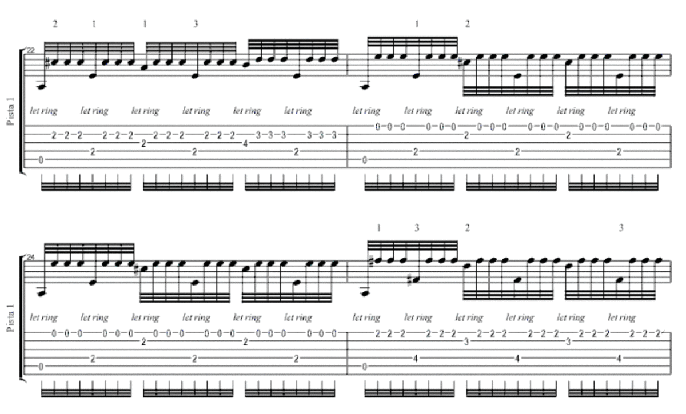
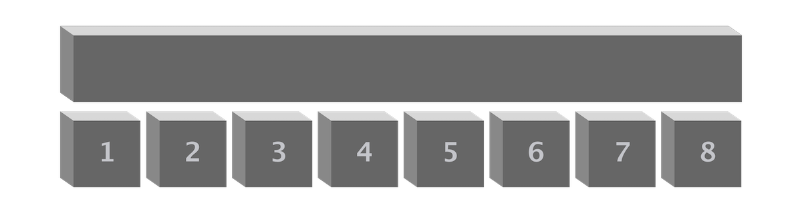
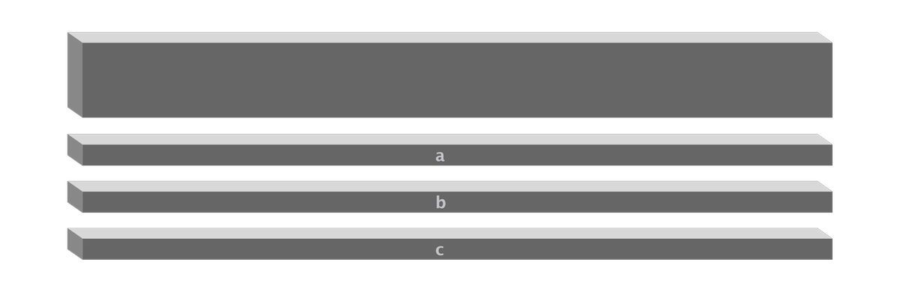

<!-- reading-navigation:start -->

<div dir="rtl" lang="fa">

[بخش قبلی: BNF و EBNF](Part.3.B.5.bnf-ebnf-pebnf.md) · [فهرست مطالب](TOC.md) · [بخش بعدی: توهمِ نیاز ضروری](Part.3.D.indispensable-illusion.md)

</div>

<!-- reading-navigation:end -->


# خردکردن مسئله

> **یادداشت مترجم — وضعیت ترجمه:** ترجمه و بازبینی اولیهٔ معنا و کامل‌بودن متن انجام شده است؛ این نسخه نهایی نیست و برای مطالعهٔ شخصی و محلی تهیه شده است. منبع، [فصل اصلی به زبان چینی](../../markdown/Part.3.C.breaking-good-and-bad.md) است. کد و خروجی ثبت‌شده بدون تغییر حفظ شده‌اند. بررسی بصری تصاویر و نمایش راست‌به‌چپ در محیط نهایی انجام نشده است.

در جریان یادگیری برنامه‌نویسی، بی‌آنکه متوجه باشید، مهارت مهمی یاد می‌گیرید:

> **خردکردن مسئله**

همین تعبیر ساده، در زندگی نقشی چنان بزرگ دارد که تصورش آسان نیست… و واقعاً هم یکی از مهم‌ترین توانایی‌های زیربناییِ خودآموزی است.

## خردکردن افقی

خوش‌شانس بودم که در دوازده‌سالگی فرصت یادگیری برنامه‌نویسی پیدا کردم؛ مفاهیم پایه را یاد گرفتم و زبان برنامه‌نویسی‌ای که آن زمان می‌آموختم BASIC بود. به همین دلیل، از همان ابتدا در مقایسه با دیگران آگاهی بیشتری نسبت به «تقسیم کار به بخش‌های کوچک‌تر» داشتم.

بعدها که در پانزده‌سالگی شروع به یادگرفتن گیتار کردم، دیدم اصل ماجرا همان است.

قطعه‌ای هست که خیلی سخت است؛ البته خیلی هم زیباست. نامش [Recrerdes Da La Alhambra، خاطرات الحمرا](https://www.youtube.com/watch?v=OOsRMECWKAE) است. کافی است نگاهی به نت‌هایش بیندازید تا ببینید چقدر سخت است:



> **یادداشت مترجم — توضیح تکمیلی:** نام رایج و قابل جست‌وجوی این قطعه «Recuerdos de la Alhambra» است؛ املای متفاوتِ متن اصلی در لینک بالا حفظ شده است. تصویر، نمونهٔ نت قطعه برای نشان‌دادن دشواری آن است؛ برای فهم استدلال فصل لازم نیست نت‌خوانی بدانید. جزئیات تصویر در این ترجمه بررسی بصری نشده است.

حالا چه باید کرد؟ واقعاً چه باید کرد؟! راه من، چه در حرف و چه در عمل، خیلی ابتدایی به نظر می‌رسید:

> * هر بار فقط یک میزان را می‌نواختم؛
>   * آن هم با سرعت کم؛ در شروع، خیلی خیلی آهسته؛
>   * بعد که به آن مسلط می‌شدم، کم‌کم سرعت را بالا می‌بردم تا به سرعت عادی برسد؛
> * بعد سراغ میزان بعدی می‌رفتم؛
>   * باز هم با سرعت کم؛ در شروع، خیلی خیلی آهسته؛
>   * بعد که به آن مسلط می‌شدم، کم‌کم سرعت را بالا می‌بردم تا به سرعت عادی برسد؛
> * سپس دو میزان را به هم وصل می‌کردم؛
>   * وصل‌کردن بعضی میزان‌ها نسبتاً آسان بود، اما برای روان‌شدن بعضی دیگر باید مدت زیادی کلنجار می‌رفتم؛

با همین روش، سرانجام توانستم آن قطعهٔ دشوار را بنوازم؛ در واقع همهٔ تازه‌کارها همین کار را می‌کنند.

می‌توانید برای استراحت کمی به این قطعه گوش بدهید؛ البته قطعاً نوازنده‌اش من نیستم، خنده‌دار می‌شد اگر بودم!

```python
from IPython.display import IFrame

IFrame('https://www.youtube.com/embed/OOsRMECWKAE?', width='800', height='450')
```

        <iframe
            width="800"
            height="450"
            src="https://www.youtube.com/embed/OOsRMECWKAE?"
            frameborder="0"
            allowfullscreen
        ></iframe>

هر بار این ماجرا را به یاد می‌آورم، بی‌اختیار آه می‌کشم؛ چون در این مورد خیلی بدشانس بودم. هنوز مدت زیادی از تمام‌کردن تمرین قطعه نگذشته بود و حتی فرصت نکرده بودم برای کسی هنرنمایی کنم که زمین خوردم و استخوان‌های کف دست و انگشتانم شکست. این حادثه آسیبی جبران‌ناپذیر به چابکی انگشتانم زد و بعد از آن فقط می‌توانستم با مضراب کمی گیتار بزنم…

برگردیم به بحث خودمان. یکی از روش‌های مهم خودآموزی این است:

> کارهای دشوار را پی‌درپی به بخش‌های کوچک‌تر تقسیم کنید؛ آن‌قدر که هر زیرکار کوچک شود، تا جایی که **انجام‌دادنی** باشد.

مثلاً regex را در نظر بگیرید؛ چیزی که باید یاد بگیرید، اما یادگرفتن و خوب یادگرفتنش واقعاً آن‌قدرها آسان نیست. همهٔ مهارت‌ها همین‌طورند: تا وقتی یادشان نگرفته‌اید، خیلی خیلی سخت‌اند؛ اما وقتی یاد گرفتید و در استفاده از آن‌ها ورزیده شدید، «کشف» می‌کنید که آن‌قدرها هم سخت نبوده‌اند…

پس در شروع چه باید کرد؟ در واقع باید از توانایی تقسیم‌کردن استفاده کنید:

> * اول دست‌کم یک بار آموزش را از ابتدا تا انتها بخوانید، حتی اگر همه‌چیز را نمی‌فهمید؛
> * محیطی برای آزمایش آماده کنید؛ شاید در Regex101.com، شاید هم در یک editor مثل VS Code؛
> * فعلاً کاری به معنای الگوها نداشته باشید؛ چند regex پیدا کنید و خودتان امتحانشان کنید؛
> * بعد رسماً وارد مرحلهٔ «خواندن دقیق» شوید و بخش‌به‌بخش از پس مطالب برآیید؛
> * پس از یادگرفتن هر بخش، آن را همراه با بخش‌های قبلی دو سه بار دیگر مرور کنید؛
> * کار یادگیری را به چند قسمت تقسیم کنید و دوباره یکی‌یکی بر آن‌ها مسلط شوید؛ مثلاً matching، replacement، استفاده در editor و استفاده در کد Python؛
> * operatorها و نویسه‌های ویژه را به چند گروه تقسیم کنید و آن‌قدر با آن‌ها کار کنید که در حافظه‌تان بمانند؛ نه اینکه در آینده مجبور باشید مدام برگردید و جست‌وجویشان کنید؛
> …

> **یادداشت مترجم — توضیح تکمیلی:** regex یا Regular Expression الگویی برای توصیف متن مورد جست‌وجوست. matching یعنی پیداکردن بخش‌هایی از متن که با الگو سازگارند؛ replacement یعنی جایگزین‌کردن آن بخش‌ها. editor ابزار ویرایش متن یا کد است و operator در اینجا نشانه‌ای است که در ساختن الگو نقش مشخصی دارد. شرح عملی این موضوع در [فصل regex](Part.3.B.4.regex.md) آمده است.

در واقع، وقتی به این روش عادت کنید، «کشف» می‌کنید که کارهای خودآموزی اصلاً «سخت» نیستند؛ فقط «میزان ریزه‌کاری و درهم‌تنیدگی‌شان فرق می‌کند».

خیلی‌ها در نهایت در خودآموزی شکست می‌خورند، یا چون بلد نیستند کار را تقسیم کنند، یا فقط چون **از دردسر می‌ترسند**. باز همان حرف: خودِ زنده‌بودن هم کم دردسر ندارد…

## خردکردن عمودی

روش اول خردکردن، تقسیم یک کار به چند کار کوچک‌تر است؛ همان چیزی که بالاتر توضیح دادم و آن را «خردکردن افقی» می‌نامم.



روش دیگری هم هست که آن را «خردکردن عمودی» می‌نامم؛ گاهی هم می‌گویم «خردکردن لایه‌به‌لایه».



> **یادداشت مترجم — توضیح تکمیلی:** منظور آموزشیِ دو نمودار، بنا بر متن پیرامونشان، این است: در خردکردن افقی، یک کار به زیرکارها تقسیم می‌شود؛ در خردکردن عمودی، لایه‌های متفاوتِ مفاهیم از هم جدا می‌شوند. این توضیح جایگزینِ خواندن نوشته‌های داخل تصاویر نیست؛ خود تصاویر بررسی بصری نشده‌اند.

این روش هنگام خودآموزیِ مجموعه‌ای پیچیده از مفاهیم، به‌ویژه مفید است.

اینکه یادگیری برنامه‌نویسی در آغاز سخت به نظر می‌رسد، فقط به دلیل «[ارجاع زودهنگام](Part.1.F.deal-with-forward-references.md)» نیست که پیش‌تر بر آن تأکید کردیم. مفاهیم این حوزه ویژگی دیگری هم دارند:

> بعضی مفاهیم، با اینکه هم‌سطح نیستند، اغلب بدون هیچ نشانهٔ روشنی در هم تنیده می‌شوند…

مثلاً constant، variable، string، function، file و مانند این‌ها، مفاهیم اختصاصیِ یک زبان برنامه‌نویسیِ خاص نیستند. همهٔ زبان‌های برنامه‌نویسی با این مفاهیم سروکار دارند، چون کامپیوتر همین چیزها را پردازش می‌کند و هر زبان برنامه‌نویسی هم در نهایت باید پردازش آن‌ها را به کامپیوتر بسپارد.

> **یادداشت مترجم — توضیح تکمیلی:** constant به مقداری ثابت اشاره دارد؛ variable نامی است که در برنامه به یک مقدار یا object ارجاع می‌دهد؛ string متن است؛ function مجموعه‌ای از دستورها برای انجام کاری مشخص است و file محل نگهداری داده‌هاست. اینجا تأکید بر جداکردن مفهوم عمومی از جزئیات هر زبان است.

مثال دیگر، branch و loop است. هر زبان برنامه‌نویسی دستورهای متناظر با آن‌ها را دارد. بنابراین خودِ branch و loop در لایهٔ تصمیم‌گیری منطقی و مدیریت جریان اجرا قرار می‌گیرند، اما «**پیاده‌سازی**» آن‌ها باید در لایهٔ دیگری قرار بگیرد. syntax دستورهای branch و loop در زبان‌های مختلف تا حدی فرق می‌کند و این جزئیات متعلق به خودِ آن زبان‌اند:

```python
# Python 这么写：

for i in range(n):
    ...
```

```javascript
// JavaScript 这么写：

var i;
for (i = 0; i < n; i++) {
  ...;
}
```

> **یادداشت مترجم — توضیح تکمیلی:** branch مسیر اجرا را براساس شرط انتخاب می‌کند؛ loop بخشی از کار را تکرار می‌کند و syntax قواعد نوشتن دستورهاست. commentهای چینیِ بالا به‌ترتیب می‌گویند «در Python این‌طور نوشته می‌شود» و «در JavaScript این‌طور نوشته می‌شود»؛ برای حفظ عین کد، تغییر نکرده‌اند.

در خودآموزیِ regex هم همین‌طور است. قواعد پایه متعلق به خودِ regex هستند؛ پیاده‌سازی در زبان‌های مختلف تفاوت دارد و به لایهٔ همان زبان‌ها مربوط می‌شود؛ editorهای مختلف هم علاوه بر قواعد پایه، تنظیمات و ویژگی‌های مخصوص خود را دارند… جزئیات زیاد به نظر می‌رسند، اما وقتی آن‌ها را لایه‌بندی و دسته‌بندی کنید، فهمیدن و به‌یادسپردنشان آسان می‌شود.

در برخورد با Object-Oriented Programming هم همین است: class، instance، object، inheritance، polymorphism… این‌ها واقعاً متعلق به یک زبان خاص نیستند، اما در تقریباً همهٔ زبان‌های برنامه‌نویسی پیاده‌سازی و استفاده می‌شوند. آنچه «دشواری» می‌نامیم، اغلب چیزی جز این نیست که مفاهیمِ دو یا چند لایه را در آموزش و یادگیری و تمرین، در هم پیچیده‌ایم…

> **یادداشت مترجم — توضیح تکمیلی:** Object-Oriented Programming یا OOP برنامه را پیرامون objectها سازمان می‌دهد؛ class الگویی برای ساختن آن‌هاست و instance نمونه‌ای ساخته‌شده از یک class است. inheritance امکان استفاده و گسترش ویژگی‌های class دیگر را می‌دهد؛ polymorphism امکان رفتارهای متفاوت از راه یک رابط مشترک را فراهم می‌کند. این اصطلاح‌ها در [فصل مفاهیم OOP](Part.3.B.1.classes-1.md) توضیح داده شده‌اند. عبارت «تقریباً همهٔ زبان‌ها» تعمیمِ متن اصلی است، نه ادعای اینکه همهٔ زبان‌ها الزاماً OOP را پشتیبانی می‌کنند.

مثال دیگر: وقتی برنامه‌نویسی را نخستین «پروژهٔ عملی» برای کسب توانایی خودآموزی قرار دادم، حتی لازم بود «خواندن» و «نوشتن» را در دو لایهٔ جدا بگذارم. اول به «خواندن» برسیم؛ «نوشتن» بماند برای وقتی که توانایی ابتداییِ «خواندن» را به دست آورده‌ایم. حتی در مرحلهٔ «نوشتن» هم باید دست‌کم دو لایه را از هم جدا کنیم: اول با «functionهای ساده» شروع کنیم، نه اینکه از همان ابتدا بخواهیم یک «برنامهٔ بزرگ» بنویسیم… انگار این مهارتِ جداکردن لایه‌ها همه‌جا به کار می‌آید!

پس هنگام خودآموزی، پیوسته راهی پیدا کنید که این مفاهیم را از نظر لایه از هم جدا کنید؛ نمی‌شود همیشه همه را در یک دیگ ریخت و در هم جوشاند.

در زندگی روزمره با کسانی روبه‌رو می‌شویم که می‌گویند «قدرت درک بالایی دارند». کسانی که چنین توصیفی درباره‌شان به کار نمی‌رود، اغلب نمی‌فهمند و سردرگم می‌شوند:

> من دقیقاً چه کم دارم که نمی‌گویید قدرت درکم بالاست؟ مگر قدرت درک من ضعیف است؟

وقتی مدت زیادی معلم باشید، این پدیده بارها شگفت‌زده‌تان می‌کند:

> چیزی که در اصل خیلی ساده است، ممکن است برای خیلی‌ها به مانعی مادام‌العمر تبدیل شود.

هرقدر هم این حرف را تکرار کنیم، باز کم است.

بیشتر مردم چندان به رابطهٔ میان مفاهیمِ ذهنشان اهمیت نمی‌دهند، چون معمولاً در کارهای روزمره دردسری ایجاد نمی‌کند. اما به محض برخورد با یک نظام دانشیِ کمی پیچیده‌تر، کاملاً درمانده می‌شوند… پیچیدگیِ یک نظام دانشی هم چیزی جز این نیست که مفاهیم تازه کمی بیشترند و ارتباطشان کمی پیچیده‌تر است. پیچیده‌ترشدن ارتباط‌ها هم یعنی هر دو مفهوم لزوماً فقط یک نوع رابطه ندارند و در نهایت شبکه‌ای از پیوندها شکل می‌گیرد…

در کتاب «راهی به‌سوی آزادی مالی» (《通往财富自由之路》)، تقریباً سراسر کتاب را به توضیح اهمیت روشن‌کردن مفاهیم و رابطه‌های میان آن‌ها اختصاص داده‌ام.

پیچیده است؟ در واقع نه؛ وقتی به‌تدریج، هم افقی و هم عمودی، آن‌ها را از هم تفکیک کرده باشید.

اما مشکل اینجاست: کسی که پیوند مفاهیم در ذهنش آشفته است، خودش چنین احساسی ندارد و حتی نمی‌تواند از آن باخبر شود. این‌ها همان [کسانی‌اند که با شما یک فیلم را می‌بینند، اما انگار فیلم دیگری دیده‌اند](Part.1.C.must.learn.sth.only.by.reading.md). آیا زیاده‌روی است اگر بگوییم قدرت درکشان ضعیف است؟ و آیا طبیعی نیست که نفهمند چرا درباره‌شان چنین قضاوتی می‌شود؟

راه روشن‌کردن مفاهیم چیست؟ آن هم چندان سخت نیست: پیوسته خردکردن و پیوسته، به ابتکار خود، مرتب‌کردن. هر بار که آن مفاهیم را با نمودار و جدول مرتب می‌کنید، می‌بینید کمی روشن‌تر شده‌اند. بعد از چند بار مرتب‌کردن، سرانجام کاملاً در ذهنتان جا می‌افتند.

پیداکردن مثالی مناسب‌تر و شگفت‌انگیزتر سخت است؛ بااین‌حال بگذارید یک نمونهٔ دیگر هم بگویم.

وقتی در سال ۲۰۱۱ با Bitcoin آشنا شدم، حالا که به گذشته نگاه می‌کنم، می‌بینم در شرایط آن روز، عادت روزمره‌ام به خردکردن افقی و عمودیِ مفاهیم و رابطه‌هایشان، خوش‌شانسی بزرگی برایم «ساخت». بعدها در «[اصول متن‌باز سرمایه‌گذاری INBlockchain در blockchain ــ به زبان چینی](https://github.com/xiaolai/INB-Principles/blob/master/Chinese.md)» از این موضوع گفتم:

> مفهوم «Bitcoin» را می‌توان به چند شکل فهمید؛ همین، دلیل اصلیِ سردرگمی مردم یا دشواریِ رسیدنشان به درکی مشترک است.
>
> اول، Bitcoin نخستین و تا امروز موفق‌ترین کاربرد blockchain در جهان است.
>
> دوم، Bitcoin یک بانک جهانی است، با این تفاوت که زیر نظر هیچ مرجع قدرتی نیست و از یک شبکهٔ غیرمتمرکز تشکیل شده است.
>
> همچنین، این بانک جهانیِ غیرمتمرکز به نام Bitcoin، پولی منتشر کرده که اتفاقاً نامش هم «Bitcoin» است. بعضی‌ها ترجیح می‌دهند محتاطانه‌تر حرف بزنند و این پول را BTC بنامند، نه Bitcoin.
>
> در نهایت، حتی هفت سال پس از ظهور ناگهانی Bitcoin، یعنی در سال ۲۰۱۷، باز هم کمتر کسی متوجه بود که Bitcoin یا BTC را می‌توان سهامِ این بانک جهانیِ غیرمتمرکز به نام Bitcoin هم دانست.

> **یادداشت مترجم — نیازمند بررسی:** blockchain دفتر ثبت داده‌ای است که در قالب زنجیره‌ای از blockها سازمان می‌یابد. توصیف Bitcoin به‌عنوان «بانک جهانی» و BTC به‌عنوان «سهام» دیدگاه و قیاسِ نویسنده است، نه تعیین ماهیت حقوقی آن یا توصیهٔ سرمایه‌گذاری. عبارت زمانی «هفت سال… یعنی ۲۰۱۷» نیز عین ادعای متن اصلی حفظ شده و ناسازگاری احتمالیِ آن نیازمند بررسی است.

این کار چیزی جز تقسیم یک مفهوم به چند لایه و فهم دقیق هر لایه نیست.

اما بی‌تردید، همین تواناییِ درک که با روشی بسیار بسیار ساده پرورش یافته بود، کمک بزرگی به من کرد.

## به‌کاربردن آموخته‌ها در زمینه‌های دیگر

هر کاری، هرقدر هم در حرف ساده به نظر برسد، تبدیل‌کردنش به کد قطعاً به همان سادگی و آسانی نیست.

بعدها هرچه بیشتر متوجه می‌شوید که بخش اصلیِ کار برنامه‌نویسی، اغلب مربوط به مرحلهٔ تایپ‌کردن کد در editor نیست.

> بخش بزرگ‌تر کار این است که چطور تمام فرایند را در ذهنتان روشن و دقیق به اجزا تقسیم کنید و همهٔ جوانب را در نظر بگیرید…

پس برنامه‌نویسی، بیش از هر چیز، کاری است که با کاغذ و قلم برای روشن‌کردن جزئیات انجام می‌دهید. وقتی همهٔ جزئیات روشن شد، تبدیلشان به کد واقعاً سریع است؛ هرچه پروژه بزرگ‌تر باشد، این نکته بیشتر صدق می‌کند.

این اصل همه‌جا یکسان است و به هم راه دارد. به‌جای برنامه‌نویسی، کتاب‌نوشتن را در نظر بگیرید؛ آنجا هم همین است.

با گذشت زمان، وقت بیشتری صرف «خردکردن مسئله» می‌کنید، چون هر پروژهٔ بزرگی را می‌توان به پروژه‌های کوچک تقسیم کرد. بنابراین، برای انجام پروژه‌های بزرگ، کارِ خردکردن اولاً ضروری است و ثانیاً بیشترین وقت و نیرو را می‌گیرد، اما بیش از همه هم ارزشش را دارد.

خیلی از اطرافیانم، از جمله ویراستاران حرفه‌ایِ انتشارات، از «سرعت کتاب‌نوشتن» من شگفت‌زده شده‌اند. حدس می‌زنم آنچه واقعاً آن‌ها را متعجب و حتی مبهوت کرده، نه «سرعت کتاب‌نوشتن لی شیائولای (Li Xiaolai)» که تصور می‌کنند، بلکه فقط «سرعت تایپ‌کردن لی شیائولای» است.

وقتی به آن‌ها می‌گویم قرار است چه کتابی بنویسم، در واقع یک کار از مدت‌ها پیش تمام شده است: «مرتب‌کردن نظام‌مندِ تمام جزئیات کتابی که قرار است نوشته شود». تنها کاری که مانده، روی کاغذ آوردن آن‌هاست؛ البته من تایپشان می‌کنم، با سرعت ورودیِ تقریباً بی‌رقیبم! طبیعی است که خیلی سریع «به نظر برسد»!

در کارآفرینی و سرمایه‌گذاری هم همین است. چون من پوست‌کلفتم و از خندیدن مردم نمی‌ترسم، می‌توانم این را با آرامش بگویم:

> در **بسیاری** از پروژه‌های کارآفرینیِ شکست‌خورده مشارکت یا سرمایه‌گذاری کرده‌ام…

نتیجهٔ بررسیِ دوبارهٔ همهٔ آن‌ها، بدون استثنا، به یک ریشه برمی‌گشت: هنگام شروع پروژه، هنوز خیلی از جزئیات مهم روشن نشده بود؛ حتی فکر نکرده بودیم که باید روشنشان کنیم، اما کار را شروع کرده بودیم… بعد، در حالی که هزینه‌ها مدام روی هم جمع می‌شد، بی‌پایان درگیر «اتفاق‌های غیرمنتظره» می‌شدیم، بی‌پایان هدف‌ها را از نو تعیین می‌کردیم، بی‌پایان عقب می‌افتادیم و بی‌پایان «دوباره شروع می‌کردیم»… تا پروژه به نفس‌نفس افتادن می‌رسید و سرانجام بی‌سروصدا رها می‌شد.

وقتی به‌اندازهٔ کافی کار را خرد نکنید، به‌آسانی ممکن است روشن فکر نکنید، اشتباه فکر کنید یا به بیراهه بروید…

شاید کسی با اطمینان اعتراض کند: «مگر می‌شود از همان اول همهٔ حالت‌ها را روشن کرد؟!» آه، بله، من هم قبلاً همین فکر را می‌کردم… تا اینکه ضررهای فراوانی دادم؛ خیلی خیلی زیاد، خیلی خیلی بزرگ. بعد «کشف» کردم و ناچار شدم با تصمیمی سخت بپذیرم: کاری را که پیشاپیش نمی‌توانید برای خودتان روشن کنید، انجام ندهید.

این توانایی، خاص و مهم و بسیار ارزشمند است. بعدها در زندگی واقعی چند آدم بسیار توانا هم دیدم که چنین قابلیتی داشتند. مثلاً می‌توانید نام [جوانگ چن‌چائو (Zhuang Chenchao، 庄辰超)](https://www.google.com/search?q=庄辰超) را جست‌وجو کنید. او یکی از آدم‌های واقعی و زنده‌ای است که دیده‌ام می‌توانند پیش از انجام هر کاری، همهٔ جوانبش را روشن کنند.

در خودآموزی، اهمیت تقسیم‌کردن کار از این هم بیشتر است.

یکی از ویژگی‌های این «کتاب» این است که فرایند «خودآموزی» ــ یا آنچه معمولاً «یادگیری» می‌نامیم ــ را به چهار مرحله تقسیم می‌کند: «یادگرفتن»، «تمرین‌کردن»، «به‌کاربردن» و «ساختن» که بعداً به آن می‌رسیم. خودِ چیدمان محتوا هم همین‌گونه است. حتی در قسمت قابل‌توجهی از آغاز کتاب، آشکارا گفته‌ایم «اصلاً انتظار نداریم با یک بار خواندن یاد بگیرید» و بارها یادآوری کرده‌ایم «باید بارها بخوانید، هرچند بار اول ناچارید حتی با نفهمیدن بعضی چیزها تا آخر پیش بروید»…

دربارهٔ گرفتاریِ معمول تازه‌کارها هم از همان ابتدا یادآوری کردیم که زبان برنامه‌نویسی در اصل تفاوتی با زبان و ادبیاتی که در مدرسه خوانده‌اید ندارد: اول خواندن را یاد بگیرید، سپس در حالی که باز هم بیشتر و بیشتر می‌خوانید، تمرین نوشتن را شروع کنید. این است روند واقعاً طبیعی.

حتی وقتی توضیح می‌دهیم چطور بنویسید، از «نوشتن function» شروع می‌کنیم، نه از «بیایید یک برنامه بنویسیم…». این تفاوت کوچک و به‌ظاهر ناچیز، اثر بزرگی دارد؛ چون شروع هر کاری از چیزی «کوچک و کامل» بسیار مهم است.

[«کوچک‌بودن» مهم نیست؛ «کامل‌بودن» اصل ماجراست ــ فصل معاشرتِ خودآموزها](Part.3.F.social-selfteaching.md).


<!-- reading-navigation:start -->

<div dir="rtl" lang="fa">

[بخش قبلی: BNF و EBNF](Part.3.B.5.bnf-ebnf-pebnf.md) · [فهرست مطالب](TOC.md) · [بخش بعدی: توهمِ نیاز ضروری](Part.3.D.indispensable-illusion.md)

</div>

<!-- reading-navigation:end -->
