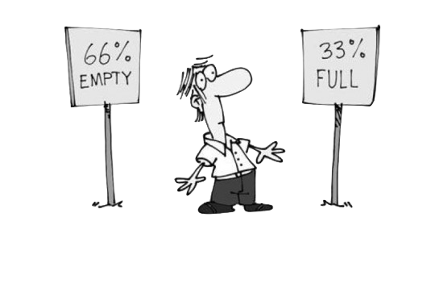

<!-- reading-navigation:start -->

<div dir="rtl" lang="fa">

[بخش قبلی: خردکردن مسئله](Part.3.C.breaking-good-and-bad.md) · [فهرست مطالب](TOC.md) · [بخش بعدی: جامع‌بودن؛ مرتبه‌ای در خودآموزی](Part.3.E.to-be-thorough.md)

</div>

<!-- reading-navigation:end -->


# توهمِ نیاز ضروری

> **یادداشت مترجم — وضعیت ترجمه:** ترجمه و بازبینی اولیهٔ معنا و کامل‌بودن متن انجام شده است؛ این نسخه نهایی نیست و برای مطالعهٔ شخصی و محلی تهیه شده است. منبع، [فصل اصلی به زبان چینی](../../markdown/Part.3.D.indispensable-illusion.md) است. کد و خروجی ثبت‌شده بدون تغییر حفظ شده‌اند. بررسی بصری تصاویر و نمایش راست‌به‌چپ در محیط نهایی انجام نشده است.

در پیشگفتار مثالی زدیم از اینکه آدم‌ها چطور ممکن است ناخواسته خودشان را گرفتار کنند؛ فقط به این دلیل که نفهمیده‌اند حرفِ درست، درست است و ربطی به این ندارد که گوینده‌اش کسی است که مدام حرف‌های تکراری می‌زند.

در خودآموزی، توهم‌های زیادی مانع پیشرفت آدم می‌شوند. مثلاً توهم زمان. مردم همیشه حس می‌کنند دیگر وقت کافی ندارند و برای همین هنگام یادگیری عجله دارند… اما در واقع، برای یادگرفتن یک مهارت تا حدی که کارتان را راه بیندازد، یکی دو سال کافی است؛ برای خیلی خوب‌شدن، سه تا پنج سال کافی است؛ و برای عالی‌شدن، موضوع به یک عمر مربوط می‌شود. نتیجه چیست؟ خیلی‌ها بیهوده عجله می‌کنند، بی‌حساب سعی می‌کنند «در وقت صرفه‌جویی کنند»، هیچ‌چیز را جامع یاد نمی‌گیرند و هیچ تمرینی را به تعداد و مقدار کافی انجام نمی‌دهند. چشم بر هم می‌زنند و سه تا پنج سال گذشته است؛ دوباره مضطرب می‌شوند و مهارت دیگری را انتخاب می‌کنند تا باز یاد بگیرند و امتحان کنند… و این چرخهٔ اضطراب تکرار می‌شود.

به نظر من، زیان‌بارترین توهم، «توهمِ نیاز ضروری» است. این هم اصطلاح دیگری است که خودم ساخته‌ام… بگذارید آرام‌آرام توضیح بدهم.

## احساس همیشه بزرگ‌ترین دام است

نتیجه‌ای که من گرفته‌ام این است:

> توانایی خودآموزیِ بیشتر مردم، اساساً قربانیِ «احساس خودشان» می‌شود.

یعنی هر کسی در آغاز تا حدی توانایی خودآموزی دارد، اما سرانجام احساس خودش آن را از پا درمی‌آورد، تا جایی که کاملاً از دستش می‌دهد. هرچند بعد از آن هم زیاد یاد می‌گیرد، تمام عمر فقط به ابتدایی‌ترین شکلِ یادگیری می‌پردازد: «تقلید».

چرا «تقلید» ابتدایی‌ترین شکل یادگیری است؟

اول، تقلید به الگویی برای تقلیدکردن وابسته است و به میدان دید خودِ فرد محدود می‌شود.

دوم، تقلید فقط از پس دانش و مهارت ساده‌ای برمی‌آید که ظاهر و باطنش یکی است. به محض اینکه موضوع عمیق‌تر باشد و از ظاهرش چندان معلوم نشود، تقلید دیگر کار نمی‌کند. حتی اگر کسی اصرار کند و به‌زور تقلید کند، نتیجه فقط تقلیدی ناشیانه و بدقواره خواهد بود؛ همان حکایت «دونگ‌شی که اخمِ دیگری را تقلید کرد».

> **یادداشت مترجم — توضیح تکمیلی:** در حکایت چینیِ «东施效颦»، دونگ‌شی (Dong Shi) حالت چهرهٔ شی‌شی (Xi Shi) را تقلید می‌کند، بی‌آنکه نتیجه همان زیباییِ الگو باشد. تعبیر اصلی کنایه از تقلیدِ نامتناسب و نتیجهٔ معکوس آن است.

در کتاب «[زمان را دوست خود بدانید](https://github.com/xiaolai/time-as-a-friend)» (《把时间当作朋友》) بارها بر نکته‌ای تأکید کرده‌ام:

> نپرسید یادگرفتنش چه فایده‌ای دارد؛ فقط یاد بگیرید…

این در اصل یکی از بهترین و بنیادی‌ترین راهبردهای خودآموزی است. بااین‌حال، کمتر کسی آن را جدی می‌گیرد؛ حتی اگر مثال‌های بی‌شماری زده باشم، حتی اگر همان لحظه کمی هم موافق بوده باشد… خیلی زود به وضعیت قبلی برمی‌گردد و در برابر هر فرصت خودآموزی، بی‌اختیار می‌پرسد:

> یادگرفتنش به چه درد من می‌خورد؟

اگر «فایده»ای که در پاسخ می‌شنود برایش «نیاز ضروری» نباشد، همان لحظه انگیزه‌اش را از دست می‌دهد و از دنبال‌کردنش دست می‌کشد… تا روزی که ناگهان «کشف» می‌کند اتفاقاً نیازی ضروری بوده است… آن وقت دقیقهٔ نود به تکاپو می‌افتد. آدم‌ها معمولاً از آنچه دنبال می‌کنند جدا نمی‌شوند؛ اما چه کسی مدام به چیزی فکر می‌کند که قبلاً رهایش کرده است؟ پس دفعهٔ بعد باز هم تصمیمی می‌گیرند که برایش «بودجهٔ کافی» کنار نگذاشته‌اند.

کسانی که در نهایت توانایی خودآموزی را از دست می‌دهند، همگی در تشخیص «نیاز ضروری» اشتباه کرده‌اند. این همان چیزی است که «توهمِ نیاز ضروری» می‌نامم.

## توهمِ نیاز ضروری

ریشهٔ «توهمِ نیاز ضروری» این است:

> چیزی که بلد نیستید، در احساستان برای شما نیازی ضروری نیست.

اگر در این «کتاب» نمونه‌ای بزرگ و چندوجهی مثل خودآموزیِ برنامه‌نویسی نبود که بتوانم بارها و از زاویه‌های مختلف با آن استدلال کنم، توضیح جملهٔ بالا واقعاً سخت می‌شد. حتی اگر روشن توضیحش می‌دادم، نبودِ مثالی زنده اثرش را از بین می‌برد.

Regular Expressions یا regex نمونهٔ خیلی خوبی است.

وقتی آن را یاد نگرفته‌اید، یا حتی از وجودش خبر ندارید، از نظر احساسی نمی‌توانید آن را نیازی ضروری بدانید؛ چون تا حالا خوب زندگی کرده‌اید، حتی وقتی اصلاً نمی‌دانستید چنین چیزی وجود دارد.

اگر کمی برای یادگیری‌اش تلاش کنید، اما یاد نگیرید، خوب یاد نگیرید یا اصلاً رهایش کنید، باز هم از نظر احساسی آن را نیازی ضروری نمی‌دانید. چون بلد نیستید از آن استفاده کنید، طبیعتاً هم «به کارتان نمی‌آید»… اصلاً راهی ندارید که بدانید بلدنبودن regex باعث شده چه چیزی را «به دست نیاورید»؛ نه «از دست بدهید»، چون هیچ‌وقت آن را نداشته‌اید.

اما کافی است کمی زحمت بکشید و واقعاً بر آن مسلط شوید؛ آن وقت دو «کشف» می‌کنید:

> * اصلاً نمی‌توانید بدون آن سر کنید<a href='#fn1' name='fn1b'><sup>[1]</sup></a>؛
> * در واقع آن‌قدرها هم سخت نیست…

> **یادداشت مترجم — توضیح تکمیلی:** regex الگویی برای توصیف و یافتن بخش‌های متن است؛ مثلاً برای جست‌وجو و جایگزینی براساس یک الگو، به‌جای بررسی دستیِ تک‌تک موارد. آموزش آن در [فصل regex](Part.3.B.4.regex.md) آمده است.

«کشف» دوم همیشه حسابی خوشحالتان می‌کند: چه خوب که یاد گرفتم، چه خوب که «کشف» کردم؛ وگرنه یک عمر خودم مانع خودم می‌شدم، بی‌آنکه اصلاً خبر داشته باشم. چه خوش‌شانسی‌ای! چه خوش‌شانسی‌ای!! اما «کشف» اول مهم‌تر است، چون حتی یک بار تجربهٔ چنین چیزی می‌تواند برای همیشه از نفرینِ «توهمِ نیاز ضروری» نجاتتان دهد.

برنامه‌نویسی هم همین‌طور است. وقتی شروع به یادگیری برنامه‌نویسی کنید و اطرافیانتان متوجه شوند، بیشترشان حتماً می‌پرسند:

> می‌خواهید یادش بگیرید که چه کار کنید؟

هر جوابی بدهید، احتمالاً واکنششان کمابیش یکسان است: خلاصه نمی‌فهمند این سرمایه‌گذاریِ وقت و نیرو منطقی است یا نه.

بعد، وقتی برنامه‌نویسی را یاد گرفتید و بر این مهارت مسلط شدید، حتماً آن دو نکته هم جزو «کشف»هایتان خواهد بود:

> * اصلاً نمی‌توانید بدون آن سر کنید؛
> * در واقع آن‌قدرها هم سخت نیست…

حتی مهارت‌های خیلی ساده هم همین‌طورند. سال‌ها پیش، عمداً یکی دو هفته برای تمرین تایپ بدون نگاه‌کردن به صفحه‌کلید وقت گذاشتم و روش ورود متن را هم به طرح Microsoft Shuangpin تغییر دادم… کسی هم طعنه زد: «عجب! این را برای چه تمرین می‌کنید؟ قرار است تا آخر عمر تایپیست باشید؟»

> **یادداشت مترجم — توضیح تکمیلی:** Microsoft Shuangpin طرحی برای ورود متن چینی است که در آن اجزای آواییِ هجا با کلیدهای مشخص وارد می‌شوند؛ منظور نویسنده تغییر زبان متن یا یادگیری یک زبان برنامه‌نویسی نیست.

البته من خیلی زود تا حدی توانایی خودآموزی پیدا کرده بودم و در نتیجه تجربه‌هایی هم داشتم. پس لازم نبود بعداً «کشف» کنم؛ از همان ابتدا «می‌دانستم» که در آینده:

> * اصلاً نمی‌توانم بدون آن سر کنم؛
> * در واقع آن‌قدرها هم سخت نیست…

در عمل چه شد؟ دقیقاً همین شد. سرعت خیلی زیادِ تایپ، مستقیماً باعث شد بعدها نویسنده‌ای پرکار شوم. نمی‌توانم تصور کنم اگر خیلی آهسته تایپ می‌کردم، چطور کتاب می‌نوشتم، چطور آن‌همه کتاب و مقاله می‌نوشتم؛ یا چطور بعدها در یکی از روزهای سپتامبر ۲۰۱۸ شروع می‌کردم و ظرف ۷۲ ساعت پیش‌نویس کتاب «پرورش خویشتنِ یک تازه‌وارد بازار» (《韭菜的自我修养》) را تمام می‌کردم… اما آیا این مهارت سخت است؟ در دورانی که من بزرگ شدم، مهارت به حساب می‌آمد؛ امروز، در دنیایی که همه از کودکی با صفحه‌کلید کار می‌کنند، چه کسی بلد نیست؟

پس در مواجهه با یک مهارت تازه، «احساس اینکه نیازی ضروری نیست» قطعاً توهم است. چون پیش از تسلط بر یک مهارت، نمی‌دانید آیا واقعاً نیازی ضروری است یا نه…

> فقط پس از تسلط واقعی بر آن مهارت است که آن مهارت به نیازی ضروری «تبدیل» می‌شود.

و همچنین:

> همین که بر مهارتی مسلط شدید، دیگر نمی‌تواند چیزی جز نیازی ضروری باشد.

این توهم خیلی به آدم ضربه می‌زند.

مغز ما قابلیتی شگفت‌انگیز دارد: «در هر شرایطی، از اطلاعات موجود تصویری کامل می‌سازد».

«در هر شرایطی» یعنی مهم نیست اطلاعات موجود چقدر آشفته، ناقص یا بی‌معنا باشد؛ مغز انسان باز هم می‌تواند از آن تصویری کامل و «معنادار» بسازد.

از این ویژگی زیاد هم بهره‌برداری می‌شود. در روزنامه‌نگاری پدیدهٔ معروف «Framing Effect» وجود دارد:


از این اصل در انواع بازاریابی هم زیاد استفاده می‌شود:



> **یادداشت مترجم — توضیح تکمیلی:** Framing Effect به این اشاره دارد که شیوهٔ ارائه و قاب‌بندیِ اطلاعات می‌تواند برداشت و قضاوت مخاطب را تغییر دهد. متن پیرامون، تصویر اول را نمونه‌ای در خبر و تصویر دوم را نمونه‌ای در بازاریابی معرفی می‌کند. تصاویر بررسی بصری نشده‌اند؛ بنابراین نوشته‌ها و جزئیات مهمِ احتمالیِ داخل آن‌ها هنوز ترجمه و تأیید نشده و نیازمند بررسی‌اند. برای دنبال‌کردن بحث فعلی، نکتهٔ اصلی این است که ارائهٔ بخشی از اطلاعات می‌تواند به برداشتی ظاهراً کامل منجر شود.

به‌راحتی می‌توان تصور کرد کسانی که مرتب با این چیزها گمراه می‌شوند، چه اندازه از «توان ذهنی» کم‌بهره‌اند؛ البته این هم یکی از پیامدهای نداشتن توانایی خودآموزی است.

وقتی تحت تأثیر توهمِ نیاز ضروری هستیم، آشکارا با «اطلاعات یک‌سویه» به «معنایی کامل» می‌رسیم و بعد همان ما را گمراه می‌کند؛ به‌شدت هم گمراه می‌کند، بی‌آنکه خودمان بفهمیم. آزاردهنده‌تر اینکه گمراه‌کننده شخص دیگری نیست، مغز خودمان است! توهم نیاز ضروری چنین است؛ توهم زمان و توهم دشواری هم همین‌طورند. حواس‌پرتی و جابه‌جایی توجه که بعداً درباره‌اش حرف می‌زنیم نیز از همین جنس است؛ مقصر اصلی خودِ آدم است…

پس وقتی تصمیم می‌گیرید چیزی یاد بگیرید، بهتر است از اطرافیانتان نظر نخواهید؛ مگر اینکه مطمئن باشید طرف مقابل واقعاً تواناست، ترجیحاً در خودآموزی. وگرنه همیشه با تردید، دلسردکردن و حتی تمسخر روبه‌رو می‌شوید. تأسف‌بارتر و درمانده‌کننده‌تر اینکه آن‌ها لزوماً آدم‌های بدی نیستند و قصدی هم ندارند؛ فقط «توهمِ نیاز ضروری» خودشان گمراهشان کرده است. آن‌ها واقعاً تصور می‌کنند همه مثل خودشان‌اند… و اگر شما هم واقعاً حرفشان را باور کنید، دیگر خیلی بد می‌شود!

**اگر می‌خواهید و قصد دارید یاد بگیرید، بروید و برای خودتان یاد بگیرید؛ لازم نیست نظر دیگران را بپرسید!**

## راهبردهای برتر

چطور نگذاریم «توهمِ نیاز ضروری» گمراه و محدودمان کند؟

اول، راهبرد پایه این است که این پدیده و توضیحش را عمیق بفهمید:

> دربارهٔ هر مهارتی، **نیاز ضروری نتیجهٔ خودآموزی است**، نه علت آن.

اگر «ضروری‌بودن یا نبودن» را ملاک شروع یادگیری بگذارید، حتماً ضرر می‌کنید؛ چون نتیجهٔ این روش آن است که قطعاً «توهمِ نیاز ضروری» گمراه و محدودتان خواهد کرد.

راهبرد بعدی، که مهم‌تر هم هست:

> **انسانی خودانگیخته باشید**، نه فردی منفعل که عامل‌های بیرونی او را به حرکت درمی‌آورند.

این اساساً عادتی است که هرچه زودتر شکل بگیرد، بهتر است. بیشتر مردم تمام عمر منفعل‌اند و فقط عامل‌های بیرونی به حرکتشان درمی‌آورد. بنابراین در لحظه‌ای «کشف» می‌کنند که مهارتی نیازی ضروری است و بعد به سراغ یادگیری‌اش می‌روند؛ اما متأسفانه آن موقع قطعاً بودجه‌شان کافی نیست و همیشه در تنگنا هستند.

آخرین راهبرد، ساده اما مؤثر است؛ همان عبارتی که [پیش‌تر گفتیم](Part.2.E.deliberate-thinking.md):

> **کاری برای انجام‌دادن پیدا کنید**

داشتن کاری برای انجام‌دادن واقعاً خوشبختی است.

## تأثیر بر نسل بعد

تصور کنید بعضی پدر و مادرها این‌طور با فرزندشان حرف بزنند:

> * پدر، مادر، چه کار می‌کنید؟
> * دارم \_\_\_\_\_\_\_\_\_\_\_\_\_\_\_\_\_ یاد می‌گیرم؛ جای خالی را خودتان پر کنید.
> * برای چه کاری یادش می‌گیرید؟
> * وقتی یاد گرفتم، معلوم می‌شود…

مدتی بعد…

> * فرزندم، بیایید ببینید! این چیزی است که پدر یا مادرتان ساخته است!

حدس می‌زنم چنین کودکی از همان کودکی به‌طور طبیعی از «توهمِ نیاز ضروری» عبور می‌کند.

آنچه «تأثیر تدریجی و نامحسوس» و «یادگرفتن از راه دیدن و شنیدن» می‌نامیم، در واقع چیز ساده‌ای است.

اما اثرش چه؟ اثر یک راهبرد به دلیل ساده یا آسان‌بودنش کمتر نمی‌شود. معمولاً هرچه راهبرد ساده‌تر و آسان‌تر باشد، اثرش شگفت‌انگیزتر است.

پس نتیجهٔ درست چنین است:

> **همهٔ مهارت‌ها نیاز ضروری‌اند.**

هرچند این به معنای بی‌نیازی از انتخاب نیست.

اما برای تصمیم دربارهٔ یادگرفتن یا نگرفتن، هیچ‌وقت «فایده‌داشتن یا نداشتن» معیار اصلی نیست. تنها معیار واقعاً معنادار این است:

> آیا وقت دارید؟

وقت دارید؟ پس یاد بگیرید! وقت ندارید؟ پس وقت باز کنید! به‌اندازهٔ کافی خوب یاد نگرفته‌اید؟ پس وقت بیشتری بگذارید…

-----
**پاورقی**

<a name='fn1'>[1]</a>: هنگام نوشتن این کتاب، تعداد زیادی فایل با پسوند `.ipynb` ساخته شد. در پایان، حتی کاری به‌ظاهر ساده مثل «ساختن فهرست مطالب» هم اگر regex بلد باشید، در چند دقیقه تمام می‌شود؛ وگرنه باید تک‌تک موارد را دستی استخراج، مرتب و ویرایش کنید… برای من چطور ممکن است **نیاز ضروری** نباشد!

```python
import re
import os

files = [f for f in os.listdir('.') if os.path.isfile(f)]
files.sort()
for f in files:
    if '.ipynb' in f:
        with open(f, 'r', encoding = 'UTF-8') as file:
            str = file.read()
            pttn = r'"# (.*)"\n'
            r = re.findall(pttn, str)
            if len(r) > 0:
                print(f'> - [{f.replace(".ipynb", "")}（**{r[0]}**）]({f})') # 生成 markdown
```

    > - [01.preface（**前言**）](01.preface.md)
    > - [02.proof-of-work（**如何证明你真的读过这本书？**）](02.proof-of-work.md)
    > - [Part.1.A.better.teachyourself（**为什么一定要掌握自学能力？**）](Part.1.A.better.teachyourself.md)
    > - [Part.1.B.why.start.from.learning.coding（**为什么把编程当作自学的入口？**）](Part.1.B.why.start.from.learning.coding.md)
    > - [Part.1.C.must.learn.sth.only.by.reading（**只靠阅读习得新技能**）](Part.1.C.must.learn.sth.only.by.reading.md)
    > - [Part.1.D.preparation.for.reading（**开始阅读前的一些准备**）](Part.1.D.preparation.for.reading.md)
    > - [Part.1.E.1.entrance（**入口**）](Part.1.E.1.entrance.md)
    > - [Part.1.E.2.values-and-their-operators（**值及其相应的运算**）](Part.1.E.2.values-and-their-operators.md)
    > - [Part.1.E.3.controlflow（**流程控制**）](Part.1.E.3.controlflow.md)
    > - [Part.1.E.4.functions（**函数**）](Part.1.E.4.functions.md)
    > - [Part.1.E.5.strings（**字符串**）](Part.1.E.5.strings.md)
    > - [Part.1.E.6.containers（**数据容器**）](Part.1.E.6.containers.md)
    > - [Part.1.E.7.files（**文件**）](Part.1.E.7.files.md)
    > - [Part.1.F.deal-with-forward-references（**如何从容应对含有过多 “过早引用” 的知识？**）](Part.1.F.deal-with-forward-references.md)
    > - [Part.1.G.The-Python-Tutorial-local（**官方教程：The Python Tutorial**）](Part.1.G.The-Python-Tutorial-local.md)
    > - [Part.2.A.clumsy-and-patience（**笨拙与耐心**）](Part.2.A.clumsy-and-patience.md)
    > - [Part.2.B.deliberate-practicing（**刻意练习**）](Part.2.B.deliberate-practicing.md)
    > - [Part.2.C.why-start-from-writing-functions（**为什么从函数开始？**）](Part.2.C.why-start-from-writing-functions.md)
    > - [Part.2.D.1-args（**关于参数（上）**）](Part.2.D.1-args.md)
    > - [Part.2.D.2-aargs（**关于参数（下）**）](Part.2.D.2-aargs.md)
    > - [Part.2.D.3-lambda（**化名与匿名**）](Part.2.D.3-lambda.md)
    > - [Part.2.D.4-recursion（**递归函数**）](Part.2.D.4-recursion.md)
    > - [Part.2.D.5-docstrings（**函数的文档**）](Part.2.D.5-docstrings.md)
    > - [Part.2.D.6-modules（**保存到文件的函数**）](Part.2.D.6-modules.md)
    > - [Part.2.D.7-tdd（**测试驱动的开发**）](Part.2.D.7-tdd.md)
    > - [Part.2.D.8-main（**可执行的 Python 文件**）](Part.2.D.8-main.md)
    > - [Part.2.E.deliberate-thinking（**刻意思考**）](Part.2.E.deliberate-thinking.md)
    > - [Part.3.A.conquering-difficulties（**战胜难点**）](Part.3.A.conquering-difficulties.md)
    > - [Part.3.B.1.classes-1（**类 —— 面向对象编程**）](Part.3.B.1.classes-1.md)
    > - [Part.3.B.2.classes-2（**类 —— Python 的实现**）](Part.3.B.2.classes-2.md)
    > - [Part.3.B.3.decorator-iterator-generator（**函数工具**）](Part.3.B.3.decorator-iterator-generator.md)
    > - [Part.3.B.4.regex（**正则表达式**）](Part.3.B.4.regex.md)
    > - [Part.3.B.5.bnf-ebnf-pebnf（**BNF 以及 EBNF**）](Part.3.B.5.bnf-ebnf-pebnf.md)
    > - [Part.3.C.breaking-good-and-bad（**拆解**）](Part.3.C.breaking-good-and-bad.md)
    > - [Part.3.D.indispensable-illusion（**刚需幻觉**）](Part.3.D.indispensable-illusion.md)
    > - [Part.3.E.to-be-thorough（**全面 —— 自学的境界**）](Part.3.E.to-be-thorough.md)
    > - [Part.3.F.social-selfteaching（**自学者的社交**）](Part.3.F.social-selfteaching.md)
    > - [Part.3.G.the-golden-age-and-google（**这是自学者的黄金时代**）](Part.3.G.the-golden-age-and-google.md)
    > - [Part.3.H.prevent-focus-drifting（**避免注意力漂移**）](Part.3.H.prevent-focus-drifting.md)
    > - [Q.good-communiation（**如何成为优秀沟通者**）](Q.good-communiation.md)
    > - [R.finale（**自学者的终点**）](R.finale.md)
    > - [S.whats-next（**下一步干什么？**）](S.whats-next.md)
    > - [T-appendix.editor.vscode（**Visual Studio Code 的安装与配置**）](T-appendix.editor.vscode.md)
    > - [T-appendix.git-introduction（**Git 简介**）](T-appendix.git-introduction.md)
    > - [T-appendix.jupyter-installation-and-setup（**Jupyterlab 的安装与配置**）](T-appendix.jupyter-installation-and-setup.md)
    > - [T-appendix.symbols（**这些符号都代表什么？**）](T-appendix.symbols.md)

> **یادداشت مترجم — توضیح تکمیلی:** comment چینیِ انتهای کد یعنی «تولید Markdown». متن چینی و مسیرهای بخش بالا، خروجی ثبت‌شدهٔ مثال‌اند؛ عمداً ترجمه یا بازنویسی نشده‌اند و لینکِ ناوبریِ ترجمه محسوب نمی‌شوند. کد در این کار اجرا نشده است.

<a href='#fn1b'><small>↑بازگشت به متن↑</small></a>


<!-- reading-navigation:start -->

<div dir="rtl" lang="fa">

[بخش قبلی: خردکردن مسئله](Part.3.C.breaking-good-and-bad.md) · [فهرست مطالب](TOC.md) · [بخش بعدی: جامع‌بودن؛ مرتبه‌ای در خودآموزی](Part.3.E.to-be-thorough.md)

</div>

<!-- reading-navigation:end -->
