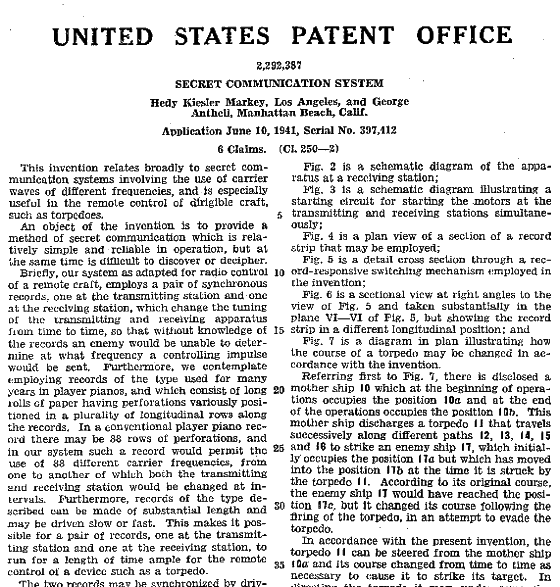

<!-- reading-navigation:start -->

<div dir="rtl" lang="fa">

[بخش قبلی: جامع‌بودن؛ مرتبه‌ای در خودآموزی](Part.3.E.to-be-thorough.md) · [فهرست مطالب](TOC.md) · [بخش بعدی: این، عصر طلاییِ خودآموزهاست](Part.3.G.the-golden-age-and-google.md)

</div>

<!-- reading-navigation:end -->


# معاشرتِ خودآموزها

> **یادداشت مترجم — وضعیت ترجمه:** ترجمه و بازبینی اولیهٔ معنا و کامل‌بودن متن انجام شده است؛ این نسخه نهایی نیست و برای مطالعهٔ شخصی و محلی تهیه شده است. منبع، [فصل اصلی به زبان چینی](../../markdown/Part.3.F.social-selfteaching.md) است. توضیحات افزوده با عنوان «یادداشت مترجم» مشخص شده‌اند. نمایش راست‌به‌چپ در محیط نهایی، متنِ داخل تصاویر و دسترس‌پذیری منابع بیرونی بررسی نشده است.

خیلی‌ها به‌طرز عجیبی دچار این سوءبرداشت‌اند که «خودآموزی» (self-teaching) حتماً یعنی «تنهایی یادگرفتن» (solo-learning)؛ غافل از اینکه خودآموزی هم به معاشرت نیاز دارد. بعضی‌های دیگر هم آن‌قدر «تمرکز» می‌کنند که معاشرت را خسته‌کننده می‌بینند و کم‌کم با هر نوع معاشرتی مخالفت می‌کنند. هیچ‌کدام از این نگاه‌ها جامع نیست.

واقعیت این است که در هر زمینه‌ای، معاشرت ضروری است. فقط خیلی‌ها اصول معاشرتِ خودشان را نساخته و صیقل نداده‌اند؛ برای همین انواع معاشرت‌های بی‌فایده خسته‌شان می‌کند. اگر هم قرار است از چیزی بدشان بیاید، نباید از خودِ معاشرت باشد؛ باید از معاشرتِ بی‌فایده باشد.

در هر مرحلهٔ خودآموزی ــ یادگیری، تمرین، کاربرد و آفرینش ــ معاشرت می‌تواند حضور داشته باشد.

حتی در مرحلهٔ «تمرین» که از همه خشک‌تر است و ظاهراً کمترین نیاز را به معاشرت دارد، معاشرت می‌تواند نقش بزرگی داشته باشد. وقتی خودتان خسته‌اید، می‌بینید کسی هنوز دارد تمرین می‌کند؛ می‌بینید خیلی‌ها مشغول تمرین‌اند؛ می‌بینید خیلی‌ها هم در واقع حسابی خسته‌اند، اما همچنان تمرین می‌کنند… همهٔ این‌ها راه‌های خوبی است برای اینکه احساس کنید کار آن‌قدر هم طاقت‌فرسا نیست.

در واقع، معاشرت در نخستین مرحله، یعنی «یادگیری»، هم بسیار مهم است.

تا به حال در زندگی با این وضعیت روبه‌رو شده‌اید که «آمپول‌زدن به دیگری را می‌بینید و خودتان زودتر از او از درد تاب نمی‌آورید»؟ علتش این است که در مغز ما نوعی نورون به نام **نورون آینه‌ای** (Mirror Neuron) وجود دارد که باعث می‌شود احساس دیگری را «انگار خودمان تجربه می‌کنیم». وقتی می‌بینیم شخص دیگری کاری انجام می‌دهد، نورون‌های آینه‌ای تا جایی که بتوانند به ما تحریک کافی می‌دهند تا احساس آن شخص را «تجربه» کنیم. قبلاً مردم نمی‌دانستند چرا خمیازه «سرایت» می‌کند؛ حالا دانشمندان خوب می‌دانند: این نورون‌های آینه‌ای‌اند که عمل می‌کنند.

وجود نورون‌های آینه‌ای به ما توانایی تقلید، حسِ مشترک، دلسوزی و همدلی می‌دهد… این هم یکی از علت‌های مهمِ نیاز طبیعیِ انسان به معاشرت است؛ چون در قشر مغزِ همهٔ ما نورون‌های آینه‌ایِ زیادی وجود دارد.

به‌طور کلی، چیزهای غیرانسانی مثل اشیا و کتاب‌ها چندان نمی‌توانند نورون‌های آینه‌ای را فعال کنند. این نورون‌ها فقط وقتی برانگیخته می‌شوند که انسانی را ببینیم. برای همین، اگر به کودکی یک گیتار بدهید، چندان علاقه‌ای نشان نمی‌دهد. اما اگر شما را هنگام نواختن ببیند، رفتار شما نورون‌های آینه‌ایِ او را فعال می‌کند و در نتیجه به نواختن گیتار علاقه‌مند می‌شود؛ دقت کنید: به نواختن، نه به خودِ گیتار. اگر هنگام نواختن، احساسی هم داشته باشید که او را تحت‌تأثیر قرار دهد، آسان‌تر از شما تأثیر می‌گیرد؛ چون احساسات، نورون‌های آینه‌ای را بیشتر برمی‌انگیزند. به بیان دیگر، همهٔ یادگیری‌ها در آغاز بر تقلید استوارند و همهٔ تقلیدها از دیدنِ رفتار یک انسان واقعی سرچشمه می‌گیرند؛ حتی اگر در فیلم ببینیم. هرچند فقط تصویر است و نه خودِ آن شخص، بالاخره تصویر یک انسان واقعی است.

> **یادداشت مترجم — نیازمند بررسی:** توضیح‌های بالا دربارهٔ نورون‌های آینه‌ای، سرایت خمیازه و منشأ همهٔ یادگیری‌ها، ادعاهای متن اصلی‌اند. این فصل برای این تعمیم‌ها منبع پژوهشی ارائه نمی‌کند؛ در این ترجمه نیز مستقلاً تأیید نشده‌اند و نباید صرفِ بیان قطعیِ نویسنده را معادل اجماع علمی دانست.

پس هر مهارتی که یاد می‌گیرید، باید کسانی را پیدا کنید که از آن مهارت استفاده می‌کنند؛ این‌طوری احتمال بیشتری دارد که نورون‌های آینه‌ایِ ما راحت‌تر برانگیخته شوند و نتیجهٔ یادگیری بهتر باشد. اگر بتوانید کسی را پیدا کنید که عاشق آن مهارت است و حتی به‌محض استفاده از آن خوشحال می‌شود ــ یکی از بهترین احساس‌ها ــ چه بهتر! شور و اشتیاق چیزی است که فقط عدهٔ کمی از خوش‌شانس‌ها در درازمدت حفظش می‌کنند. بیشتر مردم در کودکی از آن فراوان دارند، اما بعد از پانزده‌شانزده‌سالگی، آگاهانه یا ناآگاهانه شروع می‌کنند به خاموش‌کردنش؛ بی‌آنکه خودشان بدانند.

پیش‌تر گفتیم:

> وقتی می‌بینیم شخص دیگری کاری انجام می‌دهد، نورون‌های آینه‌ای **تا جایی که بتوانند** به ما تحریک کافی می‌دهند تا احساس آن شخص را «تجربه» کنیم.

در این جمله، عبارت «تا جایی که بتوانند» مهم است. چون نورون‌های آینه‌ای فقط می‌توانند با اطلاعاتی که از قبل در مغزمان هست، احساسِ طرف مقابل را شبیه‌سازی کنند. بنابراین در بهترین حالت «تمام تلاششان را می‌کنند»، نه اینکه بتوانند «درستیِ نتیجه را تضمین کنند». سوزن‌های تزریق زیرپوستی که امروزه بیماران دیابتی استفاده می‌کنند، آن‌قدر باریک شده‌اند که ممکن است استفاده‌کننده اصلاً آن‌ها را «حس نکند». پس وقتی بیماری دیابتی به خودش انسولین تزریق می‌کند، خودش دردی احساس نمی‌کند، اما تماشاگر ممکن است چنان «دردش بگیرد» که اخم کند. چرا؟ چون در مغزِ تماشاگر تجربهٔ واقعیِ تزریق انسولین با چنین سوزن باریکی وجود ندارد. بنابراین وقتی نورون‌های آینه‌ای به او احساسِ «همدردی» می‌دهند، در واقع تجربهٔ قبلیِ خودش از آمپول را به کار می‌گیرند: تجربهٔ دردناکِ تزریق وریدی با سوزنی خیلی کلفت‌تر.

برای همین، خیلی‌ها به‌اشتباه فکر می‌کنند کسانی که در نظرشان موفق‌اند، به «پافشاری» و «اراده» تکیه کرده‌اند. این کاملاً نتیجهٔ «تمام تلاشِ» نورون‌های آینه‌ایِ خودشان است؛ نتیجهٔ «به‌کارگرفتنِ تجربه‌های گذشتهٔ خود برای **هم‌حس‌شدن**»… اما واقعیت چیست؟ آن «آدم‌های موفق» در واقع چندان درگیرِ موفقیت نیستند، چون رشد تا پیش از مرگ نه باید تمام شود و نه می‌تواند تمام شود. این شیوهٔ زندگیِ آن‌هاست. یادگیری، پیشرفت، کاوش، راه‌های غیرمستقیم و حتی آزمون‌وخطا، ناکامی و سردرگمی، اجزای جدانشدنیِ زندگی‌شان‌اند. این انتخابی است که در آغاز ناآگاهانه کرده‌اند؛ حرفی از «پافشاری» یا «اراده» در میان نیست… راستش برای آن‌ها، اینکه نگذارید دست‌به‌کار شوند و این‌سو و آن‌سو را بیازمایند، واقعاً دردناک است؛ یادنگرفتن است که پافشاری و اراده می‌خواهد!

یک قدم جلوتر برویم: همین هم دلیلِ انتخاب‌کردنِ دوستان است. آدم‌ها خیلی با هم فرق دارند و بزرگ‌ترین تفاوت از شکل‌گیری شخصیت می‌آید. بیشتر مردم به شخصیتِ نتیجه‌نما دچار می‌شوند؛ فقط عدهٔ کمی با اصلاحِ پیوسته، شخصیتِ «رشدجو» را حفظ می‌کنند، از آن مراقبت می‌کنند و بیشتر پرورشش می‌دهند. آن‌ها به‌طور طبیعی خوش‌بین‌تر و صبورترند، تحمل و توانِ مبارزهٔ بیشتری دارند و بهتر می‌توانند لذتِ یادگیری و پیشرفت را هم پدید بیاورند و هم تجربه کنند. در کنار چنین کسانی، یادگیری آسان‌تر می‌شود؛ فقط به این دلیل که نورون‌های آینه‌ای آسان‌تر به‌درستی برانگیخته می‌شوند. وقتی روشن توضیحش بدهیم، اصلِ موضوع واقعاً ساده است.

> **یادداشت مترجم — توضیح تکمیلی:** منظور از «نتیجه‌نما» در اینجا تمرکز بر نمایشِ توانایی و نتیجه است؛ در مقابل، «رشدجو» بر یادگیری و بهترشدن تمرکز دارد.

یک بار دوستی می‌گفت از اینکه نمی‌تواند در فرزندش علاقه و سرگرمیِ درست‌وحسابی پرورش دهد، کلافه است… گفتم در واقع کار ساده است؛ فقط روشتان اشتباه است. لازم نیست به کودک بگویید «چه چیزی باید یاد بگیرد و به چه چیزی باید علاقه داشته باشد». در عوض، هر کاری می‌توانید بکنید تا کسی را ببیند که آن مهارت را دارد و کودک نسبت به او **احساسِ غبطه** پیدا می‌کند. کافی است کودک غبطهٔ آن شخص را بخورد؛ آن وقت خودبه‌خود فکرِ «من هم می‌خواهم این‌طوری باشم» در ذهنش شکل می‌گیرد و آخر سر دیگر کسی نمی‌تواند جلوِ او را بگیرد. این قدرتِ نورون‌های آینه‌ای است. پس آنچه معاشرت می‌نامیم، لزوماً به حرف‌زدن و گپ‌زدن با دیگران محدود نمی‌شود… دیدن و آشناشدن هم از اصلی‌ترین اجزای معاشرت است.

ببینید، چه کسی می‌گوید معاشرت مهم نیست؟

از این گذشته، برای اینکه در یک مهارت واقعاً «استاد» شوید، مؤثرترین روش این است که هرچه زودتر وارد مرحلهٔ «آفرینش» شوید؛ منظور از «آفرینش»، پیوسته **خلق‌کردن** است.

مهارتِ خودآموزی ساده است؛ یعنی پیوسته یادگرفتن:

```python
def teach_yourself(anything):
    while not create():
        learn()
        practice()
    return teach_yourself(another)

teach_yourself(coding)
```

> **یادداشت مترجم — توضیح تکمیلی:** این قطعه، الگوی مفهومیِ فرایند خودآموزی است، نه برنامه‌ای مستقل و آمادهٔ اجرا؛ چند نامِ به‌کاررفته در آن تعریف نشده‌اند. function مجموعه‌ای از دستورها برای انجام کاری مشخص است؛ اینجا هدف، نشان‌دادن چرخهٔ یادگیری و تمرین تا رسیدن به آفرینش و سپس رفتن سراغ موضوع بعدی است. کد بدون تغییر حفظ شده و اجرا نشده است.

چند چیز که یاد بگیرید، خودِ این مهارت هم به‌طور طبیعی پخته می‌شود. دربارهٔ مهارت‌های دیگری که با خودآموزی کسب می‌کنید، تقریباً همیشه می‌توانید «آیا اثری درست‌وحسابی ساخته‌ام؟» را معیارِ سنجشِ تسلطتان قرار دهید.

در سیلیکون‌ولی مرکز رشدِ مشهوری به نام Y-Combinator هست که اکنون فردی بسیار جوان به نام ساموئل اچ. آلتمن (Samuel H. Altman) آن را اداره می‌کند. او در مقالهٔ مشهورش، «[Advice for ambitious 19 year olds](https://blog.samaltman.com/advice-for-ambitious-19-year-olds)»، توصیهٔ درخشانی دارد:

> No matter what you choose, build stuff and be around smart people. <br />
> هرچه را انتخاب می‌کنید، چیزی بسازید و با آدم‌های باهوش در ارتباط باشید.

> **یادداشت مترجم — توضیح تکمیلی:** «اکنون» و توصیفِ مدیریتِ Y-Combinator مربوط به زمان نگارش متن اصلی است، نه گزارشِ وضعیت امروز.

البته برداشتِ من و سم (Sam) از مفهوم «آدم باهوش» یکسان نیست. از نظر من، همهٔ کسانی که اثر خوبی دارند، باهوش‌اند؛ اما باز همان حرف قبلی: این استعدادِ ذاتی و ضریب هوشی نیست؛ روشن است که حاصلِ انباشتِ مؤثر است.

یکی از ویژگی‌های فردی که برای من بیشترین ارزش را دارد، این است که **آیا فرد اثری درست‌وحسابی دارد یا نه**.

کمتر کسی اثری درست‌وحسابی دارد. در میان مردم، فقط عدهٔ کمی سرانجام می‌توانند اثری کامل ارائه کنند. تفاوتِ آدم‌ها آن‌قدر زیاد است که عدهٔ کمی اثر دارند، عدهٔ کمتری اثرِ خوب دارند و فقط تعداد بسیار بسیار اندکی ممکن است اثری ماندگار برای نسل‌های بعد خلق کنند. در همان حال، اکثریتِ قاطع ــ نه‌هزار و نهصد و نودونه نفر از هر ده‌هزار نفر ــ تمام عمر اثری درست‌وحسابی ندارند؛ حتی از نوشتنِ یک انشای روشن هم برنمی‌آیند. پس ارتباط با کسانی که اثرِ درست‌وحسابی دارند، همیشه بسیار ارزشمند است.

> **یادداشت مترجم — توضیح تکمیلی:** نسبتِ عددیِ بالا و داوری دربارهٔ تواناییِ بیشتر مردم، بیانِ نویسنده است؛ این فصل برای آن آمار یا منبعی ارائه نمی‌کند.

علاوه بر این، معاشرت با آن‌ها سخت نیست. آدم‌هایی‌اند که مسائل را بسیار روشن فهمیده‌اند و معمولاً تواناییِ ارتباطیِ بسیار بالایی دارند. حتی آن عدهٔ کمی که ظاهراً گفت‌وگو با آن‌ها دشوار است، در واقع دشوارفهم یا غیرقابل‌گفت‌وگو نیستند؛ فقط ساده و بی‌تکلف‌اند.

حتی بارها به شریک‌هایم توصیه می‌کنم که هنگام استخدام، این نکته را مطمئن‌ترین معیارِ قضاوت بگیرند: حرفِ اضافه و لاف‌زدن بس است؛ اثرتان را نشانم بدهید. این اصل یک‌باره همهٔ افرادِ فاقدِ صلاحیت را کنار می‌گذارد. پدیدهٔ طبیعیِ دیگری هم هست: اگر کسی بتواند چیزِ درست‌وحسابی بسازد، تراکمِ آدم‌های باهوش در اطرافش، به‌هرحال، خیلی بیشتر از دیگران می‌شود.

جایی که بالاترین تراکمِ معاشرتِ مؤثر را روی زمین دارد، [GitHub](https://github.com) است. بعضی برنامه‌نویس‌ها به شوخی می‌گویند GitHub بزرگ‌ترین شبکهٔ معاشرتِ هم‌جنس‌ها در جهان است. در واقع، خبر ندارند که نسبتِ برنامه‌نویسان زن رو به افزایش است؛ گذشته از این، زنان در علم هیچ‌وقت در حاشیه نبوده‌اند<a href='#fn1' name='fn1b'><sup>[1]</sup></a>.

در GitHub پروژه‌ای پیدا می‌کنید که برایتان جالب است، بعد سهمی در پیش‌بردنش می‌گذارید و با کارتان تأییدِ جامعه را به دست می‌آورید… معاشرت در GitHub این‌طوری است. اگر خودتان پروژه‌ای معنادار بسازید، افراد بیشتری به آن توجه می‌کنند. اگر آن پروژه برای خیلی‌ها مفید باشد، نه‌فقط توجهِ زیادی جلب می‌کند، بلکه خیلی‌ها هم مثلِ خودِ شما در آغاز، در پیش‌بردنش مشارکت می‌کنند… این همان **معاشرتِ مؤثرِ** برنامه‌نویس‌هاست.

اینکه GitHub بتواند بزرگ‌ترین شبکهٔ معاشرتِ مؤثرِ زمین باشد، عجیب نیست؛ چون **معاشرت از راهِ اثر، قطعاً کارآمدترین راه است.**

پس هرچه یاد می‌گیرید، از هر راهی که می‌توانید هرچه زودتر اثرِ خودتان را بسازید. در فرایندِ ساختنِ یک محصول، توانایی و ویژگیِ دیگری هم پرورش پیدا می‌کند که برای خودآموز ضروری است:

> **کامل‌بودن**

این را کنارِ ویژگیِ دیگری که پیش‌تر گفتیم بگذارید تا بنیادی‌ترین شایستگی‌های خودآموز به دست بیاید:

> * وقتی یاد می‌گیرید، **جامع** یاد بگیرید؛
> * وقتی می‌سازید، **کامل** بسازید.

اثر هرقدر هم کوچک باشد، سازنده را متوجه «ناکافی‌بودنِ اجتناب‌ناپذیرِ یک مهارتِ تنها» می‌کند؛ امتحان کنید تا ببینید. حتی اگر بخواهید یک وب‌سایتِ ایستا بسازید، می‌بینید فقط یادگرفتنِ HTML/CSS کافی نیست؛ چون وقتی قرار است آن را روی server راه‌دور مستقر کنید، به‌هرحال باید کارهای پایهٔ Linux را هم یاد بگیرید… و شما که از قبل شایستگی‌های بنیادیِ یک خودآموز را دارید، طبیعی است که برای «تسلطِ جامع» راهی پیدا کنید، نه اینکه فقط سرهم‌بندی کنید و بگذرید.

> **یادداشت مترجم — توضیح تکمیلی:** HTML ساختارِ صفحهٔ وب و CSS ظاهر آن را مشخص می‌کند؛ server رایانه یا سامانه‌ای است که محتوا یا خدمتی را در اختیار دیگران می‌گذارد. مثالِ نویسنده دربارهٔ استقرار روی Linux است؛ نباید آن را شرطِ همهٔ روش‌های انتشارِ وب‌سایتِ ایستا دانست.

مهم‌تر اینکه به‌محض شروعِ ساختنِ اثر، «کشفِ» بزرگ‌ترتان این است که قطعاً به خیلی از «دانش‌ها و مهارت‌هایی که قبلاً بی‌ربط به نظر می‌رسیدند» نیاز دارید؛ نه اینکه «فقط تخصصم کافی است»…

باز هم انتشارِ اولین کتابم را مثال بزنم. پیش از آن کتابی ننوشته بودم؛ اگر کتاب چاپ می‌شد و در کتاب‌فروشی قرار می‌گرفت، کسی نمی‌دانست لی شیائولای (Li Xiaolai، 李笑来) کیست… پس خودِ محتوا به‌تنهایی تضمین نمی‌کرد که کتاب فروش برود. علاوه بر نوشتنِ محتوا، ناچار بودم خیلی چیزهایی را یاد بگیرم که قبلاً اصلاً سراغشان نرفته بودم. مثلاً «چطور محتوا را به‌صورت منظم و پیوسته بازبینی و اصلاح کنم»؛ یا «چطور با ویراستارِ انتشارات درست ارتباط برقرار کنم»؛ یا «چطور اسمِ خوبی برای کتاب انتخاب کنم»… هرکدام از قبلی «بی‌ربط‌تر به تخصص»!

پس «کامل انجام‌دادن» هیچ‌وقت کارِ آسانی نیست.

از این زاویه که نگاه کنید، می‌فهمید چرا اهل‌فنِ توانا معمولاً چیزهای کوچک می‌سازند: چون وقتی دنبالِ کامل‌بودن باشید، ناگزیر می‌بینید هرچه کار کوچک‌تر باشد، کامل‌کردنش آسان‌تر است. همین هم توضیح می‌دهد چرا آدم‌های معمولی همیشه بلندپروازیِ بی‌پایه می‌کنند؛ چون به کامل‌بودن اعتنایی ندارند، می‌توانند خیالِ ساختنِ سراب را در سر بپرورانند.

اهل‌فن از کوچک‌بودنِ کار نمی‌ترسند. تازه، «کوچک» بودن اهمیتی ندارد؛ کلیدِ کار، «کامل» بودن است.

تواناییِ درکِ کسانی که اثر ساخته‌اند هم با کسانی که نساخته‌اند فرق دارد. کسی که اثری ساخته، با دیدنِ اصولی مثل MoSCoW method فوراً به درکی می‌رسد؛ کسی که اثری ندارد، لزوماً همان حس را پیدا نمی‌کند.

> ضمناً فهرستی از لینک‌های Wikipedia را هم ببینید. در برنامه‌نویسی، فلسفه‌ها و روش‌های بی‌شماری هست که می‌شود در زندگی هم از آن‌ها بهره گرفت:
> - [اگر خراب نیست، تعمیرش نکنید — If it ain't broke, don't fix it](https://en.wikipedia.org/wiki/If_it_ain%27t_broke,_don%27t_fix_it)
> - [KISS principle](https://en.wikipedia.org/wiki/KISS_principle)
> - [Don't repeat yourself](https://en.wikipedia.org/wiki/Don%27t_repeat_yourself)
> - [Feature creep](https://en.wikipedia.org/wiki/Feature_creep)
> - [فهرستِ فلسفه‌های توسعهٔ نرم‌افزار](https://en.wikipedia.org/wiki/List_of_software_development_philosophies)
> - [Minimum viable product](https://en.wikipedia.org/wiki/Minimum_viable_product)
> - [MoSCoW method](https://en.wikipedia.org/wiki/MoSCoW_method)
> - [Overengineering](https://en.wikipedia.org/wiki/Overengineering)
> - [Worse is better](https://en.wikipedia.org/wiki/Worse_is_better)
> - [S.O.L.I.D.](https://en.wikipedia.org/wiki/SOLID)
> - [Unix philosophy](https://en.wikipedia.org/wiki/Unix_philosophy)

> **یادداشت مترجم — توضیح تکمیلی:** MoSCoW method روشی برای اولویت‌بندیِ نیازهاست: چیزهایی که باید باشند، بهتر است باشند، می‌توانند باشند و فعلاً قرار نیست باشند. نام‌های دیگرِ فهرست، برای مطالعهٔ بیشتر آمده‌اند؛ توضیح هرکدام در صفحهٔ لینک‌شده است.

برای یادگیری، به خودتان زمانِ کافی بدهید؛ با «بودجهٔ» کافی، صبورانه تمرین کنید؛ پیوسته کاری برای انجام‌دادن پیدا کنید و کاربرد را جای تمرین بنشانید؛ بعد، از همه مهم‌تر، حتماً هرچه زودتر تلاش کنید اثری **کامل** از خودتان بسازید، کوچک یا بزرگ.

فقط این‌طوری است که خودتان هم کسی می‌شوید که معاشرت با او ارزش دارد.

-----
**پاورقی**

<a name='fn1'>[1]</a>: NPR: [«روزها زیباترین زن، شب‌ها مخترع» — Most Beautiful Woman' By Day, Inventor By Night](https://www.npr.org/2011/11/27/142664182/most-beautiful-woman-by-day-inventor-by-night)



تصویرِ بالا نمایی از سندی است که در ادارهٔ ثبت اختراعِ آمریکا نگهداری می‌شود (US Patent 2,292,387, Aug 11, 1942). مخترعِ این اختراع، [هدی لامار (Hedy Lamarr)](https://en.wikipedia.org/wiki/Hedy_Lamarr) است؛ ظاهرش هم این‌طور بود:

> **یادداشت مترجم — توضیح تکمیلی:** طبق توضیحِ متن اصلی، تصویرِ سند قرار است نمونه‌ای از فعالیتِ اختراعیِ لامار باشد، در کنارِ شهرتِ بازیگریِ او. متنِ داخلِ تصویر در این ترجمه مستقیماً بررسی نشده است؛ شماره و تاریخِ بالا از متنِ نویسنده نقل شده‌اند، نه از خواندنِ تصویر.


> **یادداشت مترجم — توضیح تکمیلی:** متنِ اصلی این عکس را برای نشان‌دادنِ چهرهٔ لامار در کنارِ سندِ اختراع آورده است. جزئیاتِ بصری و هر نوشتهٔ احتمالیِ داخلِ عکس مستقیماً بررسی نشده‌اند.

هدی لامار یکی از مشهورترین بازیگرانِ هالیوود بود و درعین‌حال، در خودآموزی هم بسیار توانا بود:

> با اینکه لامار آموزشِ رسمی ندیده بود و بیشتر خودآموخته بود، در وقتِ آزادش روی سرگرمی‌ها و اختراع‌های گوناگون کار می‌کرد؛ از جمله چراغِ راهنماییِ بهبودیافته و قرصی که در آب حل می‌شد و نوشیدنیِ گازدار درست می‌کرد. آن نوشیدنی موفق نبود؛ خودِ لامار می‌گفت مزه‌اش مثل Alka-Seltzer است.

<a href='#fn1b'><small>↑بازگشت به متن↑</small></a>


<!-- reading-navigation:start -->

<div dir="rtl" lang="fa">

[بخش قبلی: جامع‌بودن؛ مرتبه‌ای در خودآموزی](Part.3.E.to-be-thorough.md) · [فهرست مطالب](TOC.md) · [بخش بعدی: این، عصر طلاییِ خودآموزهاست](Part.3.G.the-golden-age-and-google.md)

</div>

<!-- reading-navigation:end -->
