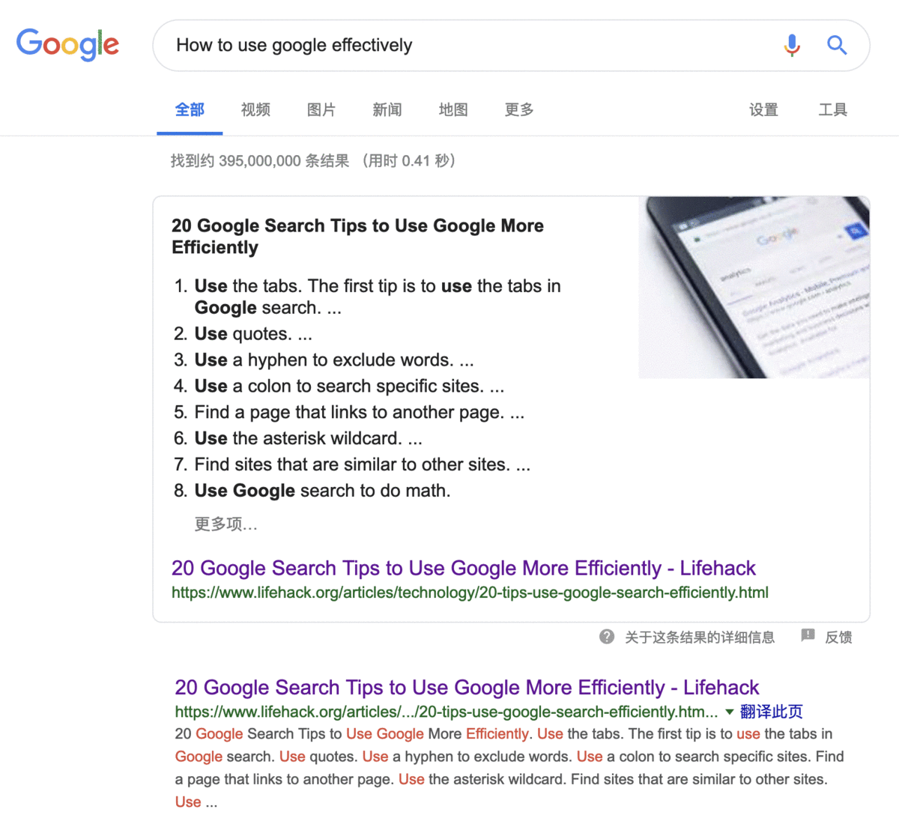
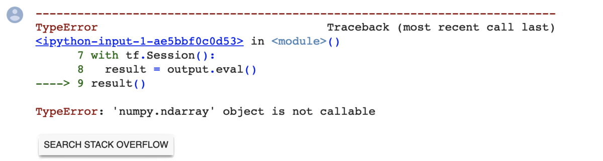
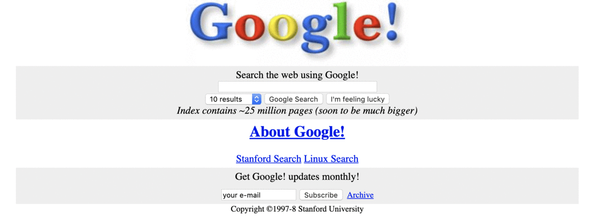

<!-- reading-navigation:start -->

[بخش قبلی: معاشرتِ خودآموزها](Part.3.F.social-selfteaching.md) · [فهرست مطالب](TOC.md) · [بخش بعدی: جلوگیری از جابه‌جاییِ کانونِ توجه](Part.3.H.prevent-focus-drifting.md)

<!-- reading-navigation:end -->

# این، عصر طلاییِ خودآموزهاست

> **یادداشت مترجم — وضعیت ترجمه:** ترجمه و بازبینی اولیهٔ معنا و کامل‌بودن متن انجام شده است؛ این نسخه نهایی نیست و برای مطالعهٔ شخصی و محلی تهیه شده است. منبع، [فصل اصلی به زبان چینی](../../markdown/Part.3.G.the-golden-age-and-google.md) است. توضیحات افزوده با عنوان «یادداشت مترجم» مشخص شده‌اند. نمایش راست‌به‌چپ در محیط نهایی، متنِ داخل تصاویر و دسترس‌پذیری منابع بیرونی بررسی نشده است.

در طولِ تاریخ، خودآموزها هیچ‌وقت به اندازهٔ امروز خوشبخت نبوده‌اند.

قبلاً این‌طور نبود. مثلاً تقریباً هر چینی از کودکی بارها داستان‌هایی از این دست شنیده است: «کسی برای شاگردشدن و یادگرفتنِ یک فن، چند روز و حتی چند ماه زانو می‌زد و باز هم معلوم نبود استاد قبولش کند.»

در روزگارِ قدیم، شاگردِ استادی شدن و فن آموختن واقعاً دشوار بود. اول اینکه پیدا‌کردنِ معلمی واقعاً خوب سخت بود؛ دوم اینکه استادکارها وقتِ معلم‌شدن نداشتند؛ سوم اینکه حتی معلمی که حاضر بود شاگرد بپذیرد و هنرش را بیاموزد، وقت و نیروی بسیار محدودی داشت… مهم‌تر اینکه آن زمان، خودآموزی هم واقعاً شدنی نبود. اساساً چیزی که بتوان اسمش را منابعِ مکتوب گذاشت، برای خواندن یا جست‌وجو وجود نداشت. خیلی از اطلاعاتِ مهم فقط در ذهنِ بعضی آدم‌ها بود. حتی اگر هم نوشته می‌شد، بسیار محدود بود و پراکنده و پنهان در جاهای مختلف باقی می‌ماند. تازه، اگر همه را هم یک‌جا جمع می‌کردید، [Google](https://www.google.com/ncr) نداشتید!

بله، مهم‌ترین نکته این است که آن زمان Google نبود…

اینترنتِ امروز دیگر آن چیزِ «جسورانه و ابتداییِ» بیست‌وچند سال پیش، در آغازِ پیدایشش، نیست. پس از سال‌ها رشد، محتوای اینترنت واقعاً یک «کتابخانهٔ یگانه و همگانیِ جهانی» را شکل داده است؛ و البته بهترین ابزارِ جست‌وجو در آن، Google است.

پس امروز خودآموزها به معنای واقعی در عصری طلایی زندگی می‌کنند: **هیچ‌چیز نیست که نتوان با خودآموزی یاد گرفت.** به عبارت دقت کنید؛ حتی لازم نیست برای دقیق‌بودن، قیدی مثل «تقریباً» به اولِ جمله اضافه کنیم. هرچه بخواهید، می‌توانید یاد بگیرید؛ نه اینکه «فقط پس از شاگردِ استاد شدن بتوانید یادگیریِ یک فن را شروع کنید».

امروز، هرچه می‌خواهید یاد بگیرید، از Google بپرسید؛ در یادگیری به هر مشکلی برخوردید، مستقیم از Google بپرسید. پرسیدنِ مستقیم از آن معمولاً بسیار کارآمدتر از سؤال‌کردن از یک نفر است. Google همین‌طور است: هرچه بیشتر استفاده‌اش کنید، سخت‌تر می‌توانید بدونِ آن سر کنید…

در واقع خیلی‌ها بلد نیستند چطور خوب از Google استفاده کنند؛ اما حتی همین مشکل را هم خودش حل می‌کند، چون می‌توانید مستقیم از خودش بپرسید:

> [How to use google effectively](https://www.google.com/search?q=How+to+use+google+effectively)

> **یادداشت مترجم — توضیح تکمیلی:** عبارتِ جست‌وجوی بالا یعنی «چطور از Google به‌طور مؤثر استفاده کنیم؟» خودِ عبارت و مقصدِ جست‌وجو بدون تغییر حفظ شده‌اند.

با گذشتِ سال‌ها، تجربهٔ استفاده از Google بهتر و بهتر شده است. امروز، در سالِ ۲۰۱۹، اگر عبارتِ بالا را جست‌وجو کنید، Google حتی در میانِ نتایج، یکی را که «به نظرش» «بهترین» است، جدا می‌کند:

> **یادداشت مترجم — توضیح تکمیلی:** مطابق توضیحِ نویسنده، نکتهٔ تصویر این است که Google در پاسخ به پرسشِ روشِ استفاده از خودش، نتیجه‌ای برگزیده را برجسته می‌کند. نوشته‌های داخلِ تصویر مستقیماً بررسی نشده‌اند. سالِ ۲۰۱۹ و توصیفِ رابطِ جست‌وجو مربوط به زمانِ نگارش‌اند، نه تضمینی دربارهٔ ظاهر یا رفتارِ امروزِ Google.

[این مقاله در lifehack.com](https://www.lifehack.org/articles/technology/20-tips-use-google-search-efficiently.html) هم واقعاً ارزشِ خواندنِ دقیق دارد. اگر آن را بخوانید و واقعاً بفهمید، بدونِ اغراق، «مهارتِ جست‌وجویتان» برای پشت‌سرگذاشتنِ ۹۹ درصدِ جمعیتِ فعالِ فعلیِ بشر کافی است… این حرف واقعاً هیچ اغراقی ندارد؛ اکثریتِ قاطعِ مردم اصلاً بلد نیستند هنگامِ جست‌وجو از آن نشانه‌ها استفاده کنند؛ مثلاً `-` `*` `~` `@` `#` `:` `"` `..`، و البته ترفندهای بسیارِ دیگر… راستی، تا به حال در Google از `Time *place*` استفاده کرده‌اید؟

شما که حالا بر regex و glob مسلط شده‌اید، یادگرفتنِ روشِ استفاده از این نشانه‌ها برایتان واقعاً مثلِ آب‌خوردن است. بااین‌حال، منفعتِ آیندهٔ همین چیزهای ساده به‌طرز شگفت‌انگیزی زیاد است؛ اگر باور نمی‌کنید، صبر کنید و ببینید.

> **یادداشت مترجم — توضیح تکمیلی:** regex و glob ابزارهایی برای توصیفِ الگوهای تطبیق‌اند؛ آن‌ها در فصل‌های قبلی مطرح شده‌اند. نشانه‌های جست‌وجوی Google لزوماً همان معنای آن ابزارها را ندارند. فهرستِ بالا و ادعای «۹۹ درصد» عیناً از نظرِ معنا حفظ شده‌اند، اما منبعی برای این آمار در فصل نیست. پشتیبانی و معنای امروزیِ تک‌تکِ نشانه‌ها و عبارتِ نمونه در این ترجمه آزمایش نشده است؛ برای کاربردِ فعلی، مستنداتِ رسمیِ معرفی‌شده در ادامه را ملاک بگیرید.

اما در عمل، باز هم باید همان اصلی را به کار بگیریم که پیش‌تر گفتیم:

> نخستین مرجعِ مراجعه، قطعاً مستنداتِ رسمی است.

یکی از دلایلِ مهمِ این کار این است که کمتر فریبِ «دانشِ دست‌دوم» را بخورید و کمتر گمراه شوید. یک نمونهٔ عالی برای فهمِ محدودیتِ دانشِ دست‌دوم اینجاست: [«کتابی» که نوشته‌ام و در اینترنت منتشر کرده‌ام](https://github.com/xiaolai/ji). وجهِ «شگفت‌انگیزِ» دیگرِ این «کتاب» این است که می‌تواند باعث شود ناگهان قدرتِ خواندن را درک کنید، چه پسر باشید و چه دختر… اگر از این لینک بگذرید، ممکن است یک زندگیِ تمام را از دست بدهید!

مستنداتِ رسمیِ Google Search اینجاست:

> https://support.google.com/websearch

Google ابزارِ قدرتمندتری هم برای استفاده در اختیارتان می‌گذارد، به نام Google Custom Search. مستنداتِ رسمیِ آن اینجاست:

> https://support.google.com/customsearch/

برای کارِ برنامه‌نویسی، Google البته اهمیتِ ویژه‌ای دارد؛ چون انبوه‌ترین و تخصصی‌ترین اطلاعاتی که در اینترنت جمع شده، طبعاً اطلاعاتِ مربوط به رایانه است. پس وقتی به پیامِ خطایی برمی‌خورید، نه‌فقط باید از Google بپرسید، بلکه باید در اولویت از [Stack Overflow](https://stackoverflow.com) هم بپرسید؛ حتی خودِ Google همین کار را می‌کند. در [colab.research.google.com](https://colab.research.google.com)، یعنی محیطِ Jupyterlab که Google برای سرویسِ TensorFlow خود ساخته است، اگر هنگامِ اجرای کدی خطا رخ بدهد، زیرِ پیامِ خطا دکمه‌ای ظاهر می‌شود که روی آن نوشته است: `SEARCH STACK OVERFLOW`. با کلیک روی آن، مستقیم نتایجِ جست‌وجوی [Stack Overflow](https://stackoverflow.com) را می‌بینید… واقعاً کارِ خوبی است!

> **یادداشت مترجم — توضیح تکمیلی:** بر اساسِ متنِ اصلی، نکتهٔ تصویر امکانِ رفتن از پیامِ خطا به جست‌وجوی Stack Overflow است؛ متنِ دکمهٔ نقل‌شده یعنی «در Stack Overflow جست‌وجو کن». متنِ کاملِ خطا، کد و خروجیِ احتمالیِ داخلِ تصویر مستقیماً بررسی یا بازنویسی نشده‌اند. توصیفِ Colab به‌عنوانِ محیطِ Jupyterlab و شکلِ این دکمه، بیانِ تاریخیِ نویسنده است و در این ترجمه به‌عنوانِ مشخصاتِ تأییدشدهٔ امروز عرضه نمی‌شود. TensorFlow ابزاری برای کارهای یادگیریِ ماشین است؛ نامِ ابزارها بدون تغییر باقی مانده است.

[Google](https://google.com)، [Stack Overflow](https://stackoverflow.com)، [Wikipedia](https://en.wikipedia.org) و [YouTube](https://youtube.com)، همگی جاهای خوبی‌اند که باید مرتب در آن‌ها جست‌وجو کنید.

بیست سال پیش، وقتی Google تازه ظاهر شده بود، چه کسی می‌توانست شکلِ امروزش را تصور کند؟ این تصویر، نمایی از نشانیِ http://google.com در ۱۱ نوامبرِ ۱۹۹۸ است:

> **یادداشت مترجم — توضیح تکمیلی:** طبق توضیحِ نویسنده و بندِ بعد، این تصویر به دورهٔ پیش از راه‌اندازیِ رسمیِ سایت مربوط است و نخستین لینکِ آن به نمونهٔ اولیه می‌رسید. متنِ کاملِ داخلِ تصویر مستقیماً بررسی نشده است؛ تاریخ و نقشِ لینک از توضیحِ متنِ اصلی نقل شده‌اند.

آن زمان سایت هنوز رسماً راه نیفتاده بود. نخستین لینک به یک طرحِ اولیه می‌رسید که با یک subdomain در وب‌سایتِ استنفورد منتشر شده بود: http://google.stanford.edu/:

> **یادداشت مترجم — توضیح تکمیلی:** subdomain بخشی از یک نامِ دامنه است؛ در نشانیِ بالا، Google زیرِ دامنهٔ stanford.edu قرار دارد. مطابقِ متنِ نویسنده، نکتهٔ تصویرِ نمونهٔ اولیه این است که Google آن زمان برای نشان‌دادنِ گسترهٔ جست‌وجویش بر «۲۵ میلیون صفحه» تأکید می‌کرد. این عدد از بندِ بعد نقل شده است؛ نوشته‌های داخلِ تصویر مستقیماً بررسی نشده‌اند.

آن وقت‌ها Google هنوز لازم می‌دید به دیگران تأکید کند که ۲۵ میلیون صفحه برای جست‌وجو دارد!

در واقع، در سالِ ۲۰۰۸، Google اعلام کرد که شمارِ صفحه‌های قابلِ جست‌وجو از یک تریلیون (One Trillion) گذشته است؛ تا پایانِ سالِ ۲۰۱۶، این عدد از ۱۳۰ تریلیون هم فراتر رفته بود…

> **یادداشت مترجم — نیازمند بررسی:** اعداد و تعبیرِ «صفحه‌های قابلِ جست‌وجو» مطابقِ متنِ اصلی حفظ شده‌اند. این فصل منبعی برای آن‌ها نمی‌دهد و تفاوتِ احتمالیِ شمارِ صفحه‌های شناخته‌شده، index‌شده و واقعاً قابلِ بازیابی را روشن نمی‌کند؛ در این ترجمه نیز مستقلاً راستی‌آزمایی نشده‌اند. index مجموعهٔ سازمان‌یافته‌ای از اطلاعات است که موتورِ جست‌وجو برای بازیابیِ نتایج به کار می‌گیرد.

از زاویه‌ای دیگر، این عدد درعین‌حال نشان‌دهندهٔ انباشتِ اطلاعات در اینترنت است. در جهان هیچ «کتابی» بزرگ‌تر و جامع‌تر از اینترنت نیست. تازه، به لطفِ وجودِ Google، این کتابِ بزرگِ اینترنت قابلِ جست‌وجوست!

پس **وقتی سؤالی دارید، اول از Google بپرسید**، به یکی از آدابِ ضروریِ خودآموزی تبدیل می‌شود.

> سؤالی را که می‌شود جوابش را با Google پیدا کرد، لازم نیست از دیگران بپرسید و وقتشان را بگیرید.

این هم یکی از شایستگی‌های بنیادیِ یک خودآموز است.

گاهی واقعاً پیش می‌آید که مدتِ زیادی در Google جست‌وجو می‌کنید و باز هم پاسخی پیدا نمی‌کنید… آن وقت ممکن است لازم باشد راهی برای «پرسیدن از آدم‌ها» پیدا کنید. بااین‌حال، قابل‌اتکاترین افراد معمولاً لزوماً «آدم‌های اطرافتان» نیستند؛ ممکن است کاربرانِ دیگرِ جامعه‌های تخصصیِ گوناگون در اینترنت باشند…

پرسیدن از آدم‌ها هم آدابی دارد. خیلی‌ها بی‌مقدمه دهان باز می‌کنند و می‌پرسند؛ نتیجه چیست؟ کسی جوابشان را نمی‌دهد. چرا؟

به‌عنوانِ خودآموزی که این آداب را می‌داند، مقاله‌ای هست که باید دقیق بخوانید:

> [How To Ask Questions The Smart Way](https://github.com/selfteaching/How-To-Ask-Questions-The-Smart-Way)

این مقاله را دو چهرهٔ برجسته، اریک اس. ریموند (Eric S. Raymond) و ریک موئن (Rick Moen)، در سالِ ۲۰۰۱ در اینترنت منتشر کردند و مردم آن را اثری کلاسیک می‌دانند. تا امروز بارها بازبینی شده است؛ آخرین بار در سالِ ۲۰۱۴، با عنوانِ `Revision 3.10`. در این فاصله به زبان‌های زیادی هم ترجمه شده است.

> **یادداشت مترجم — توضیح تکمیلی:** عنوانِ مقاله یعنی «چگونه هوشمندانه سؤال بپرسیم». لینکِ متنِ اصلی به نسخهٔ چینیِ آن در GitHub می‌رود، نه ترجمهٔ فارسی. «آخرین بار در سالِ ۲۰۱۴» و شمارهٔ نسخه، گزارشِ نویسنده در زمانِ نگارش است؛ وضعیتِ امروزِ مقاله در این ترجمه بررسی نشده است.

**اگر جدی از Google استفاده نکنید، طلایی‌ترین عصرِ خودآموزها در تمامِ تاریخِ بشر را از دست می‌دهید.**

<!-- reading-navigation:start -->

[بخش قبلی: معاشرتِ خودآموزها](Part.3.F.social-selfteaching.md) · [فهرست مطالب](TOC.md) · [بخش بعدی: جلوگیری از جابه‌جاییِ کانونِ توجه](Part.3.H.prevent-focus-drifting.md)

<!-- reading-navigation:end -->
