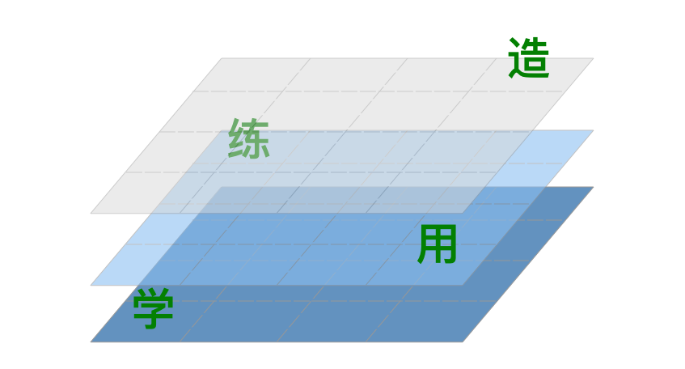

<!-- reading-navigation:start -->

[بخش قبلی: چگونه در برقراری ارتباط توانمند شویم؟](Q.good-communiation.md) · [فهرست مطالب](TOC.md) · [بخش بعدی: قدم بعدی چیست؟](S.whats-next.md)

<!-- reading-navigation:end -->

# مقصد خودآموز

... شما که دارید مهارت خودآموزی‌تان را پرورش می‌دهید، دیر یا زود با چنین موقعیتی روبه‌رو می‌شوید:

> باید مهارتی را یاد بگیرید که نه کسی آن را درس می‌دهد، نه کسی راهنمایی‌تان می‌کند و نه حتی کتابی برای مراجعه وجود دارد.

شاید این بالاترین مرتبه‌ای باشد که می‌توانم برای تجربهٔ یک خودآموز تصور کنم؛ چون خودم هم پس از این‌همه سال فقط تا همین‌جا رسیده‌ام. بعد از سال‌ها، از میان مهارت‌هایی که بدون معلم، راهنما یا حتی کتاب مرجع به‌صورت خودآموز یاد گرفته‌ام، فقط در دو مورد واقعاً می‌توانم ادعایی داشته باشم:

> * پدید آوردن کتاب‌هایی با فروش ماندگار
> * سرمایه‌گذاری در blockchain

اول از سرمایه‌گذاری در blockchain بگویم.

وقتی در سال ۲۰۱۱ سرمایه‌گذاری در Bitcoin را شروع کردم، اوضاع مثل امروز نبود. امروز در Amazon کتاب‌های فراوانی دربارهٔ فناوری blockchain و سرمایه‌گذاری در آن پیدا می‌کنید. اما در سال ۲۰۱۱، در این کتاب بزرگِ اینترنت، حتی به‌سختی یک مقالهٔ درست‌وحسابی پیدا می‌شد.

> **یادداشت مترجم — توضیح تکمیلی:** «امروز» و «اکنون» در این فصل به زمان نگارش، در سال ۲۰۱۹، اشاره دارند. blockchain فناوری ثبت داده در زنجیره‌ای از بلوک‌های به‌هم‌پیوسته است و Bitcoin یکی از کاربردهای آن است. روایت سرمایه‌گذاری و ارزیابی اشخاص در ادامه، تجربه و نظر نویسنده است، نه توصیهٔ سرمایه‌گذاری از سوی مترجم؛ سرمایه‌گذاری سنگین تضمین‌کنندهٔ دانش یا بازده نیست و خطر زیان دارد.

متخصص شدن در چنین حوزه‌ای، در واقع از آنچه بیرونی‌ها تصور می‌کنند آسان‌تر است؛ البته بیرونی‌ها همیشه هر کاری را دشوار می‌بینند. چرا آسان‌تر از تصور آن‌هاست؟ چون هیچ‌کس چیزی نمی‌داند. فقط همین.

پس کار باقی‌مانده ساده است:

> کسی که بتواند پیوسته پژوهش کند، احتمال دارد زودتر متخصص شود.

در نهایت باز همان عامل تعیین‌کننده است: صرف وقت مؤثر. باز هم فقط همین.

کسانی که مرا می‌شناسند می‌دانند در به‌اشتراک‌گذاری دانش و مهارت، هیچ‌وقت عادت نداشته‌ام چیزی را پنهان کنم. وقتی می‌گویم «فقط همین»، واقعاً منظورم همین است؛ نکتهٔ ناگفته‌ای نگه نداشته‌ام.

وقتی می‌گویم white paper مربوط به Bitcoin را دقیق می‌خوانم، واقعاً همین کار را می‌کنم؛ بارها و بارها، هر سال چند مرتبه. بعضی‌ها می‌پرسند: لازم است؟ خب، اینکه برای من لازم هست یا نه، تصمیم خودم است. تازه اگر هم لازم باشد، گفتنش به دیگران چه فایده‌ای دارد؟ درست است؟

> [ترجمهٔ من از white paper مربوط به Bitcoin اینجاست](https://github.com/xiaolai/bitcoin-whitepaper-chinese-translation).

> **یادداشت مترجم — توضیح تکمیلی:** white paper در اینجا سند فنی معرفی طرح Bitcoin است. پیوند بالا به ترجمهٔ چینیِ نویسنده می‌رود، نه به ترجمهٔ فارسی.

وقتی می‌گویم سرمایه‌گذاری می‌کنم، واقعاً سرمایه‌گذاری می‌کنم؛ نه اینکه «دو تا بخرم ببینم چه می‌شود» یا «چند تا برای سرگرمی بخرم». روش من این است که **بخش بزرگی از سرمایه‌ام را وارد کنم**. ادامهٔ پژوهش پس از سرمایه‌گذاری، قطعاً با مطالعه بدون هیچ دارایی‌ای در آن حوزه فرق دارد. نمونه‌ای کاملاً مخالف من هم هست: آندریاس ام. آنتونوپولوس (Andreas M. Antonopoulos)، نویسندهٔ مشهور «تسلط بر Bitcoin» ([Mastering Bitcoin](https://www.amazon.com/Mastering-Bitcoin-Programming-Open-Blockchain/dp/1491954388/))، که هم‌سن من و متولد ۱۹۷۲ است.

او هم در خارج از چین متخصص شناخته‌شدهٔ Bitcoin است، اما سرمایه‌گذار نیست؛ تقریباً Bitcoin نداشت. در بازار صعودی سال ۲۰۱۷، وقتی مردم شنیدند آندریاس ام. آنتونوپولوسِ بزرگ تقریباً Bitcoin ندارد، بسیار تعجب کردند و در مجموع حدود ۱۰۲ Bitcoin به او اهدا کردند. لطفاً اشتباه برداشت نکنید: هیچ قصدی برای تحقیر او ندارم. این فقط حرف نیست؛ من عملاً از او حمایت کرده‌ام. ترجمهٔ چینی کتابش، «تسلط بر Bitcoin»، را هم من با گردآوری گروهی از مترجمان سامان دادم.

فقط می‌گویم تفاوت من و او این است که در بعضی جنبه‌ها عملی‌تر برخورد می‌کنم؛ این هم واقعیت دارد. معتقدم پس از سرمایه‌گذاری واقعی، درکم از Bitcoin و blockchain عمیق‌تر می‌شود، چون نیروی محرکم فرق دارد. دلیل به همین سادگی است.

اما صرف اینکه «هرکس پیوسته پژوهش کند احتمالاً زودتر متخصص می‌شود»، برای «یاد گرفتن مهارتی که نه معلمی دارد، نه راهنمایی و نه حتی کتاب مرجع» کافی نیست.

در تمام این سال‌ها، برای یاد گرفتن چنین مهارت‌هایی، مثلاً پول درآوردن، بیشتر به «رازی» تکیه کرده‌ام که قبلاً به شما گفته‌ام. شاید یادتان نیاید، اما همین که بگویم، متوجه می‌شوید واقعاً [قبلاً آن را از من شنیده‌اید](Part.2.E.deliberate-thinking.md):

> **آگاهانه فکر کنید:** این را **دیگر** کجا می‌توانم به کار ببرم؟

> **یادداشت مترجم — توضیح تکمیلی:** پیوند این جمله در اصل به نام فایلی ناموجود اشاره می‌کرد؛ اینجا به فصل موجود «تفکر آگاهانه» متصل شده است.

همچنین گفته‌ام آشنایی با MoSCoW Method در جریان یادگیری خودآموز برنامه‌نویسی چه تأثیری بر روش کتاب نوشتنم گذاشت.

> من این‌طور کتاب می‌نویسم: در مرحلهٔ آماده‌سازی، که بسیار طولانی‌تر از تصور بیشتر مردم است، همهٔ موضوعات مرتبطی را که به ذهنم می‌رسد فهرست می‌کنم. وقتی احساس کردم دیگر چیزی برای افزودن ندارم، برای هر موضوع طرحی چندجمله‌ای می‌نویسم. آن‌وقت معلوم می‌شود بسیاری از این موضوعات در اصل باید یک موضوع باشند. پس از این یک دور گسترش و یک دور فشرده‌سازی، سراغ مرحلهٔ بعد می‌روم: با اصل MoSCoW به موضوعات برچسب می‌زنم. در این فرایند، همیشه متوجه می‌شوم بسیاری از موضوعاتی که قبلاً ضروری به نظر می‌رسیدند، می‌توانند برچسب `Won't have` بگیرند. پس آن‌ها را کنار می‌گذارم و از `Must have` شروع به نوشتن می‌کنم تا به `Should have` برسم. دربارهٔ `Could have`، به وقت و شرایط بستگی دارد؛ مثلاً اینکه مهلت نهایی دارم یا نه...
>
> در کتاب نوشتن، همیشه به نظر دیگران سریع می‌آیم و در واقع هم همین‌طور است، چون روش مشخصی دارم. اما روشن است که این روش را از کتابی دربارهٔ «چگونه کتاب بنویسیم» نگرفته‌ام؛ آن را در حوزه‌ای ظاهراً کاملاً نامرتبط یاد گرفته‌ام و بعد دربارهٔ کاربردش فکر کرده‌ام...

می‌بینید؟ آوردن دانش یک حوزه به حوزه‌ای دیگر، بنیادی‌ترین مهارت بقا در جایی است که «نه معلمی دارد، نه راهنمایی و نه حتی کتابی برای مراجعه».

حالا می‌توانیم یک قدم جلوتر برویم. وقتی در آغاز گفتیم «تا حد ممکن فقط با خواندن مهارتی تازه یاد بگیرید»، نکته‌ای بود که اکنون، پس از توضیح‌های فراوان، بالاخره می‌توان آن را روشن بیان کرد:

> ما نقش معلم را کنار نگذاشته‌ایم؛ دقیق‌تر بگوییم، فقط دیگر به «معلم به معنای سنتی آن» نیاز نداریم.

اول، خودمان را معلم خودمان می‌دانیم. واژهٔ انگلیسی Self-teaching خیلی خوب است؛ موضوع را دقیق توصیف می‌کند. اغلب پیدا کردن معلم خوب در اطرافمان دشوار، و حتی ناممکن است. در چنین شرایطی انتخاب دیگری نداریم: **باید خودمان معلم خودمان شویم و به خودمان درس بدهیم**.

دوم، حتی اگر صددرصد بر خواندن تکیه کنیم، مگر آن مطالب را دیگران ننوشته‌اند؟ نویسندهٔ آن مطالب در واقع معلم است. بله، کتاب نخستین شکل آموزش از راه دور در تاریخ بوده و حتی امروز هم یکی از مهم‌ترین و مؤثرترین شکل‌های آن است. مزیت خواندن این است که دیگر لازم نیست معلم در موقعیت جغرافیایی خاصی باشد؛ اگر بتوانید راحت انگلیسی بخوانید، مرز کشورها هم کنار می‌رود. جملهٔ «**در کتاب، زیباییِ یان رویو را خواهید یافت**» را ظاهراً کسی گفته که چندان در پی زیبایی نبوده، چون کتاب را بیشتر دوست داشته است! منظور واقعی این جمله چنین است:

> آدم‌های برجستهٔ هر حوزه در کتاب‌ها حضور دارند...

> **یادداشت مترجم — توضیح تکمیلی:** «书中自有颜如玉» بخشی از یک تعبیر سنتی چینی در ستایش تحصیل است؛ «颜如玉» (Yan Ruyu) در اینجا به زیباییِ چهره اشاره دارد. نویسنده با آن شوخی می‌کند و معنای آن را به یافتن انسان‌های برجسته در کتاب‌ها پیوند می‌دهد.

به‌هرحال، نسبت آدم‌های برجسته میان نویسندگان کتاب بالاتر است؛ این واقعیت در گذشته و حال و در همه‌جا صدق می‌کند.

مهم‌تر اینکه، اگر کل اینترنت را کتابی بزرگ و Google را دروازهٔ ورود آن بدانید، در عمل چنین اتفاقی می‌افتد:

> نقش «معلم» را **غیرمتمرکز** کرده‌اید...

از یک طرف، بار نقش «معلم» سبک‌تر می‌شود: لازم نیست بداند شما چه کسی هستید یا چه وضعی دارید؛ کار خودش را انجام می‌دهد. از طرف دیگر، چیزی رخ می‌دهد که برای شما مهم‌تر است: برای چیزهای مختلف معلم‌های مختلف پیدا می‌کنید؛ حتی برای یک موضوع هم می‌توانید چندین معلم داشته باشید. از هر معلم هم می‌توانید «از آن‌همه آب، فقط یک پیمانه» بردارید؛ یعنی فقط قوی‌ترین بخش کارش را یاد بگیرید. مگر جز این است که چند کتاب بیشتر می‌خرید؟ چند جست‌وجوی بیشتر انجام می‌دهید و چند مستند بیشتر می‌خوانید؟

در پایان، هنوز نیرومندترین ترفند کوچک را در اختیار دارید:

> هرچه یاد گرفتید، یک قدم جلوتر بروید و **آگاهانه فکر کنید:** این را **دیگر** کجا می‌توانم به کار ببرم؟

به این ترتیب «ناگهان» یک سطح بالاتر می‌روید. با این روش، در مقایسه با دیگران، احتمال بیشتری دارید که «تقریباً هر مهارتی را که معلم، راهنما و حتی کتاب مرجع ندارد» یاد بگیرید...

به مسیر خودتان نگاه کنید: از «ناچار بودم معلم خودم شوم و به خودم درس بدهم» شروع کردید. هرچند آغازش از سر **ناچاری** بود، همین ناچاری بعداً دلیل و نقطهٔ آغاز قدرتمندتر شدنتان شد. این توضیح می‌دهد چرا بسیاری از دستاوردهای افراد برجستهٔ تاریخ هم در واقع چنین «از سر اجبار» به دست آمده‌اند.

حالا بالاخره می‌توانیم جمع‌بندی خوبی داشته باشیم:

> **یادداشت مترجم — توضیح تکمیلی:** شکل، مدل خودآموزی را به‌صورت تصویری جمع‌بندی می‌کند؛ نکات اصلی آن در فهرست فارسیِ زیر آمده‌اند. نام فایل تصویر، از جمله املای آن، مانند منبع حفظ شده است.

> * حتماً راهی برای آغاز خودآموزی پیدا می‌کنید؛ وگرنه آینده‌ای ندارید.
> * خودآموزی را مهارتی می‌دانید که باید مدت طولانی و بارها آن را پرورش دهید.
> * تفاوت مرحله‌های یادگیری، تمرین، استفاده و ساختن و راهبرد مناسب هر مرحله را می‌شناسید.
> * برای مواجهه با دنیایی پر از «ارجاع زودهنگام» روش خودتان را دارید.
> * می‌توانید موقتاً مطالب را یک‌جا و بدون فهم کامل از سر بگذرانید؛ «تکرار، تکرار و باز هم تکرار» را بلد هستید و عمیقاً می‌فهمید که «با صد بار خواندن، معنا خود را آشکار می‌کند».
> * یکی از بهترین مهارت‌های آینده‌تان، تجزیه کردن، تجزیه کردن و باز هم تجزیه کردن خواهد بود.
> * با همین مهارت، هر دشواری را به کارهای کوچک و قابل انجام تقسیم می‌کنید.
> * پیش از یادگیری خودآموز هیچ مهارتی نمی‌پرسید «چه فایده‌ای دارد؟»؛ روشن می‌دانید هر چیزی را که یاد بگیرید، هم می‌توانید و هم ناگزیر خواهید بود هر روز به کار ببرید.
> * گرفتار توهم نیاز فوری، توهم زمان یا توهم دشواری نیستید؛ به‌هرحال، نگاهتان نسبتاً روشن‌تر است.
> * هر مهارت تازه‌ای که یاد بگیرید، می‌دانید با گذشت زمان حتماً می‌توانید خوب از عهده‌اش بربیایید؛ چون استادی در هر مهارت فقط به بودجهٔ کافی وابسته است.
> * می‌دانید چطور عمرتان را هدر ندهید: هر زمانی که صرف تمرین آگاهانه یا تفکر آگاهانه نشود، صرفاً «وقت‌گذرانی» است.
> * همیشه فکر می‌کنید چه اثر تازه‌ای می‌توانید بسازید.
> * آگاهانه از آثارتان برای ارتباط اجتماعی مؤثر استفاده می‌کنید و با همان آثار، ارتباطات بی‌ثمر را کنار می‌زنید.
> * از به‌اشتراک‌گذاری و خواندن لذت می‌برید و نوشتن را حتی بیشتر دوست دارید؛ چون می‌خواهید همان‌طور که دنیا به شما کمک کرده، پاسخ آن کمک را بدهید.
> * جامعیت و کامل بودن را بالاترین معیار می‌دانید و با همین معیار، حواس‌پرتی و جابه‌جایی توجهتان را مهار می‌کنید.
> * پیوسته مهارت‌های تازه را خودآموز یاد می‌گیرید، چون شکنندگیِ اتکا به یک مهارت و قدرت ترکیب چند مهارت را روزبه‌روز بهتر می‌فهمید.
> * هر روز بیشتر به اینترنت تکیه می‌کنید؛ محبوب‌ترین «کتاب» شماست و Google بهترین دوستتان است، چون همیشه کمک می‌کند معلم بهتری پیدا کنید.
> * گاهی مهارتی را یاد می‌گیرید که نه معلمی دارد، نه راهنمایی و نه حتی کتابی برای مراجعه. دیگران می‌گویند «استعداد درک بالایی» دارید، اما خودتان دقیقاً می‌دانید ماجرا چیست.
> * بیش‌ازپیش می‌فهمید که در واقع «رازی» در کار نیست و هرچه اصلی ساده‌تر و بی‌پیرایه‌تر باشد، ارزش توجه بیشتری دارد.
> * می‌بینید زمان بیشتری را صرف فکر کردن می‌کنید؛ دقیق‌تر بگویم، صرف «کندوکاو ذهنی». فقط به این دلیل که واقعاً این کار را یاد گرفته‌اید و خوب می‌دانید باید وقتتان را صرف فکر کردن به چه چیزی کنید.

هیچ‌کس به من یاد نداده چطور کتابی با فروش ماندگار بنویسم، نه صرفاً کتابی پرفروش. روشن است که این توانایی را خودآموز به دست آورده‌ام. چاره‌ای جز این نداشتم که خودم معلم خودم باشم. اما انتخاب‌های ناگزیر هم اغلب برایم خوش‌اقبالی آورده‌اند. حتی این توانایی را با خواندن کتاب خاصی هم یاد نگرفتم، چون واقعاً کتاب قابل اتکایی در این زمینه وجود نداشت. بااین‌حال یادش گرفتم. با چه چیزی؟ فقط با همان چیزهایی که بالا گفتم.

«راز» چیست؟ وقتی بگویم، حتماً احساس می‌کنید «زیادی ساده است» یا حتی «بعید است واقعاً همین باشد». هر بار، این پرسش‌ها را بسیار جدی از خودم می‌پرسم:

> * آیا چیزی که می‌خواهم بنویسم واقعاً درست است؟
> * آیا واقعاً برای خواننده مفید خواهد بود؟
> * چه مطالبی حتماً باید باشند و چه مطالبی بهتر است باشند؟
> * آیا ده سال بعد هم خواننده این مطلب را به‌اندازهٔ یک مطلب تازه مفید خواهد یافت؟
> * آیا عنوان کتابم، فقط با قرار گرفتن در برابر چشم خریدار، چنان جذاب است که بی‌اختیار میل به خرید ایجاد کند؟

وقتی پاسخ روشنی برای این پرسش‌ها داشته باشم، می‌دانم توان پدید آوردن کتاب تازه‌ای با فروش ماندگار را دارم. واقعاً «راز» دیگری وجود ندارد.

در کتاب «راه رسیدن به آزادی مالی» (通往财富自由之路) چنین نوشته‌ام:

> به نظر من توانایی خودآموزی هر فرد، که آن زمان هنوز نامش را «توانایی یادگیری» می‌گذاشتم، سه سطح دارد:
> 1. یاد گرفتن مهارتی که کسی قدم‌به‌قدم به شما آموزش می‌دهد.
> 1. یاد گرفتن مهارتی که در کتاب‌ها آموزش داده شده است.
> 1. یاد گرفتن مهارتی که هیچ‌کس نمی‌تواند آن را آموزش دهد.

این بار فقط دو سطح آخر را با مثالی بسیار بزرگ، جزءبه‌جزء باز کردم و توضیح دادم.

در نهایت، **هیچ‌چیز نیست که نتوان خودآموز یاد گرفت؛ همهٔ آن‌ها چیزی جز مهارت نیستند**. فقط هرکدام از ما با محدودیت وقت و انرژی خود روبه‌رو هستیم. پس اگر سال اول دبیرستان یا دانشگاه هستید، قدر زمانی را بدانید که می‌توانید **آزادانه بودجه‌ای فراوان برای یادگیری در نظر بگیرید**. اگر پدر یا مادر هستید، راهی پیدا کنید که با عمل خودتان بر نسل بعد تأثیر بگذارید. اما مهم‌تر این است که در هر زمانی چنین فکر کنید:

> اگر آیندهٔ درازی پیش رو باشد، واقعاً هنوز دیر نشده است...

خودآموزی فقط یک مهارت است؛ مهارتی که هرکس می‌تواند بر آن مسلط شود. فقط «امتحانش نکنید»؛ «مستقیم دست‌به‌کار شوید». این بهتر است.

در پایان، نکته‌ای هم باید اضافه کنم: بسیاری «سخت‌کوشی رنج‌آور» را می‌ستایند و آگاهانه روی بخش «رنج» آن تأکید می‌کنند؛ همان پند قدیمی که «تنها با تحمل سخت‌ترین رنج‌ها می‌توان از دیگران برتر شد». من با این دیدگاه مخالفم؛ آن هم عمیقاً مخالف.

مشاهدهٔ من این است که این «رنج»، برداشت نادرست کسانی از کارهای خودآموزان است که اصلاً خودآموزی بلد نیستند.

خودآموزی اصلاً رنج‌آور نیست، و دلیلش هم ساده است:

> چون خودآموز با میل خودش یاد می‌گیرد و **نیروی محرک از درون خودش می‌آید**؛ برخلاف کسانی که منفعلانه یاد می‌گیرند و محرکشان درونی نیست.

وقتی نیروی محرک از خودتان باشد، البته برخورد با دشواری‌ها همچنان ناراحت‌کننده است؛ اما تفاوت اینجاست که نیرویی مداوم برای غلبه بر آن‌ها دارید. پس با پشت سر گذاشتن پی‌درپی دشواری‌ها، به لذت و رضایت بیشتری می‌رسید.

بنابراین با بخش «کوشش آگاهانه» کاملاً موافقیم: آگاهانه تمرین کردن، آگاهانه فکر کردن، آگاهانه کنجکاو ماندن و آگاهانه یاد گرفتن دانشی که ظاهراً هیچ ربطی به مهارت فعلی‌مان ندارد... اما «رنج»؟ این سوءبرداشت دیگران است؛ خودمان خوشحالیم، با خوشبختی‌ای که همه‌جا هست و نمی‌توان به‌تمامی بیانش کرد.

**زندگی دراز است؛ هراسی لازم نیست.**

برایتان آرزوی موفقیت می‌کنم!

<strong>لی شیائولای (Li Xiaolai؛ 李笑来)</strong>

پیش‌نویس نخست در <em>۲۷</em> فوریهٔ <em>۲۰۱۹</em> تکمیل شد.

<!-- reading-navigation:start -->

[بخش قبلی: چگونه در برقراری ارتباط توانمند شویم؟](Q.good-communiation.md) · [فهرست مطالب](TOC.md) · [بخش بعدی: قدم بعدی چیست؟](S.whats-next.md)

<!-- reading-navigation:end -->
