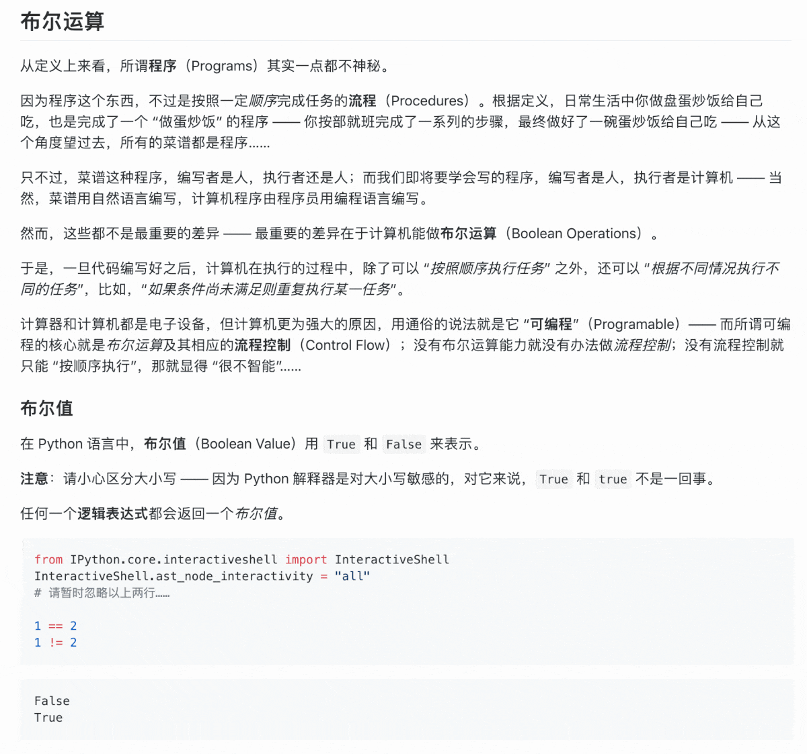

<!-- reading-navigation:start -->

<div dir="rtl" lang="fa">

[صفحهٔ اصلی](../../README.md) · [فهرست مطالب](TOC.md) · [شروع مطالعه از جلد](00.cover.md)

</div>

<!-- reading-navigation:end -->

# the-craft-of-selfteaching

> کسی که نتواند به خودش آموزش دهد، آینده‌ای ندارد<a href='#fn1' name='fn1b'><sup>[1]</sup></a>.

# خودآموزی یک مهارت است

> کسی که توانایی خودآموزی ندارد، آینده‌ای ندارد.

**نویسنده: لی شیائولای (Li Xiaolai؛ 李笑来)**

از دو معلم و دوست صریح و خیرخواهم، **هو جو (Huo Ju؛ 霍炬)** ([@virushuo](https://github.com/virushuo)) و **هونگ چیانگ‌نینگ (Hong Qiangning؛ 洪强宁)** ([@hongqn](https://github.com/hongqn))، برای کمک فراوانشان در نوشتن این کتاب صمیمانه سپاسگزارم!

```python
# pseudo-code of selfteaching in Python

def teach_yourself(anything):
    while not create():
        learn()
        practice()
    return teach_yourself(another)

teach_yourself(coding)
```

> دوستانی که مایل‌اند کمک کنند، لطفاً ابتدا [چگونگی بازخوانی و اصلاح این کتاب با Pull Request](02.proof-of-work.md) را بخوانند.

> **یادداشت مترجم — توضیح تکمیلی:** دعوت بالا متعلق به متن اصلی است. این ترجمه فعلاً فقط برای مطالعهٔ شخصی و محلی تهیه شده است؛ تا دریافت اجازهٔ لازم از صاحب حق، آن را منتشر نکنید و به مخزن، fork یا branch عمومی نفرستید. کد بالا، همان‌طور که comment آن می‌گوید، شبه‌کد است و به‌تنهایی برنامه‌ای آمادهٔ اجرا نیست؛ نام‌های استفاده‌شده در آن عمداً در این قطعه تعریف نشده‌اند.

## فهرست مطالب

> - [01.preface (**پیشگفتار**)](01.preface.md)
> - [02.proof-of-work (**چگونه ثابت کنید واقعاً این کتاب را خوانده‌اید؟**)](02.proof-of-work.md)
> - [Part.1.A.better.teachyourself (**چرا حتماً باید توانایی خودآموزی را به دست آورید؟**)](Part.1.A.better.teachyourself.md)
> - [Part.1.B.why.start.from.learning.coding (**چرا برنامه‌نویسی را نقطهٔ ورود به خودآموزی قرار دهیم؟**)](Part.1.B.why.start.from.learning.coding.md)
> - [Part.1.C.must.learn.sth.only.by.reading (**یادگیری مهارت تازه فقط با خواندن**)](Part.1.C.must.learn.sth.only.by.reading.md)
> - [Part.1.D.preparation.for.reading (**آمادگی‌های پیش از خواندن**)](Part.1.D.preparation.for.reading.md)
> - [Part.1.E.1.entrance (**نقطهٔ ورود**)](Part.1.E.1.entrance.md)
> - [Part.1.E.2.values-and-their-operators (**valueها و operatorهای مربوط به آن‌ها**)](Part.1.E.2.values-and-their-operators.md)
> - [Part.1.E.3.controlflow (**control flow**)](Part.1.E.3.controlflow.md)
> - [Part.1.E.4.functions (**functionها**)](Part.1.E.4.functions.md)
> - [Part.1.E.5.strings (**stringها**)](Part.1.E.5.strings.md)
> - [Part.1.E.6.containers (**containerهای داده**)](Part.1.E.6.containers.md)
> - [Part.1.E.7.files (**fileها**)](Part.1.E.7.files.md)
> - [Part.1.F.deal-with-forward-references (**چگونه با مطالبی پر از «ارجاع زودهنگام» با آرامش روبه‌رو شویم؟**)](Part.1.F.deal-with-forward-references.md)
> - [Part.1.G.The-Python-Tutorial-local (**آموزش رسمی: The Python Tutorial**)](Part.1.G.The-Python-Tutorial-local.md)
> - [Part.2.A.clumsy-and-patience (**ناشی‌گری و صبر**)](Part.2.A.clumsy-and-patience.md)
> - [Part.2.B.deliberate-practicing (**تمرین آگاهانه**)](Part.2.B.deliberate-practicing.md)
> - [Part.2.C.why-start-from-writing-functions (**چرا از function شروع کنیم؟**)](Part.2.C.why-start-from-writing-functions.md)
> - [Part.2.D.1-args (**دربارهٔ parameterها، بخش اول**)](Part.2.D.1-args.md)
> - [Part.2.D.2-aargs (**دربارهٔ parameterها، بخش دوم**)](Part.2.D.2-aargs.md)
> - [Part.2.D.3-lambda (**نام مستعار و بی‌نامی**)](Part.2.D.3-lambda.md)
> - [Part.2.D.4-recursion (**functionهای بازگشتی و recursion**)](Part.2.D.4-recursion.md)
> - [Part.2.D.5-docstrings (**مستندات function**)](Part.2.D.5-docstrings.md)
> - [Part.2.D.6-modules (**functionهای ذخیره‌شده در file**)](Part.2.D.6-modules.md)
> - [Part.2.D.7-tdd (**توسعه با روش TDD**)](Part.2.D.7-tdd.md)
> - [Part.2.D.8-main (**file اجرایی Python**)](Part.2.D.8-main.md)
> - [Part.2.E.deliberate-thinking (**تفکر آگاهانه**)](Part.2.E.deliberate-thinking.md)
> - [Part.3.A.conquering-difficulties (**غلبه بر دشواری‌ها**)](Part.3.A.conquering-difficulties.md)
> - [Part.3.B.1.classes-1 (**classها؛ برنامه‌نویسی object-oriented**)](Part.3.B.1.classes-1.md)
> - [Part.3.B.2.classes-2 (**classها؛ پیاده‌سازی در Python**)](Part.3.B.2.classes-2.md)
> - [Part.3.B.3.decorator-iterator-generator (**ابزارهای function**)](Part.3.B.3.decorator-iterator-generator.md)
> - [Part.3.B.4.regex (**regex**)](Part.3.B.4.regex.md)
> - [Part.3.B.5.bnf-ebnf-pebnf (**BNF و EBNF**)](Part.3.B.5.bnf-ebnf-pebnf.md)
> - [Part.3.C.breaking-good-and-bad (**تجزیه کردن**)](Part.3.C.breaking-good-and-bad.md)
> - [Part.3.D.indispensable-illusion (**توهم نیاز فوری**)](Part.3.D.indispensable-illusion.md)
> - [Part.3.E.to-be-thorough (**جامعیت؛ مرتبه‌ای از خودآموزی**)](Part.3.E.to-be-thorough.md)
> - [Part.3.F.social-selfteaching (**ارتباطات اجتماعی خودآموزان**)](Part.3.F.social-selfteaching.md)
> - [Part.3.G.the-golden-age-and-google (**این عصر طلایی خودآموزان است**)](Part.3.G.the-golden-age-and-google.md)
> - [Part.3.H.prevent-focus-drifting (**جلوگیری از جابه‌جایی توجه**)](Part.3.H.prevent-focus-drifting.md)
> - [Q.good-communiation (**چگونه در برقراری ارتباط توانمند شویم؟**)](Q.good-communiation.md)
> - [R.finale (**مقصد خودآموز**)](R.finale.md)
> - [S.whats-next (**قدم بعدی چیست؟**)](S.whats-next.md)
> - [T-appendix.editor.vscode (**نصب و تنظیم Visual Studio Code**)](T-appendix.editor.vscode.md)
> - [T-appendix.git-introduction (**آشنایی با Git**)](T-appendix.git-introduction.md)
> - [T-appendix.jupyter-installation-and-setup (**نصب و تنظیم JupyterLab**)](T-appendix.jupyter-installation-and-setup.md)
> - [T-appendix.symbols (**این نشانه‌ها چه معنایی دارند؟**)](T-appendix.symbols.md)

## نکاتی دربارهٔ تبدیل فایل‌های `.ipynb` به `.md`

```bash
# 需提前安装 nbconvert 插件，Terminal 下执行：
$ jupyter nbconvert --to markdown *.ipynb

而后将所有 `.md` 文件移到 `markdown/` 目录之下 —— 除 `README.md` 文件之外

`README.md` 文件复制一份到 `markdown/` 目录之下，而后编辑为当前文件

# 需使用 VSCode 批量 Find and Replace:
将所有 (https://raw.githubusercontent.com/selfteaching/the-craft-of-selfteaching/master/images/ 替换为 (https://raw.githubusercontent.com/selfteaching/the-craft-of-selfteaching/master/images/
将所有 (Part.1.A.better.teachyourself_files/ 替换为 (https://raw.githubusercontent.com/selfteaching/the-craft-of-selfteaching/master/images/
将所有 (Part.1.E.6.containers_files/ 替换为 (https://raw.githubusercontent.com/selfteaching/the-craft-of-selfteaching/master/images/
将所有 ```\n\n 替换为 ```\n
将所有	\n\n```	替换为 \n```
将所有 .ipynb) 替换为 .md)

`Part.1.E.3.controlflow.md` 文件中有过长的 output 需要编辑
`Part.1.E.7.files.md` 文件中有过长的 output 需要编辑
```

> **یادداشت مترجم — توضیح تکمیلی:** بلوک بالا، شامل دستور و متن راهنمای چینی، برای حفظ دقیق نمونهٔ اصلی دست‌نخورده مانده است. معنای راهنما چنین است: ابتدا nbconvert را نصب کنید و دستور نشان‌داده‌شده را در Terminal اجرا کنید؛ سپس همهٔ فایل‌های `.md` جز `README.md` را به پوشهٔ `markdown/` منتقل کنید. یک نسخه از `README.md` را نیز در آن پوشه کپی و برای تبدیل شدن به صفحهٔ حاضر ویرایش کنید. در VSCode با Find and Replace، مسیر تصاویرِ خروجیِ دو فصلِ مشخص‌شده را با مسیر تصاویر مخزن جایگزین کنید، فاصله‌های خالی اضافی کنار مرزهای بلوک کد را طبق دو الگوی نوشته‌شده کاهش دهید و مقصد پیوندهای `.ipynb)` را به `.md)` تغییر دهید. output طولانی در دو فصل control flow و fileها هم به ویرایش نیاز دارد. نخستین جایگزینی مسیر تصاویر در متن اصلی، مبدأ و مقصد یکسان دارد و تغییری ایجاد نمی‌کند؛ این مورد بی‌صدا اصلاح نشده است. کل بلوک، با وجود برچسب bash، یک اسکریپت قابل اجرای یک‌جا نیست؛ علامت `$` نشان اعلان محیط است و سطرهای توضیحی را نباید به‌عنوان دستور اجرا کرد. این دستورها در کار ترجمه اجرا نشده‌اند و هیچ Notebook یا خروجی‌ای تغییر نکرده است.

-----

به خوانندگان پیشنهاد می‌کنم افزونه‌ای برای سفارشی‌سازی CSS در مرورگرشان نصب کنند، مثل [Stylus](https://github.com/openstyles/stylus). Chrome، Firefox و Opera همگی از Stylus پشتیبانی می‌کنند. این کار تجربهٔ خواندن را بهتر می‌کند. تصویر متحرک زیر تفاوت پیش و پس از استفاده از CSS سفارشی را نشان می‌دهد:

> 

> **یادداشت مترجم — توضیح تکمیلی:** تصویر، تغییر ظاهر متن کتاب در GitHub را نشان می‌دهد؛ این تغییر شامل رنگ تأکیدها و ظاهر بلوک‌های کد است و محتوای آموزشی را عوض نمی‌کند. نام مرورگرها و وضعیت پشتیبانی در جملهٔ بالا، گزارش متن اصلی در زمان نگارش است.

CSS سفارشی من در Stylus، برای github.com، این است:

```css
.markdown-body {font-family: "PingFang SC";}
strong {color:#6392BF;}
em {color: #A9312A; font-style: normal !important;}
table {font-size: 95% !important;}


.CodeMirror, pre {font-size: 90%;}
pre {
    padding: 10px 25px;
    background-color: #fafafa;
    border-left: 4px solid #dadada;
    border-radius: 10px;
}

pre code {
    background-color: #fafafa;
}

h1 code,
h2 code,
h3 code,
h4 code,
p code, 
li code,
blockquote p code, 
blockquote li code,
td code {
    background-color: #f6f6f6;
    font-size: 90%;
    color:#2e2e2e;
    padding: 4px 4px;
    margin: 0 8px;
    box-shadow: 0px 1px 2px 0px rgba(0,0,0,0.2);
    border-radius: 4px;
}
}
```

در نوشته‌هایم برای برجسته کردن نکات اصلی، نمایش دو عنصر `strong` و `em` را جداگانه تنظیم کرده‌ام تا رنگ‌های متفاوت داشته باشند. همچنین چون نمایش ایتالیک برای زبان چینی مناسب نیست، مقدار `font-style` در `em` را `normal` گذاشته‌ام...

> **یادداشت مترجم — توضیح تکمیلی:** این CSS نمونهٔ تاریخی نویسنده برای متن چینی و ظاهر آن زمان GitHub است، نه تنظیم آماده و آزموده‌شده برای نمایش فارسی. فونت `PingFang SC` و selectorهای آن الزاماً با محیط امروز شما سازگار نیستند. یک `}` اضافی در پایان نمونهٔ اصلی وجود دارد که برای وفاداری عیناً حفظ شده است. کد در این کار اجرا یا برای فارسی بازنویسی نشده؛ راست‌به‌چپ کردن متن نباید به بلوک‌های کد تعمیم داده شود.

-----

مجوز حقوق نشر این کتاب [CC-BY-NC-ND license](https://creativecommons.org/licenses/by-nc-nd/3.0/deed.zh) است.


> **یادداشت مترجم — توضیح تکمیلی:** نشان بالا به مجوز CC BY-NC-ND 3.0 اشاره دارد: ذکر انتساب، استفادهٔ غیرتجاری و ممنوعیت توزیع آثار اقتباسی بدون اجازهٔ لازم. ترجمه اثری اقتباسی است؛ مجوز اعلام‌شده به‌خودی‌خود اجازهٔ انتشار این ترجمه را نمی‌دهد. پیوند مجوز اصلی و انتساب نویسنده حفظ شده‌اند؛ این فایل برای مطالعهٔ شخصی و محلی است، نه انتشار عمومی.

-----
**پاورقی**

<a name='fn1'>[1]</a>: ['Themselves' or 'themself'? — Oxford Dictionary](https://en.oxforddictionaries.com/usage/themselves-or-themself)

> **یادداشت مترجم — توضیح تکمیلی:** این پاورقی در اصل به انتخاب واژهٔ انگلیسی themself در عبارت «One has no future if one couldn't teach themself» مربوط است؛ در ترجمهٔ فارسی این تفاوت دستوری دیده نمی‌شود. پیوند Oxford همان پیوند تاریخی منبع است و دسترس‌پذیری کنونی آن بررسی نشده است.

<a href='#fn1b'><small>↑ بازگشت به متن ↑</small></a>


<!-- reading-navigation:start -->

<div dir="rtl" lang="fa">

[صفحهٔ اصلی](../../README.md) · [فهرست مطالب](TOC.md) · [شروع مطالعه از جلد](00.cover.md)

</div>

<!-- reading-navigation:end -->
