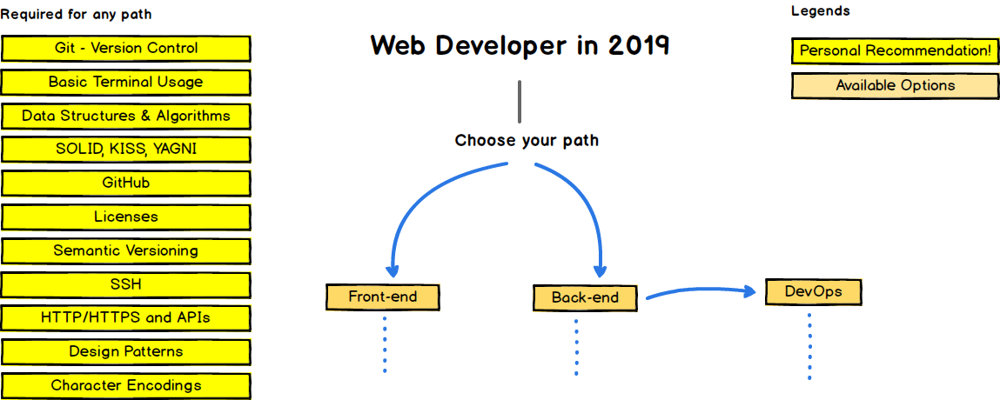
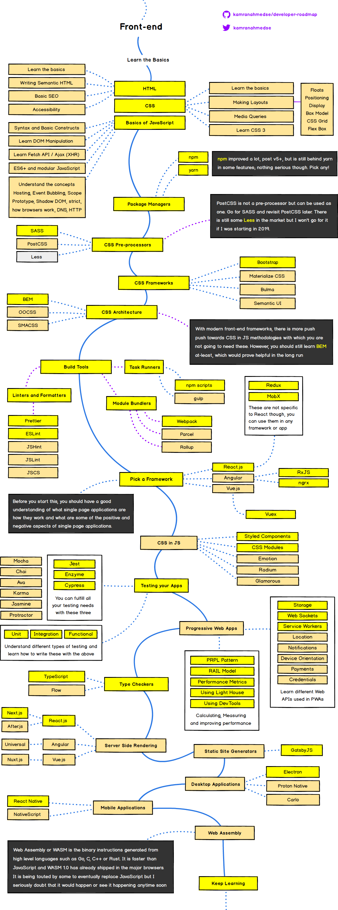
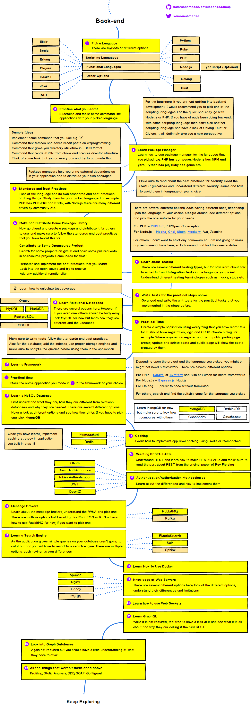
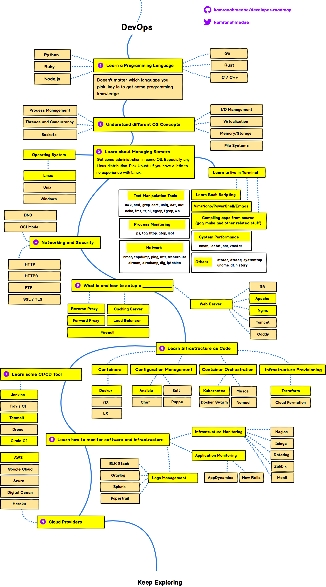

<!-- reading-navigation:start -->

[بخش قبلی: مقصد خودآموز](R.finale.md) · [فهرست مطالب](TOC.md) · [بخش بعدی: نصب و پیکربندی Visual Studio Code](T-appendix.editor.vscode.md)

<!-- reading-navigation:end -->

# قدم بعدی چیست؟

در نظریه، برای قدم بعدی انتخاب‌های زیادی دارید. خودآموزی یک مهارت است و می‌توانید با آن هر مهارت دیگری را که می‌خواهید به دست آورید، یاد بگیرید. اگر قصد دارید در برنامه‌نویسی عمیق‌تر شوید، سرنخ‌های زیر گزینه‌های خوبی‌اند.

البته اولین کار باید این باشد که نتیجهٔ «یادگیری فشرده» خودتان را بسنجید. به Pythonbasics.org بروید و تمرین‌ها را انجام دهید:

> https://pythonbasics.org/Exercises/

علاوه بر آنچه اینجا معرفی می‌کنم، به The Hitchhiker's Guide to Python هم مراجعه کنید؛ راهنمای جامع‌تری است:

> https://docs.python-guide.org/

## کتاب‌های ضروری Python

برای یادگیری هر چیزی، قطعاً یک کتاب کافی نیست. کتاب‌های زیر از منابع پایه و ضروری برای یادگیری Python هستند:

> * [The Python Tutorial](https://docs.python.org/3/tutorial/)
> * [The Hitchhiker's Guide to Python!](https://docs.python-guide.org/)
> * [Think Python: How to think like a computer scientist](http://greenteapress.com/wp/think-python-2e/)
> * [Automate the Boring Stuff with Python](https://automatetheboringstuff.com)
> * [Effective Python](https://effectivepython.com)
> * [Python Cookbook](https://www.amazon.com/Python-Cookbook-Recipes-Mastering-ebook/dp/B00DQV4GGY)
> * [Fluent Python](https://www.amazon.com/Fluent-Python-Concise-Effective-Programming-ebook/dp/B0131L3PW4)
> * [Problem Solving with Algorithms and Data Structures using Python](http://interactivepython.org/runestone/static/pythonds/index.html)
> * [Mastering Object-oriented Python - Transform Your Approach to Python Programming](https://www.amazon.com/dp/B00JVQ14UO/ref=dp-kindle-redirect?_encoding=UTF8&btkr=1)

کتاب‌های بیشتر دربارهٔ Python:

> https://pythonbooks.revolunet.com

فکر نکنید زیادند. اگر واقعاً بر مطالب به‌طور جامع مسلط شوید، بعداً هر چیز دیگری را بسیار سریع‌تر یاد خواهید گرفت...

> **یادداشت مترجم — توضیح تکمیلی:** این فهرست و پیوندهای آن مربوط به زمان نگارش کتاب، در سال ۲۰۱۹، هستند. برخی پیوندها به ویرایش مشخص یا نشانی قدیمی یک منبع اشاره دارند؛ توصیهٔ نویسنده عیناً حفظ شده و نباید از آن به‌روز بودن همهٔ ویرایش‌ها یا دسترس‌پذیری فعلی همهٔ سایت‌ها را نتیجه گرفت. هنگام انتخاب منبع، نسخهٔ Python و ویرایش مورد استفادهٔ آن را بررسی کنید. نام اصلی کتاب‌ها برای جست‌وجوی آسان حفظ شده است.

## Python Cheatsheet

همان‌طور که می‌دانید، این نوع خلاصه‌برگ‌ها وقتی واقعاً برایتان مفیدند که خودتان آن‌ها را گردآوری کرده باشید. بااین‌حال، می‌توانید از خلاصه‌برگ دیگران به‌عنوان ابزاری برای «بررسی اینکه چیزی را از قلم نینداخته‌اید» استفاده کنید.

در اینترنت Python Cheatsheetهای بی‌شماری وجود دارد. این سه مورد از نظر شخصی من بسیار خوب‌اند:

> * [Comprehensive Python Cheatsheet](https://gto76.github.io/python-cheatsheet/)
> * [Python Crash Course - Cheat Sheets](https://github.com/ehmatthes/pcc/tree/master/cheat_sheets)
> * [Pysheeet](https://www.pythonsheets.com/)

## Awesome Python

«ساکنان» GitHub حالا یک رسم دارند: برای هر چیز خوبی صفحه‌ای با عنوان «Awesome ...» می‌سازند و با همکاری هم منابع مرتبط را در آن جمع می‌کنند. مثلاً اگر بخواهید Golang یاد بگیرید، جست‌وجوی [Awesome Go](https://www.google.com/search?q=awesome+go) در Google حتماً شما را به صفحه‌ای با همین نام در GitHub می‌رساند...

پیوند Awesome Python این است:

> https://github.com/vinta/awesome-python

## دانشجویان CS چه می‌آموزند؟

اگر واقعاً می‌خواهید در این مهارت ورزیده شوید، بد نیست ببینید دانشجویان Computer Science، یا CS، چه می‌آموزند...

پیوند زیر ارزش خواندن دقیق را دارد:

> http://matt.might.net/articles/what-cs-majors-should-know/

## نقشهٔ راه full-stack engineer

حالا که شروع کرده‌اید، قطعاً به Python محدود نخواهید ماند. بر پایه‌ای محکم، هرچه بیشتر یاد بگیرید، سریع‌تر یاد خواهید گرفت. در ادامه «نقشهٔ راه full-stack engineer» را می‌بینید؛ نویسنده‌اش جوان خوش‌سیمایی اهل دبی به نام [کامران احمد (Kamran Ahmed)](https://github.com/kamranahmedse) است:

> https://github.com/kamranahmedse/developer-roadmap
>
> در ادامه مجموعه‌ای از نمودارها را می‌بینید که مسیرهای ممکن و فناوری‌هایی را نشان می‌دهند که برای فعالیت در frontend، backend یا DevOps ممکن است بخواهید به کار بگیرید. این نمودارها را برای یکی از استادان سابقم ساختم که می‌خواست چیزی با دانشجویانش به اشتراک بگذارد تا چشم‌اندازی به آن‌ها بدهد؛ اینجا هم آن‌ها را برای کمک به جامعهٔ برنامه‌نویسان به اشتراک می‌گذارم.
>
> به وبلاگم سر بزنید و در Twitter سلامی بکنید.
>
> **سلب مسئولیت**
>
> هدف این نقشه‌های راه این است که تصویری از چشم‌انداز این حوزه به شما بدهند و اگر نمی‌دانید در ادامه چه یاد بگیرید، راهنمایتان باشند؛ نه اینکه تشویقتان کنند سراغ هر چیز مُد و پرطرفداری بروید. باید کم‌کم بفهمید چرا یک ابزار در بعضی موقعیت‌ها از ابزار دیگر مناسب‌تر است. به یاد داشته باشید مُد و پرطرفدار بودن هرگز به معنای مناسب‌ترین گزینه برای آن کار نیست.

> **یادداشت مترجم — توضیح تکمیلی:** متن نقل‌شدهٔ بالا از Kamran Ahmed است. frontend به بخش رو‌به‌کاربر و backend به بخش پشت‌صحنهٔ برنامه اشاره دارد؛ DevOps به شیوه‌های همکاری توسعه و عملیات برای ساخت، تحویل و نگهداری نرم‌افزار مربوط است. full-stack engineer با چند لایهٔ اصلی برنامه کار می‌کند. تصاویر زیر نسخهٔ تاریخی نقشه‌ها در این مخزنند، نه الزاماً نسخهٔ کنونی پروژهٔ developer-roadmap؛ نام‌ها و توصیه‌های آن‌ها را با نیاز و مستندات امروز بسنجید. برای دیدن نقشه‌های به‌روز به پروژهٔ اصلیِ پیوندشده مراجعه کنید.

## مقدمه

> **یادداشت مترجم — توضیح تکمیلی:** این تصویر مدخل مجموعهٔ نقشه‌های راه توسعهٔ وب است. برای استفاده از آن، نخست حوزهٔ مورد نظرتان را از میان frontend، backend و DevOps مشخص کنید؛ نمودارها راهنمای انتخاب مسیرند، نه الزام به یادگیری یک‌جای همهٔ فناوری‌ها. عنوان‌ها و نام ابزارهای داخل تصاویر به انگلیسی باقی مانده‌اند.

## نقشهٔ راه Frontend

> **یادداشت مترجم — توضیح تکمیلی:** موضوع این نقشه، ساخت بخش قابل مشاهده و تعاملی وب برای کاربر است. برای درک مسیر، HTML را برای ساختار محتوا، CSS را برای ظاهر و JavaScript را برای رفتار تعاملی در نظر بگیرید؛ ابزارها و مسیرهای بعدی روی این پایه‌ها بنا می‌شوند. این توضیح خلاصه‌ای برای جهت‌یابی است، نه ترجمهٔ تک‌تک برچسب‌های تصویر یا توصیه به انتخاب همهٔ ابزارهای آن.

## نقشهٔ راه Backend

> **یادداشت مترجم — توضیح تکمیلی:** موضوع این نقشه، بخش پشت‌صحنهٔ برنامهٔ وب است: دریافت و پردازش درخواست‌ها، کار با داده‌ها و برقراری ارتباط با بخش‌های دیگر سامانه. هنگام خواندن تصویر، میان انتخاب زبان و ابزار، ذخیره‌سازی داده و ارتباط میان اجزا تفاوت بگذارید؛ این‌ها حوزه‌های مکمل‌اند، نه نام‌های متفاوت یک چیز.

## نقشهٔ راه DevOps

> **یادداشت مترجم — توضیح تکمیلی:** موضوع این نقشه، آماده‌سازی و ادارهٔ محیط اجرای نرم‌افزار و خودکارسازی کارهای ساخت، تحویل و نگهداری آن است. مفاهیم پایه‌ای مانند سیستم‌عامل و شبکه را از ابزارهای خاص جدا کنید؛ نام ابزارهای روی نقشه به‌تنهایی ترتیب اجباری یا انتخاب قطعی امروز را تعیین نمی‌کند.

راه دراز است و جست‌وجو ادامه دارد...

> **یادداشت مترجم — توضیح تکمیلی:** جملهٔ بالا اشاره‌ای به سطر مشهور «路漫漫其修远兮» از شعر «لی سائو» (Li Sao؛ 离骚)، سرودهٔ چو یوان (Qu Yuan؛ 屈原)، است و بر درازی مسیر جست‌وجو و یادگیری تأکید دارد.

اما چقدر جذاب است! درست مثل بازی‌ای که در آن مرحله‌به‌مرحله پیش می‌روید.

<!-- reading-navigation:start -->

[بخش قبلی: مقصد خودآموز](R.finale.md) · [فهرست مطالب](TOC.md) · [بخش بعدی: نصب و پیکربندی Visual Studio Code](T-appendix.editor.vscode.md)

<!-- reading-navigation:end -->
