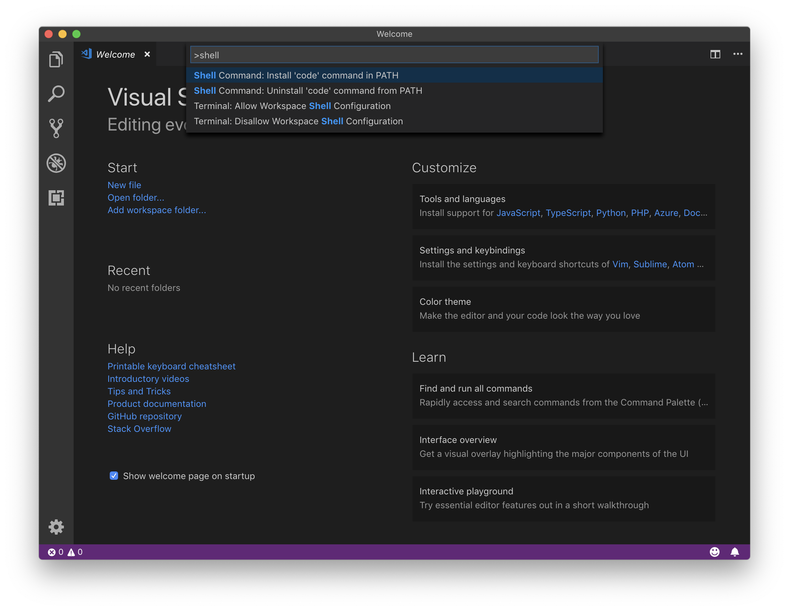
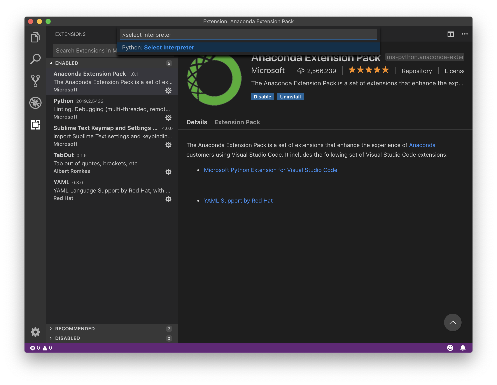
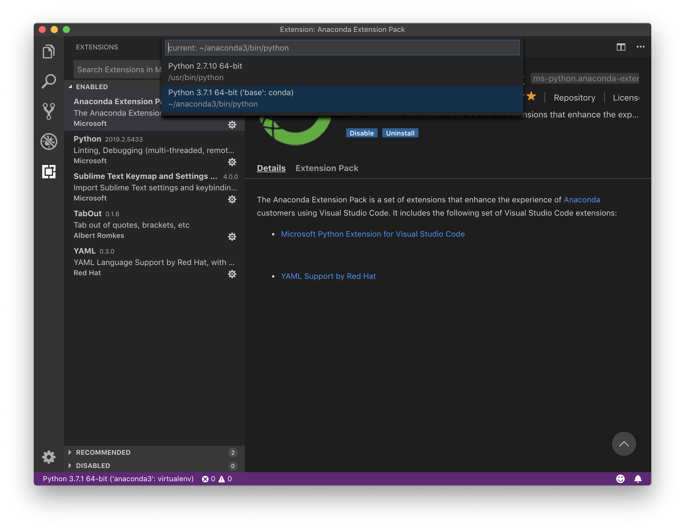
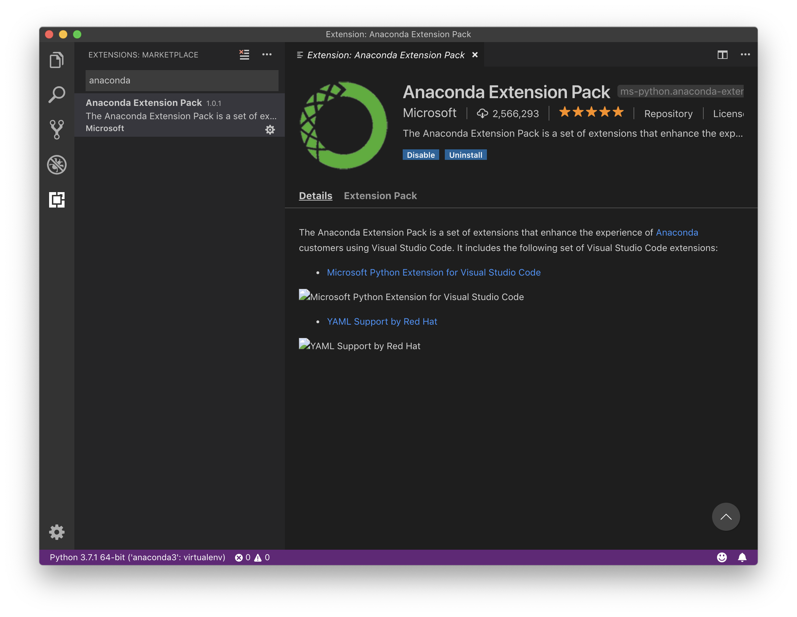
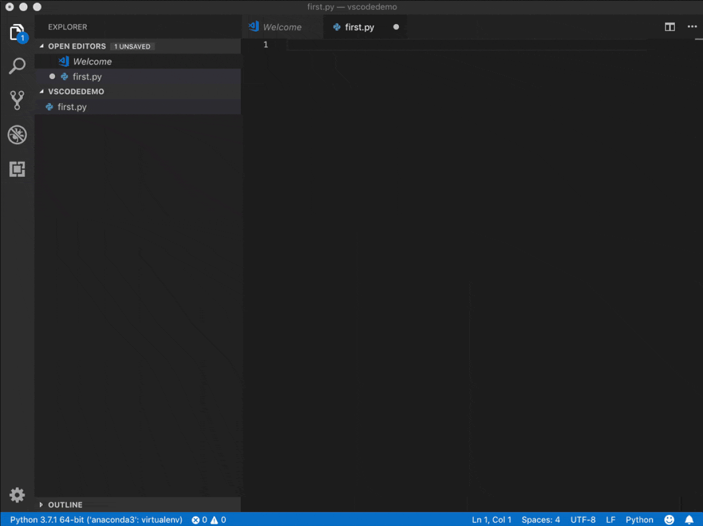

<!-- reading-navigation:start -->

<div dir="rtl" lang="fa">

[بخش قبلی: قدم بعدی چیست؟](S.whats-next.md) · [فهرست مطالب](TOC.md) · [بخش بعدی: آشنایی با Git](T-appendix.git-introduction.md)

</div>

<!-- reading-navigation:end -->


# نصب و پیکربندی Visual Studio Code

برای مراجعه به مستندات رسمی، این نشانی را ببینید:

> https://code.visualstudio.com/docs

## فعال کردن اجرای VS Code از خط فرمان

با میان‌بر `⇧⌘p`، Command Palette را باز کنید؛ در آن `shell command` را بنویسید و سپس `Install 'code' command in PATH` را انتخاب کنید. پس از آن می‌توانید در خط فرمان Terminal از دستور `code` استفاده کنید. (در Windows، این تنظیم هنگام نصب VS Code به‌طور خودکار انجام می‌شود و نیازی به این مرحله نیست.)



> **یادداشت مترجم — توضیح تکمیلی:** Command Palette جایی برای جست‌وجو و اجرای فرمان‌های ویرایشگر است. متن مهم تصویر، گزینهٔ `Install 'code' command in PATH` است: با انتخاب آن، دستور `code` از Terminal در دسترس قرار می‌گیرد. میان‌برهای این بخش برای macOS نوشته شده‌اند؛ `⌘` یعنی Command و `⇧` یعنی Shift. در Windows، دسترسی به `code` به نوع نصب و انتخاب گزینهٔ افزودن به PATH بستگی دارد؛ توضیح متن دربارهٔ خودکار بودن این کار را نباید برای همهٔ شیوه‌های نصب قطعی دانست. راهنمای رسمی: [راه‌اندازی VS Code](https://code.visualstudio.com/docs/setup/setup-overview).

## انتخاب نسخهٔ Python interpreter

با میان‌بر `⇧⌘p`، Command Palette را باز کنید؛ در آن `select interpreter` را بنویسید و سپس `Python: Select Interpreter` را انتخاب کنید.



سپس از میان نسخه‌های نصب‌شده روی سیستم، نسخهٔ موردنیازتان را انتخاب کنید. در macOS یک Python 2.7 از پیش وجود دارد و Anaconda که نصب کرده‌ایم، یک Python 3.7 دیگر هم به سیستم اضافه کرده است.



> **یادداشت مترجم — توضیح تکمیلی:** interpreter برنامه‌ای است که کد Python شما را اجرا می‌کند؛ این انتخاب مشخص می‌کند VS Code از کدام نصب یا محیط Python استفاده کند. دو تصویر، ابتدا فرمان `Python: Select Interpreter` و سپس فهرست محیط‌های موجود را نشان می‌دهند. اشاره به Python 2.7 پیش‌فرض macOS و Python 3.7 مربوط به محیط زمان نگارش کتاب است، نه وضعیت قطعی macOS یا Anaconda امروز. نسخه‌ها و مسیرهای نمایش‌داده‌شده روی رایانهٔ شما ممکن است متفاوت باشند. راهنمای رسمی: [انتخاب محیط Python در VS Code](https://code.visualstudio.com/docs/python/environments).

## نصب extensionها

با میان‌بر `⇧⌘x`، پنل extensionها را باز کنید. extension مربوط به anaconda را نصب کنید؛ با نصب آن، extension مربوط به python هم نصب می‌شود:



> **یادداشت مترجم — توضیح تکمیلی:** extension قابلیتی است که جداگانه به ویرایشگر اضافه می‌کنید. تصویر، جست‌وجو و نصب افزونهٔ Anaconda را در پنل Extensions نشان می‌دهد. این توصیه به مجموعهٔ افزونه‌های زمان نگارش مربوط است؛ در نسخهٔ فعلی، نام، موجود بودن و وابستگی‌های افزونه‌ها را بررسی کنید و برای پشتیبانی Python، [راهنمای رسمی Python در VS Code](https://code.visualstudio.com/docs/languages/python) را مبنا قرار دهید.

برای راحت‌تر شدن تایپ، دو extension دیگر هم هست که نصب آن‌ها اختیاری است:

> * Tabout: با آن می‌توانید با کلید TAB از پرانتز، علامت نقل‌قول و مانند آن که بعد از مکان‌نما قرار دارد، بیرون بروید.
> * Sublime Text Keymap and Settings Importer: با آن می‌توانید میان‌برهای SublimeText را در VS Code به کار ببرید؛ شاید مهم‌ترینشان ویرایش با چند مکان‌نما، با میان‌بر `⇧⌘l`، باشد…

## تکمیل خودکار

یکی از مهم‌ترین قابلیت‌های یک ویرایشگر حرفه‌ای این است که هنگام تایپ، به تکمیل خودکار ورودی شما کمک کند. میان‌بر معمول این کار کلید TAB، یعنی `⇥`، است.

تکمیل خودکاری که با کلید TAB، یعنی `⇥`، فعال می‌شود، دو نوع دارد:

> * رشته‌هایی که از قبل در فایل فعلی وجود دارند. مثلاً قبلاً `sum_of_word` را نوشته‌اید؛ بعد از آن کافی است `su` یا حتی `sow` را بنویسید و TAB، یعنی `⇥`، را بزنید تا قابلیت تکمیل خودکار، `sum_of_word` را برایتان کامل کند.
> * Snippetهای موجود. مثلاً وقتی می‌خواهید `if ...: ...` را وارد کنید، کافی است `if` یا حتی `i` را بنویسید و TAB، یعنی `⇥`، را بزنید تا تکمیل خودکار، ساختار آن بلوک دستور را برایتان وارد کند.

تکمیل خودکار رشته‌ها از چیزی به نام Fuzzy Match استفاده می‌کند. هر ترکیبی از نویسه‌های موجود در `sum_of_word` را که با حفظ ترتیبشان وارد کنید، تا جای ممکن با آن تطبیق می‌دهد؛ بنابراین هم `su` و هم `sow` می‌توانند با `sum_of_word` منطبق شوند. مثلاً `rst` هم می‌تواند با `result` منطبق شود.

هنگام تکمیل یک Snippet معمولاً چند «TAB Stop» وجود دارد؛ یعنی چند جای مشخص که می‌توانید با TAB، یعنی `⇥`، یا با `Shift + ⇥` میان آن‌ها جلو و عقب بروید. در این حالت، نوع اول تکمیل خودکار، یعنی تکمیل رشته‌ها، غیرفعال می‌شود. اگر به آن نیاز داشتید، با کلید ESC، یعنی `⎋`، از حالت تکمیل Snippet خارج شوید.

> **یادداشت مترجم — توضیح تکمیلی:** Snippet قالب آماده‌ای از کد است و TAB Stop جای خالی قابل‌ویرایش در آن است. Fuzzy Match هم یعنی لازم نیست همهٔ حروف را پشت سر هم بنویسید؛ ویرایشگر از روی بخشی از حروف پیشنهاد می‌دهد. رفتار دقیق TAB و پیشنهادها به تنظیمات، extensionها و نسخهٔ ویرایشگر بستگی دارد؛ شرح بالا رفتار محیط نویسنده را توضیح می‌دهد. [راهنمای رسمی Snippetها](https://code.visualstudio.com/docs/editing/userdefinedsnippets) جزئیات تنظیمات را توضیح می‌دهد.

فایل gif زیر، روند وارد کردن این کد را نشان می‌دهد:

```python
def sum_of_word(word):
    sum = 0
    for char in word:
        sum += ord(char) - 96
    return sum
with open('results.txt', 'w') as results:
    with open('words_alpha.txt', 'r') as file:
        for word in file.readlines():
            if sum_of_word(word.strip()) == 100:
                results.write(word)
```

با وجود چنین قابلیتی، هنگام وارد کردن برنامه لازم نیست عجله کنید؛ می‌توانید آهسته تایپ کنید و هم‌زمان فکر کنید… اما در عمل، کار خیلی زود تمام می‌شود.



> **یادداشت مترجم — توضیح تکمیلی:** نکتهٔ اصلی پویانمایی این است که پیشنهادهای تکمیل خودکار و جای‌خالی‌های Snippet، نوشتن همان کد بالا را سریع‌تر می‌کنند؛ برای فهم مثال، نیازی به خواندن نوشته‌های گذرای تصویر نیست. این کد بدون تغییر حفظ شده و در این ترجمه اجرا نشده است؛ اجرای آن به فایل ورودی `words_alpha.txt` نیاز دارد و فایل `results.txt` را برای نوشتن باز می‌کند.

ویرایش هم‌زمان با چند مکان‌نما در SublimeText قابلیتی است که بسیاری از برنامه‌نویسان به آن علاقهٔ زیادی دارند. به همین دلیل برای ویرایشگرهای مختلف، افزونه‌های SublimeText Keymap به‌دست دیگران نوشته شده است؛ حتی برای Jupyterlab:

> https://github.com/ryantam626/jupyterlab_sublime


<!-- reading-navigation:start -->

<div dir="rtl" lang="fa">

[بخش قبلی: قدم بعدی چیست؟](S.whats-next.md) · [فهرست مطالب](TOC.md) · [بخش بعدی: آشنایی با Git](T-appendix.git-introduction.md)

</div>

<!-- reading-navigation:end -->
