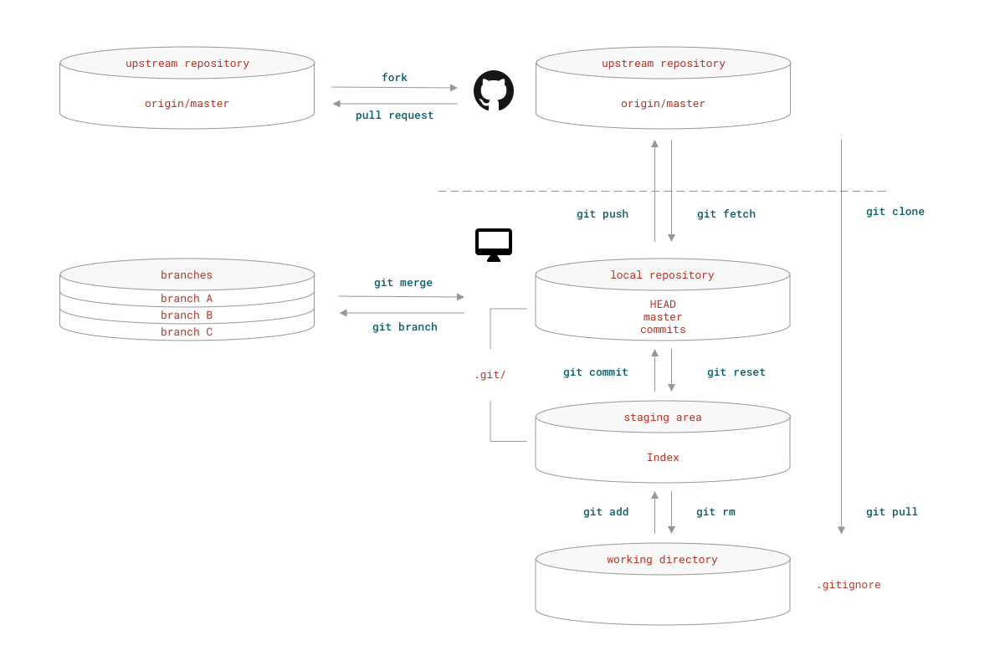

<!-- reading-navigation:start -->

<div dir="rtl" lang="fa">

[بخش قبلی: نصب و پیکربندی Visual Studio Code](T-appendix.editor.vscode.md) · [فهرست مطالب](TOC.md) · [بخش بعدی: نصب و پیکربندی JupyterLab](T-appendix.jupyter-installation-and-setup.md)

</div>

<!-- reading-navigation:end -->


# آشنایی با Git

--- باید همین دیروز Git را یاد می‌گرفتید.


> **یادداشت مترجم — توضیح تکمیلی:** تصویر جلد با تشبیه Git به «ماشین زمان» همراه است: نکته این است که با نگه داشتن تاریخچهٔ تغییرات می‌توانید به وضعیت‌های قبلی کار برگردید؛ نه اینکه Git واقعاً ماشین زمان باشد.

## هدف این بخش

بار دیگر تأکید می‌کنم که هدف این بخش، ارائهٔ یک «آموزش» نیست؛ اگر آموزش واقعی را به «نقشه» تشبیه کنیم، این بخش «راهنمای علائم» آن نقشه است. جامع‌ترین آموزش Git، یعنی کتاب **Pro Git**، به‌رایگان در اینترنت در دسترس است. آن را چند بار بخوانید تا درک کاملی از آن پیدا کنید:

> https://git-scm.com/book/en/v2

ترجمهٔ آن به زبان‌های مختلف، از جمله چینی، هم موجود است.

## چرا باید استفاده از Git را یاد بگیرید؟

Git نرم‌افزاری برای distributed version control است؛ یعنی نگه داشتن و پیگیری نسخه‌های مختلف فایل‌ها به‌صورت توزیع‌شده. شاید در نگاه اول ربطی به کار شما نداشته باشد، اما **هر کسی** با توانایی استفاده از Git می‌تواند در وقت خود صرفه‌جویی کند و کارآمدتر باشد. فراتر از آن، اگر حتی حساب فعالی در [GitHub](https://github.com) ندارید، دارید دوران همکاری جمعی بی‌سابقه‌ای در تاریخ بشر را از دست می‌دهید؛ این حرف اصلاً اغراق نیست. [GitLab](https://gitlab.com)، [Bitbucket](https://bitbucket.org) و سرویس‌های دیگری هم خدمات ابری مرتبط با Git ارائه می‌کنند.

همچنین [GitHub](https://github.com) احتمالاً نخستین پلتفرم روی زمین است که امکان «[ارتباط با دیگران از راه کارهایی که می‌سازید](Part.3.F.social-selfteaching.md)» را فراهم کرده است. واقعاً حیف است که نتوانید در آن مشارکت کنید!

## درک رابطهٔ منطقی دستورهای پایهٔ Git

کار Git را در اصل می‌توان به سه بخش تقسیم کرد:
> - پشتیبان‌گیری از فایل‌ها
> - پیگیری تغییرات فایل‌ها
> - همکاری با دیگران روی فایل‌ها

در یک Git repository، در مجموع چهار «لایهٔ انتزاعی» داریم:

> * upstream repository: مخزنی که در فضای ابری نگهداری می‌شود
> * local repository: مخزن محلی
> * staging area: جایی برای آماده کردن تغییرات پیش از ثبت آن‌ها
> * working directory: پوشه‌ای که در آن کار می‌کنید

> **یادداشت مترجم — توضیح تکمیلی:** repository تاریخچه و اطلاعات مدیریت‌شدهٔ پروژه را نگه می‌دارد. staging area مشخص می‌کند کدام تغییرات قرار است در commit بعدی، یعنی ثبت یک مرحله از کار، قرار بگیرند. این چهارلایه‌ای بودن، مدل آموزشی نویسنده است: وجود remote برای استفاده از Git اجباری نیست و remote هم لزوماً در فضای ابری قرار ندارد. upstream معمولاً به مخزن یا branch بالادستی اشاره دارد و نام عمومی همهٔ remoteها نیست. شرح دقیق‌تر در [Pro Git، بخش remoteها](https://git-scm.com/book/en/v2/Git-Basics-Working-with-Remotes) آمده است.

داده‌های دو لایهٔ `local repository` و `staging area` در پوشهٔ مخفی `.git/` در ریشهٔ `working directory` نگهداری می‌شوند؛ برای دیدن آن باید از `ls -a` استفاده کنید.

وقتی با دستور `git init` یک پوشهٔ محلی، یعنی `working directory`، را به‌عنوان `local repository` راه‌اندازی می‌کنید، ساختار داخلی آن پوشه چنین خواهد بود:

```
.
└── .git
    ├── HEAD
    ├── config
    ├── description
    ├── hooks
    │   ├── applypatch-msg.sample
    │   ├── commit-msg.sample
    │   ├── fsmonitor-watchman.sample
    │   ├── post-update.sample
    │   ├── pre-applypatch.sample
    │   ├── pre-commit.sample
    │   ├── pre-push.sample
    │   ├── pre-rebase.sample
    │   ├── pre-receive.sample
    │   ├── prepare-commit-msg.sample
    │   └── update.sample
    ├── info
    │   └── exclude
    ├── objects
    │   ├── info
    │   └── pack
    └── refs
        ├── heads
        └── tags

```

نمودار زیر فقط پایه‌ای‌ترین دستورهای Git را نشان می‌دهد؛ بیشتر آن‌ها دستورهایی هستند که هنگام کار انفرادی با Git مرتب به کار می‌آیند.



> **یادداشت مترجم — توضیح تکمیلی:** برای خواندن نمودار، مسیر اصلی این است: تغییرات را در working directory ایجاد می‌کنید، با `git add` آن‌ها را به staging area می‌فرستید، با `git commit` در local repository ثبت می‌کنید و با `git push` به remote می‌فرستید. در جهت دریافت، `git fetch` اطلاعات remote را دریافت می‌کند و `git pull` دریافت را با یک مرحلهٔ یکپارچه‌سازی همراه می‌کند. این توضیح، رابطهٔ اصلی فرمان‌ها و لایه‌های تصویر را به متن منتقل می‌کند. شکل دقیق فایل‌های ساخته‌شده با `git init` ممکن است با نسخه و تنظیمات Git متفاوت باشد.

در لایهٔ `working directory` کارهای روزمره را انجام می‌دهید: ایجاد، ویرایش، حذف و مانند آن. ممکن است برای تغییر فایل‌ها از ویرایشگر استفاده کنید؛ همچنین ممکن است مرتب دستورهای مختلف Bash مانند `rm`، `mkdir`، `cp` و `mv` را به کار ببرید.

هر از گاهی، فایل‌هایی را که کارشان تمام شده «به staging area اضافه می‌کنید». وقتی یک مرحله از کار تمام شد، می‌توانید تغییرات آماده‌شده در staging area را در مخزن محلی **commit** کنید؛ سپس به کار ادامه دهید… بسته به شرایط، اطلاعات مخزن محلی را هم به فضای ابری، یعنی مخزن remote، **push** می‌کنید. اگر با دیگران همکاری می‌کنید، احتمالاً بارها لازم می‌شود آخرین نسخه را از فضای ابری به رایانهٔ خود **pull** کنید.

## نصب Git

### Mac

سیستم‌عامل Mac از نسخهٔ Mavericks (10.9) به بعد Git را به‌صورت داخلی دارد. برای بررسی وجود Git می‌توانید در Terminal این دستورها را اجرا کنید:

``` bash
git --version
which git
```

از طریق Homebrew هم می‌توانید تازه‌ترین نسخهٔ Git را نصب کنید:

``` bash
ruby -e "$(curl -fsSL https://raw.githubusercontent.com/Homebrew/install/master/install)"
brew doctor
brew install git
```

از طریق Conda هم می‌توان آن را نصب کرد:

``` bash
conda install -c anaconda git
```

> **یادداشت مترجم — توضیح تکمیلی:** این دستور نصب Homebrew تاریخی است؛ آن را به‌عنوان دستور نصب امروزی اجرا نکنید. راهنمای فعلی را از [وب‌سایت رسمی Homebrew](https://brew.sh/) بگیرید. در macOS ممکن است اجرای Git نیازمند نصب Command Line Tools باشد؛ بنابراین عبارت «از پیش موجود» در متن تضمین نمی‌کند که Git همین حالا روی هر Mac آمادهٔ اجراست. [راهنمای رسمی نصب Git](https://git-scm.com/book/en/v2/Getting-Started-Installing-Git) را ببینید. دستورهای این بخش در جریان ترجمه اجرا نشده‌اند.

### Windows

به https://gitforwindows.org بروید و Git for Windows را دانلود و نصب کنید.

این بسته Git Bash را هم در اختیارتان می‌گذارد؛ ابزاری برای استفاده از خط فرمان Bash در Windows، شبیه آنچه در سیستم‌عامل‌های \*Nix وجود دارد.

همچنین در Windows توصیه می‌شود به‌جای CMD از Git Bash یا PowerShell برای کار با خط فرمان استفاده کنید.

### Linux

بیشتر سیستم‌عامل‌های Linux یا بر پایهٔ Debain هستند یا Red-Hat. خودتان [فهرست توزیع‌های Linux](https://en.wikipedia.org/wiki/List_of_Linux_distributions) را ببینید و مشخص کنید توزیع شما بر کدام‌یک بنا شده است.

برای توزیع‌های Linux بر پایهٔ Debian:

```bash
sudo apt-get update
sudo apt-get upgrade
sudo apt-get install git
```

برای توزیع‌های Linux بر پایهٔ Red-Hat:

```bash
sudo yum upgrade
sudo yum install git
```

> **یادداشت مترجم — توضیح تکمیلی:** «Debain» در جملهٔ اصلی اشتباه املایی Debian است. تقسیم‌بندی بالا ساده‌سازی نویسنده است و همهٔ توزیع‌های Linux را پوشش نمی‌دهد. دستورهای مدیریت بسته به توزیع و نسخه بستگی دارند؛ پیش از اجرا، مستندات توزیع خود را بررسی کنید. دستورهای `upgrade` هم ممکن است بسته‌های فراوانی را، نه فقط Git را، ارتقا دهند.

### پیکربندی محلی Git

در ابزار خط فرمان، دستورهای زیر را اجرا کنید:

```bash
git config --global user.name "<your_name>"
git config --global user.email <your_email_address>
```

> **یادداشت مترجم — توضیح تکمیلی:** عبارت‌های داخل علامت‌های زاویه‌دار جای‌نگهدارند؛ آن‌ها را همراه با خود علامت‌ها با نام و نشانی ایمیل خود جایگزین کنید. در shell، علامت‌های `<` و `>` ممکن است معنای تغییر مسیر ورودی و خروجی داشته باشند، پس نمونهٔ ایمیل را عیناً اجرا نکنید. با وجود عنوان «محلی»، گزینهٔ `--global` این مشخصات را برای حساب کاربری شما و به‌عنوان پیش‌فرض مخزن‌ها تنظیم می‌کند؛ فقط مختص مخزن جاری نیست. منبع: [پیکربندی اولیهٔ Git در Pro Git](https://git-scm.com/book/en/v2/Getting-Started-First-Time-Git-Setup).

### Git GUI

برای clientهای گرافیکی Git انتخاب‌های زیادی وجود دارد. این چند client چندسکویی از محبوب‌ترین‌ها هستند:

> * [GitHub Desktop](https://desktop.github.com)
> * [GitAhead](https://gitahead.github.io/gitahead.com/)
> * [Fork](https://git-fork.com)
> * [GitKraken](https://www.gitkraken.com)

برای گزینه‌های بیشتر، [فهرست Git GUI Clients در git-scm.com](https://git-scm.com/downloads/guis/) را ببینید.

> **یادداشت مترجم — توضیح تکمیلی:** GUI یعنی رابط گرافیکی؛ با این برنامه‌ها می‌توانید بسیاری از کارهای Git را بدون نوشتن دستور انجام دهید. «چندسکویی» بودن به معنی پشتیبانی همهٔ سیستم‌عامل‌ها نیست؛ پیش از انتخاب، سیستم‌عامل‌های پشتیبانی‌شده و وضعیت نگهداری فعلی هر برنامه را در وب‌سایت خودش بررسی کنید.

### دستورهای پایهٔ Bash که باید بشناسید

هرچند Git رابط‌های گرافیکی هم دارد، در هر صورت با ابزارهای خط فرمان روبه‌رو می‌شوید. همه، دیر یا زود، به موقعیتی می‌رسند که چاره‌ای جز استفاده از خط فرمان ندارند.

در ادامه، توضیح کوتاهی دربارهٔ دستورهای پرکاربرد Bash آمده است:

| دستور | توضیح کوتاه |
| ----- | ----------- |
| `cd` | کوتاه‌شدهٔ Change Directory؛ رفتن به پوشهٔ مشخص‌شده |
| `ls` | کوتاه‌شدهٔ List؛ نمایش محتویات پوشهٔ جاری |
| `mkdir` | کوتاه‌شدهٔ Make Directory؛ ساختن یک پوشهٔ تازه در پوشهٔ جاری |
| `pwd` | کوتاه‌شدهٔ Present Working Directory؛ نمایش پوشهٔ کاری جاری |
| `touch` | ساختن یک فایل خالی تازه با نام مشخص‌شده |
| `rm` | کوتاه‌شدهٔ Remove؛ حذف فایل مشخص‌شده |
| `rmdir` | کوتاه‌شدهٔ Remove Directory؛ حذف پوشهٔ مشخص‌شده |
| `cp` | کوتاه‌شدهٔ Copy؛ کپی کردن فایل مشخص‌شده |
| `mv` | کوتاه‌شدهٔ Move؛ جابه‌جا کردن فایل مشخص‌شده |
| `cat` | کوتاه‌شدهٔ Concatenate؛ نمایش محتوای فایل روی صفحه |
| `chmod` | کوتاه‌شدهٔ Change Mode؛ تغییر مجوزهای فایل |
| `man` | کوتاه‌شدهٔ Manual؛ نمایش راهنمای دستور مشخص‌شده |

چهار حالت پرکاربرد مجوز برای `chmod` عبارت‌اند از:

| حالت مجوز فایل | توضیح کوتاه |
| ----- | ----------- |
| `777` | همه می‌توانند فایل را بخوانند، تغییر دهند و اجرا کنند |
| `755` | همه می‌توانند فایل را بخوانند و اجرا کنند، اما فقط مالک می‌تواند آن را تغییر دهد |
| `700` | فقط مالک می‌تواند فایل را بخواند، تغییر دهد و اجرا کند |
| `+x` | فایل را قابل اجرا می‌کند |

> **یادداشت مترجم — توضیح تکمیلی:** این جدول خلاصه است، نه توصیه به استفاده از `777`؛ دادن اجازهٔ نوشتن به همه می‌تواند خطرناک باشد. `rmdir` معمولاً فقط پوشهٔ خالی را حذف می‌کند و `touch` برای فایل موجود زمان‌های آن را تغییر می‌دهد. بسط رایج `pwd` عبارت Print Working Directory است، نه Present Working Directory که در متن آمده است. جزئیات را در [مستندات GNU Coreutils](https://www.gnu.org/software/coreutils/manual/coreutils.html) ببینید.

هنگام استفاده از دستور `man`، سیستم فایل راهنما را در حالت فقط‌خواندنی با ویرایشگر متنی vim باز می‌کند. کلیدهای پرکاربرد در این حالت چنین‌اند:

| کلید | توضیح کوتاه |
| ----- | ----------- |
| `f` | یک صفحه به جلو بروید |
| `b` | یک صفحه به عقب بروید |
| `d` | نیم‌صفحه به جلو بروید |
| `u` | نیم‌صفحه به عقب بروید |
| `j` | یک خط به جلو بروید |
| `k` | یک خط به عقب بروید |
| `h` | راهنمای vim را ببینید |
| `q` | خارج شوید |

> **یادداشت مترجم — توضیح تکمیلی:** نسبت دادن نمایش `man` به vim دقیق نیست. معمولاً یک pager، یعنی برنامهٔ نمایش صفحه‌به‌صفحه مانند `less`، راهنما را نشان می‌دهد؛ انتخاب آن به تنظیمات سیستم بستگی دارد. کلیدهای جدول با `less` سازگارند و `h` در آن راهنمای خود `less` را باز می‌کند، نه راهنمای vim. منبع: [راهنمای man](https://man7.org/linux/man-pages/man1/man.1.html).

## چند آموزش خوب Git

علاوه بر کتاب Pro Git، منابع بسیار دیگری هم ارزش دیدن دارند:

> * [GIT CHEATSHEET -- an interaction from nop software](http://ndpsoftware.com/git-cheatsheet.html)
> * [Learn Git Branching](https://learngitbranching.js.org/)
> * [Learn Git in a Month of Lunches](https://livebook.manning.com/#!/book/learn-git-in-a-month-of-lunches/about-this-book/)
> * [Git How To](https://githowto.com/)
> * [Git pretty - Solve Git Mess](http://justinhileman.info/article/git-pretty/)
> * [Visualizing Git Concepts with D3](http://onlywei.github.io/explain-git-with-d3/)

البته دیر یا زود حتماً در GitHub به‌دنبال «Awesome Git» هم می‌گردید:

> https://github.com/dictcp/awesome-git


<!-- reading-navigation:start -->

<div dir="rtl" lang="fa">

[بخش قبلی: نصب و پیکربندی Visual Studio Code](T-appendix.editor.vscode.md) · [فهرست مطالب](TOC.md) · [بخش بعدی: نصب و پیکربندی JupyterLab](T-appendix.jupyter-installation-and-setup.md)

</div>

<!-- reading-navigation:end -->
