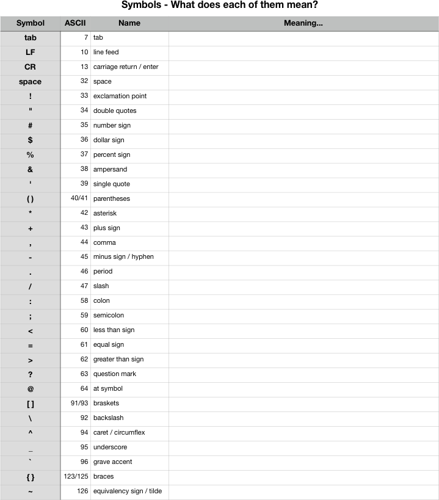

<!-- reading-navigation:start -->

[بخش قبلی: نصب و پیکربندی JupyterLab](T-appendix.jupyter-installation-and-setup.md) · [فهرست مطالب](TOC.md) · [پایان کتاب؛ بازگشت به صفحهٔ اصلی](../../README.md)

<!-- reading-navigation:end -->

# این نشانه‌ها چه معنایی دارند؟

می‌توانید بارها از جدول زیر استفاده کنید؛ هر بار که زبان تازه‌ای یاد می‌گیرید، با کمک آن دانسته‌هایتان را مرتب کنید…

در آغاز، تنها نویسه‌هایی که می‌شد به رایانه وارد کرد، نویسه‌های جدول ASCII بودند. برای همین دانشمندان کامپیوتر از همان ابتدا سخت فکر می‌کردند که چطور از این نشانه‌ها بهترین و بیشترین استفاده را بکنند…

به همین دلیل، نویسه‌های جدول ASCII اغلب در جاهای مختلف کاربردهای متفاوتی دارند. مثلاً `.` در سیستم‌عامل معمولاً جداکنندهٔ نام فایل و پسوند آن است؛ در بسیاری از زبان‌های برنامه‌نویسی برای دسترسی به Class Attributes و Class Methods به کار می‌رود؛ و در regex نمایندهٔ هر نویسه‌ای به‌جز `\r` و `\n` است…

> **یادداشت مترجم — توضیح تکمیلی:** ASCII جدولی برای کدگذاری مجموعه‌ای محدود از نویسه‌ها، مانند حروف انگلیسی، رقم‌ها و نشانه‌هاست. Attribute داده یا ویژگی وابسته به یک class یا object است و method رفتاری است که در قالب یک function به آن مربوط می‌شود. regex الگویی برای جست‌وجو و تطبیق متن است. حکم نویسنده دربارهٔ نقطه در regex به ابزار و تنظیمات بستگی دارد: در Python، `.` به‌طور پیش‌فرض هر نویسه‌ای جز `\n` را تطبیق می‌دهد و با حالت DOTALL حتی `\n` را هم تطبیق می‌دهد؛ `\r` به‌طور پیش‌فرض مستثنا نیست. برای جزئیات، [مستندات رسمی Python دربارهٔ regex](https://docs.python.org/3/library/re.html#regular-expression-syntax) را ببینید. توصیف تاریخی آغاز بخش نیز بیان کلی نویسنده است، نه اینکه همهٔ رایانه‌های اولیه الزاماً از ASCII استفاده کرده باشند.

جدول زیر را چاپ کنید، دانسته‌هایتان را مرتب کنید و در آن بنویسید هر نشانه در Python چه کاربردهایی دارد.<a href='#fn1' name='fn1b'>[1]</a>

> در پوشهٔ فعلی، فایلی به نام `symbols.numbers` هست که برای چاپ جدول زیر تهیه شده است…

> **یادداشت مترجم — توضیح تکمیلی:** فایل قابل چاپ در این نسخه در [ریشهٔ پروژه، با نام symbols.numbers](../../symbols.numbers) قرار دارد، نه در پوشهٔ ترجمه. تصویر زیر یک برگهٔ تمرین برای ثبت کاربرد نشانه‌هاست، نه پاسخ‌نامه. برای انجام تمرین بدون اتکا به تصویر، روی کاغذ دو ستون «نشانه» و «کاربرد در Python» بسازید و نشانه‌های صفحه‌کلید مانند `.`، `,`، `:`، `;`، `'`، `"`، `(`، `)`، `[`، `]`، `{`، `}`، `+`، `-`، `*`، `/`، `%`، `=`، `<`، `>`، `!`، `&`، `|`، `^`، `~`، `#`، `@`، `\`، `_`، `$`، علامت backtick و `?` را بررسی کنید. لازم نیست هر نشانه در Python به‌تنهایی کاربرد دستوری داشته باشد؛ تفاوت کاربرد آن در کد، string، ابزارهای دیگر و ترکیب با نشانه‌های دیگر را هم در نظر بگیرید. این پیشنهاد برای انجام تمرین است و رونویسی دقیق چینش تصویر نیست.

از این به بعد هر زبانی که یاد می‌گیرید، همین جدول را یک بار مرور کنید. آن‌وقت فقط یک احساس خواهید داشت: هرچه بیشتر یاد می‌گیرید، کار آسان‌تر می‌شود!

خیلی‌ها در آغاز نمی‌توانند با یادگیری پیش بروند، چون «بعضی نشانه‌ها آن‌قدر کاربردهای مختلف دارند که مرتب با هم اشتباه می‌شوند؛ بعد هم آدم خسته و کلافه می‌شود…». اما کافی است چند بار بیشتر تکرار کنید و در ذهنتان مرور کنید تا با آن‌ها آشنا شوید. وقتی واقعاً با آن‌ها آشنا شدید و بر آن‌ها مسلط شدید، احساس می‌کنید: واقعاً که چیزی نیست! کجایش این‌قدر سخت بود؟!

یکی از جنبه‌های جالب یادگیری برنامه‌نویسی این است:

> همین که یک زبان برنامه‌نویسی را یاد بگیرید، می‌بینید تک‌تک کلیدهای صفحه‌کلیدتان به کار می‌آیند…

اما تا پیش از آن، با اینکه برای خرید همان سخت‌افزار به‌اندازهٔ دیگران پول داده بودید، این‌همه چیز داشتید که اصلاً از آن‌ها استفاده نکرده بودید!

آدم‌های معمولی با همان پول فقط یک دستگاه می‌خرند؛ اما برای شما فرق می‌کند: با همان پول، رباتی بسیار فرمان‌بردار خریده‌اید؛ رباتی که می‌تواند شبانه‌روز و خستگی‌ناپذیر برایتان کار کند. حس واقعاً شگفت‌انگیزی است.

-----
**پاورقی**

<a name='fn1'>[1]</a>: برای syntax زبان Python، بخش [۲. تحلیل واژگانی (Lexical analysis)](https://docs.python.org/3/reference/lexical_analysis.html#operators) از The Python Language Reference را ببینید.

<a href='#fn1b'><small>↑بازگشت به متن↑</small></a>

<!-- reading-navigation:start -->

[بخش قبلی: نصب و پیکربندی JupyterLab](T-appendix.jupyter-installation-and-setup.md) · [فهرست مطالب](TOC.md) · [پایان کتاب؛ بازگشت به صفحهٔ اصلی](../../README.md)

<!-- reading-navigation:end -->
